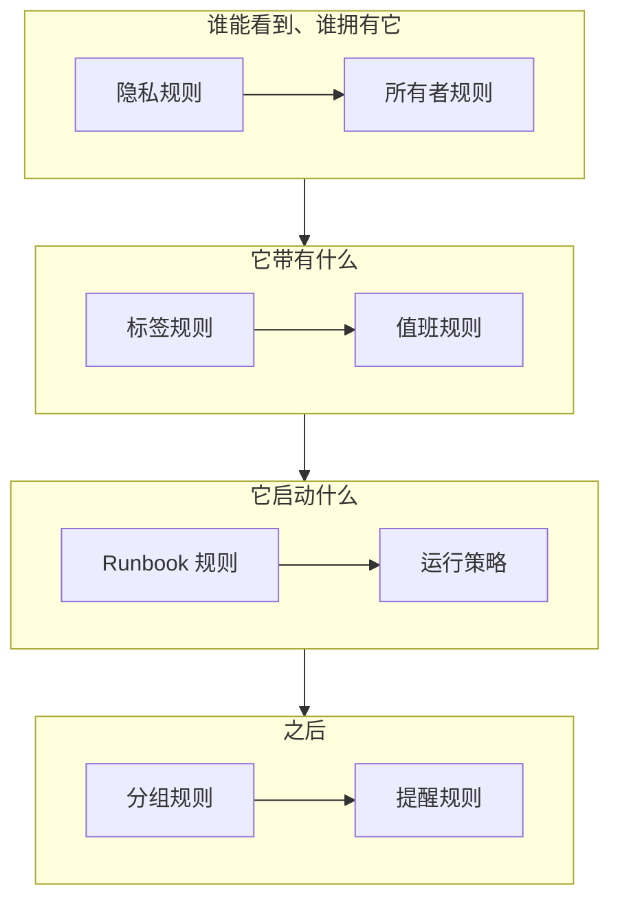

# 警报规则与设置

警报的配置位于 **警报** 中，而不是 **项目设置** 中：作用于每个新警报的规则，以及塑造项目中每个警报的设置。本页是其中每一项的参考，也说明了警报创建时会自动运行哪些内容。

:::cards
- [新警报经过的规则](#新警报经过的规则): 按顺序排列，以及每条规则的作用。
- [值班规则](#值班规则): 无需每次选择策略，就能呼叫合适的人。
- [提醒规则](#提醒规则): 在警报保持打开期间提醒所有者。
- [设置](#设置): 备注模板、自定义字段、测量、片段成员资格和编号规则。
:::

## 警报设置的位置

从顶部栏的 **产品** 菜单中打开 **警报**。其侧边菜单中的 **规则** 和 **设置** 部分起初是折叠的，因此请先展开它们。这里的每个页面都作用于整个项目，地址以 `/dashboard/{projectId}/alerts/settings/` 开头。

| 规则页面            | 作用                                                                                           |
| ------------------- | ---------------------------------------------------------------------------------------------- |
| **分组规则**        | 把相关警报放进片段。参见 [警报片段与分组规则](/docs/alerts/episodes)。                         |
| **值班规则**        | 为匹配的警报和片段运行值班策略。                                                               |
| **所有者规则**      | 为匹配的警报和片段添加所有者。                                                                 |
| **Runbook 规则**    | 为匹配的警报启动 Runbook。                                                                     |
| **隐私规则**        | 将匹配的警报和片段设为私密。                                                                   |
| **标签规则**        | 为匹配的警报和片段添加标签。                                                                   |
| **Reminder Rules**  | 在警报打开期间按一定间隔提醒所有者。                                                           |

**设置** 部分包含 **警报状态** 和 **警报严重性**（在 [警报状态与严重级别](/docs/alerts/states-and-severities) 中介绍），然后是 **备注模板**、**自定义字段**、**测量**、**片段成员资格** 和 **编号规则**，下文将逐一介绍。

另外还有两个部分作用于警报。**警报 → 人工智能 → 设置** 决定 OneUptime AI 自行做什么：**调查新警报**，新项目默认开启；**自动修复新警报**，在你开启之前保持关闭。参见 [AI SRE](/docs/ai/ai-sre)。**警报 → 工作区** 包含将警报和片段发布到频道的 Slack 和 Microsoft Teams 规则，以及它的 **摘要** 选项卡。参见 [Slack](/docs/workspace-connections/slack)。

## 新警报经过的规则

这些规则的区别在于多个规则匹配时如何处理：

- **分组规则** 和 **Reminder Rules** 按从上到下的顺序检查各自的列表，第一个匹配的胜出。拖动规则即可改变其位置；新规则会排到最后。
- **值班规则**、**所有者规则**、**标签规则**、**隐私规则** 和 **Runbook 规则** 只要匹配就都会生效。多条规则添加的同一值班策略、所有者和标签只会添加一次。

**值班规则**、**所有者规则**、**标签规则** 和 **隐私规则** 有两个选项卡：用于警报的 **Alert Rules**，以及以同样方式作用于每个新警报片段的 **Episode Rules**。新规则创建时即为启用状态；在其编辑表单中关闭 **已启用** 即可暂停它，列表会为每条规则显示绿色的 **已启用** 或红色的 **已禁用**。

大多数规则只作用于你保存它们之后创建的警报和片段。要把所有者、标签或隐私规则应用到已有的警报和片段上，请使用 **立即运行**：参见 [对现有资源运行规则](/docs/configuration/run-rules-now)。提醒规则是例外：保存一条提醒规则时，每个打开的警报都会重新匹配。

### 条件

规则的条件决定它作用于哪些警报，读起来就像句子：“如果 **警报标题** 包含 `database`”“并且 **监视器标签** 包含任一 *Production*”。没有条件的规则匹配每个警报。

| 条件                                                          | 比较方式                                                                                                       |
| ------------------------------------------------------------- | -------------------------------------------------------------------------------------------------------------- |
| **监视器**、**警报 严重性**、**警报标签**、**监视器标签**     | 与你选择的值进行 **包含任一**、**包含全部** 或 **不包含任何** 比较。                                           |
| **警报标题**、**警报描述**、**监视器名称**、**监视器描述**    | **包含**、**不包含**、**等于**、**不等于**、**开头为**、**结尾为**（不区分大小写），或用于正则表达式或 `*` 通配符的 **匹配模式** 和 **不匹配模式**。 |

有两个或更多条件时，选择 **匹配全部**（每个条件都必须成立）或 **匹配任一**（满足一个即可）。片段规则则改为匹配片段的严重级别、标签、标题和描述。

## 值班规则

**警报 → 规则 → 值班规则** 让呼叫自动进行。每条匹配的规则都会把其策略添加到新警报上，警报会连同它原有的策略一起运行这些策略，每个策略只运行一次。

:::steps
### 选择警报

点击 **创建Alert On-Call Rule**。在 **匹配** 中，新规则默认的 **所有警报** 匹配每个新警报。要缩小范围，请选择 **仅符合条件的警报** 并添加警报必须满足的条件。

### 选择策略

在 **值班策略** 中，选择该规则要呼叫的 **值班策略**。在你输入自己的名称之前，**名称** 会随之变化，例如“呼叫 Platform on-call”；**描述** 在 **更多字段** 中。然后创建规则。
:::

严重级别本身不会呼叫任何人：要设置“每个 High 警报都呼叫数据库团队”，就要用一条匹配 **警报 严重性** 的值班规则。要查看某个警报运行了什么，请打开其 **值班执行** 页面。随后，每个人都会按照自己在 **用户设置 → 值班规则** 的 **警报** 选项卡上设置的方式收到呼叫；参见 [升级规则](/docs/on-call/escalation-rules)。

警报一与规则匹配，规则就会立即呼叫。若要让它等到工作时间，请在 **更多字段** 中把 **此规则应在何时呼叫？** 选为 **仅在工作时间内**。 **工作时间** 默认是你所在时区的周一到周五 09:00 到 17:00：选择其他日子、其他 **开始时间** 或 **结束时间**，或其他 **时区**，选项下方的一句话会说明将会发生什么。在列表中，规则名称下方会显示它的工作时间。在这些时间之外匹配的警报会得到一个等待中的运行，不呼叫任何人；工作时间一开始，策略就呼叫它的第一条升级规则，并照常升级。如果警报在此之前被确认或解决，就不会呼叫任何人。如果警报在等待期间发生变化，例如严重级别被调高，从而与一条立即呼叫的规则匹配，运行会立刻开始呼叫，警报的信息流也会说明原因。呼叫同一策略的两条规则，只要其中任一条允许就会呼叫它：一条立即呼叫最高严重级别的规则，加上一条为其余级别等待工作时间的规则，就能让夜晚保持安静。

## 所有者规则和标签规则

**所有者规则** 会为匹配的新警报添加所有者用户和团队，**标签规则** 则添加标签。创建一条规则需要两个步骤：**匹配**，即条件；然后是 **所有者** 或 **标签**，即规则要添加的内容。在你输入自己的名称之前，规则的 **名称** 会跟随你的选择。

- **规则可以继承。** 折叠在 **继承所有者** 或 **继承标签** 下的六个开关，会传递警报的监视器、主机、Kubernetes 集群、Docker 主机、Podman 主机和服务的所有者或标签。片段规则没有这样的开关。所有者规则的 **继承所有者** 以 **创建者的团队** 结尾：在那里列出的团队中，创建警报的人所属的每个团队也会成为所有者。
- **新规则必须添加一些内容**：至少选择一个所有者或标签，或者开启一个开关。对于事件或警报所有者规则，在 **创建者的团队** 下列出一个团队也足够。
- 所有者规则 **更多字段** 下的 **通知所有者** 决定是否告知被添加的人。

[标签与所有者规则](/docs/configuration/label-and-owner-rules) 针对每种资源，逐步介绍该表单。

## 隐私规则和 Runbook 规则

**隐私规则** 会在其他任何内容运行之前，把匹配的新警报设为私密：只有它们的所有者以及项目的管理员和所有者可以看到它们。规则有两个步骤：**匹配**，即它设为私密的警报；然后是 **名称**，已预先填写为“将警报设为私密”。参见 [私密警报](/docs/alerts/index#私密警报)。

**Runbook 规则** 会在新警报匹配时启动一个 Runbook，除非该警报创建时即已解决。参见 [Runbook 规则](/docs/runbooks/rules)。

## 提醒规则

**警报 → 规则 → Reminder Rules** 会在警报保持打开期间提醒其所有者。每个新警报会按列表从上到下的顺序，得到第一条匹配它的规则。

:::steps
### 选择要提醒哪些警报

点击 **创建Alert Reminder Rule**。在 **匹配** 中保持选中 **所有警报**，则对每个警报进行提醒；选择 **仅符合条件的警报** 后，再选择它适用的 **警报 严重性** 和 **标签**。

### 设置间隔

在 **提醒** 中，设置 **提醒间隔（分钟）**（多久提醒一次所有者）和 **停止提醒的时机**：**已解决**（默认值）或 **已确认**。在你输入自己的名称之前，**名称** 会随两者变化，例如“每 30 分钟提醒一次，直到解决”。然后创建规则。
:::

所有者会以 **Alert reminder** 的形式收到每次提醒，它默认通过电子邮件开启。当警报的严重级别或标签发生变化时，会重新为它匹配规则。要停止某个警报的提醒，请在其 **设置** 页面上关闭 **发送提醒**；切换的那一刻就会保存。

## 设置

### 备注模板

**警报 → 设置 → 备注模板** 存放用于私密备注的现成文本。**警报的私密备注模板** 卡片列出它们；**创建警报 备注 模板** 会要求填写 **模板名称**、**模板描述** 和 **备注**。当有人为警报或片段撰写私密备注，以及确认或解决它们时，会提供模板，并且其文本可以在发布前编辑。警报备注模板是纯文本：与事件备注模板不同，它们不会填入任何变量。

### 自定义字段

**警报 → 设置 → 自定义字段** 为每个警报添加你自己的字段，例如客户等级或工单编号。在警报的 **自定义字段** 页面上填写它们，或通过 API 以 `customFields` 填写。字段可以从监视器的自定义字段复制其值，而不必手动输入：参见 [从监视器复制的字段](/docs/incidents/settings#从监视器复制的字段)，它对警报的作用方式相同。

### 测量

**警报 → 设置 → 测量** 衡量每个警报的各个环节耗时多久。选择 **确认用时** 或 **解决用时**，或你自己选择的两个时刻，例如 **警报创建时** 和它进入你所选状态的时刻。每个测量都会显示在警报的页面上，并以 `oneuptime.alert.measurement.<key>` 绘制成图表。参见 [测量](/docs/incidents/settings#测量)，它对警报的作用方式相同。

**呼叫后确认用时** 从 **首次有人被呼叫时** 开始计算，即值班策略或直接呼叫第一次就该警报通知到某人的时刻，而不是从警报创建时开始计算：夜里触发、早上才发出呼叫的警报，不会把整夜的时间计入其中。没有呼叫过任何人的警报没有值。参见 [呼叫后确认用时](/docs/incidents/settings#呼叫后确认用时)。

### 片段成员资格

**警报 → 设置 → 片段成员资格** 决定一个警报能否属于多个片段。打开 **一个警报只能属于一个片段** 后，已在某个片段中的警报在被移出该片段之前，无论通过仪表板、API、工作流还是分组规则，都不会被添加到其他片段。开关在你打开之前是关闭的，只有 Project Owners 和 Project Admins 可以更改它。打开它不会把任何警报移出片段。参见 [每个事件只属于一个片段](/docs/incidents/episodes#每个事件只属于一个片段)，它对警报的作用方式相同。

### 编号规则

**警报 → 设置 → 编号规则** 设置警报编号和片段编号前面的文本：新项目中为 `ALT-` 和 `AE-`，没有前缀时为 `#`。**更新** 会打开 **警报编号前缀** 和 **警报片段编号前缀**，并在你输入时显示预览。只有之后创建的警报和片段才会使用新前缀。前缀的规则见 [编号前缀](/docs/incidents/settings#编号前缀)。

其下方的 **下一个编号** 卡片设置下一个警报和下一个片段得到的编号，用来延续其他工具的编号：**更新** 会打开 **下一个警报编号** 和 **下一个警报片段编号**，每个都必须大于迄今的最大编号。参见 [下一个编号](/docs/incidents/settings#下一个编号)。

> [!NOTE]
> 在 OneUptime Cloud 上，备注模板和自定义字段需要 **Growth** 或更高的套餐。

## 工作流

每个警报模型都有以它命名的工作流触发器和操作：**On Create Alert**、**On Update Alert**、**On Create or Update Alert** 和 **On Delete Alert**，**警报 片段**、**警报 状态 时间线** 等也同样如此，还有 **Create One Alert** 和 **Update One Alert** 等操作。唯一的例外是警报自定义字段的定义：它们没有工作流触发器。参见 [工作流概览](/docs/workflows/index)。

## 谁可以更改这些内容

规则、自定义字段和测量需要 Project Owner 或 Project Admin，或拥有该规则自身权限的自定义角色。**警报成员** 可以处理警报和片段、它们的备注、所有者和状态时间线，以及备注模板；**警报管理员** 还可以管理警报状态和严重级别。参见 [用户、团队与权限](/docs/permissions/index)。

## 后续步骤

:::cards
- [警报片段与分组规则](/docs/alerts/episodes): 深入了解分组规则。
- [升级规则](/docs/on-call/escalation-rules): 值班规则运行策略之后会发生什么。
- [标签与所有者规则](/docs/configuration/label-and-owner-rules): 逐步介绍规则表单。
- [AI SRE](/docs/ai/ai-sre): 自动调查和修复新警报。
:::
