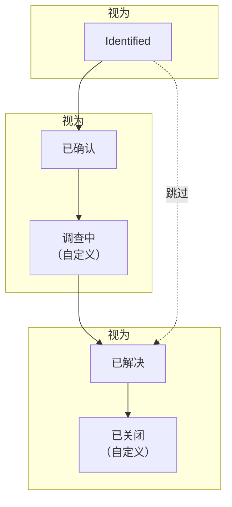

# 警报状态与严重级别

每个警报都带有一个 **状态**，表示你的团队处理到了哪一步，以及一个 **严重级别**，表示它有多重要。状态决定 OneUptime 做什么：谁仍会被呼叫、什么算作活动、片段何时解决。严重级别为警报排序，规则也可以按严重级别进行匹配。本页面向所有设置它们的人，以及想知道某个警报为什么呼叫或没有呼叫任何人的人。

:::cards
- [预置状态](#预置状态): Identified、已确认和已解决，以及各自的作用。
- [添加自己的状态](#添加自己的状态): 属于你自己的步骤，例如“调查中”。
- [让警报经过各个状态](#让警报经过各个状态): 状态发生变化的每一种方式。
- [严重级别](#预置严重级别): High 和 Low，以及如何添加自己的严重级别。
:::

## 工作原理

一个项目的警报状态是一个有序列表，警报只会沿着它向下移动。状态所处的位置决定了处于该状态的警报算作什么：尚未确认、已确认或已解决。警报片段也经过同一个列表。

`AlertState` 模型有 `name`、`description`、`color` 和 `order`，外加三个标志：`isCreatedState`、`isAcknowledgedState` 和 `isResolvedState`。OneUptime 读取的是标志和顺序，从不读取名称，因此你可以把 **已解决** 重命名为“已关闭”，而不会破坏任何东西。`AlertSeverity` 模型有 `name`、`description`、`color` 和 `order`，没有标志。

> [!TIP]
> 这两个列表都在 **警报 → 设置** 下，它在侧边菜单中起初是折叠的：展开 **设置** 即可找到 **警报状态** 和 **警报严重性**。

## 预置状态

每个新项目都以三个警报状态开始，顺序如下：

| 状态             | `order` | 标志                  | 颜色      | 含义                                            |
| ---------------- | ------- | --------------------- | --------- | ----------------------------------------------- |
| **Identified**   | `1`     | `isCreatedState`      | `#fd625e` | 新警报开始时所处的状态。                        |
| **已确认**       | `2`     | `isAcknowledgedState` | `#ffbf53` | 有人在处理它，呼叫随之停止。                    |
| **已解决**       | `3`     | `isResolvedState`     | `#2ab57d` | 警报已经结束，不再算作活动。                    |

这三个带标志的状态在设置页面上带有 **内置** 标签。你可以重命名、重新着色和拖动它们，但它们会保持自己的顺序（创建在确认之前，确认在解决之前），并且无法删除：它们的 **删除** 保持锁定，并说明原因。

## 每个标志的作用

| 标志                  | OneUptime 用它做什么                                                                                                                                                              |
| --------------------- | --------------------------------------------------------------------------------------------------------------------------------------------------------------------------------- |
| `isCreatedState`      | 没有人选择其他状态时，新警报从这里开始：监视器触发的每个警报，以及 **初始状态** 留空时创建的每个警报。                                                                            |
| `isAcknowledgedState` | **确认** 会把警报移到这里。在此状态或其后的任何状态中，警报都算作已确认：它的值班策略停止呼叫，也不再提供 **确认**。                                                              |
| `isResolvedState`     | **解决** 会把警报移到这里。在此状态或其后的任何状态中，警报都算作已解决：它离开 **活动警报**，其提醒停止，其片段可以解决。                                                        |

## 添加自己的状态

你添加的状态，是你的团队会经历、而预置的三个状态没有命名的步骤：“调查中”“已缓解”“已关闭”。

:::steps
### 打开状态列表

前往 **警报 → 设置 → 警报状态**。**警报 状态** 卡片按顺序列出你的状态。每一行显示其颜色和名称、处于该状态的警报 **视为** 什么，以及它的描述。

### 创建状态

点击 **创建警报状态**，并填写 **名称**、**描述** 和 **颜色**。颜色已经预先选好：一个尚未被其他状态使用的颜色。新状态会被添加到已解决状态的正上方，因此它会让警报保持活动。

### 拖到合适的位置

按住某一行的拖动手柄即可移动它；松开时就会保存新的顺序。**视为** 列也会随之变化：在已确认状态之上的警报为 **未确认**，从它往下为 **已确认**，从已解决状态往下为 **已解决**。
:::

你添加的状态没有标志，因此它所处的位置就是它的含义。把缓解步骤放在 **已确认** 和 **已解决** 之间，把分诊步骤放在 **已确认** 之上。放在 **已解决** 之下的状态在任何地方都算作已解决。

你可以从警报页眉的 **⋯** 菜单中，在 **Change state to** 下把警报移到你自己的状态，该菜单会列出当前状态之后的每个状态。其确认对话框的标题为 **将警报标记为“{{state}}”**，其中带有该状态的名称。

> [!NOTE]
> 在 OneUptime Cloud 上，添加或更改警报状态和严重级别需要 **Growth** 或更高的套餐。所有套餐都可以读取和使用它们，也可以删除你添加的状态。

## 顺序是强制执行的

警报的每一次状态更改都会对照该列表进行检查，无论由谁发起：仪表板、Slack、Microsoft Teams、API、Terraform、工作流，还是 OneUptime 本身。

- **向后移动会被拒绝**，并附带一条点明两个状态的消息：“Alert cannot transition to Acknowledged state from Resolved state because Acknowledged is before Resolved in the order of alert states.”
- **移动到当前所处的状态会被拒绝**：“Alert state cannot be same as previous state.”
- **选择器只提供当前状态之后的状态**，因此没有人会看到一个会被拒绝的移动。

警报片段遵循同一个列表，并使用自己的消息（“Episode cannot transition to …”）。唯一一次沿列表向上的移动来自 OneUptime 自身：分组规则重新打开一个最近解决的片段。要纠正误设的状态，请在警报的 **状态时间线** 页面上删除对应的行；警报会回到其最新剩余行的状态。

## 预置严重级别

每个新项目都以两个警报严重级别开始，最严重的在前：

| 严重级别 | `order` | 颜色      | 预置描述                                                                          |
| -------- | ------- | --------- | --------------------------------------------------------------------------------- |
| **High** | `1`     | `#b70400` | Issues causing very high impact to customers. Immediate attention is required.    |
| **Low**  | `2`     | `#ffbf53` | Issues causing low impact to customers.                                           |

事件以三个严重级别开始，警报则以两个开始。当监视器推荐的模板写的是 **严重** 或 **Warning** 时，OneUptime 会把它映射到你的第一个和第二个警报严重级别，在新项目中即 **High** 和 **Low**。

## 编辑严重级别

前往 **警报 → 设置 → 警报严重性**。**警报 严重性** 卡片按最严重的在前列出它们；拖动某一行即可改变其排名。**创建警报严重性** 会在列表末尾添加一个最不严重的级别，字段与状态相同：**名称**、**描述** 和 **颜色**。

排名决定了在 OneUptime 比较严重级别时哪一个胜出：片段的严重级别会升到加入它的最严重警报的级别。严重级别没有标志，也没有删除锁：任何严重级别都可以删除，包括预置的两个。

严重级别本身不会呼叫任何人。要按严重级别呼叫，请添加一条 **警报 严重性** 与之匹配的值班规则：参见 [警报规则与设置](/docs/alerts/settings)。更改警报的严重级别会在其信息流中写入一条记录，并重新匹配其提醒规则。

## 归档状态或严重性

对于团队不应再使用的状态或严重性，请将其归档而不是删除。归档不会更改任何警报。删除状态会从每个警报的历史记录中移除其行，而严重性在仍有警报使用时无法删除。

- **归档** 位于该行的 **⋯** 菜单中。它会先请求确认，并列出设置为使用该值的规则、测量、监视器条件和工作流：在您更改它们之前，它们会继续使用该值。
- **任何人都无法再选择它。** **更改状态**、警报标题栏、Slack、Microsoft Teams、规则和监视器条件都不会提供它。API、Terraform 和 MCP 会拒绝它，并说明是哪个值以及在哪里取消归档。
- **警报会保留它。** 已有该值的警报在之后的每次编辑中都会保留它，其状态时间线仍会显示它，您仍可按它筛选。
- **已归档的值会单独列出**，位于表格下方折叠的 **已归档的警报状态** 或 **已归档的警报严重性** 部分，并显示每个值由谁在何时归档。**取消归档** 会将其恢复原样。
- **有些值无法归档。** 创建、确认和已解决状态，以及项目中最后一个未归档的严重性。它们的 **归档** 已锁定，并说明原因。

**删除** 会先说明将发生什么。只要仍有警报或片段使用该值，删除就会被拒绝，对话框会列出它们。否则，它会列出删除将更改的内容，并提供 **改为归档**。

## 让警报经过各个状态

| 方式                 | 位置                                                                                      | 它询问什么                                                                                                                           |
| -------------------- | ----------------------------------------------------------------------------------------- | ------------------------------------------------------------------------------------------------------------------------------------ |
| **页眉按钮**         | 警报的页眉：**确认**、**解决**，以及其 **⋯** 菜单中的 **Change state to**                | 一个简短的确认，可在 **添加私密备注** 下附上一条可选备注：**确认警报**、**解决警报** 或 **将警报标记为“{{state}}”**。              |
| **State timeline**   | 警报侧边菜单中的 **状态时间线**                                                           | 你手动添加的一行，包含 **警报状态** 和 **开始**。                                                                                     |
| **列表行** | 警报列表中警报行上的 **⋯** 菜单：**确认**、**解决** 和 **更改状态** | 与页眉相同的确认，并写明警报的名称。其间已被其他更改推进的警报保持不变，对话框会说明原因。 |
| **批量更改**         | 在警报列表中对选中的警报使用 **确认**、**解决** 或 **更改状态**                                                 | 目标状态，以及添加到每个警报的一条私密备注。已经处于或越过该状态的警报会被跳过。                                                     |
| **自动**             | 监视器、片段、关联的事件或你自己的代码                                                    | 监视器条件上的 **自动解决警报**、片段的状态更改、[关联的告警](/docs/incidents/linked-alerts) 上的事件开关，或在 `/api/alert-state-timeline` 创建的一行。 |

页眉在警报尚未确认时提供 **确认** 和 **解决**，确认之后只提供 **解决**。已解决的警报两者都不显示。

## 确认会做什么

从警报移入你的已确认状态或其后的任何状态（包括已解决状态）的那一刻起，它就算作已确认。此后：

- **值班不再为它呼叫。** 它的值班策略不会呼叫下一级。
- **不再提供确认**，无论是在页眉中，还是在 Slack 和 Microsoft Teams 中；在那里再次确认会被拒绝，并提示“Alert is already acknowledged.”或“Alert is already resolved.”。此后才应答呼叫的人，其呼叫会被确认，而警报保持原样。
- **确认用时就此确定**，从第一次这样的移动算起：即 **概览** 的第一个图块，以及一个在 **警报被确认时** 结束的测量。

## 解决会做什么

当警报移入你的已解决状态或其后的任何状态时，它就算作已解决。此后：

- **它离开活动警报**，也不再计入侧边菜单中的数量。
- **它的提醒停止**，无论其提醒规则如何规定。
- **它的片段可以解决。** 当片段中的每个警报都已解决时，片段会自行解决。参见 [警报片段与分组规则](/docs/alerts/episodes)。
- **它的监视器可以触发新警报。** 一个条件同一时间只保留一个未解决的警报；该警报解决后，下一次匹配会打开另一个。

从 **已解决** 继续移到其后的状态（比如“已关闭”）不会改变上述任何一点：警报早已解决。

## 状态时间线

警报的 **状态时间线** 页面记录了它经历过的每个状态。其卡片 **状态时间线** 将它们绘制成时间线：一条色带，每个状态的长度与其持续时间相同，下方按从新到旧的顺序列出每次更改。卡片标题中的 **表格** 则将它们按行列出，包含 **警报状态**、**开始**、**结束** 和 **持续时间**。

- **查看原因** 显示随该更改记录的根本原因。
- **查看日志** 显示警报更改时 OneUptime 记录的内容，例如导致更改的那次监视器检查。

行可以添加和删除，但不能编辑，并且警报始终至少保留一行。删除最新的一行会让警报回到前一行的状态。

> [!WARNING]
> 删除一行会改写警报的历史，以及据此计算出的每个测量。用它来纠正错误，而不是用来整理。

## 活动警报列表

**警报 → 活动警报** 包含状态位于你的已解决状态之上的每个警报，除此之外没有任何其他决定因素：与严重级别无关，与存在时长无关，也与是否有人确认无关。侧边菜单中它旁边的红色徽标统计的也正是这些警报。

因此，位于 **已解决** 之上的自定义状态会让警报留在列表中，而位于其下的状态会像解决一样把它们移出列表。**活动片段** 对片段的作用方式相同。

## 后续步骤

:::cards
- [警报概览](/docs/alerts/index): 警报从何而来，以及你的团队如何处理它们。
- [警报片段与分组规则](/docs/alerts/episodes): 片段的状态如何带动其中的警报。
- [警报规则与设置](/docs/alerts/settings): 按严重级别呼叫和提醒。
- [事件状态与严重级别](/docs/incidents/states-and-severities): 同样的生命周期，用于事件。
:::
