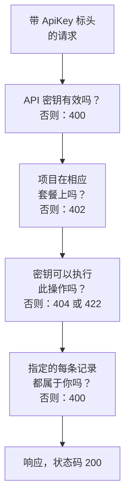

# OneUptime API 参考

你在 OneUptime 仪表板上能做的一切，也都可以通过它的 REST API 完成：自动化重复性工作、把 OneUptime 连接到你的其他工具，或构建你自己的集成。本页介绍如何发出第一个请求，以及每个请求都遵循的规则。每个端点和字段都列在 [完整的 API 参考](/reference) 中。

:::cards
- [发出第一个请求](#发出第一个请求): 一个 API 密钥、一个标头和一条 curl 命令。
- [请求和响应](#请求和响应): 每个资源都有的六种请求，以及每个状态码的含义。
- [套餐和 API](#套餐和-api): 套餐提供什么，以及低于套餐时仍可使用什么。
- [指定和写入记录](#指定和写入记录): ID、引用、开关，以及由 OneUptime 设置的字段。
- [状态和片段](#状态和片段): 记录的初始状态以及它经历的状态。
- [请求能触及的范围](#请求能触及的范围): 读取、更改和删除，一次一个项目。
:::

## 请求如何得到响应

该 API 围绕 REST 组织：标准的 HTTP 方法和状态码，输入 JSON，输出 JSON。每个请求都携带一个 API 密钥，并经过几项检查。请求未通过的第一项检查会以一个状态码和 `{ "message": "..." }` 作出响应，因此消息会说明是什么拦住了它。



## 发出第一个请求

所有 API 请求都使用 API 密钥进行身份验证。一个密钥属于一个项目，并执行其权限允许的操作。

:::steps
### 创建 API 密钥

打开 **项目设置 → 高级 → API 密钥**，然后点击 **创建API 密钥**。为它填写 **名称**，并在 **访问** 下选择它可以做什么：**项目管理员**、**项目成员**、**查看者**，或选择 **稍后选择权限** 以在密钥的页面上添加单项权限。除非你在 **高级** 下选择其他日期，否则密钥会在一年后过期。

### 复制密钥

密钥的页面随即打开。从 **API 密钥详情** 卡片中复制 **API 密钥**，并且不要把它写进代码：

```bash
export ONEUPTIME_API_KEY="your-api-key"
```

### 发送请求

列出前十个监视器。密钥读取的是它自己的项目，因此请求无需指明项目：

```bash
curl -X POST 'https://oneuptime.com/api/monitor/get-list?skip=0&limit=10' \
  -H "ApiKey: $ONEUPTIME_API_KEY" \
  -H 'Content-Type: application/json' \
  -d '{ "select": { "name": true } }'
```

响应为 `{ "data": [...], "count": ... }`：监视器，以及它们的总数。在自托管安装中，请用你自己的 OneUptime 地址替换 `https://oneuptime.com`。
:::

### 每个资源的示例

OneUptime 仪表板中的每个资源在侧边菜单中都有一个 **开发者** 分区，在你打开之前处于折叠状态。其中的 **API** 页面提供了该资源可直接运行的 `curl` 命令，指向你的 OneUptime 并已填入你自己项目的数据：在资源自己的页面上读取、更改和删除它，或在列表页面（例如 **监视器**）上列出、计数和创建。这些命令从环境变量 `ONEUPTIME_API_KEY` 读取你的 API 密钥。

示例是针对该资源编写的。例如在 **事件** 列表上，列表请求会用你的第一个事件展示其响应；筛选器会使用你自己的状态、严重程度和监视器，查找未解决的事件、某一严重程度的事件、与某个监视器相关的事件或最近七天内的事件；创建请求会用你的某个严重程度声明一个事件，并用一行文字说明每个字段的用途。事件自己的页面会用真实的响应读取它、把它改为你的另一个严重程度，并提供常用任务：确认并解决它（使用你项目自己的状态），以及添加内部或公开备注。每个 API 页面的最后都列出该资源的端点。

## 请求和响应

每个资源都有相同的请求，位于 `https://oneuptime.com/api` 加上资源路径之下，例如 `/monitor` 或 `/incident`：

| 请求 | 方法和路径 | 请求体包含什么 |
| --- | --- | --- |
| 列出 | `POST /api/<resource>/get-list` | `query`、`select` 和 `sort` |
| 计数 | `POST /api/<resource>/count` | `query` |
| 读取单条 | `POST /api/<resource>/<id>/get-item` | `select` |
| 创建 | `POST /api/<resource>` | `{ "data": { ... } }` |
| 更改单条 | `PUT /api/<resource>/<id>` | `{ "data": { ... } }`，即要更改的字段 |
| 删除单条 | `DELETE /api/<resource>/<id>` | 无 |

`POST /api/<resource>/<id>/update-item` 和 `POST /api/<resource>/<id>/delete-item` 也可以更改和删除单条记录，供只能发送 `POST` 的客户端使用。

### 筛选、排序和分页

列表或计数接受一个 `query`。带值的字段匹配该值；带 `_type` 的对象进行比较：

| `_type` | 匹配 |
| --- | --- |
| `Search` | 包含 `value` 的文本 |
| `NotEqual` | 除 `value` 之外的任何内容 |
| `GreaterThan`、`LessThan` | 更晚的日期或更大的数字，或者更早、更小的 |
| `InBetween` | 介于 `startValue` 和 `endValue` 之间的日期或数字 |
| `Includes` | `value` 中的任意一个值 |
| `IsNull`、`NotNull` | 没有值，或有任意值 |

资源所指定记录的字段在其关系下筛选：`"user": { "name": { "_type": "Search", "value": "ada" } }` 会找出其用户名称包含“ada”的团队成员。按某个字段筛选需要读取该字段的权限，经由关系时与在资源本身上一样：对你无权读取的字段进行筛选会被拒绝，返回指明该字段的 `422`。

`select` 指明要返回的字段，`_id` 总会返回。`sort` 按 `ASC` 或 `DESC` 排序；不指定时，最新的记录排在最前。除非设置 `limit`，列表返回 10 条记录，最多可达 10,000 条；`skip` 会先跳过这么多条：不断按 `limit` 增加 `skip`，直到取到 `count` 条为止。在列表请求中加上 `?output-type=csv` 即可得到 CSV 而不是 JSON。

例如，名称包含“checkout”、自 2026 年初以来创建的监视器，最新的排在最前：

```bash
curl -X POST 'https://oneuptime.com/api/monitor/get-list' \
  -H "ApiKey: $ONEUPTIME_API_KEY" \
  -H 'Content-Type: application/json' \
  -d '{
    "query": {
      "name": { "_type": "Search", "value": "checkout" },
      "createdAt": { "_type": "GreaterThan", "value": "2026-01-01T00:00:00.000Z" }
    },
    "select": { "name": true, "createdAt": true },
    "sort": { "createdAt": "DESC" },
    "limit": 100
  }'
```

日期和 `_id` 以外的 ID 会被包装后返回，形如 `{ "_type": "DateTime", "value": "..." }` 和 `{ "_type": "ObjectID", "value": "..." }`：请从 `value` 中读取。

请求用来筛选或写入的每个 ID——`_id`、`monitorId` 这样的字段，以及关系列出的每条记录，例如 `"labels": [{ "_id": "..." }]`——都是 UUID，以文本形式发送，或像返回时那样包装后发送。其他任何内容，例如不是 UUID 的文本，或代替 ID 的对象，都会被拒绝，并返回一个指明字段的 `400`，说明它在 `query` 还是 `data` 中，并且不会读取或写入任何内容：

```text
Invalid ID for "currentIncidentStateId" in the query: "resolved". An ID is a UUID, such as "550e8400-e29b-41d4-a716-446655440000".
```

### 状态码

| 状态码 | 含义 | 了解更多 |
| --- | --- | --- |
| `200` | 请求已成功。列表或计数以你可以读取的记录作出响应，没有时则为空。 | [按 ID 读取单条记录](#按-id-读取单条记录) |
| `400` | 请求有误：API 密钥无效、某个值不被允许、某个字段无法写入、它指定的某条记录不属于你，或者它一次更改多个项目。消息会说明哪里出错。 | [请求所指定的记录](#请求所指定的记录) |
| `402` | 项目的套餐不包含请求所使用的功能。消息会指明套餐。 | [你的套餐不包含的功能](#你的套餐不包含的功能) |
| `404` | 记录不存在、位于另一个项目中，或是你无权读取的记录：每种情况的响应都相同。 | [更改或删除你无权读取的记录](#更改或删除你无权读取的记录) |
| `422` | 你无权这样做：API 密钥没有这类记录的权限，你可以读取该记录但不能更改它，或者某个权限的标签排除了它。消息会说明原因。 | [更改或删除你无权读取的记录](#更改或删除你无权读取的记录) |
| `500` | 服务器上出现了故障。当新记录的所有者无法写入时，该记录会被再次移除，以便可以重试创建。 | [请求所指定的记录](#请求所指定的记录) |

## 套餐和 API

### 你的套餐不包含的功能

在 OneUptime Cloud 上，有些资源随套餐提供：单点登录提供商和 SCIM 连接在 **Scale** 中；API 密钥、值班排班，以及 Slack 和 Microsoft Teams 的通知规则和摘要等在 **Growth** 中。创建、更改或启用这类资源需要相应的套餐。低于该套餐时，请求会被拒绝并返回 `402 Payment Required`，消息会指明套餐。

资源的某些设置也以同样的方式随套餐提供。例如：私有的状态页面、隐藏其某个列表的状态页面，或带有自定义 HTML、CSS 或 JavaScript、电子邮件报告、短信、Slack、Microsoft Teams 或 Webhook 订阅者、IP 允许列表的状态页面；公开共享的仪表板或其 IP 允许列表；表单的 IP 允许列表；项目的审计日志。每项设置的指南以及仪表板中该设置旁的说明都会指明它所需的套餐。这样的设置每次写入时都需要其套餐——无论是带着它创建资源，还是之后更改它——因此低于套餐时启用某项设置的创建也会以 `402` 被拒绝。保持默认值或恢复为默认值的设置在任何套餐上都可用：不触碰这些设置的创建可以通过，不设置它们的 Terraform 配置也可以。

项目已经拥有的东西，无论套餐如何都仍可管理，例如试用期结束或套餐降级之后：

- 你可以删除这些记录；
- 对于带有 `isEnabled` 字段的资源，你可以只发送 `"isEnabled": false` 来关闭它；
- 你可以列出并读取套餐降级后项目需要找到的内容——以便关闭它们，或查看哪些已停止工作：单点登录提供商、SCIM 连接、API 密钥及其权限、值班排班，以及 Slack 和 Microsoft Teams 的通知规则和摘要。

和在套餐内时完全一样，仍由常规权限决定谁可以做什么。读取套餐提供的其他资源，例如模板、自定义字段、监视器组、值班日志和表单提交，仍然需要套餐：读取它们就是在使用该功能。低于 **Growth** 时，API 密钥的权限不会被逐个删除，因为删除一项阻止权限会让密钥获得更多访问权限；请改为删除密钥。

### 低于其套餐时的 API 密钥和 SCIM

在 OneUptime Cloud 上，项目的 API 密钥仅在项目处于 **Growth** 或更高套餐时可用，而它的 SCIM 连接（项目自己的以及其状态页面的）仅在处于 **Scale** 或更高套餐时才能完全工作。当项目降到该套餐以下时：

- 使用项目某个 API 密钥发出的每个请求，无论请求什么，都会被拒绝并返回 `402 Payment Required`：REST API，以及所有用 API 密钥调用它的东西——Terraform、`oneuptime` CLI、用 API 密钥连接的 MCP 客户端、在请求标头中发送密钥的工作流，以及你自己的脚本。消息会指明套餐：`API keys need the Growth plan. This project's plan does not include them, so its API keys stopped working. The keys are kept: upgrade the project to Growth in Project Settings > Billing and Invoices > Billing and they work again.`
- 它的 SCIM 连接只能移除人员。停用和删除人员以及把他们移出组仍然有效，因此离开的人仍会失去访问权限；每个会添加或更改人员或组的 SCIM 请求都会以 SCIM 错误格式返回 `402` 并被拒绝，以便你的身份提供商显示原因（[低于 Scale 套餐时](/docs/identity/scim#低于-scale-套餐时)）。

不会删除或关闭任何内容。密钥和连接都会保留，项目一回到该套餐，它们就会原样完全恢复工作：无需创建新密钥，也无需在身份提供商中重新设置任何内容。套餐变更会在一分钟内生效。

低于 **Growth** 时，**项目设置** > **高级** > **API 密钥** 会列出项目仍有的密钥并说明它们已停止工作，因此在任何套餐上都可以删除（吊销）其中任何一个。创建或更改密钥需要 **Growth**。**项目设置** > **账单和发票** > **账单** 会针对你可以选择的每个套餐，说明较低套餐会停止多少个 API 密钥、限制多少个 SCIM 连接，以及项目的套餐已停止了什么；当套餐变更使它们停止时，项目所有者会收到一封电子邮件。在此机制开始时项目就已低于这些套餐的所有者，会收到一封电子邮件，说明哪些已停止以及如何重新启用。

只有项目的 API 密钥和 SCIM 连接受影响。人员不受影响：登录仪表板以及通过登录连接的 MCP 客户端照常工作。遥测摄取密钥、探针密钥和代理密钥不是 API 密钥，会继续工作。自托管安装没有套餐，因此对它们没有任何变化。

## 指定和写入记录

### 查找资源的 ID

读取、更改或删除单个资源的请求通过其 ID（一个 UUID）指定它。在资源自己的页面上，其详情卡片的末尾有一行小小的 **ID**，显示 ID 的开头：点击 ID 或旁边的复制按钮即可复制完整的 ID。支持此功能的列表会在行的 **⋯** 菜单中提供 **显示 ID**，ID 也是页面地址的最后一部分。你的项目的 ID 是 **项目设置 → 项目** 中 **项目详情** 卡片上的第一项。

### 请求所指定的记录

许多资源会指定其他记录：监视器指定其标签和探针，状态页面订阅者指定其状态页面，网络设备指定其站点，事件成员指定事件和角色。以下每条规则对 API、Terraform 和工作流同样适用：

| 当请求 | 它必须 | 否则 |
| --- | --- | --- |
| 按 ID 指定记录 | 指定你项目中的记录 | `400` |
| 创建通过另一条记录读取的记录，例如备注 | 在你可以读取的记录下创建 | `400`，或在没有读取该类记录的权限时返回 `422` |
| 把记录移到另一条记录之下 | 移到你可以读取的记录之下 | `400` |
| 列出记录，或在专门的字段中指定一条记录 | 指定你的读取权限能触及的记录 | `400` |
| 指定保存凭据的设置 | 来自可以读取该类设置的人 | `400` |
| 在限定于标签的权限下创建记录或重新设置其标签 | 给记录加上其中一个标签 | `422` |
| 用两种方式指定同一条记录 | 两次都指定同一条记录 | `400` |

#### 每个 ID 都必须属于你的项目

你为资源所指定的记录发送的每个 ID，都必须是你项目中的记录——仪表板的选择器不会提供其他选项——来自 Terraform 和工作流的请求也遵循同样的规则。另一个项目的记录的 ID 和不存在的 ID 会以同样的方式被拒绝，返回一个指明字段和 ID 的 `400`：

```text
This network device references records that are not in this project: Network Site "…". Please pick values from this project and try again.
```

人员按成员资格检查：不是项目成员的人也会以同样方式被拒绝。每个项目都能使用的全局探针被视为属于你的项目。更改资源时只检查更改所添加的 ID，因此指定了某个后来已不存在的东西的资源仍然可以保存。

#### 通过另一条记录读取的记录

通过另一条记录读取的记录——事件或警报的备注和状态时间线，状态页面的公告、域名和分组——也必须按照读取它时所遵循的规则，指定一条你可以读取的记录：一个事件，如果位于你读取事件的权限所能触及的标签或所有者之外，或带有读取事件的阻止所移除的标签，或被标记为私有而你既不直接也不通过团队位于其所有者之中（项目所有者和管理员可以看到每个私有的事件、警报和片段），都会以同样的 `400` 被拒绝，并且不会写入任何内容。公告所指定的每个状态页面都必须是你可以读取的，而读取状态页面的权限只能触及其中一部分的密钥，必须至少指定一个。创建这类记录的权限需要一项读取其所属记录的权限；没有时，创建会被拒绝，并返回一个指明能让它通过的权限的 `422`：

```text
You do not have permissions to create Incident Internal Note. It is read through its Incident, and you need one of these permissions to read Incidents: …
```

移动这类记录的更改也遵循同样的规则：它作为父级添加的每条记录——公告的另一个状态页面、通过其服务读取的记录的另一个服务——都必须是你可以读取的，否则更改会以同样的 `400` 被拒绝，并且不会写入任何内容。记录已有的父级不会再次检查；而让记录不再位于任何父级之下的更改，和不指定任何父级的创建一样，需要一项能触及所有该类记录的读取权限。

#### 所有者

资源的所有者——监视器、值班策略、仪表板以及其他任何有所有者的资源的用户和团队所有者记录——也以同样的方式通过其所拥有的资源读取：列出、读取、添加和移除它们，需要在该资源的标签和所有者范围内读取该资源的权限；对于你无权读取的资源，其所有者记录会被当作不存在来响应。添加和移除它们同样遵循允许此操作的权限的范围：`Owned` 范围的权限只触及你或你的某个团队拥有的资源的所有者，向其他任何资源添加所有者都会被拒绝，并返回说明原因的 `422`。

#### 写入所列出或指定的记录

创建或更改所列出的记录——事件的监视器和值班策略、警报的服务、计划维护活动的状态页面、规则的运行手册——在你有读取该类记录的权限时遵循该权限，并且无论如何都遵循对其读取设置的带标签的阻止：超出范围的记录会以同样的 `400` 被拒绝。更改只检查它添加到列表中的记录，因此列表中已有的记录会保留。

创建或更改在专门字段中指定的那一条记录——警报的监视器、状态页面资源所显示的监视器、成本预算的服务、运行手册运行所关联的事件——无论用它的哪个名称，都遵循同样的规则：超出你读取该类记录权限的记录，或带有读取阻止所移除的标签的记录，会以同样的 `400` 被拒绝。更改只在指定了与字段已有记录不同的记录时才检查它。OneUptime 的全局探针和 AI 代理供每个项目使用，对每个项目保持开放。模板替你填入的记录在填入后、保存任何内容之前也以同样方式检查：事件模板向由它声明的事件添加的监视器、状态页面和值班策略，必须是你可以读取的，就像是你亲自选择的一样。

#### 保存凭据的设置

保存凭据的设置——SMTP 服务器、电话和短信提供商、SNMP 凭据、视频通话连接、API 密钥、外部 MCP 服务器——只能由可以读取该类设置的调用方指定：状态页面的 `smtpConfig` 和 `callSmsConfig`、来电策略的 `projectCallSMSConfig`、网络设备或站点的 `snmpCredentialProfile`、事件或警报的视频通话 `videoCallConnection`、API 密钥权限的 `apiKey`，以及 AI 规则的 `externalMcpServers`。在没有读取该类设置的权限时指定其中之一——或使用被不带标签的阻止所移除的权限——无论用哪个名称，都会以同样的 `400` 被拒绝；保留记录已指定的设置的更改不会被检查。来电策略的号码搜索和已拥有号码列表，需要对其所指定的电话和短信配置有同样的读取权限。

#### 创建时的标签和所有者

限定于标签的创建权限只创建带有其中一个标签的记录——对于没有自己标签的记录，则是带有标签的记录之下的记录——除非另一项创建该类记录的权限覆盖整个项目；而创建权限上带标签的阻止会拒绝带有其中某个标签的记录。超出范围的创建会被拒绝，并返回一个指明这些标签的 `422`：

```text
Your access lets you create Status Pages only with one of these labels: Production. Add one of them and try again.
```

范围为 **Owned** 的创建权限，只为某个人创建监视器、状态页面或其他有自己所有者的记录，此人会成为其所有者之一；而备注或其他从所属记录继承所有者的记录，只会创建在你或你的某个团队所拥有的记录之下。

创建者会在记录保存后、发生任何其他事情之前立即成为所有者。如果无法写入所有者行，记录会被再次移除，创建会以 `500` 被拒绝，因此不会留下创建者无法访问的记录。

#### 标签的更改

对记录所带标签的更改——它自己的标签，或者对于没有自己标签的记录，它所指定的记录——同样遵循你更改该类记录的权限：在限定于标签的权限下，记录至少要保留其中一个标签，除非另一项更改它的权限覆盖整个项目；而更改权限上带标签的阻止会拒绝为记录加上其中某个标签。这样的更改会被拒绝，并返回一个指明这些标签的 `422`：

```text
Your access lets you change Monitors only with one of these labels: Production. Keep one of them and try again.
```

#### 用两种方式指定记录

一条记录可以用两种方式指定：用它的 ID 字段（`monitorId`），或用关系（`"monitor": { "_id": "…" }`），后者正是仪表板表单发送的方式。请只发送其中一个。如果请求同时发送两者，它们必须指定同一条记录：两者不一致的请求——两个不同的 ID，或一个 ID 和一个空值——会被拒绝，并返回一个指明两个字段的 `400`：

```text
Conflicting Monitor references were provided. monitorId and monitor are names for the same field and must hold the same value: send only one of them, or the same id in each.
```

两个名称以同样方式检查。关于你所指定记录的规则，无论你用哪个名称发送都适用：状态页面分组的父分组必须位于同一个状态页面上，一个状态页面最多有三个页眉链接，分组名称在其状态页面上必须唯一。

### 开关

开或关的字段——`isEnabled`、`isVisibleOnStatusPage`、`isArchived` 以及其他所有 `true` 或 `false` 字段——接受 `true` 或 `false`。数据库会读作其中之一的文本和数字会被当作该值接受，对 API、Terraform 和工作流都一样：`"true"`、`"yes"`、`"on"`、`"1"` 和 `1` 是 `true`，`"false"`、`"no"`、`"off"`、`"0"` 和 `0` 是 `false`，不区分大小写。OneUptime 对该记录所做的一切也都把它当作该值处理：以 `"isVisibleOnStatusPage": "true"` 发送的计划维护活动会在状态页面上显示其图片，而 `"isEnabled": "false"` 会像 `false` 一样在低于套餐时关闭资源。任何其他值，例如 `"maybe"`、`""` 或 `2`，都会被拒绝，并返回一个指明字段的 `400`：

```text
isVisibleOnStatusPage must be true or false.
```

以记录现有的值写入的更新不会改变任何东西：它不会启动记录的 **On Update** 工作流，不会发送实时更新，也不会添加审计日志条目。写在 `false` 上的 `false` 算作相同的值，写在 `false` 上的 `"false"`、以文本写入的数字、以另一种格式写入的同一时刻，以及以任意顺序写入的相同标签也都一样。当更新更改了一些值、又把另一些值按原样写回时，其审计日志条目只列出更改了的值，工作流的 **Fields to watch** 也只会收到这些值。

### 项目的购买渠道

项目的经销商、经销商套餐和经销商许可证（`resellerId`、`resellerPlanId`、`resellerLicenseId`，以及关系 `reseller` 和 `resellerPlan`）只由 OneUptime 设置：在用经销商的优惠码创建项目时，以及经销商更改套餐时。发送其中任何一个的项目创建或更改，无论由谁发送，都会被拒绝，并返回一个指明字段的 `400`：

```text
User is not allowed to create on resellerId column of Project. No permission allows it: the column is set by the server, not by a request.
```

### 记录的创建者

OneUptime 根据请求本身记录是谁创建了记录——以及是谁归档、解决、确认或触发了它：已登录的人，或者在请求来自 API 密钥或工作流时为无人。这些字段（`createdByUserId` 以及其他以 `ByUserId` 结尾的字段，连同 `createdByUser` 等关系）是只读的，记录被归档或解决的时间（`archivedAt`、`markedAsResolvedAt`、`markedAsArchivedAt`）也是只读的：打开 `isArchived` 或 `isResolved` 会记录是谁、在何时做的，关闭则会清除两者。按开关现有的状态发送它，会保留是谁、在何时切换的它。

API 参考将这些字段标记为只读。请求在其他更改之外为其中某个字段发送的值会被忽略，因此其余更改可以通过；除此之外什么都不发送的更新会被拒绝，并返回一条指明这些字段的消息。OneUptime 代表某人自行创建的记录——从 Slack 或 Microsoft Teams 发布的备注、通过邀请创建的账户——会指明那个人。

## 状态和片段

### 新记录的初始状态

事件、警报、事件片段和警报片段都可以在你项目的任意状态下创建，就像它们的创建表单中 **初始状态** 字段所做的那样：发送 `currentIncidentStateId`（事件和事件片段）或 `currentAlertStateId`（警报和警报片段），或者发送关系。记录从该状态开始，其状态时间线也从它开始。省略时，记录从你项目的创建状态开始，即带有 `isCreatedState` 标记的状态——或者，对于从带有初始状态的模板声明的事件，则从模板的状态开始。另一个项目的状态会像其他任何记录一样被拒绝。Terraform 的 `current_incident_state_id` 和 `current_alert_state_id` 的工作方式相同。在你的已确认状态或之后的状态下创建的记录不会呼叫任何人，而以已解决状态创建的记录还不会被分组、自动修复或由 AI 调查，也不会获得 Slack 或 Microsoft Teams 频道——请参阅 [声明时即已确认或已解决](/docs/incidents/declaring-incidents#声明时即已确认或已解决)。

### 更改记录的状态

记录的状态通过其状态时间线中的一行来更改——`POST /api/incident-state-timeline`、`/api/alert-state-timeline`、`/api/incident-episode-state-timeline`、`/api/alert-episode-state-timeline` 或 `/api/scheduled-maintenance-state-timeline`——或者通过写入其当前状态（`currentIncidentStateId`、`currentAlertStateId`、`currentScheduledMaintenanceStateId` 或关系）的更新来更改，后者会记录同样的一行。无论哪种方式，都由一条规则约束状态转换，对片段和对事件、警报或计划维护活动都一样：在你项目的顺序中早于记录当前状态的状态，会在保存任何内容之前被拒绝，记录已处于的状态也一样：

```text
Episode cannot transition to Acknowledged state from Resolved state because Acknowledged is before Resolved in the order of incident states.
```

误设的状态可以通过从记录的状态时间线中删除对应行来纠正。请参阅 [顺序是真正的约束，而不是显示偏好](/docs/incidents/states-and-severities#顺序是真正的约束而不是显示偏好)。

### 事件或警报所在的片段

事件的 `incidentEpisodeId` 和警报的 `alertEpisodeId`——以及它们的关系 `incidentEpisode` 和 `alertEpisode`——指明它最近被加入且仍是其成员的片段，或者为空。它们是只读的：OneUptime 根据片段的成员来设置它们。要把事件放入片段，请创建一个 Incident Episode Member（`POST /api/incident-episode-member`，带 `incidentEpisodeId` 和 `incidentId`）；要把它移出，请删除该成员，之后事件会指明它仍所在的最新片段，或者为空。警报通过 Alert Episode Members（`/api/alert-episode-member`，带 `alertEpisodeId` 和 `alertId`）以同样方式工作。分组规则也以同样方式把事件和警报加入片段。发送其片段的事件或警报的创建或更新会被拒绝，无论发送者是谁——API、Terraform、MCP 工具还是工作流。在 Terraform 中，`incident_episode_id` 和 `alert_episode_id` 可以读取但不能设置；成员资格由 `oneuptime_incident_episode_member` 和 `oneuptime_alert_episode_member` 资源管理。

## 请求能触及的范围

### 更改或删除你无权读取的记录

更改或删除只会触及 API 密钥（或已登录的人）有权读取的记录。位于其标签或所有者之外的记录、被读取阻止挡住的记录，或通过另一条它无权读取的记录来读取的记录（事件的备注、状态页面的公告），也都无法更改或删除。更改或删除某类记录的权限要与读取它的权限一起起作用，更改事件备注的权限要与读取事件的权限一起起作用。

按 ID 更改或删除单条记录的请求——`PUT /api/<resource>/<id>` 或 `POST /api/<resource>/<id>/update-item`、`DELETE /api/<resource>/<id>` 或 `POST /api/<resource>/<id>/delete-item`——如果什么都没有触及，会这样响应：

- `404`：当记录不存在、位于另一个项目中，或是你无权读取的记录时——每种情况的响应都相同：

```text
Incident not found.
```

- `422`：当你可以读取该记录但不能更改或删除它时，并附上原因：

```text
You do not have permission to update this incident.
```

过去，什么都没有触及的删除会返回 `200`。按查询进行的更新和删除，例如工作流的更新和删除步骤，会以它们更改的记录数作出响应，什么都没有触及时为 `0`。Terraform 会把 `terraform destroy` 时的 `404` 当作已不存在的资源。

遥测遵循同样的规则。删除日志、追踪、指标、异常、性能剖析或会话回放时，会触及那些你既可以读取又可以删除其遥测的资源（服务、主机、集群等）的行，并且一次在一个项目中进行：跨你所有项目的请求会被拒绝。按 ID 删除单行而什么都没有触及时，会如上所述返回 `404` 或 `422`。

### 更改一次在一个项目中进行

对项目记录的更新或删除在请求所指定的项目中进行：通过 `tenantid` 标头，或者对于 API 密钥，则是密钥自己的项目。已登录用户的更新或删除，如果没有指定项目，或通过 `is-multi-tenant-query` 标头跨其所有项目进行，会被拒绝并返回 `400`：

```text
Changes to incidents are made in one project at a time. Please pass the project ID in the 'tenantid' header.
```

这样的请求过去会以 `500` 失败。读取仍然可以跨你的所有项目进行。

### 按 ID 读取单条记录

按 ID 读取单条记录——`POST /api/<resource>/<id>/get-item`——在记录不存在、位于另一个项目中或是你无权读取的记录时返回 `404`，每种情况的响应都相同：

```text
Incident not found.
```

它过去会返回 `200` 和空的响应体。列表（`get-list`）和计数仍然以 `200` 和你可以读取的记录作出响应，没有时则为空。Terraform 提供程序会把刷新时的 `404` 当作已不存在的资源，并将其从 state 中移除，因此下一次 plan 会重新创建它：请给它所使用的 API 密钥授予读取它所管理的每个资源的权限和标签。MCP 工具对 `404` 的响应是一个指向相应列表工具的错误，而 CLI 会以代码 `3` 退出。

## 完整的端点参考

每个资源、端点和字段都列在 [OneUptime API 参考](/reference) 中。它提供多种语言：语言根据你的浏览器选择，你也可以随时用页面顶部的选择器切换。

## 故障排查

:::details 每个请求都返回 400 Invalid API Key
`ApiKey` 标头为空、不是密钥，或指定了已过期或已重置的密钥。请从 **项目设置 → 高级 → API 密钥** 下该密钥的页面重新复制密钥，那里也有它的 **过期** 日期。
:::

:::details 每个请求都返回 402 Payment Required
在 OneUptime Cloud 上，只有当项目处于 **Growth** 或更高套餐时，API 密钥才能工作。密钥会保留，项目回到该套餐后会原样重新工作：请参阅 [低于其套餐时的 API 密钥和 SCIM](#低于其套餐时的-api-密钥和-scim)。
:::

:::details 每个请求都返回 422 You do not have permissions
该 API 密钥没有这类记录的权限。用 **稍后选择权限** 创建的密钥在获得权限之前什么也做不了：在 **项目设置 → 高级 → API 密钥** 中打开它，然后点击 **添加角色** 或 **添加权限**。消息会列出能让请求通过的权限。
:::

:::details 我在仪表板中能看到的记录返回 404
API 密钥只读取其权限及其标签所能触及的内容，而密钥能触及的范围可能比你自己的账户更小。请给密钥授予能触及该记录的权限：请参阅 [按 ID 读取单条记录](#按-id-读取单条记录)。
:::

:::details 更新返回 400 Invalid request body
更新要把需要更改的字段放在 `data` 中发送，例如 `{ "data": { "name": "New name" } }`。不带它的请求体会被拒绝，而不是返回 `200` 却什么都不更改：

```text
Invalid request body. The update payload should be an object of the form { "data": { ...fields to update... } }.
```
:::

:::details 写入返回 400 并指明一个字段和一个 ID
该 ID 指定的是另一个项目的记录、不存在的记录，或你的权限无法触及的记录。请参阅 [请求所指定的记录](#请求所指定的记录)。
:::

## 后续步骤

:::cards
- [用户、团队与权限](/docs/permissions/index): API 密钥的权限和标签能触及什么。
- [Terraform 提供程序](/docs/terraform/index): 通过同一个 API，以代码方式管理 OneUptime 资源。
- [OneUptime CLI](/docs/cli/index): 从终端和脚本调用 API。
- [MCP 服务器](/docs/ai/mcp-server): 让 AI 助手处理你的项目。
:::
