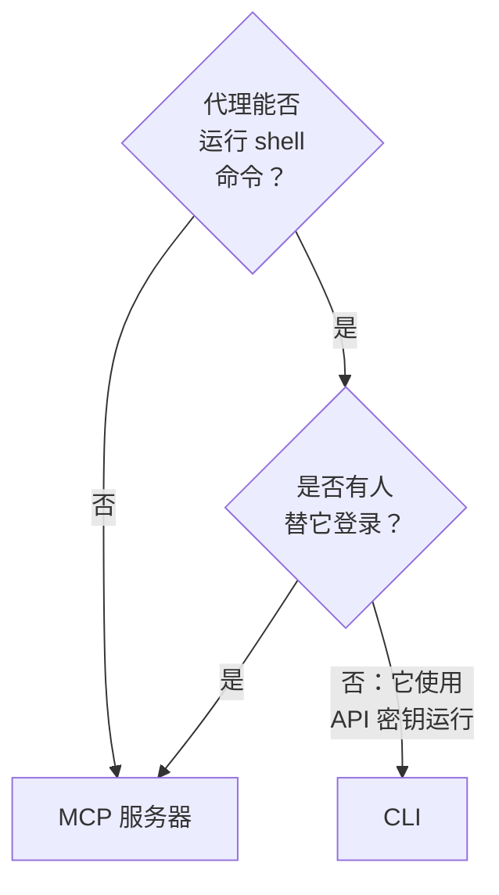

# 面向 AI 代理的 CLI

能运行 shell 命令的 AI 代理，例如编辑器中的编码代理或流水线中的作业，可以通过 CLI 而不是 [MCP 服务器](/docs/ai/mcp-server) 使用 OneUptime。本页说明各自适合的场景，以及代理如何安装 CLI、找到用法并读取回答。

:::cards
- [CLI 还是 MCP 服务器](#cli-还是-mcp-服务器): 代理应使用哪一个。
- [为代理设置](#为代理设置): 安装它，并通过环境变量提供密钥。
- [代理如何找到用法](#代理如何找到用法): 资源、它们的字段以及帮助。
- [读取回答](#读取回答): 每条命令都回答 JSON，错误也不例外。
:::

## CLI 还是 MCP 服务器

两者都访问 OneUptime API，并执行其凭据允许的操作。区别在于代理访问它们需要什么：



| | CLI | MCP 服务器 |
| --- | --- | --- |
| 代理需要 | shell 以及 Node.js 22 或更高版本 | MCP 客户端，例如 Claude 或 Cursor |
| 登录方式 | `ONEUPTIME_API_KEY` 中的项目 API 密钥 | 你的 OneUptime 账户或 API 密钥 |
| 可访问范围 | API 的每个资源，450 多个 | 有对应工具的记录和遥测数据，以及事件响应工具 |
| 适合 | 代理编写、供人保留的脚本，流水线中的检查，以及处理大量记录的工作 | 对话：调查事件、设置监视器 |

当代理本来就在运行命令（像编码代理那样），或者它构建的东西要在没有它的情况下继续运行（仓库中的脚本、流水线中的一步）时，请使用 CLI。当有人在聊天客户端中与代理交谈时，请使用 MCP 服务器，这样代理以此人的权限工作，客户端会在更改前征求同意。

## 为代理设置

每个 OneUptime 都提供与自身版本对应的 CLI 安装脚本：下面的命令从 `https://oneuptime.com` 下载它，所以在自托管的 OneUptime 上请把它换成你的 URL。脚本会先保存为 `install.sh`，方便你在运行前阅读它：

```bash
curl -fsSL https://oneuptime.com/install/cli -o install.sh
ONEUPTIME_URL=https://oneuptime.com bash install.sh
```

给代理一个只具备其工作所需访问权限的项目 API 密钥，通过环境变量而不是命令行提供，并让它先检查密钥：

```bash
export ONEUPTIME_API_KEY="your-api-key"
export ONEUPTIME_URL=https://oneuptime.com
oneuptime whoami --check -o json
```

在 **项目设置 → 高级 → API 密钥** 中创建密钥：参见 [创建 API 密钥](/docs/api-reference/api-reference#创建-api-密钥)。只能读取的密钥只让代理查看，别无其他。

## 代理如何找到用法

CLI 会说明自己能做什么，不需要 API 密钥，也不发送请求：

| 命令 | 回答的内容 |
| --- | --- |
| `oneuptime resources -o json` | 每个资源：它的命令、名称、API 路径、操作和动作 |
| `oneuptime incident fields -o json` | 资源的字段：每个字段的用途、类型、创建时是否需要以及它的标志 |
| `oneuptime incident create --help` | 命令的参数和标志 |

保存 ID 的字段会说明它接受哪个资源的 ID，因此代理会先列出该资源：`incidentSeverityId` 取自 `oneuptime incident-severity list` 的 ID。指定某人的字段也接受此人的电子邮件地址，例如 `--user-email`。

## 读取回答

让代理在每条命令后加上 `-o json` 或 `--json`。这样每条命令都用 JSON 回答，包括回答是一句话的命令，而错误是标准错误中的一个 JSON 对象：

```bash
oneuptime incident acknowledge 6f1c2a40-3b1e-4c55-9a0b-3e2f8d7c1a11 -o json
```

```json
{
  "_id": "6f1c2a40-3b1e-4c55-9a0b-3e2f8d7c1a11",
  "action": "acknowledge",
  "changed": true,
  "state": {
    "_id": "0b7d5e2c-8f4a-4d1b-9c3e-5a6f7b8c9d0e",
    "name": "Acknowledged"
  }
}
```

退出码说明发生了什么：成功时为 `0`，失败时为 `1`，API 密钥缺失或被拒绝时为 `2`，记录不存在时为 `3`。错误的 JSON 在 `exitCode` 中包含相同的退出码，在 `hint` 中给出下一步该做什么。参见 [输出格式](/docs/cli/output-formats#json) 和 [退出码](/docs/cli/scripting#退出码)。

## 后续步骤

:::cards
- [资源操作](/docs/cli/resource-operations): 每个操作及其标志和筛选条件。
- [命令参考](/docs/cli/command-reference): 每条命令、选项和默认值。
- [MCP 服务器](/docs/ai/mcp-server): 改为把聊天客户端连接到 OneUptime。
:::
