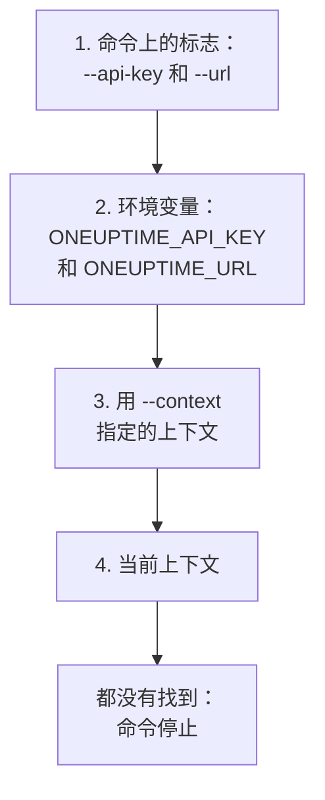

# 认证

CLI 发送的每个请求都带有你项目的 API 密钥。可以用 `oneuptime login` 一次保存密钥，每个环境一个上下文；也可以像脚本那样，通过标志或环境变量把密钥交给命令。本页介绍每种方式，以及同时存在多种时命令使用哪一种。

:::cards
- [登录](#登录): 保存 API 密钥和你的 OneUptime 地址。
- [上下文](#上下文): 为每个项目或环境保存的登录，以及在它们之间切换。
- [命令使用哪些凭据](#命令使用哪些凭据): 先是标志，然后是环境变量，再然后是上下文。
- [故障排除](#故障排除): 找不到凭据、无效的密钥和拒绝。
:::

## 开始之前

你需要项目的 API 密钥。在 **项目设置 → 高级 → API 密钥** 中通过 **创建API 密钥** 创建一个，并赋予它命令所需的访问权限：参见 [创建 API 密钥](/docs/api-reference/api-reference#创建-api-密钥)。密钥只能做其权限允许的事：只能读取记录的密钥可以列出和读取记录，但不能更改它们。

在 OneUptime Cloud 上，只有当项目处于 **Growth** 套餐或更高时，API 密钥才有效。低于该套餐时，每条命令都会返回 `API error (402)` 以及一条指明套餐的消息，直到项目升级；之后同一个密钥会重新生效。参见 [低于其套餐时的 API 密钥和 SCIM](/docs/api-reference/api-reference#低于其套餐时的-api-密钥和-scim)。

## 登录

`oneuptime login` 将 API 密钥和你的 OneUptime 地址保存为上下文，并将其设为当前上下文：

```bash
oneuptime login <api-key> <instance-url> [--context-name <name>]
```

| 参数或选项 | 说明 |
| --- | --- |
| `<api-key>` | 你项目的 API 密钥 |
| `<instance-url>` | 你的 OneUptime 地址：`https://oneuptime.com`，或你自己服务器的地址，例如 `https://oneuptime.example.com` |
| `--context-name <name>` | 保存上下文所用的名称。默认值：`default` |

例如，一个名为 `production` 的上下文：

```bash
oneuptime login <api-key> https://oneuptime.com --context-name production
```

它回答 `Logged in successfully. Context "production" is now active.`。地址末尾的斜杠会被去掉，用同一名称再次登录会替换该上下文。

> [!NOTE]
> `login` 保存密钥时不会向 OneUptime 询问它。运行一条命令，例如 `oneuptime incident count`，即可确认密钥可用。

## 上下文

上下文就是保存下来的登录：一个名称、一个地址和一个 API 密钥。为每个项目或环境保存一个，然后为之后的所有命令或单条命令选择一个。

:::steps
### 为每个环境保存一个上下文

```bash
oneuptime login <production-api-key> https://oneuptime.com --context-name production
oneuptime login <staging-api-key> https://oneuptime.example.com --context-name staging
```

每次登录都会把它的上下文设为当前上下文，所以现在 `staging` 是当前上下文。

### 列出它们

```bash
oneuptime context list
```

```text
┌───┬────────────┬───────────────────────────────┐
│   │ Name       │ URL                           │
├───┼────────────┼───────────────────────────────┤
│   │ production │ https://oneuptime.com         │
├───┼────────────┼───────────────────────────────┤
│ * │ staging    │ https://oneuptime.example.com │
└───┴────────────┴───────────────────────────────┘
```

`*` 标出当前上下文。API 密钥永远不会被列出。

### 切换到另一个上下文

```bash
oneuptime context use production
```

它回答 `Switched to context "production".`，之后的命令都使用它。

### 为单条命令使用上下文

```bash
oneuptime incident list --context staging
```

当前上下文保持不变。
:::

| 命令 | 作用 |
| --- | --- |
| `oneuptime context list` | 列出已保存的上下文；`*` 标出当前上下文。使用 `-o json` 时输出每个上下文的 `name`、`apiUrl` 和 `isCurrent`，从不输出它的密钥 |
| `oneuptime context use <name>` | 将已保存的上下文设为当前上下文 |
| `oneuptime context current` | 显示当前上下文的名称、URL 和 API 密钥，密钥除前四个和后四个字符外都被隐藏 |
| `oneuptime context delete <name>` | 删除已保存的上下文。如果它是当前上下文，剩下的第一个上下文成为当前上下文 |

## 命令使用哪些凭据

命令需要一个 API 密钥和一个 URL。它从以下位置中第一个有值的位置分别获取这两者：



所以可以混合使用：例如，API 密钥来自环境变量，URL 来自当前上下文。环境变量适合没有已保存上下文的脚本和 CI 作业：

:::tabs
@tab Linux
```bash
export ONEUPTIME_API_KEY=<api-key>
export ONEUPTIME_URL=https://oneuptime.com
oneuptime incident list
```
@tab macOS
```bash
export ONEUPTIME_API_KEY=<api-key>
export ONEUPTIME_URL=https://oneuptime.com
oneuptime incident list
```
@tab Windows
```powershell
$env:ONEUPTIME_API_KEY = "<api-key>"
$env:ONEUPTIME_URL = "https://oneuptime.com"
oneuptime incident list
```
:::

对单条命令而言，标志优先于其他一切：

```bash
oneuptime --api-key <api-key> --url https://oneuptime.com incident list
```

> [!WARNING]
> 作为标志传入的密钥会留在你的 shell 历史中，机器上的其他用户也能在进程列表中看到它。在共享机器上，请改用上下文或环境变量。

## 检查 CLI 将使用什么

`oneuptime whoami` 显示下一条命令将使用的 URL 和 API 密钥，以及它们来自的上下文：

```bash
oneuptime whoami
```

```text
URL:     https://oneuptime.com
API Key: 4f1c****0a13
Context: production
```

只显示密钥的前四个和后四个字符。只有当 URL 和密钥是该上下文自己的值，而不是被标志或环境变量替换的值时，才会显示 `Context` 这一行。`whoami` 读取你的设置时不调用 OneUptime：它显示命令将发送什么，而不是 OneUptime 是否接受。如果什么都没有保存或设置，它回答：

```text
Not authenticated. Run `oneuptime login` to authenticate.
```

## 配置文件

`oneuptime login` 将上下文保存在你主目录下的 `~/.oneuptime/config.json` 中（在 Windows 上是 `%USERPROFILE%\.oneuptime\config.json`）。CLI 创建该文件时，只有你的用户可以读写它（模式 `0600`）：

```json title="~/.oneuptime/config.json"
{
  "currentContext": "production",
  "contexts": {
    "production": {
      "name": "production",
      "apiUrl": "https://oneuptime.com",
      "apiKey": "<api-key>"
    },
    "staging": {
      "name": "staging",
      "apiUrl": "https://oneuptime.example.com",
      "apiKey": "<api-key>"
    }
  }
}
```

该文件原样保存 API 密钥：不要把它放进共享文件夹、备份或代码仓库。要退出一个上下文，用 `oneuptime context delete <name>` 删除它；要退出所有上下文，删除该文件。可能已泄露的密钥会一直有效，直到你在 OneUptime 的 **项目设置 → 高级 → API 密钥** 中删除它。

输出格式和列表大小不保存在这里：请为每条命令传入 `-o` 和 `--limit`。

## 故障排除

:::details 消息“No credentials found”
`Authentication error: No credentials found.` 表示没有任何标志、环境变量或已保存的上下文为命令提供 API 密钥和 URL。运行 `oneuptime login`，或同时设置 `ONEUPTIME_API_KEY` 和 `ONEUPTIME_URL`。命令以退出码 `2` 结束。
:::

:::details 消息“API error (400): Invalid API Key”
该密钥不是 OneUptime 的 API 密钥，或已过期，或已被重置。从 **项目设置 → 高级 → API 密钥** 中该密钥的页面重新复制它（它的 **过期** 日期也在那里），并用同一上下文名称重新登录。命令以退出码 `2` 结束。
:::

:::details 消息“API error (402): API keys need the Growth plan”
在 OneUptime Cloud 上，项目低于 **Growth** 套餐，因此它的 API 密钥停止工作。升级项目后，同一个密钥会重新生效：CLI 中无需任何更改。
:::

:::details 消息“API error (422): You do not have permissions”
密钥的权限覆盖不到命令所请求的内容。在 **项目设置 → 高级 → API 密钥** 中该密钥的页面上为它分配角色或权限：消息会指出能让请求通过的权限。
:::

:::details 消息“Context "staging" does not exist”
没有保存该名称的上下文。`oneuptime context list` 会显示现有的名称。
:::

:::details whoami 显示的 URL 或密钥与上下文不同
环境变量或标志替换了上下文的值。`env | grep ONEUPTIME` 会显示已设置的变量，`unset ONEUPTIME_API_KEY ONEUPTIME_URL` 让你回到上下文。
:::

:::details 发往该地址的请求失败
`Error: Request failed to https://...` 表示 CLI 无法在该地址访问 OneUptime。用 `oneuptime whoami` 检查 URL：它就是你打开 OneUptime 时的地址，带 `https://`，例如 `https://oneuptime.com`。
:::

## 后续步骤

:::cards
- [资源操作](/docs/cli/resource-operations): 列出、读取、创建、更改、删除和统计记录。
- [脚本与 CI/CD](/docs/cli/scripting): 通过环境变量把密钥交给流水线。
- [OneUptime API 参考](/docs/api-reference/api-reference): API 密钥能做什么，以及每个回答的含义。
:::
