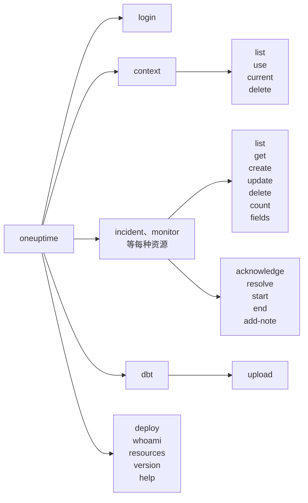

# 命令参考

`oneuptime` CLI 的每条命令，以及它的参数、选项和默认值。在任何命令后加上 `--help`，即可在终端中看到相同的内容。

:::cards
- [全局选项](#全局选项): 每条命令都接受的选项。
- [登录与上下文](#登录与上下文): login 和 context 命令。
- [资源命令](#资源命令): 每个资源的操作、字段和动作。
- [其他命令](#其他命令): deploy、dbt upload、data-checks apply、whoami、resources、version 和 help。
:::

## 命令总览



## 全局选项

| 选项 | 作用 | 默认值 |
| --- | --- | --- |
| `--api-key <key>` | 本条命令使用的 API 密钥 | `ONEUPTIME_API_KEY`，然后是上下文的密钥 |
| `--url <url>` | 本条命令使用的 OneUptime 地址 | `ONEUPTIME_URL`，然后是上下文的 URL |
| `--context <name>` | 本条命令使用的已保存上下文 | 当前上下文 |
| `-o, --output <format>` | `json`、`table` 或 `wide` | 终端中为 `table`，管道中为 `json` |
| `--json` | 等同于 `-o json` | |
| `--no-color` | 不带颜色地打印 | 带颜色，除非设置了 `NO_COLOR` |
| `-V, --version` | 打印 CLI 的版本 | |
| `-h, --help` | 显示命令的帮助 | |

选项可以写在命令前后：`oneuptime --context staging incident list` 和 `oneuptime incident list --context staging` 的效果相同。

每条命令都接受 `-o` 和 `--json`，因此下面的表格省略了它们。回答是一句话的命令（例如 `delete`）会打印这句话，除非 `-o json` 或 `--json` 要求 JSON：参见 [输出格式](/docs/cli/output-formats#json)。

## 登录与上下文

### `oneuptime login`

将 API 密钥和地址保存为上下文，并将其设为当前上下文。参见 [登录](/docs/cli/authentication#登录)。

```bash
oneuptime login <api-key> <instance-url> [--context-name <name>]
```

| 参数或选项 | 必需 | 说明 | 默认值 |
| --- | --- | --- | --- |
| `<api-key>` | 是 | 你项目的 API 密钥 | |
| `<instance-url>` | 是 | 你的 OneUptime 地址，例如 `https://oneuptime.com` | |
| `--context-name <name>` | 否 | 保存上下文所用的名称 | `default` |

### `oneuptime context list`

列出已保存的上下文；`*` 标出当前上下文。API 密钥从不列出：JSON 给出每个上下文的 `name`、`apiUrl` 和 `isCurrent`。

```bash
oneuptime context list
```

### `oneuptime context use`

将已保存的上下文设为当前上下文。

```bash
oneuptime context use <name>
```

| 参数 | 必需 | 说明 |
| --- | --- | --- |
| `<name>` | 是 | 已保存上下文的名称 |

### `oneuptime context current`

显示当前上下文的名称和 URL，以及除前四个和后四个字符外都被隐藏的 API 密钥。

```bash
oneuptime context current
```

### `oneuptime context delete`

删除已保存的上下文。如果它是当前上下文，剩下的第一个上下文成为当前上下文。

```bash
oneuptime context delete <name>
```

| 参数 | 必需 | 说明 |
| --- | --- | --- |
| `<name>` | 是 | 已保存上下文的名称 |

## 资源命令

`<resource>` 是某种记录的命令，来自 [资源](#资源) 表格，例如 `incident` 或 `monitor`。资源带有 API 为它接受的操作，大多数是全部六种，`oneuptime <resource> --help` 会列出它自己的操作。示例参见 [资源操作](/docs/cli/resource-operations)。

### `oneuptime <resource> list`

列出记录，最新的在前。标签则按名称排列，带编号的标签在前（`2. Team` 在 `10. Owner` 之前）。

```bash
oneuptime <resource> list [--query <json>] [--limit <n>] [--skip <n>] [--sort <json>] [--fields <names>] [--all]
```

| 选项 | 作用 | 默认值 |
| --- | --- | --- |
| `--query <json>` | JSON 形式的筛选 | 密钥可读取的所有记录 |
| `--limit <n>` | 最多返回的记录数，最多 10,000 | `10` |
| `--skip <n>` | 先跳过多少条记录 | `0` |
| `--sort <json>` | JSON 形式的顺序：`{"<field>":"ASC"}` 或 `{"<field>":"DESC"}` | 最新的在前 |
| `--fields <names>` | 要返回的字段，用逗号分隔；关联记录的字段写在点号后面，例如 `currentIncidentState.name` | 密钥可读取的所有字段 |
| `--all` | 每次 100 条、最多 100,000 条地返回所有匹配的记录，代替 `--limit` 和 `--skip`。仅限记录：遥测数据没有 `--all` | |

### `oneuptime <resource> get`

读取一条记录。

```bash
oneuptime <resource> get <id> [--fields <names>]
```

| 参数或选项 | 必需 | 说明 |
| --- | --- | --- |
| `<id>` | 是 | 记录的 ID，一个 UUID |
| `--fields <names>` | 否 | 要返回的字段，用逗号分隔。默认：密钥可读取的所有字段 |

### `oneuptime <resource> create`

创建一条记录并打印它。

```bash
oneuptime <resource> create [--<field> <value>]... [--data <json>] [--file <path>]
```

| 选项 | 必需 | 说明 |
| --- | --- | --- |
| `--<field> <value>` | 创建时必须提供的字段 | 字段的值：`--title <text>`、`--incident-severity-id <id>`、`--labels <ids>`。`oneuptime <resource> create --help` 会列出它们。仅限记录 |
| `--data <json>` | 否 | 以 JSON 表示的记录 |
| `--file <path>` | 否 | 包含该记录的 JSON 文件。与 `--data` 一起给出时使用文件 |

标志会叠加在 `--data` 或 `--file` 之上。用用户 ID 指定某人的字段还有一个用电子邮件地址指定此人的标志：`--user-email` 对应 `--user-id`。

### `oneuptime <resource> update`

更改你给出的字段。

```bash
oneuptime <resource> update <id> [--<field> <value>]... [--data <json>] [--file <path>]
```

| 参数或选项 | 必需 | 说明 |
| --- | --- | --- |
| `<id>` | 是 | 记录的 ID |
| `--<field> <value>` | 否 | 要更改的字段：`oneuptime <resource> update --help` 会列出它们。仅限记录 |
| `--data <json>` | 否 | 以 JSON 表示的要更改的字段 |
| `--file <path>` | 否 | 包含要更改字段的 JSON 文件。与 `--data` 一起给出时使用文件 |

### `oneuptime <resource> delete`

立即删除一条记录，不会询问。

```bash
oneuptime <resource> delete <id> [--force]
```

| 参数或选项 | 必需 | 说明 |
| --- | --- | --- |
| `<id>` | 是 | 记录的 ID |
| `--force` | 否 | 会被接受，但不改变任何行为：`delete` 从不请求确认 |

### `oneuptime <resource> count`

统计记录并打印数字。

```bash
oneuptime <resource> count [--query <json>]
```

| 选项 | 必需 | 说明 |
| --- | --- | --- |
| `--query <json>` | 否 | JSON 形式的筛选。不给出时为密钥可读取的所有记录 |

### `oneuptime <resource> fields`

列出资源的字段：每个字段的用途、类型、创建时是否必须提供，以及设置它的标志。它直接从 CLI 本身读取这些信息，不需要 API 密钥，也不发送请求。

```bash
oneuptime <resource> fields
```

### `oneuptime <resource> acknowledge`

像仪表盘按钮那样，把事件、警报或它们的片段移到项目的已确认状态。已确认或处于之后状态的记录保持不变。

```bash
oneuptime <resource> acknowledge <id>
```

| 参数 | 必需 | 说明 |
| --- | --- | --- |
| `<id>` | 是 | 记录的 ID |

### `oneuptime <resource> resolve`

把事件、警报或它们的片段移到项目的已解决状态。

```bash
oneuptime <resource> resolve <id>
```

| 参数 | 必需 | 说明 |
| --- | --- | --- |
| `<id>` | 是 | 记录的 ID |

### `oneuptime <resource> start`

把维护事件移到项目的进行中状态。

```bash
oneuptime <resource> start <id>
```

| 参数 | 必需 | 说明 |
| --- | --- | --- |
| `<id>` | 是 | 该事件的 ID |

### `oneuptime <resource> end`

把维护事件移到项目的已结束状态。

```bash
oneuptime <resource> end <id>
```

| 参数 | 必需 | 说明 |
| --- | --- | --- |
| `<id>` | 是 | 该事件的 ID |

### `oneuptime <resource> add-note`

为事件、警报、它们的片段或维护事件添加备注。

```bash
oneuptime <resource> add-note <id> --note <markdown> [--public]
```

| 参数或选项 | 必需 | 说明 |
| --- | --- | --- |
| `<id>` | 是 | 记录的 ID |
| `--note <markdown>` | 是 | 以 Markdown 编写的备注 |
| `--public` | 否 | 在记录的状态页面上发布备注，并通知其订阅者。仅限事件、它们的片段和计划维护 |

### 资源

OneUptime API 的每个资源都是一条命令，带有 API 为它接受的操作、`fields`，以及具备动作的记录的那些动作：

{{CLI_RESOURCE_COMMANDS}}

CLI 与 OneUptime 一同发布，因此 `oneuptime resources` 列出的是你所安装版本的命令。

### API 请求

每个操作都是对 API 的一次请求，密钥放在 `APIKey` 请求头中。`<path>` 是资源的 API 路径，由 `oneuptime resources` 给出：`incident` 对应 `/incident`，`on-call-policy` 对应 `/on-call-duty-policy`。

| 操作 | 请求 | 请求体 |
| --- | --- | --- |
| `list` | `POST /api/<path>/get-list` | `query`、`select`、`skip`、`limit` 和 `sort` |
| `get` | `POST /api/<path>/<id>/get-item` | `select` |
| `create` | `POST /api/<path>` | `{"data": ...}` |
| `update` | `PUT /api/<path>/<id>/` | `{"data": ...}` |
| `delete` | `DELETE /api/<path>/<id>/` | 无 |
| `count` | `POST /api/<path>/count` | `query` |

动作会读取项目的各个状态和该记录，然后像仪表盘按钮那样在记录的状态时间线上创建一行：对事件执行 `acknowledge` 会创建一个 `incident-state-timeline`。`add-note` 创建一个 `incident-internal-note`，加上 `--public` 时则创建一个 `incident-public-note`。电子邮件标志会先列出项目中使用该地址的团队成员。当 OneUptime 拒绝密钥无法读取的字段时，列表或读取会去掉该字段重新请求。

## 其他命令

### `oneuptime deploy`

从流水线记录一次部署或其他变更：它会绘制在服务的图表上，OneUptime AI 调查事件时也会读取它。它使用遥测摄取密钥写入，而不是 API 密钥。参见 [部署与变更](/docs/telemetry/change-events)。

```bash
oneuptime deploy [--service <name>] [--service-version <version>] [--previous-version <version>] [--commit <sha>] [--repository <url>] [--branch <name>] [--pull-request <number>] [--environment <name>] [--title <title>] [--description <text>] [--type <type>] [--time <time>] [--attribute <key=value...>] [--ingestion-key <key>]
```

| 选项 | 必需 | 说明 | 默认值 |
| --- | --- | --- | --- |
| `--service <name>` | 否 | 被部署的服务 | 作用于整个项目的变更 |
| `--service-version <version>` | 否 | 部署的版本 | |
| `--previous-version <version>` | 否 | 它所替换的版本 | |
| `--commit <sha>` | 否 | 部署的提交 | |
| `--repository <url>` | 否 | 该提交所在的仓库 | |
| `--branch <name>` | 否 | 部署的分支 | |
| `--pull-request <number>` | 否 | 部署的拉取请求 | |
| `--environment <name>` | 否 | 部署到的环境 | |
| `--title <title>` | 否 | 变更的标题；部署以外的其他类型需要提供 | `Deploy <version>` |
| `--description <text>` | 否 | 变更的详细信息 | |
| `--type <type>` | 否 | 变更的类型，例如 `config-change` 或 `rollback` | `deployment` |
| `--time <time>` | 否 | 变更发生的时间，例如 `2026-10-19T10:00:00Z` | 现在 |
| `--attribute <key=value...>` | 否 | 更多属性，形式为 `key=value`，一个或多个 | |
| `--ingestion-key <key>` | 否 | 项目的遥测摄取密钥 | `ONEUPTIME_TELEMETRY_INGESTION_KEY` |

### `oneuptime dbt upload`

在一次构建之后，从 CI 或 dbt Cloud 作业把 dbt 项目的产物发送到数据可观测性。它的模型显示在它们构建的表上，并带有血缘；它的测试显示在 OneUptime 的检查旁边，并且可以触发警报；每次构建都是该项目管道的一次运行。它从 dbt 的目标文件夹读取 `manifest.json` 和 `run_results.json`，只发送数据可观测性会读取的内容，并使用遥测摄取密钥写入，而不是 API 密钥。你的仪表盘中数据可观测性的文档页面展示了如何在 CI 作业中使用它。

```bash
oneuptime dbt upload [--target-path <dir>] [--manifest <file>] [--run-results <file>] [--project <name>] [--ingestion-key <key>]
```

| 选项 | 必需 | 说明 | 默认值 |
| --- | --- | --- | --- |
| `--target-path <dir>` | 否 | dbt 写入其产物的文件夹 | `target` |
| `--manifest <file>` | 否 | 要发送的清单 | 目标文件夹中的 `manifest.json` |
| `--run-results <file>` | 否 | 要发送的运行结果 | 目标文件夹中的 `run_results.json` |
| `--project <name>` | 否 | dbt 项目的名称，仅在不发送清单时需要 | 清单中的项目 |
| `--ingestion-key <key>` | 否 | 项目的遥测摄取密钥 | `ONEUPTIME_TELEMETRY_INGESTION_KEY` |

### `oneuptime data-checks apply`

让项目的数据检查与一个 YAML 文件一致，这样它们就保存在仓库中，并像代码一样接受审查。文件中任何地方出错，都不会应用任何内容，并以错误退出。文件的格式见 [检查与对账](/docs/data-observability/checks)。

```bash
oneuptime data-checks apply <file> [--dry-run] [--prune]
```

| 选项 | 必需 | 说明 | 默认值 |
| --- | --- | --- | --- |
| `--dry-run` | 否 | 说明将会更改什么，但不做任何更改 | 关闭 |
| `--prune` | 否 | 删除之前某次应用创建、而文件中不再提到的检查 | 关闭 |

### `oneuptime whoami`

显示下一条命令将使用的 URL 和 API 密钥（密钥已遮盖），以及它们来自的上下文。不加 `--check` 时，它不调用 OneUptime。参见 [检查 CLI 将使用什么](/docs/cli/authentication#检查-cli-将使用什么)。

```bash
oneuptime whoami [--check]
```

| 选项 | 必需 | 说明 |
| --- | --- | --- |
| `--check` | 否 | 询问 OneUptime 是否接受该密钥，并显示密钥所属的项目、你的 OneUptime 的版本和 CLI 的版本 |

### `oneuptime resources`

列出 CLI 为之提供命令的每种记录：它的命令、单数和复数名称、类型和 API 路径，以及总数。JSON 给出每种记录的 `name`、`singularName`、`pluralName`、`modelType`、`apiPath`、`operations` 和 `actions`。

```bash
oneuptime resources [--type <type>]
```

| 选项 | 必需 | 说明 | 默认值 |
| --- | --- | --- | --- |
| `--type <type>` | 否 | 记录用 `database`，遥测数据用 `analytics` | 两者都有 |

### `oneuptime version`

打印 CLI 的版本，与 `oneuptime --version` 相同。

```bash
oneuptime version
```

### `oneuptime help`

显示 CLI 或某条命令的帮助。

```bash
oneuptime help [command]
```

## 环境变量

| 变量 | 作用 |
| --- | --- |
| `ONEUPTIME_API_KEY` | 没有 `--api-key` 标志提供密钥时使用的 API 密钥 |
| `ONEUPTIME_URL` | 没有 `--url` 标志提供地址时使用的 OneUptime 地址 |
| `ONEUPTIME_TELEMETRY_INGESTION_KEY` | 没有 `--ingestion-key` 标志提供密钥时，`oneuptime deploy` 写入所用的遥测摄取密钥 |
| `NO_COLOR` | 设为任意值即关闭颜色 |

## 文件

| 文件 | 保存的内容 |
| --- | --- |
| `~/.oneuptime/config.json` | 已保存的上下文、它们的 API 密钥和当前上下文 |

## 退出码

| 代码 | 含义 |
| --- | --- |
| `0` | 成功 |
| `1` | 失败：OneUptime 拒绝了请求，或命令有误 |
| `2` | 没有可用的 API 密钥：找不到、无效，或低于其套餐 |
| `3` | 未找到：OneUptime 返回 `404` |

示例参见 [退出码](/docs/cli/scripting#退出码)。

## 后续步骤

:::cards
- [CLI 概览](/docs/cli/index): 安装 CLI 并运行你的第一批命令。
- [资源操作](/docs/cli/resource-operations): 每个操作的示例。
- [脚本与 CI/CD](/docs/cli/scripting): 在脚本和流水线中使用 CLI。
:::
