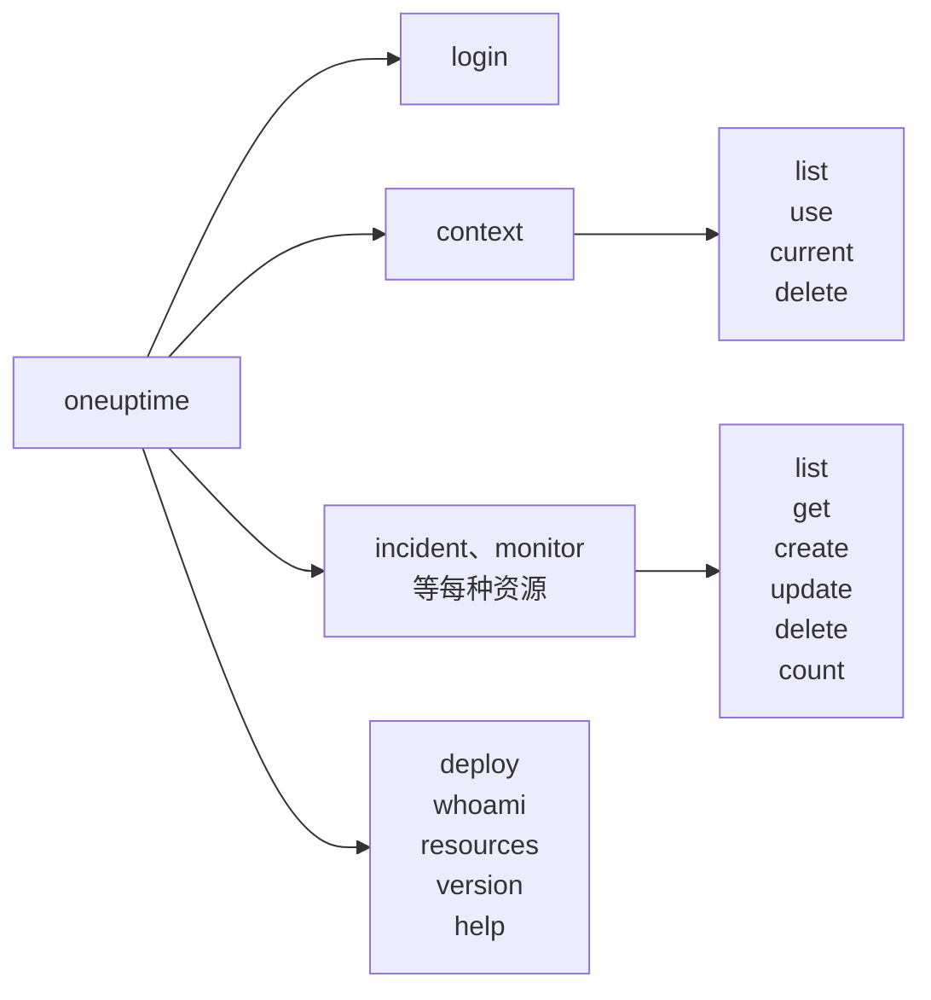

# 命令参考

`oneuptime` CLI 的每条命令，以及它的参数、选项和默认值。在任何命令后加上 `--help`，即可在终端中看到相同的内容。

:::cards
- [全局选项](#全局选项): 每条命令都接受的选项。
- [登录与上下文](#登录与上下文): login 和 context 命令。
- [资源命令](#资源命令): list、get、create、update、delete 和 count。
- [其他命令](#其他命令): deploy、whoami、resources、version 和 help。
:::

## 命令总览



## 全局选项

| 选项 | 作用 | 默认值 |
| --- | --- | --- |
| `--api-key <key>` | 本条命令使用的 API 密钥 | `ONEUPTIME_API_KEY`，然后是上下文的密钥 |
| `--url <url>` | 本条命令使用的 OneUptime 地址 | `ONEUPTIME_URL`，然后是上下文的 URL |
| `--context <name>` | 本条命令使用的已保存上下文 | 当前上下文 |
| `-o, --output <format>` | `json`、`table` 或 `wide` | 终端中为 `table`，管道中为 `json` |
| `--no-color` | 不带颜色地打印 | 带颜色，除非设置了 `NO_COLOR` |
| `-V, --version` | 打印 CLI 的版本 | |
| `-h, --help` | 显示命令的帮助 | |

选项可以写在命令前后：`oneuptime --context staging incident list` 和 `oneuptime incident list --context staging` 的效果相同。

## 登录与上下文

### `oneuptime login`

将 API 密钥和地址保存为上下文，并将其设为当前上下文。参见 [登录](/docs/cli/authentication#登录)。

```bash
oneuptime login <api-key> <instance-url> [--context-name <name>]
```

| 参数或选项 | 必需 | 说明 | 默认值 |
| --- | --- | --- | --- |
| `<api-key>` | 是 | 你项目的 API 密钥 | |
| `<instance-url>` | 是 | 你的 OneUptime 地址，例如 `https://oneuptime.com` | |
| `--context-name <name>` | 否 | 保存上下文所用的名称 | `default` |

### `oneuptime context list`

列出已保存的上下文；`*` 标出当前上下文。API 密钥永远不会被列出。

```bash
oneuptime context list [-o <format>]
```

| 选项 | 必需 | 说明 |
| --- | --- | --- |
| `-o, --output <format>` | 否 | `json`、`table` 或 `wide`。JSON 给出每个上下文的 `name`、`apiUrl` 和 `isCurrent` |

### `oneuptime context use`

将已保存的上下文设为当前上下文。

```bash
oneuptime context use <name>
```

| 参数 | 必需 | 说明 |
| --- | --- | --- |
| `<name>` | 是 | 已保存上下文的名称 |

### `oneuptime context current`

显示当前上下文的名称和 URL，以及除前四个和后四个字符外都被隐藏的 API 密钥。

```bash
oneuptime context current
```

### `oneuptime context delete`

删除已保存的上下文。如果它是当前上下文，剩下的第一个上下文成为当前上下文。

```bash
oneuptime context delete <name>
```

| 参数 | 必需 | 说明 |
| --- | --- | --- |
| `<name>` | 是 | 已保存上下文的名称 |

## 资源命令

`<resource>` 是某种记录的命令，来自 [资源](#资源) 表格，例如 `incident` 或 `monitor`。示例参见 [资源操作](/docs/cli/resource-operations)。

### `oneuptime <resource> list`

列出记录，最新的在前。标签则按名称排列，带编号的标签在前（`2. Team` 在 `10. Owner` 之前）。

```bash
oneuptime <resource> list [--query <json>] [--limit <n>] [--skip <n>] [--sort <json>] [-o <format>]
```

| 选项 | 作用 | 默认值 |
| --- | --- | --- |
| `--query <json>` | JSON 形式的筛选 | 密钥可读取的所有记录 |
| `--limit <n>` | 最多返回的记录数，最多 10,000 | `10` |
| `--skip <n>` | 先跳过多少条记录 | `0` |
| `--sort <json>` | JSON 形式的顺序：`{"<field>":"ASC"}` 或 `{"<field>":"DESC"}` | 最新的在前 |
| `-o, --output <format>` | `json`、`table` 或 `wide` | 终端中为 `table`，管道中为 `json` |

### `oneuptime <resource> get`

读取一条记录。仅限记录：遥测数据没有 `get`。

```bash
oneuptime <resource> get <id> [-o <format>]
```

| 参数或选项 | 必需 | 说明 |
| --- | --- | --- |
| `<id>` | 是 | 记录的 ID，一个 UUID |
| `-o, --output <format>` | 否 | `json`、`table` 或 `wide` |

### `oneuptime <resource> create`

创建一条记录并打印它。

```bash
oneuptime <resource> create (--data <json> | --file <path>) [-o <format>]
```

| 选项 | 必需 | 说明 |
| --- | --- | --- |
| `--data <json>` | 二者之一 | JSON 形式的记录 |
| `--file <path>` | 二者之一 | 包含该记录的 JSON 文件。与 `--data` 一起给出时使用文件 |
| `-o, --output <format>` | 否 | `json`、`table` 或 `wide` |

### `oneuptime <resource> update`

更改你给出的字段。仅限记录：遥测数据没有 `update`。

```bash
oneuptime <resource> update <id> --data <json> [-o <format>]
```

| 参数或选项 | 必需 | 说明 |
| --- | --- | --- |
| `<id>` | 是 | 记录的 ID |
| `--data <json>` | 是 | 要更改的字段，JSON 形式 |
| `-o, --output <format>` | 否 | `json`、`table` 或 `wide` |

### `oneuptime <resource> delete`

立即删除一条记录，不会询问。仅限记录：遥测数据没有 `delete`。

```bash
oneuptime <resource> delete <id> [--force]
```

| 参数或选项 | 必需 | 说明 |
| --- | --- | --- |
| `<id>` | 是 | 记录的 ID |
| `--force` | 否 | 会被接受，但不改变任何行为：`delete` 从不请求确认 |

### `oneuptime <resource> count`

统计记录并打印数字。

```bash
oneuptime <resource> count [--query <json>] [-o <format>]
```

| 选项 | 必需 | 说明 |
| --- | --- | --- |
| `--query <json>` | 否 | JSON 形式的筛选。不给出时为密钥可读取的所有记录 |
| `-o, --output <format>` | 否 | `json`、`table` 或 `wide` |

### 资源

记录支持 `list`、`get`、`create`、`update`、`delete` 和 `count`：

| 领域 | 命令 |
| --- | --- |
| 监控 | `monitor`, `monitor-status`, `monitor-status-event` |
| 事件 | `incident`, `incident-state`, `incident-severity`, `incident-state-timeline`, `incident-public-note`, `incident-internal-note`, `incident-alert`, `postmortem-status` |
| 警报 | `alert`, `alert-state`, `alert-severity`, `alert-state-timeline`, `alert-internal-note` |
| 状态页面 | `status-page`, `status-page-announcement` |
| 计划维护 | `scheduled-maintenance-event`, `scheduled-maintenance-state`, `scheduled-maintenance-state-timeline` |
| 团队与值班 | `team`, `on-call-policy` |
| 安全 | `security-case`, `security-case-evidence`, `security-case-note`, `security-case-priority`, `security-case-status`, `security-case-task`, `security-detection`, `security-playbook` |
| 数据安全 | `data-store`, `data-store-finding`, `data-store-access-entry`, `data-flow`, `data-security-issue`, `data-security-scan`, `custom-data-type`, `check-setting`, `residency-rule`, `data-security-setting` |
| 标签 | `label` |

遥测数据支持 `list`、`create` 和 `count`：

| 领域 | 命令 |
| --- | --- |
| 可观测性 | `log`, `metric`, `span`, `exception-instance`, `monitor-log` |
| 安全 | `security-event`, `threat-intel-indicator` |
| 变更与成本 | `change-event`, `kubernetes-cost-allocation` |

CLI 与 OneUptime 一同发布，因此 `oneuptime resources` 列出的是你所安装版本的命令。

### API 请求

每个操作都是对 API 的一次请求，密钥放在 `APIKey` 请求头中。`<path>` 是资源的 API 路径，由 `oneuptime resources` 给出：`incident` 对应 `/incident`，`on-call-policy` 对应 `/on-call-duty-policy`。

| 操作 | 请求 | 请求体 |
| --- | --- | --- |
| `list` | `POST /api/<path>/get-list` | `query`、`select`、`skip`、`limit` 和 `sort` |
| `get` | `POST /api/<path>/<id>/get-item` | `select` |
| `create` | `POST /api/<path>` | `{"data": ...}` |
| `update` | `PUT /api/<path>/<id>/` | `{"data": ...}` |
| `delete` | `DELETE /api/<path>/<id>/` | 无 |
| `count` | `POST /api/<path>/count` | `query` |

## 其他命令

### `oneuptime deploy`

从流水线记录一次部署或其他变更：它会绘制在服务的图表上，OneUptime AI 调查事件时也会读取它。它使用遥测摄取密钥写入，而不是 API 密钥。参见 [部署与变更](/docs/telemetry/change-events)。

```bash
oneuptime deploy [--service <name>] [--service-version <version>] [--previous-version <version>] [--commit <sha>] [--repository <url>] [--branch <name>] [--pull-request <number>] [--environment <name>] [--title <title>] [--description <text>] [--type <type>] [--time <time>] [--attribute <key=value...>] [--ingestion-key <key>]
```

| 选项 | 必需 | 说明 | 默认值 |
| --- | --- | --- | --- |
| `--service <name>` | 否 | 被部署的服务 | 作用于整个项目的变更 |
| `--service-version <version>` | 否 | 部署的版本 | |
| `--previous-version <version>` | 否 | 它所替换的版本 | |
| `--commit <sha>` | 否 | 部署的提交 | |
| `--repository <url>` | 否 | 该提交所在的仓库 | |
| `--branch <name>` | 否 | 部署的分支 | |
| `--pull-request <number>` | 否 | 部署的拉取请求 | |
| `--environment <name>` | 否 | 部署到的环境 | |
| `--title <title>` | 否 | 变更的标题；部署以外的其他类型需要提供 | `Deploy <version>` |
| `--description <text>` | 否 | 变更的详细信息 | |
| `--type <type>` | 否 | 变更的类型，例如 `config-change` 或 `rollback` | `deployment` |
| `--time <time>` | 否 | 变更发生的时间，例如 `2026-10-19T10:00:00Z` | 现在 |
| `--attribute <key=value...>` | 否 | 更多属性，形式为 `key=value`，一个或多个 | |
| `--ingestion-key <key>` | 否 | 项目的遥测摄取密钥 | `ONEUPTIME_TELEMETRY_INGESTION_KEY` |

### `oneuptime whoami`

显示下一条命令将使用的 URL 和 API 密钥（密钥已隐藏部分），以及它们来自的上下文。它不调用 OneUptime。参见 [检查 CLI 将使用什么](/docs/cli/authentication#检查-cli-将使用什么)。

```bash
oneuptime whoami
```

### `oneuptime resources`

列出 CLI 有命令的每种记录：它的命令、单数和复数名称、类型和 API 路径，以及总数。

```bash
oneuptime resources [--type <type>] [-o <format>]
```

| 选项 | 必需 | 说明 | 默认值 |
| --- | --- | --- | --- |
| `--type <type>` | 否 | 记录用 `database`，遥测数据用 `analytics` | 两者都有 |
| `-o, --output <format>` | 否 | `json`、`table` 或 `wide`。JSON 给出每一种的 `name`、`singularName`、`pluralName`、`modelType` 和 `apiPath` | 终端中为 `table`，管道中为 `json` |

### `oneuptime version`

打印 CLI 的版本，与 `oneuptime --version` 相同。

```bash
oneuptime version
```

### `oneuptime help`

显示 CLI 或某条命令的帮助。

```bash
oneuptime help [command]
```

## 环境变量

| 变量 | 作用 |
| --- | --- |
| `ONEUPTIME_API_KEY` | 没有 `--api-key` 标志提供密钥时使用的 API 密钥 |
| `ONEUPTIME_URL` | 没有 `--url` 标志提供地址时使用的 OneUptime 地址 |
| `ONEUPTIME_TELEMETRY_INGESTION_KEY` | 没有 `--ingestion-key` 标志提供密钥时，`oneuptime deploy` 写入所用的遥测摄取密钥 |
| `NO_COLOR` | 设为任意值即关闭颜色 |

## 文件

| 文件 | 保存的内容 |
| --- | --- |
| `~/.oneuptime/config.json` | 已保存的上下文、它们的 API 密钥和当前上下文 |

## 退出码

| 代码 | 含义 |
| --- | --- |
| `0` | 成功 |
| `1` | 失败：OneUptime 拒绝了请求，或命令有误 |
| `2` | 没有可用的 API 密钥：找不到、无效，或低于其套餐 |
| `3` | 未找到：OneUptime 返回 `404` |

示例参见 [退出码](/docs/cli/scripting#退出码)。

## 后续步骤

:::cards
- [CLI 概览](/docs/cli/index): 安装 CLI 并运行你的第一批命令。
- [资源操作](/docs/cli/resource-operations): 每个操作的示例。
- [脚本与 CI/CD](/docs/cli/scripting): 在脚本和流水线中使用 CLI。
:::
