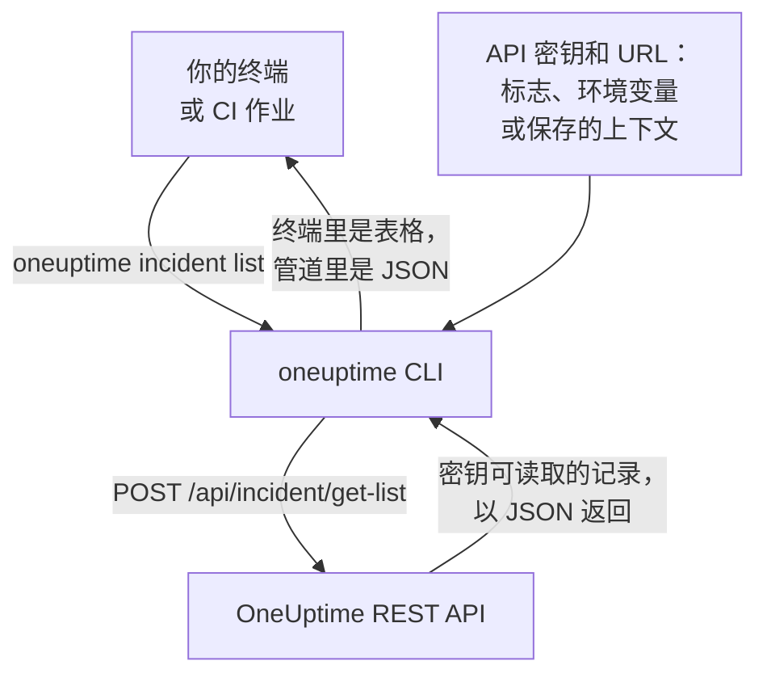

# CLI 概览

OneUptime 的 CLI，即 `oneuptime`，让你在终端或脚本中管理 OneUptime 项目。它使用项目的 API 密钥，列出、读取、创建、更改、删除和统计监视器、事件、警报、状态页面以及 OneUptime API 提供的其他记录。

:::cards
- [CLI 的工作方式](#cli-的工作方式): 一条命令，一次 API 请求，一个回答。
- [安装 CLI](#安装-cli): 一条 npm 命令，以及该选的版本。
- [运行你的第一批命令](#运行你的第一批命令): 保存 API 密钥，然后列出你的事件。
- [命令一览](#命令一览): 每条命令，以及讲解它的页面。
:::

## CLI 的工作方式

每条命令向 OneUptime 的 REST API 发送一次请求，并打印回答。CLI 从标志、环境变量或 `oneuptime login` 保存的上下文中获取 API 密钥和你的 OneUptime 地址。命令能读取和更改什么由密钥决定，和 API 完全一样。



记录的命令随 CLI 一起提供：OneUptime API 向工具开放的每种记录都有一条，与 [MCP 服务器](/docs/ai/mcp-server) 提供工具的记录相同。运行 `oneuptime resources` 即可列出它们。

## 开始之前

- **Node.js 和 npm**：当前的 LTS 版本，用于安装 CLI。
- **项目的 API 密钥。** 在 **项目设置 → 高级 → API 密钥** 中通过 **创建API 密钥** 创建：参见 [创建 API 密钥](/docs/api-reference/api-reference#创建-api-密钥)。
- **在 OneUptime Cloud 上，需要 Growth 套餐或更高。** 项目的 API 密钥只在该套餐上有效：参见 [低于其套餐时的 API 密钥和 SCIM](/docs/api-reference/api-reference#低于其套餐时的-api-密钥和-scim)。

## 安装 CLI

从 npm 安装 `@oneuptime/cli` 包。它会添加 `oneuptime` 命令，`--version` 会打印你安装的版本：

```bash
npm install -g @oneuptime/cli
oneuptime --version
```

CLI 与 OneUptime 一同发布，版本号也相同。在自托管的 OneUptime 上，请安装与你的 OneUptime 版本相同的 CLI，让它的命令与你服务器上的记录一致：

```bash
npm install -g @oneuptime/cli@<your-oneuptime-version>
```

> [!WARNING]
> 14.0.64 之前的 CLI 版本一启动就会停止，并报出 `Cannot find module 'Common/Models/DatabaseModels/Index'` 之类的错误。请用 `npm install -g @oneuptime/cli@latest` 安装 14.0.64 或更高版本。在早于 14.0.64 的自托管 OneUptime 上，请先[升级 OneUptime](/docs/installation/upgrading#如何升级)，再安装与升级后版本相同的 CLI。

## 运行你的第一批命令

:::steps
### 保存你的 API 密钥

用密钥和你的 OneUptime 地址登录。CLI 会把它们保存为名为 `default` 的上下文，并从此使用它：

```bash
oneuptime login <your-api-key> https://oneuptime.com
```

它回答 `Logged in successfully. Context "default" is now active.`。在自托管的 OneUptime 上，请用它的地址代替 `https://oneuptime.com`。

### 列出你的事件

```bash
oneuptime incident list
```

最新的十个事件以表格显示。`login` 保存密钥时不会检查它，所以这条命令是第一个能证明密钥可用的命令：如果被拒绝，请参见 [故障排除](/docs/cli/authentication#故障排除)。

### 看看还能管理什么

```bash
oneuptime resources
```

列表显示你可以处理的每种记录及其命令，例如 `monitor`、`status-page` 或 `on-call-policy`。
:::

## 命令一览

| 命令 | 作用 | 了解更多 |
| --- | --- | --- |
| `oneuptime login <api-key> <instance-url>` | 将 API 密钥和地址保存为上下文 | [认证](/docs/cli/authentication#登录) |
| `oneuptime context list`, `use`, `current`, `delete` | 列出、切换、显示和删除已保存的上下文 | [认证](/docs/cli/authentication#上下文) |
| `oneuptime whoami` | 显示下一条命令将使用的 URL 和 API 密钥 | [认证](/docs/cli/authentication#检查-cli-将使用什么) |
| `oneuptime deploy` | 为图表和 OneUptime AI 记录一次部署或其他变更 | [部署与变更](/docs/telemetry/change-events) |
| `oneuptime <resource> list`, `get`, `create`, `update`, `delete`, `count` | 处理一种记录 | [资源操作](/docs/cli/resource-operations) |
| `oneuptime resources` | 列出各种记录及其命令 | [命令参考](/docs/cli/command-reference#oneuptime-resources) |
| `oneuptime version` | 打印 CLI 的版本 | [命令参考](/docs/cli/command-reference#oneuptime-version) |
| `oneuptime help [command]` | 显示命令的帮助 | [获取帮助](#获取帮助) |

## 全局选项

这些选项适用于每条命令，写在命令前后均可：

| 选项 | 作用 |
| --- | --- |
| `--api-key <key>` | 本条命令使用的 API 密钥，代替已保存的密钥 |
| `--url <url>` | 本条命令使用的 OneUptime 地址 |
| `--context <name>` | 本条命令使用的已保存上下文，代替当前上下文 |
| `-o, --output <format>` | `table`、`json` 或 `wide`：参见 [输出格式](/docs/cli/output-formats) |
| `--no-color` | 不带颜色地打印 |
| `-V, --version` | 打印 CLI 的版本 |
| `-h, --help` | 显示命令的帮助 |

## 获取帮助

每条命令都有自己的帮助，列出它的参数、选项和默认值：

```bash
oneuptime --help
oneuptime help incident
oneuptime incident list --help
```

## 后续步骤

:::cards
- [认证](/docs/cli/authentication): 每个环境的上下文，以及命令使用哪个密钥。
- [资源操作](/docs/cli/resource-operations): 列出、读取、创建、更改、删除和统计记录。
- [输出格式](/docs/cli/output-formats): 表格给人看，JSON 给脚本用。
- [脚本与 CI/CD](/docs/cli/scripting): 退出码、jq 和流水线。
- [命令参考](/docs/cli/command-reference): 每条命令、选项和默认值。
:::
