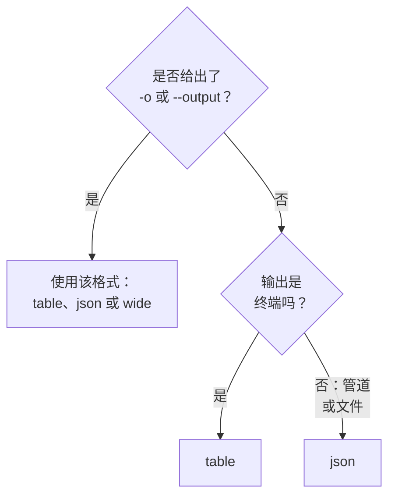

# 输出格式

当你在终端中阅读回答时，CLI 打印表格；当脚本或其他程序读取回答时，它打印 JSON。任何命令都可以用 `-o` 或 `--output` 选择格式。

:::cards
- [格式如何确定](#格式如何确定): 终端得到表格，管道得到 JSON。
- [表格](#表格): 六列，每个值在 60 个字符处截断。
- [JSON](#json): 完整的每个字段，供脚本和 jq 使用。
- [宽表](#宽表): 包含所有列的表格。
:::

## 格式如何确定



| 格式 | 打印的内容 | 最适合 |
| --- | --- | --- |
| `table` | 最多六列的表格；单条记录按每个字段一行显示 | 在终端中阅读 |
| `json` | OneUptime 发送的原样回答，以两个空格缩进 | 脚本、`jq` 和文件 |
| `wide` | 每个字段一列的表格 | 一眼比较许多字段 |

`-o` 适用于每条打印记录的命令：资源的 `list`、`get`、`create`、`update` 和 `count`，以及 `oneuptime resources` 和 `oneuptime context list`。它可以写在命令行的任何位置。其他任何值都会在发送请求之前被拒绝：

```text
error: option '-o, --output <format>' argument 'yaml' is invalid. Allowed choices are json, table, wide.
```

## 表格

在终端中默认使用表格。例如，`oneuptime resources --type analytics` 会打印这个表格：

```text
┌────────────────────────────┬────────────────────────────┬─────────────────────────────┬───────────┬─────────────────────────────┐
│ Command                    │ Singular                   │ Plural                      │ Type      │ API Path                    │
├────────────────────────────┼────────────────────────────┼─────────────────────────────┼───────────┼─────────────────────────────┤
│ log                        │ Log                        │ Logs                        │ analytics │ /logs                       │
├────────────────────────────┼────────────────────────────┼─────────────────────────────┼───────────┼─────────────────────────────┤
│ span                       │ Span                       │ Spans                       │ analytics │ /span                       │
├────────────────────────────┼────────────────────────────┼─────────────────────────────┼───────────┼─────────────────────────────┤
│ metric                     │ Metric                     │ Metrics                     │ analytics │ /metrics                    │
├────────────────────────────┼────────────────────────────┼─────────────────────────────┼───────────┼─────────────────────────────┤
│ exception-instance         │ Exception Instance         │ Exception Instances         │ analytics │ /exceptions                 │
├────────────────────────────┼────────────────────────────┼─────────────────────────────┼───────────┼─────────────────────────────┤
│ monitor-log                │ Monitor Log                │ Monitor Logs                │ analytics │ /monitor-log                │
├────────────────────────────┼────────────────────────────┼─────────────────────────────┼───────────┼─────────────────────────────┤
│ kubernetes-cost-allocation │ Kubernetes Cost Allocation │ Kubernetes Cost Allocations │ analytics │ /kubernetes-cost-allocation │
├────────────────────────────┼────────────────────────────┼─────────────────────────────┼───────────┼─────────────────────────────┤
│ security-event             │ Security Event             │ Security Events             │ analytics │ /security-events            │
├────────────────────────────┼────────────────────────────┼─────────────────────────────┼───────────┼─────────────────────────────┤
│ change-event               │ Change Event               │ Change Events               │ analytics │ /change-events              │
├────────────────────────────┼────────────────────────────┼─────────────────────────────┼───────────┼─────────────────────────────┤
│ threat-intel-indicator     │ Threat Intel Indicator     │ Threat Intel Indicators     │ analytics │ /threat-intel-indicators    │
└────────────────────────────┴────────────────────────────┴─────────────────────────────┴───────────┴─────────────────────────────┘

Total: 9 resources
```

对于记录列表，表格最多显示六列：先是 `_id`、`name`、`title`、`status`、`createdAt` 和 `updatedAt` 中记录具有的那些，然后按顺序是记录的后续字段。列取自第一条记录。超过 60 个字符的值会截断为前 57 个字符，后接 `...`。

`get` 和 `create` 打印的单条记录是一个两列的表格：字段名和它的值，每个字段一行。

OneUptime 将日期和其他记录的 ID 作为对象发送，例如 `{"_type":"DateTime","value":"2026-10-14T09:12:44.000Z"}`，表格会按原文显示它们。它们的值在 `value` 中：参见 [JSON](#json)。

## JSON

JSON 是 OneUptime 发送的原样回答，以两个空格缩进：列表是记录的数组，单条记录是一个对象。

```bash
oneuptime incident list --limit 1 -o json
```

```json
[
  {
    "_id": "6f1c2a40-3b1e-4c55-9a0b-3e2f8d7c1a11",
    "createdAt": {
      "_type": "DateTime",
      "value": "2026-10-14T09:12:44.000Z"
    },
    "title": "Checkout API is down",
    "currentIncidentStateId": {
      "_type": "ObjectID",
      "value": "0b7d5e2c-8f4a-4d1b-9c3e-5a6f7b8c9d0e"
    }
  }
]
```

记录包含密钥可读取的每个字段；这条记录被裁剪为四个字段。记录自己的 `_id` 是文本，其他 ID 和日期则是对象，值保存在其 `value` 中：

```bash
oneuptime incident list -o json | jq -r '.[] | "\(.createdAt.value)  \(.title)"'
```

当输出不是终端时，例如 `oneuptime incident list | jq '.[].title'`，即使没有 `-o json`，CLI 也会打印 JSON。不过在脚本中仍请写上 `-o json`，让脚本不依赖这一点。

## 宽表

`-o wide` 是记录的每个字段各占一列的表格。每个值仍在 60 个字符处截断，而记录的字段很多，所以宽表非常宽：请用 `less -S` 翻阅。

```bash
oneuptime incident list -o wide | less -S
```

## 颜色

表头为青色；消息在操作成功时为绿色，提示信息为蓝色，错误为红色。使用 `--no-color`，或把 `NO_COLOR` 设为任意值，即可关闭颜色：

```bash
oneuptime incident list --no-color
NO_COLOR=1 oneuptime incident list
```

## 每条命令打印什么

记录和计数输出到标准输出，错误输出到标准错误，因此管道只读取回答。

| 命令 | 表格中 | JSON 中 |
| --- | --- | --- |
| 什么都没找到的 `list` | `No results found.` | `[]` |
| `get` 或 `create` | 每个字段一行 | 该记录 |
| `count` | 该数字 | 该数字 |
| `update` | 一个空行 | `{}` |
| `delete` | `Monitor <id> deleted successfully.` | 同一行 |

## 后续步骤

:::cards
- [脚本与 CI/CD](/docs/cli/scripting): 在脚本和流水线中用 jq 读取 JSON。
- [资源操作](/docs/cli/resource-operations): 产生这些回答的操作。
- [命令参考](/docs/cli/command-reference): 每条命令和每个选项。
:::
