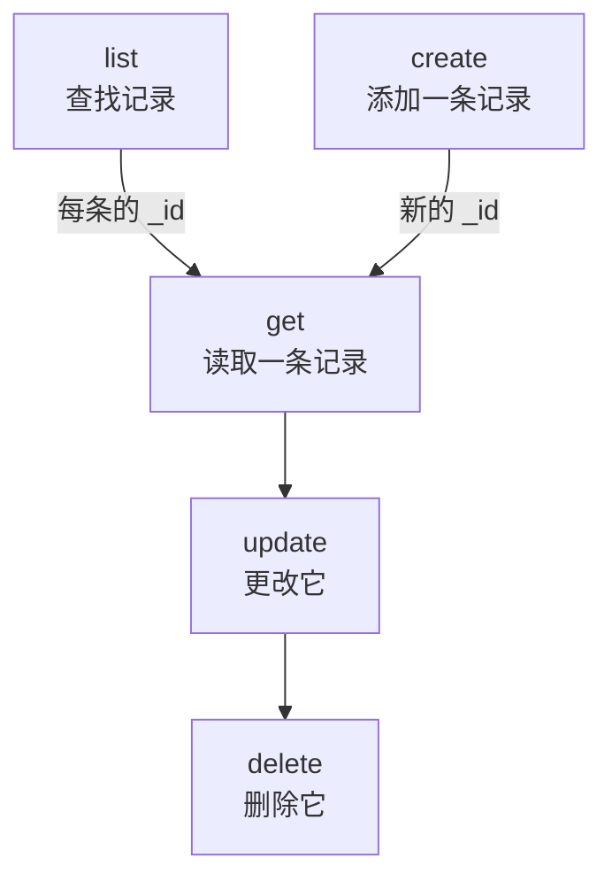

# 资源操作

每种记录都有自己的命令，例如 `incident`、`monitor` 或 `status-page`，并带有 API 为它接受的操作：大多数是 `list`、`get`、`create`、`update`、`delete` 和 `count`。本页介绍每个操作，以及筛选、分页和书写记录所用的标志，还有执行仪表盘按钮所做操作的命令。

:::cards
- [找到某种记录的命令](#找到某种记录的命令): oneuptime resources 会把它们全部列出。
- [列出记录](#列出记录): 筛选、排序和分页。
- [创建记录](#创建记录): 每个字段一个标志，或者以 JSON 给出整条记录。
- [确认、解决和添加备注](#确认解决和添加备注): 把仪表盘的按钮变成命令。
- [删除记录](#删除记录): 立即删除，无法撤销。
:::

## 各操作如何配合

读取、更改和删除记录都需要它的 ID。列出、统计和创建则不需要，而列表或创建的结果会给出其他操作所需的 ID：



ID 是一个 UUID，例如 `6f1c2a40-3b1e-4c55-9a0b-3e2f8d7c1a11`。你也可以在 OneUptime 中该记录的页面上复制它：参见 [查找资源的 ID](/docs/api-reference/api-reference#查找资源的-id)。

## 找到某种记录的命令

```bash
oneuptime resources
```

列表显示每种记录的命令、名称、类型和 API 路径。类型有两种：

| 类型 | 包含的内容 |
| --- | --- |
| `database` | 你管理的记录：监视器、事件、警报、状态页面、团队等 |
| `analytics` | 遥测数据：日志、跨度、指标、异常和其他事件 |

用 `oneuptime resources --type database` 或 `--type analytics` 只显示一种类型。[命令参考](/docs/cli/command-reference#资源) 列出了每条命令。

资源接受 API 为它接受的操作。大多数资源接受全部六种；由 OneUptime 自己写入的资源（例如邮件日志）是只读的。`oneuptime <resource> --help` 列出资源的子命令。

## 查看资源的字段

`fields` 直接从 CLI 本身列出资源的字段，不需要 API 密钥，也不发送请求：

```bash
oneuptime incident fields
```

每个字段都有类型、用途、创建时是否必须提供，以及设置它的标志。保存 ID 的字段会指出该 ID 所属的资源：`incidentSeverityId` 取自 `oneuptime incident-severity list` 的 ID。使用 `-o json` 时，脚本或 AI 代理读取的是相同的内容，每个字段都有相同的键：`name`、`title`、`type`、`description`、`required`、`create`、`update`、`read`、`flag`、`emailFlag` 和 `relatedResource`。

## 列出记录

```bash
oneuptime <resource> list [--query <json>] [--limit <n>] [--skip <n>] [--sort <json>] [--fields <names>] [--all] [-o <format>]
```

| 选项 | 作用 | 默认值 |
| --- | --- | --- |
| `--query <json>` | 只返回匹配的记录：参见 [筛选列表](#筛选列表) | 密钥可读取的所有记录 |
| `--limit <n>` | 最多返回的记录数，最多 10,000 | `10` |
| `--skip <n>` | 先跳过多少条匹配的记录 | `0` |
| `--sort <json>` | 顺序，例如 `{"createdAt":"ASC"}`，或用 `"DESC"` 让最新的排在前面 | 最新的在前 |
| `--fields <names>` | 要返回的字段，用逗号分隔，例如 `title,createdAt` | 密钥可读取的所有字段 |
| `--all` | 逐页返回所有匹配的记录，代替 `--limit` 和 `--skip`。仅限记录 | |
| `-o, --output <format>` | `table`、`json` 或 `wide` | 终端中为 `table`，管道中为 `json` |

```bash
# The ten newest incidents
oneuptime incident list

# The oldest monitors first, 50 at a time: the second page
oneuptime monitor list --sort '{"createdAt":"ASC"}' --limit 50 --skip 50

# Every field of each incident, as JSON
oneuptime incident list -o json

# The title, the state and the creation date of every incident
oneuptime incident list --all --fields title,currentIncidentState.name,createdAt -o json
```

列表会向 OneUptime 请求密钥可读取的每条记录的所有字段。`--fields` 则只请求它指定的字段，点号后面的则是关联记录的字段，例如 `currentIncidentState.name`。表格显示六个字段；JSON 显示全部（参见 [输出格式](/docs/cli/output-formats)）。`--all` 每次读取 100 条记录，逐页读完，最多 100,000 条；`count` 会告诉你总数。

标签按名称排列，而不是最新的在前：名称以数字开头的标签排在前面，按该数字的大小排序（`2. Team` 在 `10. Owner` 之前），其余标签按字母顺序排在后面。要按其他顺序列出，请指定 `--sort`。

### 筛选列表

`--query` 接受与 API 相同的筛选：带值的字段匹配该值，带 `_type` 的对象进行比较。

| 筛选 | 匹配 |
| --- | --- |
| `{"title":"Checkout API is down"}` | 恰好具有该值的记录 |
| `{"title":{"_type":"Search","value":"checkout"}}` | 包含该值的文本 |
| `{"createdAt":{"_type":"GreaterThan","value":"2026-10-01T00:00:00.000Z"}}` | 更晚的日期，或更大的数字 |
| `{"currentIncidentState":{"isResolvedState":false}}` | 资源所指向记录的字段：这里是尚未解决的事件 |

```bash
oneuptime incident list --query '{"title":{"_type":"Search","value":"checkout"}}'
```

API 参考中的 [筛选、排序和分页](/docs/api-reference/api-reference#筛选排序和分页) 列出了每种 `_type`。

## 读取记录

```bash
oneuptime <resource> get <id> [--fields <names>] [-o <format>]
```

```bash
oneuptime incident get 6f1c2a40-3b1e-4c55-9a0b-3e2f8d7c1a11
```

表格为记录的每个字段显示一行，每个值在 60 个字符处截断；`-o json` 显示完整的值。如果 ID 指向的不是你的密钥可读取的记录，会返回 `Not found`，命令以退出码 `3` 结束。

## 创建记录

```bash
oneuptime <resource> create [--<field> <value>]... [--data <json>] [--file <path>] [-o <format>]
```

创建所接受的每个字段都有一个标志：`--title <text>`、`--incident-severity-id <id>`、用于逗号分隔 ID 的 `--labels <ids>`、用于是/否字段且单独给出时为 true 的 `--is-visible-on-status-page [true|false]`，以及用于保存 JSON 的字段的 `--monitor-steps <json>`。`oneuptime <resource> create --help` 会列出它们，[`fields`](#查看资源的字段) 说明每个字段的用途。项目来自 API 密钥，所以记录中从不指定项目。

```bash
# A manual monitor
oneuptime monitor create --name "Checkout API" --monitor-type Manual

# An incident with one of your severities
oneuptime incident create --title "Checkout API is down" --incident-severity-id <severity-id>

# The same incident, from a file
oneuptime incident create --file incident.json
```

`--data` 以 JSON 形式接收记录，`--file` 从 JSON 文件中读取它，使用的都是 API 的字段：[API 参考](/reference) 列出了每个资源的字段。两者都给出时使用文件，而标志会叠加在其中任意一个之上。

用用户 ID 指定某人的字段还有第二个标志，用电子邮件地址指定此人：`--user-email` 对应 `--user-id`，`--owner-user-emails` 对应 `--owner-users`。CLI 会在 API 密钥所属项目的成员和受邀者中查找此人。用项目中无人使用的地址指定的团队成员会被邀请加入项目，与在仪表盘中邀请的效果相同：

```bash
oneuptime team-member create --team-id <team-id> --user-email alice@example.com
```

CLI 会打印新记录及其 `_id`。事件从你项目的已创建状态开始，除非 `currentIncidentStateId` 指定了其他状态：参见 [新记录的初始状态](/docs/api-reference/api-reference#新记录的初始状态)。要查找各严重程度的 ID：

```bash
oneuptime incident-severity list -o json | jq -r '.[] | "\(._id)  \(.name)"'
```

> [!TIP]
> 在 Windows 上，请用标志给出字段，或者把 JSON 写进文件并使用 `--file`：PowerShell 和命令提示符为命令行中的 JSON 加引号的方式与 Bash 不同。

## 更新记录

```bash
oneuptime <resource> update <id> [--<field> <value>]... [--data <json>] [--file <path>] [-o <format>]
```

只给出要更改的字段，可以用标志，也可以用 JSON：

```bash
# Rename a monitor
oneuptime monitor update <monitor-id> --name "Checkout API (EU)"

# Record an incident's root cause
oneuptime incident update <incident-id> --root-cause "A full disk on the primary database"
```

OneUptime 用一个空对象回答更新：CLI 打印一个空行，使用 `-o json` 时打印 `{}`。运行 `get` 查看记录的当前状态。要把事件移到另一个状态，请给出 `--current-incident-state-id`：这次更改会像仪表盘那样记录在它的时间线上，而早于当前状态的状态会被拒绝。[`acknowledge` 和 `resolve`](#确认解决和添加备注) 会替你找到状态。要找到项目顺序中第一个已解决状态的 ID：

```bash
oneuptime incident-state list --query '{"isResolvedState":true}' --sort '{"order":"ASC"}' --limit 1 -o json | jq -r '.[0]._id'
```

## 确认、解决和添加备注

事件、警报、它们的片段以及维护事件都有命令，用来执行仪表盘按钮对它们所做的操作：

| 命令 | 作用 | 资源 |
| --- | --- | --- |
| `acknowledge <id>` | 把记录移到项目的已确认状态 | `incident`, `alert`, `incident-episode`, `alert-episode` |
| `resolve <id>` | 把它移到项目的已解决状态 | 同样这四种 |
| `start <id>` | 把该事件移到项目的进行中状态 | `scheduled-maintenance-event` |
| `end <id>` | 把它移到项目的已结束状态 | `scheduled-maintenance-event` |
| `add-note <id> --note <markdown>` | 添加只有能查看该记录的人才能阅读的备注，加上 `--public` 时则在记录的状态页面上发布备注 | 全部五种 |

```bash
oneuptime incident acknowledge 6f1c2a40-3b1e-4c55-9a0b-3e2f8d7c1a11
oneuptime incident add-note 6f1c2a40-3b1e-4c55-9a0b-3e2f8d7c1a11 --note "Rolled back the 14:05 deploy."
oneuptime incident resolve 6f1c2a40-3b1e-4c55-9a0b-3e2f8d7c1a11
```

`acknowledge` 回答 `Incident 6f1c2a40-3b1e-4c55-9a0b-3e2f8d7c1a11 acknowledged: it is in Acknowledged now.` 已处于该状态或之后状态的记录保持不变：命令会说明这一点，并以 `0` 退出。使用 `-o json` 时，它回答记录的 `_id`、`action`、表示是否有更改的 `changed`，以及记录所处的 `state`。警报和警报片段只接受内部备注。

## 删除记录

```bash
oneuptime <resource> delete <id>
```

```bash
oneuptime monitor delete 6f1c2a40-3b1e-4c55-9a0b-3e2f8d7c1a11
```

它回答 `Monitor 6f1c2a40-3b1e-4c55-9a0b-3e2f8d7c1a11 deleted successfully.` 使用 `-o json` 时，它回答记录的 `_id` 和 `"deleted": true`。

> [!CAUTION]
> `delete` 会立即删除记录。CLI 不会请你确认，也无法撤销。它接受 `--force`，以兼容带有该标志的脚本，但 `--force` 不会改变任何行为。

## 统计记录

```bash
oneuptime <resource> count [--query <json>]
```

```bash
# Every incident
oneuptime incident count

# Incidents that are not resolved
oneuptime incident count --query '{"currentIncidentState":{"isResolvedState":false}}'
```

CLI 只打印一个数字，在表格和 JSON 中都一样，所以脚本可以直接读取它。

## 故障排除

:::details 消息“Not found: API error (404)”
该记录不存在、位于其他项目，或者密钥无法读取它：OneUptime 对每种情况的回答都相同。用 `list` 检查 ID，并检查密钥的权限。命令以退出码 `3` 结束。
:::

:::details 消息“Left out fields this API key may not read”
列表或读取会请求记录的所有字段，而 OneUptime 会拒绝密钥无法读取的字段：CLI 会去掉该字段重新请求，并在标准错误中指出被省略的字段。请为密钥分配可以读取这些字段的权限，或者用 `--fields` 指定你需要的字段：如果指定的字段密钥无法读取，命令会以 `API error (422)` 停止。
:::

:::details 消息“Error: Invalid JSON”
`--query`、`--sort` 或 `--data` 的值不是 JSON。在 Bash 和 zsh 中用单引号把它括起来；在 Windows 上用标志给出字段，或者把记录写进文件并使用 `--file`。
:::

:::details 创建或更新时返回 API error (400)
OneUptime 拒绝了某个字段：消息会指出它，`oneuptime <resource> fields` 会列出字段以及设置它们的标志。完全没有给出字段的命令会在发送前被拒绝，并列出应给出的标志。
:::

:::details 消息“No one in this project, or invited to it, has the email address”
电子邮件标志指定的人既不是 API 密钥所属项目的成员，也未受邀加入。请用 `oneuptime team-member create --team-id <team-id> --user-email <email>` 邀请此人，或改用用户 ID 指定。
:::

## 后续步骤

:::cards
- [输出格式](/docs/cli/output-formats): 以表格或 JSON 形式读取回答。
- [脚本与 CI/CD](/docs/cli/scripting): 在脚本和流水线中使用这些操作。
- [命令参考](/docs/cli/command-reference): 每条命令、选项和默认值。
:::
