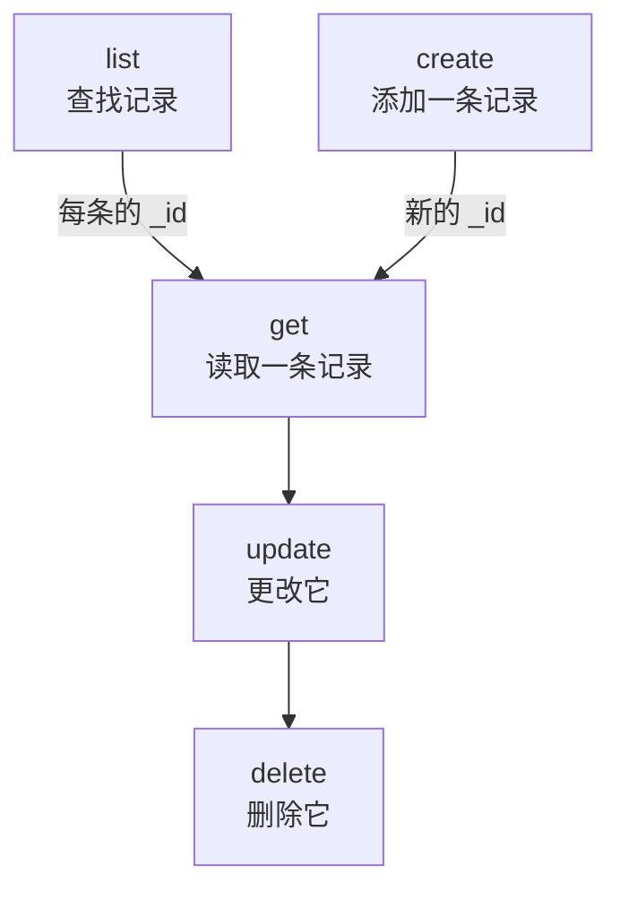

# 资源操作

每种记录都有自己的命令，例如 `incident`、`monitor` 或 `status-page`，它们都接受相同的操作：`list`、`get`、`create`、`update`、`delete` 和 `count`。本页介绍每个操作，以及筛选、分页和书写记录所用的 JSON。

:::cards
- [找到某种记录的命令](#找到某种记录的命令): oneuptime resources 会把它们全部列出。
- [列出记录](#列出记录): 筛选、排序和分页。
- [创建记录](#创建记录): 来自命令行或文件中的 JSON。
- [删除记录](#删除记录): 立即删除，无法撤销。
:::

## 各操作如何配合

读取、更改和删除记录都需要它的 ID。列出、统计和创建则不需要，而列表或创建的结果会给出其他操作所需的 ID：



ID 是一个 UUID，例如 `6f1c2a40-3b1e-4c55-9a0b-3e2f8d7c1a11`。你也可以在 OneUptime 中该记录的页面上复制它：参见 [查找资源的 ID](/docs/api-reference/api-reference#查找资源的-id)。

## 找到某种记录的命令

```bash
oneuptime resources
```

列表显示每种记录的命令、名称、类型和 API 路径。类型有两种：

| 类型 | 包含什么 | 操作 |
| --- | --- | --- |
| `database` | 你管理的记录：监视器、事件、警报、状态页面、团队等 | `list`, `get`, `create`, `update`, `delete`, `count` |
| `analytics` | 遥测数据：日志、跨度、指标、异常和其他事件 | `list`, `create`, `count` |

用 `oneuptime resources --type database` 或 `--type analytics` 只显示一种类型。[命令参考](/docs/cli/command-reference#资源) 列出了每条命令。

## 列出记录

```bash
oneuptime <resource> list [--query <json>] [--limit <n>] [--skip <n>] [--sort <json>] [-o <format>]
```

| 选项 | 作用 | 默认值 |
| --- | --- | --- |
| `--query <json>` | 只返回匹配的记录：参见 [筛选列表](#筛选列表) | 密钥可读取的所有记录 |
| `--limit <n>` | 最多返回的记录数，最多 10,000 | `10` |
| `--skip <n>` | 先跳过多少条匹配的记录 | `0` |
| `--sort <json>` | 顺序，例如 `{"createdAt":"ASC"}`，或用 `"DESC"` 让最新的排在前面 | 最新的在前 |
| `-o, --output <format>` | `table`、`json` 或 `wide` | 终端中为 `table`，管道中为 `json` |

```bash
# The ten newest incidents
oneuptime incident list

# The oldest monitors first, 50 at a time: the second page
oneuptime monitor list --sort '{"createdAt":"ASC"}' --limit 50 --skip 50

# Every field of each incident, as JSON
oneuptime incident list -o json
```

列表会向 OneUptime 请求密钥可读取的每条记录的所有字段。表格显示其中六个；JSON 显示全部（参见 [输出格式](/docs/cli/output-formats)）。要翻阅所有记录，按 `--limit` 递增 `--skip`，直到某一页返回为空；`count` 会告诉你总数。

### 筛选列表

`--query` 接受与 API 相同的筛选：带值的字段匹配该值，带 `_type` 的对象进行比较。

| 筛选 | 匹配 |
| --- | --- |
| `{"title":"Checkout API is down"}` | 恰好具有该值的记录 |
| `{"title":{"_type":"Search","value":"checkout"}}` | 包含该值的文本 |
| `{"createdAt":{"_type":"GreaterThan","value":"2026-10-01T00:00:00.000Z"}}` | 更晚的日期，或更大的数字 |
| `{"currentIncidentState":{"isResolvedState":false}}` | 资源所指向记录的字段：这里是尚未解决的事件 |

```bash
oneuptime incident list --query '{"title":{"_type":"Search","value":"checkout"}}'
```

API 参考中的 [筛选、排序和分页](/docs/api-reference/api-reference#筛选排序和分页) 列出了每种 `_type`。

## 读取记录

```bash
oneuptime <resource> get <id> [-o <format>]
```

```bash
oneuptime incident get 6f1c2a40-3b1e-4c55-9a0b-3e2f8d7c1a11
```

表格为记录的每个字段显示一行，每个值在 60 个字符处截断；`-o json` 显示完整的值。如果 ID 指向的不是你的密钥可读取的记录，会返回 `Not found`，命令以退出码 `3` 结束。

## 创建记录

```bash
oneuptime <resource> create --data <json> [-o <format>]
oneuptime <resource> create --file <path> [-o <format>]
```

`--data` 以 JSON 形式接收记录，`--file` 从 JSON 文件中读取它。二者给出其一即可；两者都给出时使用文件。字段就是 API 的字段，[API 参考](/reference) 列出了每个资源的字段。项目来自 API 密钥，所以记录中从不指定项目。

```bash
# A manual monitor
oneuptime monitor create --data '{"name":"Checkout API","monitorType":"Manual"}'

# An incident with one of your severities
oneuptime incident create --data '{"title":"Checkout API is down","incidentSeverityId":"<severity-id>"}'

# The same incident, from a file
oneuptime incident create --file incident.json
```

CLI 会打印新记录及其 `_id`。事件从你项目的已创建状态开始，除非 `currentIncidentStateId` 指定了其他状态：参见 [新记录的初始状态](/docs/api-reference/api-reference#新记录的初始状态)。要查找各严重程度的 ID：

```bash
oneuptime incident-severity list -o json | jq -r '.[] | "\(._id)  \(.name)"'
```

> [!TIP]
> 在 Windows 上，把 JSON 写进文件并使用 `--file`：PowerShell 和命令提示符为命令行中的 JSON 加引号的方式与 Bash 不同。

## 更新记录

```bash
oneuptime <resource> update <id> --data <json> [-o <format>]
```

`--data` 是必需的，只包含要更改的字段：

```bash
# Rename a monitor
oneuptime monitor update <monitor-id> --data '{"name":"Checkout API (EU)"}'

# Move an incident to your resolved state
oneuptime incident update <incident-id> --data '{"currentIncidentStateId":"<resolved-state-id>"}'
```

OneUptime 用一个空对象回答更新：CLI 打印一个空行，使用 `-o json` 时打印 `{}`。运行 `get` 查看记录的当前状态。用这种方式把事件移到另一个状态，会像仪表盘那样在它的时间线上记录这次更改，而早于当前状态的状态会被拒绝。要查找已解决状态（在你项目的顺序中排第一个）的 ID：

```bash
oneuptime incident-state list --query '{"isResolvedState":true}' --sort '{"order":"ASC"}' --limit 1 -o json | jq -r '.[0]._id'
```

## 删除记录

```bash
oneuptime <resource> delete <id>
```

```bash
oneuptime monitor delete 6f1c2a40-3b1e-4c55-9a0b-3e2f8d7c1a11
```

它回答 `Monitor 6f1c2a40-3b1e-4c55-9a0b-3e2f8d7c1a11 deleted successfully.`

> [!CAUTION]
> `delete` 会立即删除记录。CLI 不会请你确认，也无法撤销。它接受 `--force`，以兼容带有该标志的脚本，但 `--force` 不会改变任何行为。

## 统计记录

```bash
oneuptime <resource> count [--query <json>]
```

```bash
# Every incident
oneuptime incident count

# Incidents that are not resolved
oneuptime incident count --query '{"currentIncidentState":{"isResolvedState":false}}'
```

CLI 只打印一个数字，在表格和 JSON 中都一样，所以脚本可以直接读取它。

## 每种类型能做什么

| 操作 | `database` | `analytics` |
| --- | --- | --- |
| `list` | 是 | 是 |
| `get` | 是 | 否 |
| `create` | 是 | 是 |
| `update` | 是 | 否 |
| `delete` | 是 | 否 |
| `count` | 是 | 是 |

## 故障排除

:::details 消息“Not found: API error (404)”
该记录不存在、位于其他项目，或者密钥无法读取它：OneUptime 对每种情况的回答都相同。用 `list` 检查 ID，并检查密钥的权限。命令以退出码 `3` 结束。
:::

:::details 消息“API error (422): You do not have permissions to select on”
列表或读取会请求记录的所有字段，而密钥无法读取其中一个：消息会指出该字段以及可以读取它的权限。为密钥分配其中一个权限。
:::

:::details 消息“Error: Invalid JSON”
`--query`、`--sort` 或 `--data` 的值不是 JSON。在 Bash 和 zsh 中用单引号把它括起来；在 Windows 上把记录写进文件并使用 `--file`。
:::

:::details 创建或更新时返回 API error (400)
OneUptime 拒绝了某个字段：消息会指出它。`No fields to update` 表示 `--data` 中没有要更改的字段。
:::

## 后续步骤

:::cards
- [输出格式](/docs/cli/output-formats): 以表格或 JSON 形式读取回答。
- [脚本与 CI/CD](/docs/cli/scripting): 在脚本和流水线中使用这些操作。
- [命令参考](/docs/cli/command-reference): 每条命令、选项和默认值。
:::
