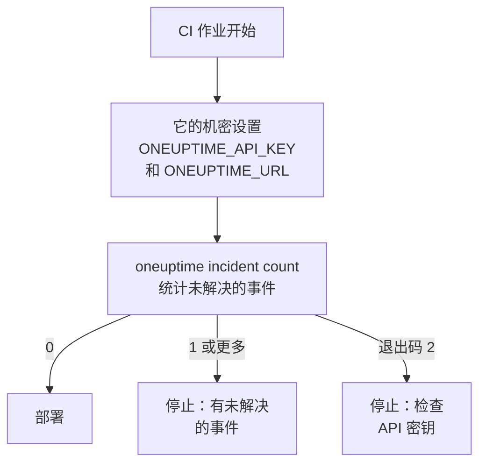

# 脚本与 CI/CD

CLI 在脚本中的工作方式与在终端中相同。通过环境变量给它 API 密钥，把它的回答当作 JSON 读取，并让它的退出码告诉脚本发生了什么。本页介绍其中的每一项，以及适用于 GitHub Actions、GitLab CI 和 Docker 的完整流水线。

:::cards
- [为脚本提供 API 密钥](#为脚本提供-api-密钥): 两个环境变量，无需保存的上下文。
- [退出码](#退出码): 成功时为 0，失败时说明原因。
- [用 jq 读取回答](#用-jq-读取回答): 从 JSON 中取出 ID、标题和日期。
- [流水线示例](#流水线示例): GitHub Actions、GitLab CI 和 Docker。
:::

## 脚本如何使用 CLI

部署可以先询问 OneUptime 是否有未解决的事件，如果有就停止：



## 为脚本提供 API 密钥

从 CI 系统的机密中设置 `ONEUPTIME_API_KEY` 和 `ONEUPTIME_URL`。这样 CLI 既不需要 `login`，也不需要配置文件。对单条命令而言，标志仍然优先于它们，而它们优先于已保存的上下文。

```bash
export ONEUPTIME_API_KEY="$CI_ONEUPTIME_API_KEY"
export ONEUPTIME_URL="https://oneuptime.com"
oneuptime incident count
```

> [!TIP]
> 为每条流水线提供专属的 API 密钥，只赋予它需要的访问权限：只读取的检查只需要只读取的密钥。流水线停用时，在 OneUptime 中删除该密钥。

如果一台机器为多个项目运行作业，请为每个项目保存一个上下文，并在每条命令中指定它，这样作业永远不会使用另一个作业的当前上下文：

```bash
oneuptime --context production incident count
oneuptime --context staging monitor count
```

## 退出码

| 代码 | 含义 | 示例 |
| --- | --- | --- |
| `0` | 成功 | 一次列出，即使什么都没找到 |
| `1` | 失败 | OneUptime 拒绝了请求，例如 `API error (422)`；无效的 JSON；缺少或未知的选项；未保存的上下文 |
| `2` | 没有可用的 API 密钥 | 找不到凭据；无效的 API 密钥；低于其套餐的密钥（`402`）；`401` |
| `3` | 未找到 | OneUptime 返回 `404`：记录不存在、位于其他项目，或密钥无法读取它 |

即使什么都没有保存，`whoami` 和 `context current` 也以 `0` 结束：它们报告已设置的内容，但不检查它。脚本通过退出码区分各种情况：

```bash
oneuptime incident get "$INCIDENT_ID" -o json > incident.json
case $? in
  0) echo "Saved the incident to incident.json" ;;
  2) echo "Check ONEUPTIME_API_KEY and ONEUPTIME_URL" >&2; exit 1 ;;
  3) echo "There is no incident $INCIDENT_ID" >&2; exit 1 ;;
  *) echo "OneUptime refused the request" >&2; exit 1 ;;
esac
```

错误消息输出到标准错误，因此 `incident.json` 只包含回答。

## 用 jq 读取回答

在脚本中写上 `-o json`。在管道中 CLI 本来就会打印 JSON，但有了这个标志，脚本在任何地方运行都能正常工作：

```bash
# The title of each incident
oneuptime incident list -o json | jq -r '.[].title'

# The ID of a new monitor
MONITOR_ID=$(oneuptime monitor create --data '{"name":"Checkout API","monitorType":"Manual"}' -o json | jq -r '._id')

# When each incident was created: dates come as objects
oneuptime incident list -o json | jq -r '.[] | "\(.createdAt.value)  \(.title)"'

# The newest 100 incidents as CSV
oneuptime incident list --limit 100 -o json | jq -r '.[] | [._id, .title, .createdAt.value] | @csv'
```

统计只打印一个数字，可直接用于比较：

```bash
OPEN=$(oneuptime incident count --query '{"currentIncidentState":{"isResolvedState":false}}')
echo "$OPEN incidents are open"
```

## 从文件创建记录

把记录作为 JSON 文件放在代码旁边，并从那里创建它们：

```json title="monitors/checkout-api.json"
{
  "name": "Checkout API",
  "monitorType": "Manual"
}
```

```bash
oneuptime monitor create --file monitors/checkout-api.json
```

从一个 JSON 数组创建多条记录，每条创建一次：

```bash
jq -c '.[]' monitors.json | while IFS= read -r monitor; do
  oneuptime monitor create --data "$monitor" -o json | jq -r '._id'
done
```

> [!NOTE]
> 每次运行都会创建新记录。要让监视器和状态页面与文件保持同步，只更改变化的部分并删除已不存在的部分，请使用 [Terraform 提供程序](/docs/terraform/index)。

## 流水线示例

:::tabs
@tab GitHub Actions
```yaml title=".github/workflows/deploy.yml"
name: Deploy
on:
  push:
    branches: [main]

jobs:
  deploy:
    runs-on: ubuntu-latest
    steps:
      - uses: actions/checkout@v4
      - uses: actions/setup-node@v4
        with:
          node-version: lts/*
      - name: Install the OneUptime CLI
        run: npm install -g @oneuptime/cli
      - name: Stop while an incident is open
        env:
          ONEUPTIME_API_KEY: ${{ secrets.ONEUPTIME_API_KEY }}
          ONEUPTIME_URL: https://oneuptime.com
        run: |
          OPEN=$(oneuptime incident count --query '{"currentIncidentState":{"isResolvedState":false}}')
          if [ "$OPEN" -gt 0 ]; then
            echo "$OPEN incidents are open: not deploying."
            exit 1
          fi
      - name: Deploy
        run: ./deploy.sh
```
@tab GitLab CI
```yaml title=".gitlab-ci.yml"
check-incidents:
  stage: test
  image: node:lts
  variables:
    ONEUPTIME_URL: https://oneuptime.com
  script:
    - npm install -g @oneuptime/cli
    - OPEN=$(oneuptime incident count --query '{"currentIncidentState":{"isResolvedState":false}}')
    - echo "$OPEN incidents are open"
    - test "$OPEN" -eq 0
```
@tab Docker
```dockerfile title="Dockerfile"
FROM node:lts-slim
RUN npm install -g @oneuptime/cli
ENTRYPOINT ["oneuptime"]
```
:::

在 GitHub Actions 中，在仓库的 **Settings → Secrets and variables → Actions** 下添加 `ONEUPTIME_API_KEY`；在 GitLab 中，把它添加为掩码 CI/CD 变量。使用 Docker 镜像时，每次运行都传入这些变量：

```bash
docker build -t oneuptime-cli .
docker run --rm -e ONEUPTIME_API_KEY -e ONEUPTIME_URL oneuptime-cli incident count
```

## 后续步骤

:::cards
- [认证](/docs/cli/authentication): 设置了多个密钥时命令使用哪一个。
- [输出格式](/docs/cli/output-formats): 你的脚本读取的 JSON。
- [资源操作](/docs/cli/resource-operations): 筛选、分页和记录的字段。
- [Terraform 提供程序](/docs/terraform/index): 把 OneUptime 的配置保存在文件中。
:::
