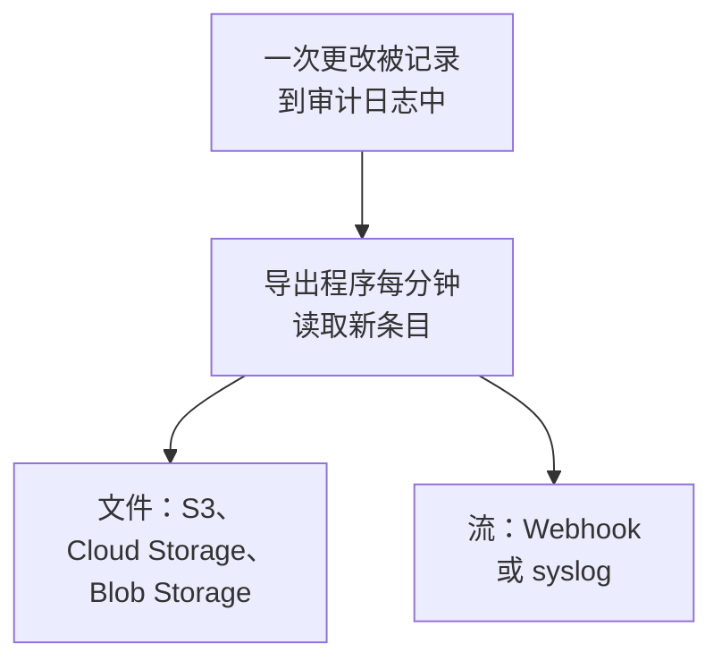

# 审计日志导出

在审计日志记录时，将其发送到你选择的存储或服务：Amazon S3 或 S3 兼容存储、Google Cloud Storage、Azure Blob Storage、Webhook 或 syslog。条目可以在那里保存到合规审查需要的时长，并在你的 SIEM 中搜索。项目的所有者和管理员在项目设置中导出该项目的审计日志，主管理员在 Admin Dashboard 中导出所有项目的审计日志。在 OneUptime Cloud 上它属于 Enterprise 套餐，自托管时属于 Enterprise Edition。

:::cards
- [设置导出](#设置导出): 选择目标，测试，然后保存。
- [发送的内容](#发送的内容): 每个条目一个 JSON 对象，采用稳定的结构。
- [条目何时发送](#条目何时发送): 每分钟一次，每个条目只发送一次，按顺序。
- [目标失败时](#目标失败时): 重试、错误信息，并且不会跳过任何条目。
:::

## 条目如何到达你的目标



- **一个导出，一个目标。** 一个项目可以有多个导出，每个导出都会把所有条目发送到自己的目标。
- **项目的导出，或实例的导出。** 项目的导出发送该项目的条目。在 Admin Dashboard 中设置的导出会发送所有记录审计日志的项目的条目。
- **从保存时开始。** 导出发送保存之后记录的内容，除非你把**导出起始时间**设为更早的日期。

## 开始之前

- **在 OneUptime Cloud 上：Enterprise 套餐。** 在其他套餐上，此页面会显示该功能的作用以及如何获得。
- **自托管时：Enterprise Edition**，以及包含审计日志的许可证。参见[企业版](/docs/self-hosted/enterprise)。
- **已开启审计日志**：在你要导出的每个项目中开启。参见[审计日志](/docs/configuration/audit-logs)。
- **Project Owner 或 Project Admin** 才能导出项目的审计日志，导出实例的审计日志则需要主管理员。

## 设置导出

:::steps
### 打开导出页面

对于项目，前往**项目设置 → 审计日志 → 导出**。对于整个实例，在 Admin Dashboard 中前往**设置 → 审计日志导出**。

### 选择目标

点击**添加导出**，从下面六个目标中选择一个。导出的目标之后无法更改。

### 填写如何连接

填写目标需要的内容。大多数人保持不变的设置位于**更多字段**中，**设置指南**会打开本页上该目标的章节。

### 发送测试

点击**写入测试文件**或**发送测试条目**。存储会在其文件夹中收到文件 `oneuptime-audit-log-export-test.ndjson.gz`，Webhook 或 syslog 会收到一个操作为 `Test` 的条目。测试失败时会说明需要修正什么。

### 开始导出

点击**下一步**，为导出命名，然后点击**开始导出**。第一批条目会在几分钟内到达。
:::

导出所在的行会显示其状态：**正在导出**、**失败**、**已暂停**、**等待条目**或**正在启动**。**发送测试**会使用已保存的设置发送一次测试，**编辑**用于更改设置：留空的凭据会保留已保存的值。

## 目标

| 目标 | 收到的内容 | 登录方式 |
| --- | --- | --- |
| [Amazon S3](#amazon-s3) | 压缩的 NDJSON 文件 | 访问密钥 |
| [S3 兼容存储](#s3-兼容存储) | 压缩的 NDJSON 文件 | 访问密钥 |
| [Google Cloud Storage](#google-cloud-storage) | 压缩的 NDJSON 文件 | 服务账号密钥 |
| [Azure Blob Storage](#azure-blob-storage) | 压缩的 NDJSON 文件 | SAS 令牌或访问密钥 |
| [Webhook](#webhook) | HTTPS 请求 | 可选的标头和签名密钥 |
| [Syslog](#syslog) | RFC 5424 消息 | 无 |

### Amazon S3

| 字段 | 填写内容 |
| --- | --- |
| **存储桶** | 文件写入的存储桶。 |
| **区域** | 存储桶所在的区域。初始值为 `us-east-1`。 |
| **访问密钥 ID** | 可以向存储桶写入对象的访问密钥。 |
| **秘密访问密钥** | 该密钥的秘密。 |
| **文件夹** | 位于**更多字段**中。留空时，文件写入 `oneuptime/audit-logs/`。 |

该密钥只需要对文件夹拥有 `s3:PutObject` 权限：

```json
{
  "Version": "2012-10-17",
  "Statement": [
    {
      "Effect": "Allow",
      "Action": "s3:PutObject",
      "Resource": "arn:aws:s3:::my-audit-logs/oneuptime/audit-logs/*"
    }
  ]
}
```

### S3 兼容存储

字段与 Amazon S3 相同，另外先填写**端点**：存储的 S3 地址，例如 `https://minio.example.com:9000` 或 `https://<account>.r2.cloudflarestorage.com`。将**区域**设为存储要求的值：MinIO 和 Wasabi 的默认值为 `us-east-1`，Cloudflare R2 为 `auto`。

### Google Cloud Storage

填写**存储桶**，并粘贴一个**服务账号密钥**（JSON），该服务账号需要在存储桶上拥有 Storage Object Creator 角色。**文件夹**位于**更多字段**中。

### Azure Blob Storage

填写**存储账户**和**容器**，并选择**登录方式**：在容器上拥有 Create 和 Write 权限的**SAS 令牌**，或存储账户的**访问密钥**。SAS 令牌可以只限于此容器，因此是更安全的选择。**云**和**文件夹**位于**更多字段**中。

### Webhook

OneUptime 将每个批次以 POST 方式发送到 **URL**，按照**正文格式**的设置，以 JSON 数组（`application/json`）或每行一个条目（`application/x-ndjson`）的形式发送，并带有以下标头：

| 标头 | 值 |
| --- | --- |
| `X-OneUptime-Event` | `audit-log-export` |
| `X-OneUptime-Batch-Id` | 批次中第一个条目的 ID：同一批次再次发送时带有相同的 ID。 |
| `X-OneUptime-Entry-Count` | 正文中包含的条目数。 |
| `X-OneUptime-Signature` | 设置了**签名密钥**时，为 `sha256=` 加上用它计算的正文 HMAC-SHA256。 |

**凭据**（例如 `Bearer <token>`）通过你在**标头名称**中选择的标头发送，未更改时为 `Authorization`。**正文格式**、**标头名称**和**签名密钥**位于**更多字段**中。任何 2xx 响应都算作送达。`413` 会把批次一分为二，其他任何拒绝都会在稍后重新发送整个批次。

### Syslog

每个条目是一条发送到**主机**和**端口**的 RFC 5424 消息，除非**协议**选择 TCP，否则通过 TLS 发送到端口 `6514`，facility 为 13（log audit），severity 为 6（informational）：

```text
<110>1 2026-10-24T09:15:03.000Z oneuptime.example.com oneuptime - audit-log - {"schemaVersion":1,"id":"..."}
```

消息按八位字节计数（RFC 5425）分帧，除非**分帧方式**选择每行一条消息。如果接收方的证书由私有 CA 签发，需要在 **CA 证书**中填写该 CA 的证书。这两项都位于**更多字段**中。

## 发送的内容

每个条目是一个 JSON 对象，其键始终按以下顺序排列：

| 键 | 包含的内容 |
| --- | --- |
| `schemaVersion` | `1`。结构的变更会随新版本一起发布。 |
| `id` | 条目的 ID。同一条目发送两次时 ID 相同。 |
| `createdAt` | 更改被记录的时间，采用 UTC。 |
| `projectId` | 进行更改的项目。 |
| `action` | `Create`、`Update`、`Delete` 或 `Download`。 |
| `resourceType`, `resourceId`, `resourceName` | 被更改的内容。 |
| `rootResourceType`, `rootResourceId` | 它所属的资源，例如规则所属的 SLO。 |
| `userId`, `userName`, `userEmail`, `userType` | 进行更改的人。 |
| `apiKeyId`, `apiKeyName` | 进行更改所用的 API 密钥（如有）。 |
| `mcpOAuthGrantId`, `mcpClientName` | 进行更改所经由的 MCP 客户端（如有）。 |
| `workflowId`, `workflowName` | 进行更改的工作流（如有）。 |
| `changes` | 每个被更改的字段：`field`，以及 `oldValue` 和 `newValue`。 |

文件每行一个条目，使用 gzip 压缩，并按其第一个条目所在的小时归档：`oneuptime/audit-logs/2026/10/24/09/20261024T091503Z_<first entry id>.ndjson.gz`。

密钥、令牌和密码永远不会外发：它们被记录为 `[REDACTED]`，任何人都无权读取的字段不会出现在任何条目中。

## 条目何时发送

- **每分钟。** 记录时间超过一分钟的条目会按从旧到新的顺序读取，并分批发送：每个文件最多 5,000 个条目或 16 MB，每个 Webhook 请求或 syslog 连接最多 500 个条目。
- **不会为每个条目都写一个文件。** 当批次已满，或其第一个条目已有五分钟时，才写入文件。
- **每个条目只发送一次，按顺序。** 每次送达后，导出都会记住最后发送的条目，因此重启或其他工作进程会从那里继续。
- **重复可以识别。** 崩溃后重新发送的批次会写入相同的文件名，或带有相同的 `X-OneUptime-Batch-Id`，并且每个条目都带有其 `id`。

## 目标失败时

一个批次会尝试三次，每次间隔几秒，之后导出会等待一段时间再重试：先是一分钟，然后两分钟、四分钟，依此类推，最长一小时。其所在行显示**失败**，**查看错误**会显示目标的响应以及下次尝试的时间。

不会跳过任何条目：条目在审计日志中等待，下一次成功的送达会从最旧的条目开始追赶。但无论是否已发送，每个条目一旦早于记录时的保留期就会被删除，因此请在该期限内修复失败的导出。延长保留期只会让更改之后记录的条目保存得更久。

失败的导出会给能修复它的人发送邮件：项目的导出发给项目所有者，实例的导出发给所有主管理员。第一封邮件在连续失败 30 分钟后发出，附上目标的响应。第二封邮件在导出尚未发送的最旧条目被删除前一天发出，说明条目从何时开始丢失。失败持续期间每封邮件只发一次，一次成功的送达会让两封都重新开始。

要暂停导出，请在其所在行的菜单中选择**关闭**：它会保留自己的位置，**开启**后会发送期间记录的内容。在 OneUptime Cloud 上，离开 Enterprise 套餐的项目会停止导出，其导出会在升级卡片下等待，可以在那里关闭或删除。自托管时，只要许可证不包含审计日志，导出就会停止，一旦许可证包含审计日志，就会从停止处继续。

## 故障排除

:::details 测试提示访问被拒绝
密钥、令牌或服务账号无权写入导出所写的位置。按照上面各目标章节的说明，授予它在文件夹中创建对象的权限，然后再次发送测试。
:::

:::details 测试无法访问该地址
OneUptime Cloud 上的项目导出无法访问私有网络地址。自托管时可以访问，除非 `DATA_SOURCE_BLOCK_PRIVATE_ADDRESSES` 为 `true`，而在 Admin Dashboard 中设置的导出始终可以访问。环回地址和链路本地地址永远不会被访问。
:::

:::details 什么都没有收到
检查项目中是否已开启审计日志，以及保存导出后是否有人更改过内容。存储只有在批次已满或已有五分钟时才会收到文件。
:::

## 后续步骤

:::cards
- [审计日志](/docs/configuration/audit-logs): 记录哪些内容，以及保留多久。
- [用户、团队与权限](/docs/permissions/index): 决定谁可以设置导出。
- [企业版](/docs/self-hosted/enterprise): 自托管安装上的审计日志。
:::
