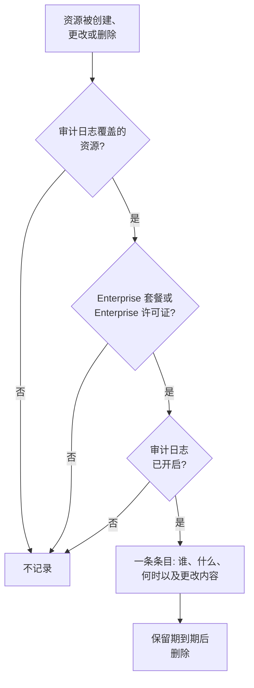

# 审计日志

审计日志记录谁在你的项目中更改了什么：它所覆盖资源的每一次创建、更改和删除，以及更改前后的值。用它查明谁关闭了某个监视器或更改了某个 API 密钥，并为合规审查保留记录。在 OneUptime Cloud 上它属于 Enterprise 套餐，自托管时属于 Enterprise Edition。

:::cards
- [开启审计日志](#开启审计日志): 所有项目默认关闭。
- [阅读审计日志](#阅读审计日志): 谁在何时更改了什么。
- [记录哪些内容](#记录哪些内容): 它覆盖的资源和操作。
- [条目保留多久](#条目保留多久): 7 到 180 天。
:::

## 更改如何成为条目

- **默认关闭。** 在有人开启审计日志之前，项目不会记录任何内容，也不会记录开启之前发生的事。
- **记录人们所做的事。** 由人员、API 密钥、MCP 客户端或工作流做出的更改会被记录。OneUptime 自身做出的更改（例如来自后台任务的更改）不会被记录，除非你打开**存储系统事件**。
- **条目无法更改。** 任何人都无法在仪表板中或通过 API 编辑或删除条目。条目只有在保留期到期时才会消失。

## 开始之前

- **在 OneUptime Cloud 上：Enterprise 套餐。** 在其他套餐上，审计日志页面会显示该功能的作用以及如何获得。
- **自托管时：Enterprise Edition**，以及包含审计日志的许可证。参见[企业版](/docs/self-hosted/enterprise)。
- **可以读取审计日志的角色。** Project Owner、Project Admin、Settings Admin 或 **Read Audit Log** 权限。开启审计日志和更改其设置需要 Project Owner、Project Admin 或编辑项目的权限。

## 开启审计日志

:::steps
### 打开审计日志设置

前往**项目设置 → 审计日志 → 设置**。**审计日志**在侧边菜单中默认折叠：点击它即可展开。

### 编辑设置

点击 **Edit Audit Log Settings**。

### 开启

打开**启用审计日志**，设置**保留时长（天）**，并选择是否**存储系统事件**。点击**保存更改**。
:::

| 设置 | 初始值 | 作用 |
| --- | --- | --- |
| **启用审计日志** | 关闭 | 从现在起记录项目资源的更改。 |
| **保留时长（天）** | 7 | 每个条目保留的天数：7 到 180。 |
| **存储系统事件** | 关闭 | 同时记录 OneUptime 自身做出的、不是由人员或密钥发起的更改。 |

对这些设置的更改会在一分钟内生效。

## 阅读审计日志

**项目设置 → 审计日志 → 审计日志**列出项目中的每个条目，最新的在前：

| 列 | 显示内容 |
| --- | --- |
| **何时** | 多久以前，附带日期和时间。 |
| **操作** | `Create`、`Update` 或 `Delete`，或者对于有人下载的抓包文件为 `Download`。 |
| **资源** | 资源名称（资源存在时可点击打开）及其类型。 |
| **执行者** | 做出更改的主体：人员、API 密钥、工作流，或对于 OneUptime 自身做出的更改为 `System`。人员通过 MCP 客户端做出的更改会注明是哪个客户端。 |
| **更改** | 更改了多少个字段，或在创建或删除时记录了多少个字段。点击可查看每个字段。 |

按**资源类型**、**资源名称**、**操作**、**用户电子邮件**或**时间**筛选。更改只显示被更改的字段及其前后值，未做任何更改的保存不会添加条目。

没有自身名称的资源，会以 OneUptime 中指代它的内容命名：异常以其类型和消息的开头命名，其中的 ID、地址以及任何看起来像机密的内容都会被遮盖；Runbook 的执行以其 Runbook 命名；来电策略的电话号码以该号码命名；模板或域名以其自身的名称命名。

监视器、事件、警报、状态页面、SLO 以及许多其他资源，在其侧边菜单的折叠部分（如**高级**）中也有自己的**审计日志**页面。它只显示该资源的条目，以及属于它的内容的条目：SLO 的页面还会显示其规则和所有者。

## 记录哪些内容

人们在项目中创建、更改或删除的一切都会被记录：监视器、事件、告警、状态页、工作流及其步骤、队列、仪表板、值班策略、团队及其成员、API 密钥以及每一项设置。**资源类型** 说明条目所涉及的内容，例如 `Monitor`、`Workflow` 或 `Queue`。

| 不记录的内容 | 原因 |
| --- | --- |
| 消息日志 | 每一条本身就是 OneUptime 发送或接收的电子邮件、短信、电话、推送通知或聊天消息的记录。 |
| 运行记录 | 每一条本身就是一次工作流运行、值班升级、扫描、导入或 AI 运行的记录。 |
| 代理和遥测上报的内容 | 发现的资源、读数和用量随每次上报而变化，并不是因为有人更改了它们。 |
| 活动动态 | 动态显示的是审计日志已经记录的更改。 |
| OneUptime 的工作状态 | 会话、排队的作业以及 OneUptime 在工作时保留的其他状态。 |
| 个人自己的通知设置 | 每个人的地址、号码和个人值班规则只属于其本人。 |

当管理员在他人的账户上添加或移除通知方式或个人值班规则时，也会记录，但不包含地址或号码本身。

只有 OneUptime 写入的字段（例如主机最后一次被看到的时间）会从所有条目中省略，任何人都无权读取的字段也是如此。当 OneUptime 应某人的请求写入这类字段时（例如把一个异常合并到另一个异常，或重置 Webhook URL），条目会将其记录为此人的更改。密钥、令牌和密码记录为 `[REDACTED]`：条目只显示它们已更改，绝不显示其值。工作流的步骤会按照所发生的更改来记录，写出步骤设置的名称，但绝不记录其中输入的内容，在画布上移动步骤不会被记录。

OneUptime 因为有人要求而做的以下事情，也会记录为该人的更改，无论项目是否存储系统事件：

- 启动、批准、完成、跳过和取消 Runbook 的执行。其步骤会记录为对每个步骤所做的操作，例如 `Approved "Restart the API" (step 3)`，绝不会带上步骤输出的内容。
- 有人运行规则时规则所做的更改：它添加的标签和所有者、隐私规则设为私有的记录、站点分配规则移动的设备、自动导入规则创建的设备和监视器，以及状态页面或 SLO 的监视器规则在其页面或 SLO 上做的更改。
- 购买、关联和释放来电策略的电话号码。
- 解决有人标记为预期之中或不是问题的数据告警。
- 重置日历订阅的链接。
- 某人通过 SSO 登录时加入的团队。

规则自行做的事属于 OneUptime 自身的更改，在开启 **存储系统事件** 时记录：规则在创建记录时添加的标签和所有者，以及当时设为私有的记录；自动导入规则根据新的扫描结果创建的设备和监视器；以及在保存规则、监视器或标签时，状态页面或 SLO 的监视器规则所做的更改。

重置主机、集群或云账户的 AI 代理，会记录在该资源自己的 **审计日志** 页面上，作为重置者对 `aiAgentResetAt` 的更改：谁重置的，以及何时。为云账户的 AI 代理创建密钥也是如此：密钥显示为已更改，绝不会带上密钥或哈希值。代理在连接和报到时上报的内容，仍和以前一样不会记录。

## 条目保留多久

每个条目的保留时间，是其被记录时项目所设的**保留时长（天）**，之后会被删除。新的保留时长适用于新条目：已记录的条目保持原有日期。通过 API 设置时也一样，保留时长是 7 到 180 之间的整数天数：其他值都会被拒绝。

要将条目保留超过 180 天，请在记录时将它们发送到你自己的存储或 SIEM：参见[审计日志导出](/docs/configuration/audit-log-export)。你也可以使用拥有 **Read Audit Log** 的 API 密钥通过 API 读取它们，并存储到你需要的地方。参见[OneUptime API 参考](/docs/api-reference/api-reference)。

## 当套餐或许可证不再包含审计日志时

- **在 OneUptime Cloud 上**，离开 Enterprise 套餐的项目会停止记录，其审计日志页面会显示升级卡片，直到重新回到该套餐。
- **自托管时**，如果 Enterprise 试用期或宽限期结束时没有许可证，或者许可证不包含审计日志，审计日志就会停止记录。审计日志会以红色显示这一点。已记录的条目会保留，一旦激活许可证，就会以相同的设置恢复记录。参见[许可证过期或缺失时](/docs/self-hosted/enterprise#许可证过期或缺失时)。

## 故障排除

:::details 审计日志为空
审计日志默认关闭，不会记录开启之前的任何内容。如果列表提示审计日志已关闭，请按其链接前往设置并开启。否则，更改一个监视器或事件，然后刷新列表。
:::

:::details 审计日志中缺少某项更改
检查该资源是否列在[记录哪些内容](#记录哪些内容)中，以及更改是否发生在开启审计日志之后。OneUptime 自身做出的更改只有在打开**存储系统事件**时才会被记录。
:::

## 后续步骤

:::cards
- [审计日志导出](/docs/configuration/audit-log-export): 将审计日志发送到你自己的存储或 SIEM。
- [用户、团队与权限](/docs/permissions/index): 决定谁可以读取审计日志。
- [项目设置](/docs/configuration/project-settings): 项目的其他设置。
- [账单与用量](/docs/configuration/billing): 更改项目的套餐。
- [企业版](/docs/self-hosted/enterprise): 自托管安装中的审计日志。
:::
