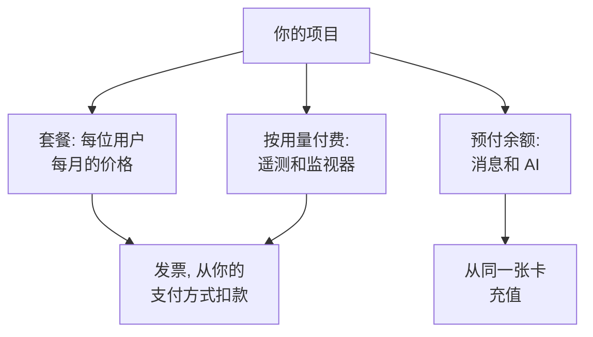

# 账单与用量

在 OneUptime Cloud 上，项目按用户为其套餐付费，并为其使用的内容付费：遥测数据、活跃监视器，以及从预付余额中支付的消息和 AI 工作。本页介绍在哪里查看和更改每一项，以及谁可以操作。自托管安装没有账单功能，也没有这些页面。

:::cards
- [你的套餐和席位](#你的套餐和席位): 套餐的费用，以及谁算作一个席位。
- [支付方式](#支付方式): 发票扣款所用的卡。
- [发票](#发票): 支付、下载发票，并查看你的用量。
- [预付余额](#预付余额): 消息和 AI，手动或自动充值。
:::

## 项目为什么付费

| 内容 | 计费方式 |
| --- | --- |
| 套餐 | 按每位用户每月计价，按月或按年计费。项目中的每个人都是一个席位。 |
| 遥测 | 摄取的数据每 GB $0.10，含 15 天保留期。更长的保留期费用更高，不足 7 天的保留期按 7 天计费：参见[保留期的费用](/docs/telemetry/data-retention#保留的成本)。 |
| 会话回放 | 每 GB $2，含 15 天保留期。 |
| 活跃监视器 | 每个监视器每月 $1。除手动监视器外，每个监视器都是活跃的，即使已关闭也是如此。 |
| 短信、电话、WhatsApp 和 Telegram | 每条消息发送时从项目余额中支付。 |
| OneUptime AI | 从项目的 AI 积分中支付，除非它运行在你自己的 LLM 提供商上。 |

[价格页面](https://oneuptime.com/pricing)对各套餐进行了比较。

## 开始之前

- **OneUptime Cloud。** **项目设置**中的**账单和发票**部分仅存在于 OneUptime Cloud，并且默认折叠：点击其标题即可展开。
- **可以读取账单的角色。** Project Owner、拥有 **Manage Billing** 的人以及三个账单角色可以读取所有账单页面。参见[谁可以做什么](#谁可以做什么)。

## 你的套餐和席位

前往**项目设置 → 账单和发票 → 账单**。**当前套餐**卡片显示项目的套餐及每位用户的价格，还有**席位**：项目中的每个人一个。

从你邀请某人的那一刻起，即使对方尚未接受，此人也算作一个席位，直到你将其移除。要更改席位数量，请邀请或移除人员：参见[邀请成员](/docs/permissions/inviting-people)。

## 更改套餐

:::steps
### 先添加支付方式

更改套餐需要支付方式。没有支付方式时，**Change Plan** 会改为打开 **Add a Payment Method**：参见[支付方式](#支付方式)。

### 点击 Change Plan

在**当前套餐**卡片上点击 **Change Plan**。**年度套餐**默认打开：将其关闭可查看按月价格。

### 选择套餐

每个套餐都显示其每位用户的价格。套餐下方的说明会告诉你试用期会怎样：项目仍在试用期内时显示 **Your free trial carries over**，不在试用期时显示 **Changing plan does not start a free trial**。

### 保存更改

点击**保存更改**。付费套餐从你切换的那一刻起计费，你在该套餐下邀请的每个人都在被邀请时计费。
:::

API 密钥需要 Growth 或更高的套餐，而在 Scale 套餐以下，SCIM 连接只能移除人员。会停止它们的套餐会在你选择前说明涉及多少个，停止期间**账单**页面会显示**此套餐不包含**。不会删除任何内容：在包含它们的套餐上，它们会再次生效。

> [!NOTE]
> 通过经销商或云市场（AWS Marketplace、Microsoft Marketplace、Google Cloud Marketplace 或 Vercel Marketplace）购买了 OneUptime？**账单**页面会注明。经销商会替你更改套餐，而云市场会把项目的套餐和用量计入你的云账单。

## 支付方式

**支付方式**卡片列出项目中的卡。发票会自动从默认卡扣款。

:::steps
### 点击添加支付方式

在**支付方式**卡片上点击**添加支付方式**。

### 输入卡信息

输入支付信息，然后点击 **Save payment method**。你添加的方式会成为默认方式，添加后即启用按用量付费。这不会更改你的套餐。
:::

- **设为默认**会把列表中的另一种方式设为发票扣款的方式。
- 默认方式上的 **Re-sync Autopay** 可修复仍从旧卡扣款的续订。
- 项目至少保留一种支付方式：删除最后一种之前，请先添加另一种。

## 账单地址和发票邮箱

**企业详情 / 账单地址**卡片包含你的发票上关于你的信息。点击**更新**，然后填写两个步骤：

| 步骤 | 字段 |
| --- | --- |
| **账单地址** | **企业详情 / 账单地址**：公司的法定名称、地址以及增值税号或税号。**国家**：你的账单所在国家。 |
| **发票** | **财务 / 会计邮箱**：发票、收据和账单消息的发送地址，多个地址用逗号分隔。**通过电子邮件发送发票**：每张发票开具后立即发送到那里。 |

## 发票

**项目设置 → 账单和发票 → 发票**列出项目的发票，每张都有**发票编号**、**发票日期**、**金额**和**发票状态**。

- **支付发票**用于支付仍未付款的发票。
- **下载**以 PDF 格式打开发票。对于仍未付款的发票，它位于行菜单 **⋯** 中。

当你的银行仍在处理付款时，OneUptime 会提示：有些银行确认银行卡付款最多需要 2 天，发票会自行更新。请不要重复付款。

## 使用历史

**项目设置 → 账单和发票 → 使用历史**显示项目发送的遥测数据，每个产品、服务和日期一行：

| 列 | 显示内容 |
| --- | --- |
| **产品** | 日志、追踪、指标以及其他类型的遥测数据。 |
| **天** | 发送的日期。 |
| **服务** | 发送数据的服务，或主机、集群等其他资源。 |
| **已引入的数据（GB）** | 摄入了多少。 |
| **数据保留期（天）** | 保留多长时间。 |
| **总成本** | 花费多少，以美元计。 |

一天的用量在当天结束后显示。按**产品**、**天**或**服务**筛选，找出增长的部分。

## 预付余额

短信、电话、WhatsApp 和 Telegram 消息从项目的余额中支付，OneUptime AI 从其 AI 积分中支付。你需要预先为每一项充值：

| 余额 | 位置 |
| --- | --- |
| 短信、电话、WhatsApp 和 Telegram | **项目设置 → 通知 → 通知设置** |
| OneUptime AI | **项目设置 → 人工智能 → AI 积分** |

:::steps
### 立即充值

在页面的**当前余额**卡片上点击**充值余额**。输入 $20 到 $1,000 之间的金额，然后点击**充值**。金额会从项目的卡上扣除。

### 或让它自动充值

在**自动充值**卡片上点击**编辑自动充值**，然后打开**启用自动充值**。它默认关闭。打开后，每当余额降到 $10 时，OneUptime 就会充值 $20，金额也可以自行设定。
:::

当余额不足以支付时，消息不会发送，或 OneUptime AI 会停止，项目的所有者会收到电子邮件。参见[呼叫未发送时](/docs/on-call/escalation-rules#呼叫未发送时)和[AI 积分用完时](/docs/ai/ai-sre#ai-积分用完时)。

## 谁可以做什么

| 要做的事 | 需要 |
| --- | --- |
| 读取账单页面：套餐、发票、用量、余额和支付方式 | Project Owner、**Manage Billing**、**账单管理员**、**账单成员** 或 **账单查看者** |
| 下载发票 | Project Owner、Project Admin、**Manage Billing**、**Read Invoices**、**账单管理员** 或 **账单成员** |
| 更改账单地址和发票邮箱 | Project Owner、**Manage Billing**、**账单管理员** 或 **账单成员** |
| 打开或关闭短信、电话、WhatsApp 或 Telegram | Project Owner、**Manage Billing** 或 **账单管理员** |
| 添加支付方式 | Project Owner、**Manage Billing** 或 **Create Payment Method** |
| 支付发票 | Project Owner、**Manage Billing** 或 **Edit Invoices** |
| 更改套餐、为余额充值或更改自动充值 | Project Owner 或 **Manage Billing** |

你无权使用的按钮会显示为锁定状态，并说明谁可以使用。关于账单角色，参见[用户、团队与权限](/docs/permissions/index#团队)。

## 需要套餐的设置

在 OneUptime Cloud 上，以下管理设置需要套餐。你没有相应套餐的页面会显示该功能的作用以及所需的套餐。

| 设置 | 所需套餐 |
| --- | --- |
| 标签 | Growth |
| API 密钥 | Growth |
| 你自己的 SMTP 服务器和 Twilio 账户 | Growth |
| 你自己的 LLM 提供商 | Growth |
| 连接 MCP 客户端 | Growth |
| 创建团队 | Scale |
| SSO、OIDC 和 SCIM | Scale |
| 保留期覆盖 | Scale |
| 审计日志 | Enterprise |

## 取消套餐

要停止为项目付费，请删除它：删除后计费即停止。参见[删除项目](/docs/configuration/project-settings#删除项目)。通过经销商购买的项目在经销商处取消，通过云市场购买的项目在市场上取消。

## 故障排除

:::details "Add a payment method in Project Settings > Billing and Invoices > Billing before using paid monitoring or telemetry"
使用 Free 套餐的项目在创建活跃监视器或发送遥测数据之前需要支付方式，因为这些是按用量付费的。在[支付方式](#支付方式)下添加一个。手动监视器仍然免费。
:::

:::details 红色横幅提示有未付发票
有未付发票的项目会变为非活跃状态，如果发票一直未付，项目将被删除。打开**发票**，在每张仍未付款的发票上点击**支付发票**。
:::

:::details Change Plan 打开了 Add a Payment Method
项目还没有支付方式。请先添加一个，然后更改套餐。
:::

:::details 使用历史为空
用量按天统计，一天结束后才会显示。没有发送过遥测数据的项目没有任何行。
:::

## 后续步骤

:::cards
- [项目设置](/docs/configuration/project-settings): 适用于整个项目的其他所有设置。
- [邀请成员](/docs/permissions/inviting-people): 添加占用你席位的人员。
- [数据保留](/docs/telemetry/data-retention): 按需保留遥测数据，不多保留。
- [丢弃过滤器与清理规则](/docs/telemetry/drop-filters-and-scrub-rules): 不再为你不使用的遥测数据付费。
:::
