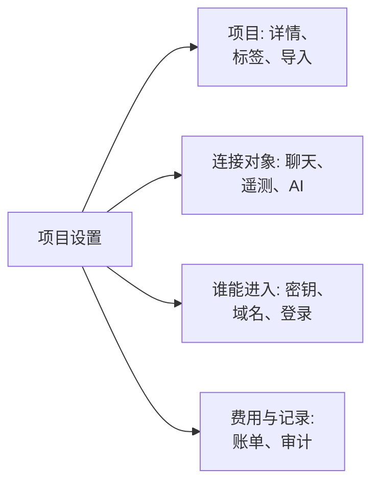

# 项目设置

项目设置包含适用于整个项目的内容：名称、它所连接的工具、密钥、人员的登录方式、账单以及审计记录。大部分内容只需设置一次，之后很少再改动。本页是这些设置的地图，并介绍没有独立页面的设置：项目详情、标签、功能标志和删除项目。

:::cards
- [查找设置](#查找设置): 侧边菜单中每个部分包含的内容。
- [项目详情](#项目详情): 名称、ID 和支持访问。
- [标签](#标签): 用于资源、权限和规则的标记。
- [删除项目](#删除项目): 需要什么，以及会随之消失什么。
:::

## 打开项目设置

前往**产品 → 设置 → 项目设置**。侧边菜单把页面分成若干部分，默认只展开**基础**：点击某个部分的标题即可展开。在某个部分的任意页面上，该部分会自动展开。

## 开始之前

- **可以更改项目的角色。** 这些设置大多由 Project Owner 和 Project Admin 更改。账单、通知渠道和删除项目需要更多权限，具体见各部分说明。
- **在 OneUptime Cloud 上：包含该设置的套餐。** 某些设置需要特定套餐：参见[需要套餐的设置](/docs/configuration/billing#需要套餐的设置)。

## 查找设置

| 部分 | 页面 | 详细阅读 |
| --- | --- | --- |
| **基础** | **项目**、**标签** | [项目详情](#项目详情)、[标签](#标签) |
| **工作区** | **Slack**、**Microsoft Teams**、**Video Calls** | [Slack](/docs/workspace-connections/slack)、[Microsoft Teams](/docs/workspace-connections/microsoft-teams)、[视频通话](/docs/workspace-connections/video-calls) |
| **遥测与 APM** | **摄取密钥**、**数据保留** | [摄取密钥](/docs/telemetry/ingestion-keys)、[数据保留](/docs/telemetry/data-retention) |
| **通知** | **通知设置**、**通知日志**、**移动应用** | [通知](#通知) |
| **人工智能** | **AI Features**、**LLM 提供商**、**外部 MCP 服务器**、**AI 积分**、**AI 日志**、**MCP 服务器** | [LLM 提供商](/docs/ai/llm-provider)、[外部 MCP 服务器](/docs/ai/external-mcp-servers)、[MCP 服务器](/docs/ai/mcp-server)、[AI SRE](/docs/ai/ai-sre#成本控制) |
| **高级** | **域名**、**API 密钥**、**功能标志**、**从其他工具导入** | [自定义域名](/docs/status-pages/branding-and-domains#自定义域名)、[API 密钥](/docs/permissions/index#api-密钥)、[功能标志](#功能标志)、[从 Opsgenie 迁移](/docs/moving-to-oneuptime/opsgenie)及其他迁移指南 |
| **安全** | **SSO**、**SCIM** | [SSO](/docs/identity/sso)、[SCIM](/docs/identity/scim) |
| **账单和发票** | **账单**、**使用历史**、**发票** | [账单与用量](/docs/configuration/billing) |
| **审计日志** | **审计日志**、**设置**、**导出** | [审计日志](/docs/configuration/audit-logs)、[审计日志导出](/docs/configuration/audit-log-export) |
| **危险区域** | **危险区域** | [删除项目](#删除项目) |

**账单和发票**和**AI 积分**仅存在于 OneUptime Cloud：自托管安装没有账单功能。

## 项目详情

**项目设置 → 基础 → 项目**有两张卡片。

**项目详情**显示项目的名称和 ID：

- **项目名称**：点击**编辑项目**可重命名项目。名称至少 2 个字符。重命名需要 Project Owner，或编辑项目或管理账单的权限。
- **项目 ID**：在 API、CLI 和 Terraform 中使用，或联系支持时复制它。
- **Data Residency**：在 OneUptime Cloud 上，OneUptime 记录后你的项目数据所存放的位置。只有 OneUptime 会设置它。

**客户支持访问权限**决定在 OneUptime Cloud 上 OneUptime 支持团队能否打开项目。需要帮助时，打开**允许 OneUptime 支持团队访问此项目**：由于支持团队届时可以查看和更改项目中的一切，OneUptime 会先确认，你再点击**允许支持团队进入**。处理完后将其关闭：更改会立即保存。Project Owner 和 Project Admin 可以更改此项。

## 标签

标签是你贴在监视器、事件、状态页面和其他资源上的标记。它们用于筛选和分组列表，并限制团队权限和项目规则的作用范围。

:::steps
### 打开标签

前往**项目设置 → 基础 → 标签**。

### 创建标签

点击**创建标签**。为其填写**名称**，如有需要再填写**描述**。**标签颜色**已预先选好一种页面上还没有标签使用的颜色：如果你愿意，可以另选一种。点击**创建标签**保存。
:::

在 OneUptime Cloud 上，创建和更改标签需要 Growth 套餐。关于标签如何限制权限，参见[标签](/docs/permissions/index#标签)；关于在资源创建时为其添加标签，参见[标签与所有者规则](/docs/configuration/label-and-owner-rules)。

在列表中，记录的标签会上下逐个显示；超过四个时，显示前三个和一个查看其余标签的链接。凡是列出标签的地方（列表、记录页面和每个标签选择器），标签都按自然顺序排列：名称以数字开头的标签排在前面，按该数字的大小排序（`2. Team` 在 `10. Owner` 之前），其余标签按字母顺序排在后面，不区分大小写。要决定标签的顺序，请让名称以数字开头，例如 `1. Category` 和 `2. Subcategory`。

### 归档标签

要停用某个标签，请从其所在行的 **⋯** 菜单中将其归档，而不是删除。已有该标签的内容会保留它，您仍可按它筛选，但任何人都无法再将它添加到任何内容：每个标签选择器都不会提供它，API、Terraform 和 MCP 会拒绝它。对话框会列出设置为使用该标签的规则和权限，在您更改它们之前，它们会继续使用该标签。已归档的标签会单独列在折叠的 **已归档的标签** 部分中，**取消归档** 可将其恢复。**删除** 会先列出该标签将从中移除的所有内容，并提供 **改为归档**。

## 通知

**项目设置 → 通知**包含项目发送通知的方式：

- **通知设置**：**通知渠道**卡片为项目打开或关闭短信、电话、WhatsApp 和 Telegram。四者默认均为关闭。由 Project Owner、**账单管理员** 或拥有 **Manage Billing** 的人打开它们。该页面还包含项目自己的邮件服务器，位于**自定义 SMTP 配置**下（参见[SMTP](/docs/emails/smtp)），以及项目自己的 Twilio 账户（参见[Twilio 集成](/docs/self-hosted/twilio-integration)）。在 OneUptime Cloud 上，它还包含支付这些消息的余额：参见[预付余额](/docs/configuration/billing#预付余额)。
- **通知日志**：项目发送的每条通知，每个渠道一个选项卡：**电子邮件**、**SMS**、**WhatsApp**、**Telegram**、**Webhook**、**调用**、**推送**和**工作区**。
- **移动应用**：获取 iOS 和 Android 应用的位置。参见[应用概览](/docs/mobile-desktop-apps/index)。

## 功能标志

**项目设置 → 高级 → 功能标志**为项目打开或关闭可选功能。每个功能都是一个开关，切换后立即保存。目前该页面包含**监视器组**，在新项目中默认关闭：打开后，监视器菜单中会加入监视器组。关闭它不会删除任何组。参见[监视器组](/docs/monitor/monitor-groups)。

## 删除项目

删除项目会为所有成员删除其中的一切：监视器、事件、状态页面、值班设置和遥测数据。任何操作都无法将其恢复。

:::steps
### 打开危险区域

前往**项目设置 → 危险区域**。

### 点击删除按钮

点击**删除项目**。对话框会请你确认。

### 输入项目名称

准确输入项目名称。在你输入之前，**删除项目**会保持锁定。在 OneUptime Cloud 上，对话框还会询问你离开的原因：回答是可选的。

### 确认

点击**删除项目**。OneUptime 会删除项目并将你移出该项目。
:::

> [!CAUTION]
> 删除项目无法撤销。这需要 Project Owner，或删除项目的权限。

在 OneUptime Cloud 上，删除项目即可取消其套餐：项目删除后计费停止。通过云市场计费的项目会为其用量产生最后一笔费用，而在市场上的购买会一直有效，直到你在那里取消。

## 故障排除

:::details 侧边菜单中似乎缺少某个部分
除**基础**外，所有部分默认都是折叠的。点击该部分的标题即可展开。在自托管安装中，既没有**账单和发票**部分，也没有**AI 积分**页面。
:::

:::details 编辑项目被锁定
重命名需要 Project Owner，或编辑项目或管理账单的权限。锁定的按钮会显示你缺少的权限。
:::

:::details 对话框中的删除项目一直处于锁定状态
请完全按照对话框显示的样子输入项目名称：大小写有区别。
:::

## 后续步骤

:::cards
- [邀请成员](/docs/permissions/inviting-people): 把你的团队带进项目。
- [账单与用量](/docs/configuration/billing): 你的套餐、支付方式、发票和用量。
- [审计日志](/docs/configuration/audit-logs): 查看谁在项目中更改了什么。
- [SSO](/docs/identity/sso): 让人们通过你的身份提供商登录。
:::
