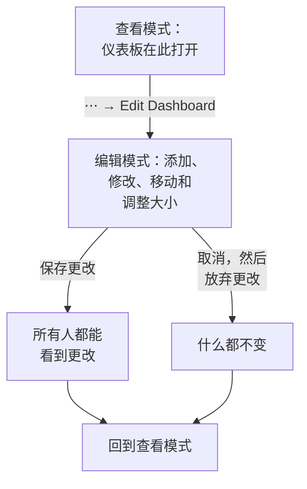

# 创建仪表板

要创建仪表板，请打开 **产品 → 仪表板** ，点击 **创建仪表板** 。 **创建仪表板** 对话框会先问你如何开始，再问名称。 **从零开始** 给你一个空白仪表板；模板会为你创建它的小部件，通常还有变量，并填好它的名称（如果项目中已有同名仪表板，则会加上编号，例如"Kubernetes Dashboard 2"）。点击 **创建仪表板** ，新仪表板随即打开。空白仪表板会在画布上打开，并提供一个 **添加小部件** 按钮用于添加第一个小部件。

:::cards
- [新建仪表板](#新建仪表板): 从零开始，或从模板开始。
- [编辑与保存](#编辑与保存): 在你点击"保存更改"之前，任何人看到的都不会改变。
- [添加小部件](#添加小部件): 从目录中选择、进行设置，然后放到位。
- [放大峰值](#放大峰值): 在图表上拖动，读取那一刻的整个仪表板。
:::

## 开始之前

项目所有者和管理员可以创建和编辑所有仪表板。其他人需要团队权限：创建仪表板需要 `CreateDashboard` ，修改仪表板需要 `EditDashboard` 。项目成员和查看者无需这两个权限即可阅读仪表板。无权编辑仪表板的人仍然可以打开它的 **⋯** 菜单，其中的 **编辑仪表板** 处于锁定状态，并说明需要哪个权限。

## 新建仪表板

:::steps
### 选择开始方式

打开 **产品 → 仪表板** ，点击 **创建仪表板** 。 **创建仪表板** 对话框从 **从零开始** 开始，这是一个可以添加你自己的小部件的空白仪表板。下方的 **或者从模板开始** 列出六个 **推荐** 模板。

### 选择模板

点击一个模板，查看它会添加什么：它的小部件（名称与 **添加小部件** 中一致），以及你在工具栏中用来缩小范围的变量。其他模板可以在搜索框旁选择一个类别或 **全部模板** ，或在 **搜索模板…** 中输入来查找：你输入的每个词都必须匹配。然后点击 **使用此模板** ，或双击该模板。在搜索框中，方向键选择模板， **Enter** 使用它。

### 为仪表板命名

模板的名称已经填好，并按项目中已有的名称往后编号。 **从零开始** 时名称为空：请输入一个。描述是可选的，折叠在 **更多字段** 下，你也可以稍后在仪表板的 **概览** 页面添加。 **返回** 会带你回到离开时的模板选择。

### 创建

点击 **创建仪表板** 。新仪表板随即打开：如果是模板，会立即显示它的小部件；否则显示带有 **添加小部件** 的空画布。
:::

模板按选择器中的类别列出：

| 类别 | 模板 |
| --- | --- |
| 监控与 APM | Monitor Dashboard, Metrics Dashboard, Real User Monitoring Dashboard, SLO Dashboard |
| 事件响应 | Incident Dashboard, Alert Dashboard |
| 基础设施 | Kubernetes Dashboard, Kubernetes Cost Dashboard, Hosts Dashboard, Proxmox Dashboard, VMware Dashboard, Ceph Dashboard, Storage Array Dashboard, Docker Swarm Dashboard, Network Dashboard |

**推荐** 包含 Monitor Dashboard、Incident Dashboard、Alert Dashboard、Kubernetes Dashboard、Hosts Dashboard 和 Metrics Dashboard。模板只是起点，而不是关联：仪表板创建后，你可以随意修改。之后模板不会再更新它。

## 编辑与保存

仪表板以查看模式打开，供阅读。要修改它，请打开工具栏中的 **⋯** 菜单并选择 **编辑仪表板** 。工具栏会在名称旁显示 **编辑中** ，并把时间范围和其他控件换成 **添加小部件** 、 **变量** 、 **取消** 和 **保存更改** 。下方还有一行，用于设置仪表板的 **默认时间范围** 和 **默认自动刷新** 。

在你保存之前，更改只属于你自己。编辑期间不会保存任何内容，所以其他人看到的仍然是原来的仪表板。

- **保存更改** 会一次性保存小部件、它们的位置和大小、变量以及默认时间范围和自动刷新，然后回到查看模式。如果保存被拒绝，例如因为你在此期间失去了权限，你会带着更改留在编辑模式，网格上方会显示原因。
- **取消** 会先询问，因为它会丢弃你的更改： **放弃更改** 回到已保存的仪表板， **继续编辑** 则让你回到工作中。

编辑期间，自动刷新会暂停，放大后的时间范围会回到你选择的范围。

## 添加小部件

:::steps
### 打开小部件目录

点击 **添加小部件** ：编辑时它在工具栏中，空仪表板则在画布上。目录按小部件显示的内容分组。在搜索框中输入名称或用途即可查找（"error budget", "pods"），按 Enter 添加第一个结果。

### 选择小部件

点击它。小部件会放到网格上第一个能容纳它的空位，并打开它的设置。

### 设置显示内容

设置对话框会在设置上方显示小部件的 **Live Preview** ，预览会跟随你的每一次修改。选择小部件读取的内容（指标查询、过滤器、文本）和外观，然后点击 **完成** 。

### 放到位

拖动小部件来移动它，拖动它的边缘或角来调整大小。参见 [网格上的小部件](#网格上的小部件) 。
:::

[仪表板小部件](/docs/dashboards/widgets) 列出了每个小部件及其设置。

## 网格上的小部件

画布是一个十二列宽的网格。小部件会吸附到网格上，页面会随着你添加行而向下延伸。拖动小部件时，虚线轮廓会显示它将落在哪里，以及所在的列和行；调整大小时，轮廓会以网格单位显示它的大小。挡路的小部件会自动让开，因此两个小部件永远不会重叠。

每种小部件都有最小尺寸，以保证绘制的内容清晰可读：图表至少六列宽、三行高，而单个数字只需一个格子。

之后要修改小部件，请在编辑时点击它。它的设置会再次打开，底部多出两个按钮：

- **Duplicate Widget** 会在第一个空位添加一个设置相同的副本。
- **删除小部件** 会在你确认后将其移除。

## 时间范围与自动刷新

在查看模式下，工具栏的时间范围选择器决定所有图表、数字、日志和链路小部件读取的时间窗口。可以选择从最近 5 分钟到最近 3 个月的预设，或自定义开始和结束时间。仪表板以其默认时间范围打开：除非编辑者另行设置，否则为最近一小时。

事件、警报、监视器和资源的列表显示的是当前状态，与时间范围无关。

时间范围旁边的自动刷新菜单会每 5 秒、10 秒、30 秒、1 分钟、5 分钟或 15 分钟重新读取每个小部件，并显示距下一次刷新的倒计时。排查问题时请把它关掉，让视图保持静止。仪表板以其默认自动刷新打开：除非编辑者另行设置，否则为关闭。

只要仪表板有一个小部件，时间范围选择器、变量和自动刷新就会出现。

### 仪表板的默认设置

编辑仪表板时，工具栏按钮下方的一行决定所有人打开它时的设置： **默认时间范围** （从最近 5 分钟到最近 3 个月的预设）和 **默认自动刷新** 。 **保存更改** 会把它们与仪表板的其余部分一起保存，对你的团队和公开链接的访客同样生效。自定义的开始和结束不能作为默认值：否则仪表板会永远停留在那个时刻。只要仪表板有一个小部件，这一行就会出现。

在这些设置出现之前保存的仪表板，以最近一小时和原有的自动刷新打开。通过 API 和 Terraform，两者都位于仪表板的 `dashboardViewConfig` 中：`timeRange` 是按 API 参考写法书写的预设，例如 `Past 1 Day`；`refreshInterval` 例如 `1m`。其他任何值都会被拒绝。

### 你自己的选择

你在查看模式下选择的时间范围和自动刷新只属于你，浏览器会为每个仪表板记住它们：刷新页面、重启浏览器或墙面屏幕重启后，仪表板都会按你离开时的样子打开。只有预设会被记住。自定义范围或放大只持续到你离开页面，因此仪表板永远不会停留在过去的某个时刻。

每个选择器的第一项会显示仪表板的默认值，例如 默认（Past 1 Day）。选择它即可回到默认值：浏览器会忘记你的选择，仪表板会重新跟随默认值，即使之后有人修改了它。你自己保存新的默认值后，会立即看到它们。

### 放大峰值

查看峰值时，你不必去用时间范围选择器。在任意折线图或面积图上拖过感兴趣的区段， **整个仪表板** 就会切换到那个时间窗口，就像你在时间范围选择器中选了它一样：每个使用时间范围的小部件都会一起重新查询，所以你在整个仪表板上读到的是同一时刻，而不是某个图表与相邻图表比例不同。实时列表一如既往地继续显示当前正在发生的事情。

**双击任意图表** 即可撤销：无论你放大了多少次，仪表板都会回到开始放大之前的范围。放大生效期间，时间范围选择器旁会出现 **重置缩放** 按钮；在未放大的仪表板上双击则不会有任何效果。

放大后的时间窗口是固定的，因此即使开启了自动刷新，它也不会向前滚动——这是有意为之，因为排查到一半时间窗口悄悄移走会更糟。重置放大即可让它重新滚动。

放大只在查看模式下有效；在编辑模式下，拖动会移动小部件并调整其大小。柱状图也以同样的方式放大（在柱子上拖动），双击柱状图也会像其他图表一样重置仪表板。只有拖动才会放大：单击图表永远不会改变仪表板的时间范围。同样的手势适用于 OneUptime 中所有的图表；参见 [放大时间范围](/docs/telemetry/charts-and-time-ranges) 。

## 全屏

**⋯ → 全屏** 会在整个屏幕上显示仪表板的小部件，适合墙上的显示器或会议。按 Esc 退出。

## 让仪表板经久耐用的建议

- **一个仪表板一个主题。** 几个聚焦的仪表板胜过一个塞满所有监控内容的页面。
- **把最重要的小部件放在最上面。** 人们从上往下阅读，所以要让他们第一眼看到的内容回答"一切健康吗？"
- **用文本小部件为各部分命名。** 每隔几行放一个简短的标题（"延迟"、"错误"、"容量"），即使隔着房间也能轻松浏览页面。
- **用变量代替副本。** 如果你正打算为第二个服务创建同样的仪表板，请改为添加一个 `service` 变量。参见 [仪表板变量与过滤器](/docs/dashboards/variables) 。
- **大改之前先复制。** 仪表板 **设置** 页面上的 **复制仪表板** 会创建一个安全的副本，供你尝试新想法。

## 后续步骤

:::cards
- [仪表板小部件](/docs/dashboards/widgets): 每个小部件、它的设置，以及该选哪一个。
- [仪表板变量与过滤器](/docs/dashboards/variables): 每个服务、主机或客户一个仪表板。
- [共享与公开仪表板](/docs/dashboards/sharing): 在团队之外共享仪表板。
- [仪表板配置与权限](/docs/dashboards/configuration): 所有者、标签、归档，以及谁可以做什么。
:::
