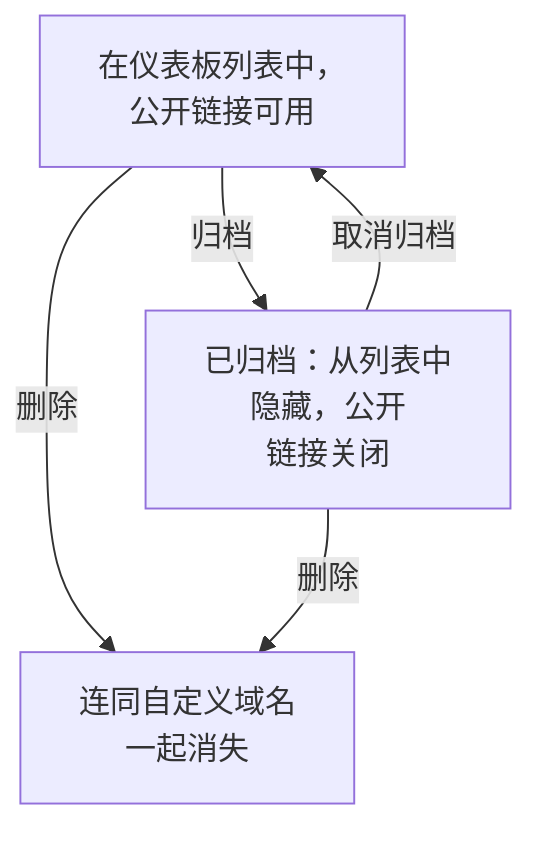

# 仪表板配置与权限

当你有了一个值得保留的仪表板，本页介绍谁可以阅读和修改它、所有者和标签如何组织你的仪表板，以及如何复制、导出、归档和删除仪表板。

:::cards
- [谁可以做什么](#谁可以做什么): 每个操作背后的权限，以及谁拥有这些权限。
- [所有者](#所有者): 仪表板所属的用户和团队。
- [复制仪表板](#复制仪表板): 一个安全的副本，自动为你编号。
- [归档仪表板](#归档仪表板): 收起仪表板而不删除它。
:::

## 谁可以做什么

仪表板遵循你项目的 [权限](/docs/permissions/index) 。每个操作都需要以下权限之一，通过团队获得：

| 操作 | 所需权限 |
| --- | --- |
| 阅读仪表板 | `ReadDashboard` ，或项目角色：Project Owner、Project Admin、Project Member、Viewer 或某个 Settings 角色 |
| 创建仪表板 | `CreateDashboard` 、Project Owner 或 Project Admin |
| 修改仪表板：它的小部件、变量、共享、品牌，以及归档它 | `EditDashboard` 、Project Owner 或 Project Admin |
| 删除仪表板 | `DeleteDashboard` 、Project Owner 或 Project Admin |
| 添加和移除所有者 | 仪表板所有者权限、Project Owner、Project Admin 或 Project Member |
| 添加和修改自定义域名 | 仪表板域名权限、Project Owner、Project Admin、Project Member、Settings Admin 或 Settings Member |
| 创建所有者规则和标签规则 | 规则权限、Project Owner 或 Project Admin |

因此，Project Member 可以阅读所有仪表板，但要构建仪表板需要 `CreateDashboard` 和 `EditDashboard` 。阅读、编辑和删除都可以分别限制在团队拥有的仪表板上，或带有某些标签的仪表板上：参见 [范围：一条允许权限能覆盖多远](/docs/permissions/index#范围一条允许权限能覆盖多远) 。

在团队的 **权限** 页面上分配它们：打开 **产品 → 团队** 并选择该团队。

谁可以在项目之外查看仪表板是另一个问题，由仪表板的 **共享** 页面决定：参见 [公开仪表板的访问](#公开仪表板的访问) 。

## 所有者

仪表板的 **所有者** 是它所属的用户和团队。在仪表板的 **所有者** 页面上添加他们，或在 **仪表板** 列表中选择多个仪表板，一次性为它们全部添加所有者。

所有者会在你要求时收窄访问范围：限定在团队所拥有仪表板上的团队权限，只作用于把该团队或执行操作的本人列为所有者的仪表板。仅仅拥有并不会授予任何权限。

**仪表板** 列表会显示每个仪表板的所有者，它的 **所有者** 过滤器可以找到某个人或团队拥有的仪表板。

## 标签

标签是用来组织仪表板的标记。在仪表板的 **概览** 页面上添加它们（你也在那里编辑名称和描述），或从 **仪表板** 列表一次为多个仪表板添加。

常见做法：

- **按团队**: `team:platform` 、 `team:checkout` 、 `team:growth` 。
- **按环境**: `env:prod` 、 `env:staging` 。
- **按用途**: `purpose:oncall` 、 `purpose:exec` 、 `purpose:investigation` 。

在已经积累了大量仪表板的项目中， **仪表板** 列表上的 **标签** 过滤器是找到仪表板最快的方式。标签也会限制权限：限定在某些标签上的团队权限，只作用于带有其中任一标签的仪表板。

## 所有者规则和标签规则

与其手动添加所有者和标签，不如让规则来做。在 **仪表板** 侧边菜单的 **设置** 下， **所有者规则** 会添加所有者， **标签规则** 会添加标签，作用于每个与之匹配的新仪表板：依据它已有的标签，或它的名称或描述中的模式。 [标签与所有者规则](/docs/configuration/label-and-owner-rules) 说明了规则如何匹配，以及如何对已有的仪表板运行规则。

## 公开仪表板的访问

谁可以在项目之外查看仪表板，是仪表板 **共享** 页面上的一个选择（在仪表板本身上也可以用 **⋯ → 分享** 打开；参见 [共享与公开仪表板](/docs/dashboards/sharing) ）：

1. **仅此项目中的成员** （默认）——仪表板没有公开链接；它的公开地址显示"未找到"页面。
2. **任何拥有链接的人** ——任何拥有公开链接的人无需登录即可查看。
3. **任何拥有链接和密码的人** ——访客要先输入密码，仪表板才会出现。

在同一页面的 **更多设置** 下， **IP 允许列表** （Scale 套餐）会拒绝来自列表之外任何 IP 地址对公开链接的请求。最严格的公开设置是 **任何拥有链接和密码的人** 加上 IP 允许列表——适用于需要两层保护的合作伙伴门户。

## 复制仪表板

要复制仪表板，请打开它，进入它的 **设置** 页面并点击 **复制仪表板** 。副本的名称会自动填好：仪表板的名称，按项目中已有的名称往后编号（"Checkout API"会复制为"Checkout API 2"，再复制一次则为"Checkout API 3"）。如有需要可以修改，然后用 **复制仪表板** 确认，副本随即打开。副本包含仪表板的小部件、变量、描述和标签。品牌和自定义域名保留在原仪表板上，公开共享总是从关闭状态开始，由你决定是否开启。

当你想把一个模板（例如"我们的值班仪表板"）派生为某个服务专用的副本时，这是正确的做法。

## 导出与导入

仪表板以 JSON 形式迁移：

- 仪表板 **设置** 页面上的 **导出仪表板** 会把它下载为 JSON 文件。要导出多个，请在 **仪表板** 列表中选中它们并选择 **导出 JSON** 。
- **仪表板** 列表上方的 **导入 JSON** 会根据这样的文件创建仪表板，可以在本项目，也可以在其他项目中。

导出包含仪表板自身的设置，其中包括它的小部件和变量。它的所有者和标签不包含在内，指向本项目资源（例如 SLO 或数据源）的小部件，在另一个项目中可能需要重新选择这些资源。

## 归档仪表板

把你不再使用但想保留的仪表板归档。归档的仪表板会从 **仪表板** 列表中消失，如果它是公开的，它的公开链接将停止工作——它的 URL 和自定义域名会返回 "Dashboard not found"。它的小部件、变量、品牌、域名和公开设置都会保留，因此取消归档后它会完全恢复原样，包括公开链接。

要归档一个仪表板，请打开它，进入它的 **设置** 页面并点击 **归档** 。要归档多个，请在 **仪表板** 列表中选中它们并选择 **归档** 。要恢复一个，请打开 **仪表板 → 高级 → 已归档** ，选中它并选择 **取消归档** ，或者打开它并点击其页面顶部横幅上的 **取消归档** 。

归档是删除的可逆替代方案：不确定时，先选择归档。

## 删除仪表板

打开仪表板的 **删除** 页面。删除无法撤销：仪表板、它的小部件和变量，以及关联到它的所有自定义域名都会被移除。你的遥测数据不受影响。

如果仪表板通过自定义域名公开，删除后该地址会立即停止响应。要继续提供该地址，请在删除这个仪表板之后，把域名添加到另一个仪表板：一个域名同一时间只属于一个仪表板。

## 审计日志

仪表板的 **审计日志** 页面列出对仪表板的每一次更改，以及更改人。审计日志属于 Enterprise 套餐和 [企业版](/docs/self-hosted/enterprise) 。

## 数据保留与备份

仪表板本身不会过期。它们显示的数据遵循项目的保留设置：时间范围设为最近 3 个月时，日志保留 15 天的项目会显示其中最近 15 天的数据。

如果你自托管 OneUptime，定期备份数据库就足够了：仪表板的配置与项目的其他数据一起存储。在 OneUptime Cloud 上，备份由我们为你处理。如果想要自己的副本，可以把仪表板导出为 JSON，或通过 [OneUptime API](/docs/api-reference/api-reference) 读取它。

## 后续步骤

:::cards
- [共享与公开仪表板](/docs/dashboards/sharing): 公开链接、密码、IP 允许列表和自定义域名。
- [用户、团队与权限](/docs/permissions/index): 团队、角色、范围和阻止。
- [仪表板变量与过滤器](/docs/dashboards/variables): 每个服务一个仪表板。
- [仪表板概览](/docs/dashboards/index): 全局概览。
:::
