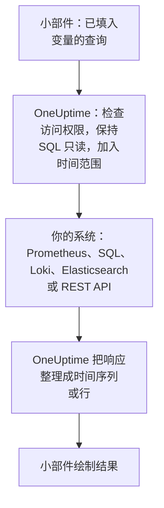

# 外部数据源

外部数据源用于连接 OneUptime 之外的系统，例如 Prometheus、SQL 数据库、ClickHouse、Loki、Elasticsearch 或 REST API，这样你的仪表板就能把它的数据和你自己的数据并排绘制出来。系统只需连接一次；之后每个小部件都会用该系统自己的语言运行只读查询。

:::cards
- [连接数据源](#连接数据源): 选择类型，然后说明它在哪里、如何登录。
- [编写查询](#编写查询): PromQL、SQL、LogQL、Query DSL 或请求。
- [限制](#限制): 保护双方的超时和上限。
- [安全保障](#安全保障): 只读查询和只写凭据。
:::

## 查询如何运行

小部件把已填入变量的查询发送给 OneUptime。OneUptime 检查你是否有权读取该数据源，填入时间范围，并使用它保存的凭据查询你的系统。然后它把响应整理成时间序列或行，交给小部件绘制。



## 开始之前

- **包含该功能的套餐。** 在 OneUptime Cloud 上，创建和修改数据源需要 **Growth** 套餐。删除在任何套餐上都可以。
- **添加数据源的权限。** 项目所有者和管理员可以添加数据源；其他人需要 `CreateDataSource` ，修改和删除还需要 `EditDataSource` 和 `DeleteDataSource` 。所有能读取项目数据源的人（包括成员和查看者）都能看到这些数据源的小部件数据。
- **只读账号。** 仪表板只会读取。请用只能读取的账号连接数据库，用只能查询的令牌连接 HTTP 数据源。
- **可达的网络路径。** 连接你系统的是 OneUptime 的 API 服务器，因此它必须能够访问到你的系统：被拒绝的地址参见 [安全保障](#安全保障) 。

## 支持的系统

| 类型 | 查询语言 | 适用于 |
| --- | --- | --- |
| Prometheus | PromQL | Prometheus, Thanos, Cortex, Mimir, VictoriaMetrics |
| PostgreSQL | SQL | PostgreSQL, TimescaleDB, CockroachDB |
| MySQL | SQL | MySQL, MariaDB |
| Microsoft SQL Server | T-SQL | SQL Server, Azure SQL |
| ClickHouse | SQL | ClickHouse（通过其 HTTP 接口） |
| Grafana Loki | LogQL | Loki 及兼容 Loki 的端点 |
| Elasticsearch | Query DSL (JSON) | Elasticsearch, OpenSearch |
| REST API | 请求 (JSON) | 任何以 JSON 响应的 HTTP(S) API |

## 连接数据源

:::steps
### 打开数据源

打开 **产品 → 仪表板** ，在侧边菜单中展开 **设置** ，然后点击 **数据源** 。

### 选择类型

点击 **创建Data Source** 。 **Choose a Data Source Type** 对话框按存放的内容对类型分组：指标、日志、数据库、搜索和 API。点击其中一个。

### 命名

在 **基本信息** 下，为它指定一个 **名称** ，例如"生产环境 Prometheus"，如有需要再填写 **描述** 。

### 说明它在哪里

在 **连接** 下，HTTP 数据源填写它响应的 **URL** 。数据库填写 **Database Host** 、 **Database Port** （端口为 5432、3306、1433 或 8123 时留空）和 **数据库名称** 。

### 说明如何登录

在 **认证** 下，输入 **用户名** 和 **密码** ；对于 HTTP 数据源，则输入以 Bearer 令牌发送的 **API 令牌** 。 **更多字段** 中包含 **Custom HTTP Headers** （例如 `{ "X-Scope-OrgID": "tenant-1" }` ）和 **Additional Options** ：数据库使用 `sslEnabled` 和 `sslRejectUnauthorized` ，Elasticsearch 使用 `elasticsearchIndex` ，不设置时 Elasticsearch 会读取所有索引（ `*` ）。

### 测试

点击 **创建Data Source** ，然后点击它所在行的 **测试** 。OneUptime 会用你提供的信息进行连接，并告诉你是否成功或出了什么问题。
:::

之后要修改数据源，请从列表中打开它。 **Data Source Details** 上的 **编辑** 可以修改除机密信息之外的所有内容； **更新凭据** 会替换密码、令牌或请求头，留空的字段保持不变； **测试** 会再次检查它。

## 在小部件中使用

编辑仪表板，点击 **添加小部件** ，然后选择外部数据源分组中的小部件： **图表** 、 **值** 、 **仪表** 或 **表格** 。在它的设置中：

- 选择 **Data Source** 并编写 **查询** 。编辑器会显示查询语言的名称，并给出该类型的示例。
- 在图表上， **添加查询** 会在同一坐标轴上叠加更多查询，而 **Legend (optional)** 设置会根据标签为每条序列命名： `{{instance}} — errors` 会把序列的 `instance` 标签写在最前面。
- 在值或仪表上， **Reduce** 会把数据点归约为一个数字：最新值（默认）、第一个值、平均值、总和、最小值或最大值。 **Unit** 会添加后缀，并换算已知单位： `Bytes` 显示为 1.5 MB， `ms` 显示为 2.4 s。
- 在表格上，任何只读查询都可以使用，行会按返回的样子显示。

## 编写查询

每种类型使用自己的语言，但返回结果的规则相同：

- **图表、值和仪表需要时间序列。** SQL 查询要返回一个名为 `time` 、 `timestamp` 、 `date` 或 `ts` 的时间列，以及一个数值型的 `value` 列（或第一个数值列）；其他所有列都会成为序列标签。Elasticsearch 需要 `date_histogram` 聚合，Loki 需要像 `rate()` 或 `count_over_time()` 这样的指标查询。
- **表格显示行。** 按查询返回的样子显示：SQL 行、Prometheus 序列、Loki 日志行、Elasticsearch 命中结果，或 REST API 的 `rowsPath` 处的对象。

:::tabs
@tab Prometheus
```text title="PromQL"
sum by (job) (rate(http_requests_total{job=~"{{job}}"}[5m]))
```
@tab SQL
```sql title="SQL"
SELECT date_trunc('minute', created_at) AS time, COUNT(*) AS value
FROM orders
WHERE created_at BETWEEN $__startTime AND $__endTime
GROUP BY 1
ORDER BY 1
```
@tab Loki
```text title="LogQL"
sum by (app) (rate({app="api"} |= "error" [5m]))
```
@tab Elasticsearch
```json title="Query DSL"
{
  "query": { "range": { "@timestamp": { "gte": "$__startTime", "lte": "$__endTime" } } },
  "aggs": {
    "over_time": {
      "date_histogram": { "field": "@timestamp", "fixed_interval": "1m" }
    }
  }
}
```
@tab REST API
```json title="Request"
{
  "path": "/api/stats?from=$__startTimeMs&to=$__endTimeMs",
  "method": "GET",
  "rowsPath": "data.items",
  "timestampField": "time",
  "valueField": "count",
  "seriesField": "service"
}
```
:::

### 时间宏

Prometheus 和 Loki 在每次请求时都会收到仪表板的时间范围，因此它们的查询无需额外处理。其他类型会把时间范围填到你写宏的位置：

| 宏 | 替换为 | 适用于 |
| --- | --- | --- |
| `$__startTime`, `$__endTime` | 范围的开始和结束（UTC）：在 SQL 中为 `'2026-10-13 09:00:00'` ，其他地方为 ISO 8601 | SQL, Elasticsearch, REST API |
| `$__startTimeMs`, `$__endTimeMs` | 同样的值，以自 1970 年以来的毫秒数表示 | SQL, Elasticsearch, REST API |
| `$__rangeSeconds` | 范围的长度（秒） | SQL |

SQL 宏以 UTC 写入，因此请让数据库会话以 UTC 运行，或在查询中进行转换。

### 仪表板变量

在查询的任意位置写入 `{{name}}` ，小部件会在发送查询前把变量的值填进去。多选变量的多个值用 `|` 连接，这正是 PromQL 或 LogQL 正则匹配器所需要的形式： `job=~"{{job}}"` 。没有选择任何值的变量会让占位符保持原样，因此报错时会显示它的名字。如何添加变量，参见 [仪表板变量与过滤器](/docs/dashboards/variables) 。

## 限制

每个查询都有上限，这样一个每分钟刷新、包含二十个小部件的仪表板就不会让 OneUptime 或你的系统过载：

| 限制 | 值 |
| --- | --- |
| 连接 | 10 秒 |
| 运行查询 | 30 秒 |
| 时间序列响应中的数据点 | 11,000 |
| 表格中的行 | 1,000 |
| 单个响应中的序列 | 100 |
| HTTP 数据源的响应 | 20 MB |

Prometheus 和 Loki 的范围查询会在整个时间范围内请求大约 250 个数据点，间隔不小于 10 秒、不大于一天。

## 安全保障

- **SQL 保持只读。** 查询必须是一条以 `SELECT` 、 `WITH` 、 `SHOW` 、 `EXPLAIN` 、 `DESCRIBE` 或 `DESC` 开头的语句。会写入或更改会话的词，例如 `INSERT` 、 `UPDATE` 、 `DELETE` 、 `DROP` 、 `INTO` 或 `SET` ，在字符串和带引号的名称之外的任何位置都会被拒绝，因此请为与它们同名的列加上引号。在字符串中用两个引号（ `''` ）表示一个引号：引号前的反斜杠会被拒绝。PostgreSQL、MySQL 和 ClickHouse 的会话也是只读的。SQL Server 没有只读会话，因此请用只读登录名连接它。
- **凭据只写。** **密码** 、 **API 令牌** 和 **Custom HTTP Headers** 会加密存储，API 永远不会返回它们，即使是返回给你本人。
- **地址会被检查。** 回环地址、链路本地地址（云元数据所在之处）和其他保留地址在任何地方都会被拒绝。私有地址在 OneUptime Cloud 上会被拒绝，在自托管安装中则会被允许，除非 `DATA_SOURCE_BLOCK_PRIVATE_ADDRESSES` 为 `true` ：参见 [私有网络访问](/docs/self-hosted/private-network-access) 。
- **公开仪表板永远不会运行它们。** 外部数据源小部件连同查询一起，都会被排除在 [公开仪表板](/docs/dashboards/sharing) 之外。

## 故障排查

:::details 测试提示无法连接
从 OneUptime 运行的位置检查 URL，或主机和端口：防火墙、OneUptime Cloud 上的私有地址，或只在本机监听的数据库，从这里看起来都一样。对于需要 TLS 的数据库，请在 **Additional Options** 中添加 `{ "sslEnabled": true }` 。
:::

:::details "Only read-only queries are allowed"
查询不是以 `SELECT` 、 `WITH` 、 `SHOW` 、 `EXPLAIN` 、 `DESCRIBE` 或 `DESC` 开头。请发送一条只读的语句： `;` 之后的第二条语句同样会被拒绝，提示为 "Only a single SQL statement is allowed per query."
:::

:::details "Query contains a keyword that is not allowed"
一个会写入的词出现在字符串之外，通常是列名，例如 `delete` 或 `set` 。请按数据库的方式为它加引号：PostgreSQL 中用 `"delete"` ，SQL Server 中用 `[delete]` ，MySQL 和 ClickHouse 中用反引号。
:::

:::details 图表一直为空，但表格显示了行
查询返回了行，但没有时间序列。在 SQL 中把时间列命名为 `time` 、把数字命名为 `value` ；在 Elasticsearch 中添加 `date_histogram` 聚合；或用 `rate()` 或 `count_over_time()` 把 Loki 日志查询变成指标查询。
:::

:::details 部分数据缺失
响应达到了某个 [限制](#限制) 。请缩小时间范围、过滤查询，或把它聚合成更少的序列。
:::

## 后续步骤

:::cards
- [仪表板小部件](/docs/dashboards/widgets): 每个小部件，包括外部数据源分组。
- [仪表板变量与过滤器](/docs/dashboards/variables): 可在查询中使用的变量。
- [私有网络访问](/docs/self-hosted/private-network-access): 从自托管安装访问私有网络中的系统。
- [仪表板配置与权限](/docs/dashboards/configuration): 谁可以添加数据源，以及谁可以读取它们。
:::
