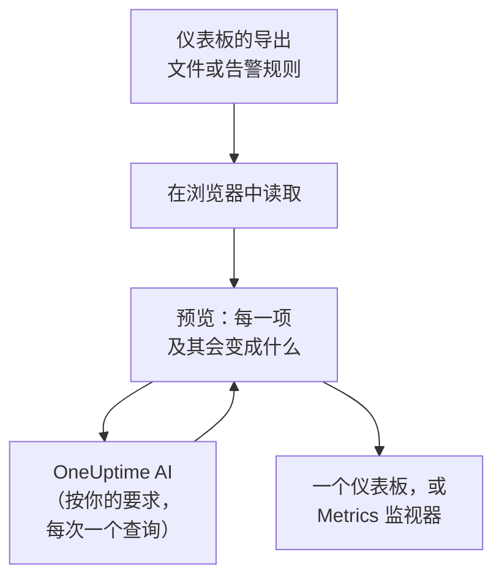

# 从 Grafana 和 Datadog 导入

把你在 Grafana 或 Datadog 中做好的仪表板，或为 Prometheus、Grafana、Datadog 写好的告警规则带进 OneUptime。粘贴或上传文件，看清每个面板和每条规则会变成什么，然后再创建仪表板或监视器。

:::cards
- [导入仪表板](#导入仪表板): Grafana 仪表板的 JSON 模型，或 Datadog 仪表板的导出文件。
- [导入告警规则](#导入告警规则): Prometheus 规则文件、Grafana 告警规则和 Datadog 监视器。
- [每一项如何转换](#每一项如何转换): 精确转换、近似转换或不转换，以及原因。
- [用 OneUptime AI 转换查询](#用-oneuptime-ai-转换查询): 用于没有规则能转换的查询。
:::

## 导入的过程

OneUptime 在你的浏览器中读取文件，并逐一转换每个面板、小部件、变量和规则。预览会列出所有项及其各自会变成什么。在你选择创建之前不会创建任何东西；创建时会使用你自己的权限，与仪表板和监视器表单的创建方式相同。

## 开始之前

- 导入的小部件和监视器用 PromQL 读取本项目自己的指标。通过 Prometheus remote write、OpenTelemetry 或 Datadog Agent 发送它们，它们会保留在那里的名称。
- 导入仪表板需要能创建仪表板的角色，导入告警规则需要能创建监视器的角色。
- 文件最大 10 MB，其中最多读取 500 个面板或规则。

## 导入仪表板

:::steps
### 打开仪表板导入

打开 **产品 → 仪表板** ，然后选择 **更多选项 → Import from Grafana or Datadog** 。

### 粘贴仪表板

在 Grafana 中，从仪表板的设置里复制 JSON 模型。在 Datadog 中，导出仪表板的 JSON。粘贴它，或选择 **Upload a File** ，然后选择 **预览** 。

### 创建仪表板

检查每个面板和每个变量会变成什么，为仪表板命名，然后选择 **创建仪表板** 。新的仪表板随即打开。
:::

Grafana 的 PromQL 保持原样：OneUptime 会像 Grafana 一样填入 `$__interval`、`$__rate_interval` 和 `$__range`，设为 All 的变量匹配所有值。Datadog 查询会变成针对 Datadog Agent 所发送指标的 PromQL：`avg:system.cpu.user{host:web-1}` 读取 `system_cpu_user{host="web-1"}`。

## 导入告警规则

:::steps
### 打开告警导入

打开 **产品 → 监视器** ，然后选择 **更多选项 → Import Alerts** 。

### 粘贴规则

粘贴 Prometheus 规则文件或 PrometheusRule 资源、Grafana 导出的告警规则，或以 JSON 导出的 Datadog 监视器，然后选择 **预览** 。

### 创建监视器

取消勾选不需要的规则，在 **When a rule fires** 中选择触发的规则要打开什么，然后选择 **创建监视器** 。
:::

每条规则都会变成一个 Metrics 监视器，带有一个 PromQL 查询、规则的条件和它的时间窗口。它会为每个越过阈值的序列打开一个告警或事件，并在序列恢复时解决它。标题和描述来自规则的摘要或消息，并填入序列的标签。

## 每一项如何转换

| 状态 | 含义 |
| --- | --- |
| **Converted exactly** | 它读取相同的数据，并以相同的方式显示。 |
| **Converted approximately** | 它会被创建，其备注会说明有何不同。 |
| **Not converted** | 不会为它创建任何东西，其备注会说明原因。 |

记录规则、针对日志的告警规则、读取日志、追踪或事件的 Datadog 小部件，以及 Datadog 的异常、离群值和预测监视器都不会被转换。

## 用 OneUptime AI 转换查询

没有规则能转换的查询会显示 **Convert with OneUptime AI** ，这需要项目已开启 AI。只有该查询和仪表板变量的名称会发送给你项目的 AI 提供商。答案会像任何查询一样经过检查并展示给你：选择 **Use This Query** 即可使用。在你创建仪表板或监视器之前，不会创建任何东西。

## 后续步骤

:::cards
- [仪表板小部件](/docs/dashboards/widgets): 修改导入的小部件所显示的内容。
- [仪表板变量与过滤器](/docs/dashboards/variables): 导入所创建的变量。
- [指标监控](/docs/monitor/metrics-monitor): 导入所创建的监视器。
- [PromQL](/docs/telemetry/promql): 导入的小部件和监视器所读取的语言。
:::
