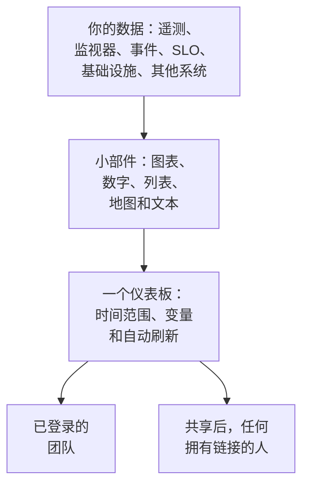

# 仪表板概览

仪表板是由你自己摆放的小部件组成的一个页面：指标、日志和链路的图表，事件、警报和监视器的列表，你的 SLO 和基础设施，甚至还有 OneUptime 之外系统的数据。你可以为值班屏幕、团队的晨检或面向客户的页面创建仪表板，并与项目成员或任何拥有链接的人共享。

:::cards
- [仪表板如何工作](#仪表板如何工作): 数据从哪里来，谁能看到。
- [找到你的仪表板](#找到你的仪表板): 仪表板列表，以及每个仪表板自己的页面。
- [创建你的第一个仪表板](#创建你的第一个仪表板): 从模板到共享页面，只需五步。
- [示例：值班仪表板](#示例值班仪表板): 一个适用于所有服务的页面。
:::

## 仪表板如何工作

每个小部件在仪表板的时间范围内、按其变量过滤后，从一个来源读取数据。打开仪表板的每个人看到的都是相同的小部件：你的团队登录后可以看到，访客则在你共享后通过公开链接看到。

| 术语 | 含义 |
| --- | --- |
| 仪表板 | 一个页面：名称、小部件网格、时间范围、变量和自动刷新设置。 |
| 小部件 | 网格上的一个图块：图表、数字、列表、地图、时钟或一段文本。 |
| 变量 | 工具栏中的选择器，把每个支持它的小部件限定到某一个服务、主机或客户。 |
| 时间范围 | 所有图表和数字读取的时间窗口。仪表板以其默认值打开，除非编辑者另行设置，否则为最近一小时；每位查看者都可以自行选择。 |
| 自动刷新 | 小部件重新读取数据的频率：关闭，或从每 5 秒到每 15 分钟。 |
| 查看与编辑 | 仪表板以阅读方式打开。编辑是单独的一步，以保存或放弃更改结束。 |

## 仪表板适合做什么

- **一个"一切正常吗？"页面。** 给值班工程师、团队站会或墙上的屏幕使用。
- **看清关联**: CPU 飙升、延迟上升和一个未解决的事件放在同一页上一目了然，分散在三个页面上就很容易错过。
- **排查问题**: 把你反复打开的图表并排放置，在峰值上拖动，就能读取那一刻所有小部件的数据。
- **在团队之外共享**: 为客户或合作伙伴提供性能页面，可按需用密码或 IP 允许列表保护。

## 找到你的仪表板

打开 **产品 → 仪表板** 。 **仪表板** 列表显示项目中的仪表板及其描述、标签和所有者。你可以按名称或描述搜索，用 **所有者** 和 **标签** 过滤器缩小列表，或选择多个仪表板来更改它们的标签或所有者、归档它们或将它们导出为 JSON。

列表的侧边菜单包含管理所有仪表板的页面：

| 页面 | 在那里做什么 |
| --- | --- |
| **仪表板** | 项目中的仪表板。新建一个，或通过 **导入 JSON** 导入仪表板。 |
| **设置 → 所有者规则** | 自动为新仪表板添加所有者。 |
| **设置 → 标签规则** | 自动为新仪表板添加标签。 |
| **设置 → 数据源** | 连接 Prometheus、SQL 数据库、ClickHouse、Loki、Elasticsearch 或 REST API。 |
| **高级 → 已归档** | 你归档的仪表板。在这里取消归档。 |

打开一个仪表板后，它自己的侧边菜单包含以下页面。除 **基础** 外，所有分区默认折叠：点击标题即可展开。

| 页面 | 在那里做什么 |
| --- | --- |
| **仪表板** | 仪表板本身。阅读它，或从它的 **⋯** 菜单进行编辑。 |
| **概览** | 名称、描述和标签。 |
| **共享** | 谁可以查看、公开链接，以及"更多设置"下的 IP 允许列表。 |
| **所有者** | 拥有它的用户和团队。 |
| **品牌** | 公开仪表板的页面标题、描述、徽标、主题和网站图标。 |
| **自定义域名** | 在你自己的域名上托管公开仪表板。 |
| **设置** | 复制、导出或归档仪表板。 |
| **审计日志** | 对仪表板的每一次更改，以及更改人。 |
| **删除** | 永久删除仪表板。 |

## 创建你的第一个仪表板

:::steps
1. **创建** — 选择一个模板，或 **从零开始** 。模板会填好名称并带着它的小部件打开；从零开始的仪表板打开时是空的，画布上有 **添加小部件** 。
2. **添加小部件** — 从目录中选择一个小部件，在设置中指定它读取的内容，然后把它拖到位并调整大小。
3. **按需添加变量** — 例如，一个 `service` 变量可以让一个仪表板显示任意服务。
4. **保存** — 点击 **保存更改** 。在你这样做之前，编辑期间的任何更改都不会保留。
5. **（可选）公开共享** — 在仪表板上选择 **⋯ → 分享** ，并决定谁可以查看：任何拥有链接的人，或任何拥有链接和密码的人。
:::

[创建仪表板](/docs/dashboards/authoring) 会逐步讲解每个步骤。

## 示例：值班仪表板

目标：为 checkout 服务做一个页面，包含它的延迟、错误率、未解决的事件和最新日志，并且同样适用于其他所有服务。

1. 点击 **创建仪表板** ，选择 **从零开始** ，并将仪表板命名为"Checkout 值班"。
2. 点击 **添加小部件** ，添加一个请求延迟指标的 **图表** ，按 P95 聚合。
3. 在它旁边添加错误率的 **值** ，警告阈值设为 1，严重阈值设为 5。
4. 在它们下方，添加一个过滤为未解决事件的 **事件列表** ，以及该服务日志的 **日志流** 。
5. 打开 **变量** ，添加一个名为 `service` 的变量，来源为 Telemetry Attribute，属性键为 `service.name` ，默认值为 `checkout` 。
6. 点击 **保存更改** 。在工具栏的 `service` 选择器中选择 `payments` ：图表、值和日志流会切换到 payments 服务，而事件列表继续显示所有未解决的事件。

## 仪表板与 OneUptime 其他功能的关系

- **监视器和遥测** 是数据的来源。你发送的每个指标、日志和链路都可以放到小部件上。
- **事件和警报** 显示在 **事件列表** 和 **警报列表** 小部件中。仪表板只负责展示：处理它们要在各自的页面上进行。
- **状态页** 告诉客户你的服务是否正常运行。仪表板则详细展示它的运行情况。两者并行协作。
- **工作流** 对发生的事情采取行动。仪表板是你阅读这些事情的地方。

## 后续步骤

:::cards
- [创建仪表板](/docs/dashboards/authoring): 创建仪表板、编辑它并保存更改。
- [仪表板小部件](/docs/dashboards/widgets): 每个小部件，以及该选哪一个。
- [仪表板变量与过滤器](/docs/dashboards/variables): 每个服务、主机或客户一个仪表板。
- [共享与公开仪表板](/docs/dashboards/sharing): 公开链接、密码、IP 允许列表和自定义域名。
:::
