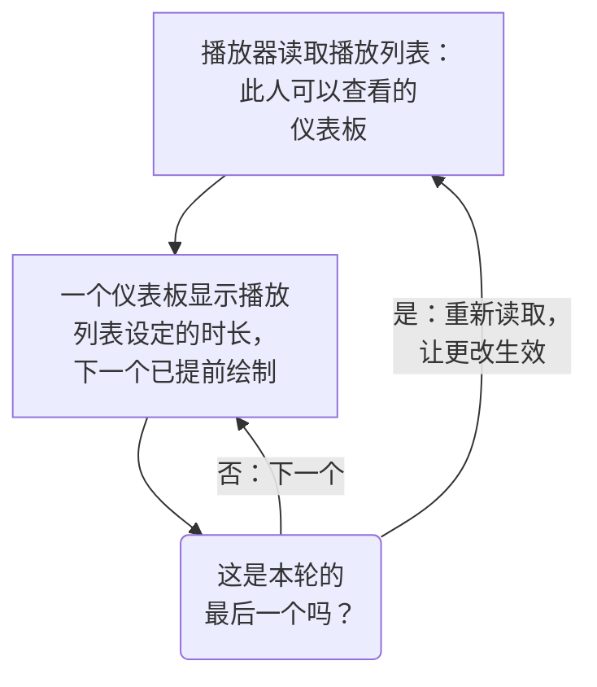

# 仪表板播放列表

播放列表在一块无人操作的屏幕上依次显示一组仪表板，比如 NOC 大屏或团队的电视：每个仪表板显示你选定的时长，循环往复，直到有人暂停。只需创建一次播放列表，在屏幕上打开它的播放器，然后让它一直播放。

:::cards
- [播放列表如何播放](#播放列表如何播放): 顺序、轮换，以及每个仪表板显示什么。
- [创建播放列表](#创建播放列表): 名称、按顺序排列的仪表板，以及每个仪表板的显示时长。
- [在屏幕上播放](#在屏幕上播放): 播放器的工具栏、按钮和按键。
- [谁能看到什么](#谁能看到什么): 权限，以及查看者无权阅读的仪表板。
:::

## 播放列表如何播放

播放器先显示播放列表中的第一个仪表板，时间到后显示下一个，显示完最后一个后再从第一个开始。每个仪表板都按编辑者保存时的样子打开：使用它自己的默认时间范围、自动刷新和变量，无论播放器的地址里写了什么。在一个仪表板显示期间，播放器会在看不见的地方提前绘制下一个，因此两个仪表板之间屏幕永远不会空白。

播放列表只引用它的仪表板，从不复制：编辑者保存到仪表板的更改，会在该仪表板下一次轮到时出现在屏幕上。播放器在每一轮之前都会重新读取播放列表，因此添加、移动或移除的仪表板会在一轮之内出现，无需重新加载屏幕；如果这次读取失败，屏幕会再播放一遍手头的这一轮。

## 创建播放列表

:::steps
### 打开播放列表
打开 **产品 → 仪表板** ，然后在侧边菜单中打开 **播放列表** 。列表显示每个播放列表包含多少个仪表板、每个仪表板显示多长时间，每一行都有 **播放** 。

### 命名
点击 **创建播放列表** ，并给它一个说明在哪里播放的 **名称** ，比如“NOC 大屏”。

### 添加仪表板
在 **仪表板** 下，按屏幕显示的顺序从 **添加仪表板** 中逐个选择。仪表板所在行上的按钮可以将它上移、下移或移除。已归档的仪表板不会出现在可选列表中。

### 选择每个仪表板的显示时长
**每个仪表板显示时长** 默认为 1 分钟；可以选择 15 秒到 1 小时之间的时长。点击 **创建播放列表** 。
:::

播放列表的页面按顺序列出它的仪表板、每个仪表板的显示时长和 **播放器链接** 。 **编辑播放列表** 可以更改名称、仪表板、它们的顺序和时长。页面底部的 **删除仪表板播放列表** 会删除播放列表，但绝不会删除其中的仪表板。

通过 API 和 Terraform，播放列表由 `name` 、按显示顺序排列的列表 `dashboards` （形如 `[{"dashboardId": "<id>"}]` ，最多 100 个），以及 `intervalInSeconds` （10 到 86400 之间的任意整数秒，即最长一天）组成。超出这些范围的值会被拒绝，并说明错在哪里。

## 在屏幕上播放

在播放列表所在行或它的页面上点击 **播放** 。播放器会覆盖 OneUptime 的其余部分，铺满浏览器窗口； **全屏** 会铺满整个屏幕。要让一块屏幕独立启动，在它上面打开 **播放器链接** 并添加书签：打开这个链接会直接进入播放器。

播放器的工具栏会显示屏幕上的仪表板、播放列表、本轮进度（“第 2 个，共 5 个”）以及接下来的仪表板。在一个仪表板的轮次中，工具栏下方的进度线会逐渐填满。工具栏的按钮可以转到上一个仪表板、暂停或播放，以及转到下一个仪表板；在电脑上，下面这些按键的作用相同：

| 按键 | 作用 |
| --- | --- |
| `Space` | **暂停或播放** 。暂停时仪表板留在屏幕上，工具栏显示 **已暂停** 。 |
| `Right Arrow` | **下一个仪表板** 。 |
| `Left Arrow` | **上一个仪表板** 。 |
| `F` | **全屏** ，或退出全屏。 |
| `Esc` | **退出播放器** ，返回播放列表的页面。在全屏状态下，第一次按 `Esc` 只会退出全屏。 |
| `?` | **显示键盘快捷键** 。 |

转到的仪表板，无论是下一个还是上一个，都会获得完整的一轮时长。在从右向左阅读的页面上，比如波斯语页面，方向键会互换： `Left Arrow` 转到下一个仪表板。播放期间，在浏览器允许的情况下，播放器会阻止屏幕进入休眠。

## 谁能看到什么

播放列表有自己的权限，和仪表板的权限一样通过团队获得：

| 操作 | 所需权限 |
| --- | --- |
| 查看和播放播放列表 | `ReadDashboardPlaylist` ，或项目角色：Project Owner、Project Admin、Project Member、Viewer 或某个 Settings 角色 |
| 创建播放列表 | `CreateDashboardPlaylist` 、Project Owner 或 Project Admin |
| 修改播放列表：它的名称、仪表板和时长 | `EditDashboardPlaylist` 、Project Owner 或 Project Admin |
| 删除播放列表 | `DeleteDashboardPlaylist` 、Project Owner 或 Project Admin |

播放列表绝不会向任何人显示其无权阅读的仪表板。播放器只播放在屏幕上登录的人可以阅读且未归档的仪表板，其余的都会跳过：已删除的仪表板、已归档的仪表板，或其权限不允许查看的仪表板。播放列表的页面会说明跳过每一个的原因。保存播放列表时，编辑者自己看不到的仪表板会保留在其中，因此别人放进去的内容不会丢失。

| 播放器发现 | 显示 |
| --- | --- |
| 可以显示的仪表板 | 依次轮流显示。 |
| 没有可以显示的仪表板 | **暂无可显示的内容** ，并且每分钟再检查一次。 |
| 播放列表已删除，或此人无权阅读 | **找不到播放列表** 。 |
| 读取失败 | **无法加载此播放列表** ，并且每分钟重试一次，或在点击 **重试** 时重试。 |

> [!NOTE]
> 播放器面向已登录 OneUptime 的人。要在一块屏幕上播放播放列表，请在这块屏幕上用可以阅读该播放列表及其仪表板的账号登录，比如具有 Viewer 角色的团队成员。

## 后续步骤

:::cards
- [创建仪表板](/docs/dashboards/authoring): 构建播放列表要显示的仪表板。
- [仪表板变量与过滤器](/docs/dashboards/variables): 每个仪表板打开时使用的已保存选择。
- [共享与公开仪表板](/docs/dashboards/sharing): 向不登录的人展示一个仪表板。
- [仪表板配置与权限](/docs/dashboards/configuration): 所有者、标签，以及谁可以阅读仪表板。
:::
