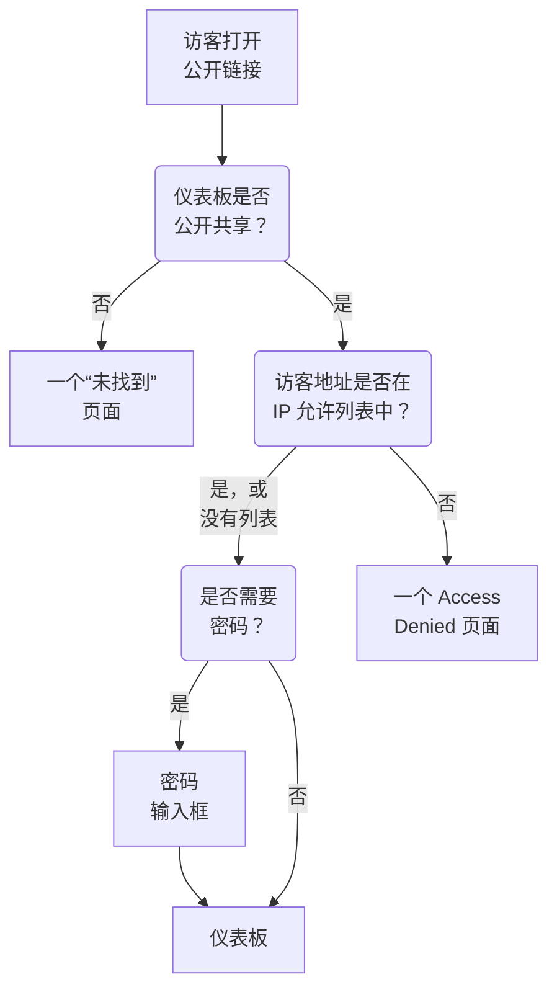

# 共享与公开仪表板

默认情况下，仪表板仅在你的项目内可见：只有登录你项目的人才能看到。你也可以通过公开链接共享它，用密码保护这个链接，把它限制在特定 IP 地址，并在你自己的域名上托管它。本页介绍全部四种方式。

:::cards
- [谁可以查看仪表板](#谁可以查看仪表板): 三选一，每种选择都需要相应的套餐。
- [使用密码共享](#使用密码共享): 把链接和密码依次分享给应该查看的人。
- [IP 允许列表](#ip-允许列表): 只允许你的办公室或 VPN 打开公开链接。
- [自定义域名](#自定义域名): 在你自己的域名上提供仪表板，并附带免费证书。
:::

## 访客会经历什么

打开仪表板公开链接的访客会依次经过以下检查。登录 OneUptime 的项目成员无论你在这里如何选择，都能在产品内看到仪表板。



## 谁可以查看仪表板

打开仪表板并选择 **⋯ → 分享** ，或在仪表板的侧边菜单中打开 **共享** 。 **谁可以查看此仪表板** 卡片是一个单选项：

- **仅此项目中的成员** （默认）：成员登录 OneUptime 后可以看到仪表板。它没有公开链接：它的公开地址显示的"未找到"页面与不存在仪表板的地址相同，不会透露任何关于该仪表板的信息，连名称也不会。
- **任何拥有链接的人** ：仪表板是公开的。任何拥有链接的人无需登录即可查看。
- **任何拥有链接和密码的人** ：访客打开链接后，输入你与他们分享的一个密码。任何人都不需要账号。

选择一个选项时会要求确认，并说明对访客有何变化，然后立即生效。仪表板还没有密码时，选择 **任何拥有链接和密码的人** 会在同一个对话框中要求设置密码；在保持这个选项期间， **更改密码** 可以替换密码。仪表板公开期间，访客打开它的地址会显示在选项下方：先是它的自定义域名，然后是它的公开链接，每个都带有 **复制链接**。尚未生效的自定义域名会标为 **尚未生效** 并说明原因。

在项目内部，所有者和标签控制谁能看到什么——参见 [仪表板配置与权限](/docs/dashboards/configuration) 。能查看但不能编辑仪表板的人可以看到这个选项并复制公开链接，但不能更改选项。

在 OneUptime Cloud 上，共享仪表板需要 **Growth** 套餐：在较低的套餐上，两个公开选项会显示所需的套餐且无法选择。把仪表板改回私有（ **仅此项目中的成员** ）在任何套餐上都可以，因此试用结束时或降级套餐后仍保持公开的仪表板，始终可以停止共享；对话框会说明再次共享需要 **Growth** 。在 **任何拥有链接的人** 和 **任何拥有链接和密码的人** 之间切换，以及更改密码，在任何套餐上都可以。通过 API 或 Terraform 创建的仪表板也适用同样的套餐：以公开方式创建需要 **Growth** ，带 IP 允许列表创建需要 **Scale** 。

这个选项存储在三列中，API 和 Terraform 仍像以前一样读写它们： `isPublicDashboard` 、 `enableMasterPassword` 和 `masterPassword` 。只有公开仪表板才有公开链接，只要 `enableMasterPassword` 开启，访客就会被要求输入密码。 `enableMasterPassword` 已开启但未设置密码的公开仪表板，不会让任何人通过公开链接进入： **共享** 页面会将其显示为 **任何拥有链接和密码的人** ，说明目前还没有人能打开链接，并提供 **设置密码** 。选择 **仅此项目中的成员** 也会关闭 `enableMasterPassword` 并保留密码，因此再次使用密码共享时可以重新使用它。

## 公开仪表板

公开仪表板：

- 始终以阅读方式打开。访客无法编辑，也永远看不到编辑控件。
- 包含你添加的变量。访客可以使用与你的团队相同的选择器，还可以更改时间范围、放大、开启自动刷新和进入全屏。它会以仪表板的默认时间范围和自动刷新打开，每位访客的浏览器会记住他们自己的选择。
- 让访客像你的团队一样，点击列标题来[为列表和表格排序](/docs/dashboards/widgets#为列表和表格排序)。每位访客的浏览器会记住他们自己的排序，OneUptime 会自行对整个列表排序，且只按小部件自己的某一列排序。
- 使用你在仪表板 **品牌** 页面上设置的品牌：页面标题、描述、徽标、主题、网站图标。
- 每位访客都可以用工具栏中的太阳或月亮按钮在浅色和深色仪表板之间切换；具体方法见 [主题](#主题)。

请像发布网页一样对待共享仪表板。上面的每个小部件都会对任何拥有链接的人可读。共享之前，先看看画布上有什么。

每个小部件只发布它绘制的内容，而且只针对它所指向的资源。例如，SLO 小部件会发布该 SLO 的关键数字，但永远不会发布它的定义——参见 [SLO](/docs/dashboards/widgets#slo) 。外部 **Data Source** 小部件是例外：它们会被完全排除在公开仪表板之外而不被渲染，因为它们的配置就是查询本身。另外还有几个小部件在没有登录会话时无法显示，并会在原位置说明这一点： [在公开仪表板上](/docs/dashboards/widgets#在公开仪表板上) 列出了它们。

## 使用密码共享

选择 **任何拥有链接和密码的人** ，并在对话框中输入密码。访客在仪表板出现之前会看到密码输入框。输入框只显示仪表板的名称、页面标题和网站图标，并以仪表板的主题绘制：描述、徽标和小部件会在输入密码后出现。密码以哈希形式存储——没有人能读回它。新密码立即生效；输入过旧密码的人最多还能继续查看仪表板 7 天。

在以下情况使用密码：

- 你想与合作伙伴或客户共享，但不希望 URL 泄露后可以被利用。
- 仪表板是"半公开"的——开放到不想把每位查看者都邀请为团队成员，但又没有开放到可以放到公开互联网上。

如需更严格的控制（每位查看者单独的账号、谁查看了什么的审计记录），请将仪表板保持为 **仅此项目中的成员** ，改为把查看者邀请为只读团队成员。

## IP 允许列表

在 **共享** 页面的 **更多设置** 下， **IP 允许列表** 部分（ `ipWhitelist` 列）会把公开链接限制在你列出的 IP 地址或 IPv4 范围内，每行一个，例如 `203.0.113.7` 或 `10.0.0.0/8` 。无论是否使用密码都会生效；登录的项目成员不受影响。留空则允许所有地址。它与选项分开单独保存，在 OneUptime Cloud 上修改它需要 **Scale** 套餐；清空它在任何套餐上都可以。列表生效期间，折叠的 **更多设置** 标题会显示 **IP 允许列表** 及其中的条目数。自托管时，更改它属于 Enterprise Edition：在 Community Edition 上，已设置的列表会继续生效，且只能移除。

在以下情况使用：

- 仪表板只能从你的办公室或 VPN 访问。
- 供应商门户只能从其已知 IP 访问。
- 你希望在密码之外再加一层保护。

来自任何其他 IP 的请求都会被拒绝，并显示一个 **Access Denied** 页面，其中不会透露任何关于仪表板的信息：没有名称、没有品牌，也没有密码输入框。既不是 IP 地址也不是 IPv4 范围的行会在保存时被拒绝，因为服务器会跳过它。

## 自定义域名

默认情况下，公开仪表板通过它的公开链接、在 OneUptime 自己的地址上提供。要把它托管在你自己的子域名上（例如 `dashboard.acme.com` ），请在仪表板的侧边菜单中打开 **品牌 → 自定义域名** 。它的工作方式与状态页的 **自定义域名** 页面完全相同。

该卡片的标题是 **自定义域名** ，并说明了要做什么：把每个域名的 CNAME 记录指向你的安装的仪表板 CNAME 记录，OneUptime 就会为该域名签发 SSL 证书并替你续期。表格有两列： **域名** 和 **状态** 。

把仪表板放到你自己的域名上需要三步，只有前两步需要你来做：

1. **添加域名**: 一个子域名，以及一个你已验证的域名。
2. **添加它的 CNAME 记录**: 在你的 DNS 提供商处添加。添加域名后， **DNS 设置** 对话框会立即带着这条记录打开。
3. **免费 SSL 证书会自动签发**: 一旦找到记录就会签发。没有需要点击的按钮。

验证通过后，你的自定义域名和原始 URL 都可以访问该仪表板。

### 添加域名

点击 **创建仪表板 域** 。对话框只有一页：

- **子域名** ：只填标签部分，占位符为 `dashboard (leave blank for root)` 。只输入 `dashboard` ，而不是完整的主机名。留空或输入 `@` 则使用根（apex）域名。
- **域名** ：在 **项目设置 → 高级 → 域名** 下验证过的域名，你在那里用 TXT 记录证明域名归你所有。未验证的域名不会列出，因为它会被拒绝。字段旁边的 **添加域名** 链接会在新标签页中打开那个页面。
- **更多字段** ：已折叠。折叠时，它的标题会说明该域名将使用哪种证书："我们为此域名签发免费的 SSL 证书并自动续期。"只有要使用你自己的证书时才需要展开（见下文）。

点击 **创建仪表板 域** 。对话框关闭，新域名的 **DNS 设置** 随即打开。域名的完整名称在添加时就已固定，因此 **编辑** 只能更改它的证书。要使用其他子域名，请添加那个域名并删除旧的。

### DNS 设置与立即检查

**DNS 设置** 对话框会显示要在 DNS 提供商处添加的记录，每行一个字段，每个字段都带有复制按钮： **类型** 为 `CNAME` ， **名称** 为你添加的完整域名， **值** 为你的安装的仪表板 CNAME 记录。对于没有子域名的根域名，对话框会附加一条说明：许多 DNS 提供商不允许在那里使用 CNAME 记录，因此请改用提供商的 ALIAS、ANAME 或 CNAME 扁平化记录，值保持不变。

OneUptime 每 15 分钟检查一次所有未验证的域名，检查找到记录后，会在同一次检查中为该域名订购免费的 Let's Encrypt 证书，无论你是否回来查看。要立即检查，请点击 **立即检查** ：

- **尚未找到记录。** 对话框保持打开，并说明它查找的是哪条记录。新的 DNS 记录可能需要一段时间才会生效。稍后再次点击 **立即检查** ，或交给每 15 分钟一次的检查。
- **已找到记录。** 对话框会显示"您的 CNAME 记录已验证。"以及证书接下来会怎样。免费证书在那一刻订购，通常在 15 分钟内生效。

在域名通过验证且证书就位之前，它所在的行都有一个 **DNS 设置** 操作，可以打开同一个对话框。对于证书订购一直失败或证书已过期的已验证域名，在那里点击 **立即检查** 会重新订购，并显示上一次订购失败的原因。每个域名每 15 分钟最多订购一次；在此期间，OneUptime 会自行持续重试，并在每次连续失败后稍微延长等待时间。续期会自动进行，远早于证书到期，而 DNS 检查失败永远不会移除仍然有效的证书。

### 读懂状态列

**状态** 列说明每个域名在通往 HTTPS 的路上处于哪一步，共有八种状态之一，与状态页相同。订购失败时，原因会显示在下面一行。

| 状态列显示的内容 | 含义 |
| --- | --- |
| 等待 DNS：请添加 CNAME 记录。 | 尚未找到 CNAME 记录。打开 **DNS 设置** 查看记录，在 DNS 提供商处添加，然后点击 **立即检查** ，或等待每 15 分钟一次的检查。 |
| 正在签发免费证书，通常在 15 分钟内完成。 | 记录已验证，证书正在订购或写入。无需任何操作。 |
| 暂时无法签发免费证书。我们会继续尝试。 | 记录已验证，但由于下面一行所示的原因，证书订购失败。修复原因后，打开 **DNS 设置** 并点击 **立即检查** 即可立即重新订购。 |
| 证书已过期。我们会继续尝试续期。 | 由于续期失败，域名的证书已过期。打开 **DNS 设置** 并点击 **立即检查** ，即可立即续期并查看原因。 |
| 证书已签发，将自动续期。 | 完成。该域名通过 HTTPS 提供证书，OneUptime 负责续期。 |
| 证书已签发，但续期失败。我们会继续尝试。 | 该域名仍在提供有效的证书，但由于下面一行所示的原因，上一次续期失败。OneUptime 会在证书到期前很早就再次尝试。 |
| 正在使用您上传的证书。 | 记录已验证，该域名使用你上传的证书提供服务。 |
| 已验证。正在使用您自己的代理提供的 HTTPS。 | 在没有 Let's Encrypt 账户密钥的自托管安装上，记录已验证，域名可以访问。除非您上传证书，否则其 HTTPS 由您自己的代理负责。 |

如果订购失败，常见原因是你的域名上有不允许 `letsencrypt.org` 的 CAA 记录，以及在自托管安装中，Let's Encrypt 无法通过 80 端口访问到服务器。

### 使用你自己的证书，以及重新签发

要改用你自己的证书，请在添加域名时展开 **更多字段** ，打开 **上传自定义证书** ，然后粘贴 **证书** 及其 **证书私钥** 。OneUptime 会在 15 分钟内开始使用它，而不是订购 Let's Encrypt 证书，它会取代该域名之前的任何 Let's Encrypt 证书。上传证书的续期需要你自己负责：编辑域名并粘贴新证书。如果该域名之前有免费证书，在你的证书使用期间，OneUptime 会继续为它续期，因此可以随时立即切换回去。

为某个域名订购免费证书后，该行会显示 **Reissue SSL** ，当你希望在自动续期之前获得新证书时，它会向 Let's Encrypt 申请一张全新的证书。每个域名每 24 小时可以重新签发一次。

在自托管安装中，仪表板自定义域名由环境变量 `DASHBOARD_CNAME_RECORD` （Helm chart 中为 `dashboard.cnameRecord` ）开启，它就是你的 CNAME 记录所指向的目标。没有它时，卡片和 **DNS 设置** 对话框会显示 "Custom Domains not enabled for this OneUptime installation" 而不是记录，OneUptime 也不会为仪表板验证域名或订购证书。没有 Let's Encrypt 账户密钥（`LETS_ENCRYPT_ACCOUNT_KEY`，Helm chart 中为 `letsEncrypt.accountKey`）的安装不会订购证书：仪表板域名的记录一经验证即可访问，并通过你自己代理的 HTTPS 或你上传的证书提供服务。

### 谁可以检查和重新签发

**立即检查** 、订购域名证书和 **Reissue SSL** 都会更改域名，因此需要编辑域名的权限： **Edit Dashboard Domain** ，或包含该权限的角色（Project Owner、Project Admin、Project Member、Settings Admin 或 Settings Member）。

只能读取域名的人，例如 Viewer 或 Settings Viewer，仍然可以看到 **状态** 列以及 **DNS 设置** 中要添加的记录。对他们来说， **立即检查** 和 **Reissue SSL** 处于锁定状态，并说明需要哪个权限。无论如何，OneUptime 都会自行持续检查每个域名并为其订购证书。

API 密钥也是如此。只能读取仪表板域名的密钥无法调用 `/dashboard-domain` 上的 `verify-cname` 、 `order-ssl` 或 `reissue-ssl` 。如有需要，请为它授予 **Read Dashboard Domain** 和 **Edit Dashboard Domain** 。

一个域名同一时间只属于项目中的一个仪表板。如果你要向多个受众提供相同的内容，可以为一个仪表板关联多个自定义域名：使用你自己品牌的面向客户的仪表板、联合品牌的合作伙伴仪表板，或带有独立 URL 的公开健康页面。 状态页或表单已在使用的名称，无论在哪个项目中，都会被拒绝：一个域名只显示一个状态页、仪表板或表单。

## 品牌

在仪表板的 **品牌** 页面上，你可以配置：

- **页面标题** ——显示在浏览器标签页和页面顶部的内容。
- **页面描述** ——搜索引擎和社交预览使用的描述。
- **徽标** ——显示在公开仪表板页眉中的图片。
- **主题** ——浅色、深色，或按每位访客设备的设置显示；见 [主题](#主题)。
- **网站图标** ——浏览器标签页中的小图标。

徽标和网站图标是上传到仪表板所在项目中的文件，每次保存时都会检查这一点——无论是从仪表板、API、Terraform 还是工作流保存。在其他项目中上传的文件会被拒绝，提示语与不再存在的文件相同："The logo's file could not be found. Upload the logo again." 或 "The favicon's file could not be found. Upload the favicon again." 公开仪表板只显示其所在项目中的图片。

页面标题和描述也会显示在团队所见的仪表板工具栏顶部，取代仪表板的名称和描述。徽标、主题和网站图标只作用于公开仪表板。

访客只有在被允许查看仪表板后才能看到品牌。在输入密码之前，使用密码共享的仪表板只显示页面标题、网站图标和主题，搜索引擎和链接预览能看到页面标题，但看不到页面描述。带有 IP 允许列表的仪表板只向列表中的地址显示品牌，搜索引擎和链接预览什么也看不到。

### 主题

徽标正下方的 **主题** 卡片决定公开仪表板在访客眼中的样子。从它的三个选项中选一个，选择会立即保存；没有 **编辑** 按钮。

| 选项 | 访客看到的内容 |
| ------ | ----------------- |
| **浅色** | 浅色仪表板，无论访客的设备如何设置。在此设置出现之前创建的仪表板都是 **浅色**，因此外观和以往一样。 |
| **深色** | 深色仪表板，无论访客的设备如何设置。 |
| **跟随访问者的设备** | 按访客设备的设置显示浅色或深色，仪表板打开期间也会随设备切换。 |

无论你选择哪一项，仪表板工具栏中的太阳或月亮按钮都能让每位访客切换到浅色或深色仪表板，或者切回你设置的主题；浏览器会记住这一选择，并用于该地址下的所有公开仪表板。在深色仪表板上，徽标放在浅色底板上，因此为白色页面设计的徽标依然清晰可辨。

从现在起创建的仪表板以 **跟随访问者的设备** 开始。通过 API 和 Terraform，该字段为 `theme`，取值为 `Light`、`Dark` 或 `System`（**跟随访问者的设备**）之一，必须按此拼写；其他任何值都会被拒绝。未设置 `theme` 的 Terraform 配置会得到 `Light`，因此在此设置出现之前编写的配置绝不会对它管理的仪表板计划任何更改。

主题写在仪表板的 HTML 中，因此仪表板从一开始就以该主题绘制：深色仪表板在加载时不会闪白，它的密码输入框也以该主题绘制。每个小部件都遵循主题；HTML 小部件可以用自己的代码为深色主题设置样式，详见 [HTML](/docs/dashboards/widgets#html)。 **Access Denied** 页面和"未找到"页面不会显示任何仪表板的内容，因此它们遵循访客：访客自己的选择，没有选择时则遵循其设备。

## 嵌入

你可以用 iframe 把公开仪表板嵌入你自己的网站，使用它的公开链接或某个自定义域名：

```html title="embed.html"
<iframe
  src="https://dashboard.acme.com"
  width="100%"
  height="800"
  frameborder="0"
></iframe>
```

如果仪表板使用密码共享，访客会在 iframe 中看到密码输入框。

要让嵌入的仪表板与你的网站风格一致，请在它的地址后加上 `?theme=light` 或 `?theme=dark`，例如 `https://dashboard.acme.com/?theme=dark`：这样，所有打开该地址的人看到的仪表板都会以该主题绘制，不论仪表板自己的主题和访客的选择如何，而且工具栏中没有主题按钮。`?theme=system` 会跟随每位访客的设备。经过密码输入框后，主题依然保持不变。

## 发送链接

公开链接会以已保存的默认值打开仪表板。要发送一个打开时就是特定值的链接，请把变量以 `?var-<name>=<value>` 的形式加到链接上，就像访客选择值时地址栏所做的那样；多个值用逗号分隔。要以特定的时间范围或自动刷新打开，请以同样的方式加上 `range` 和 `refresh`：`?range=1d&refresh=1m` 会打开最近一天并每分钟刷新一次，适合墙面屏幕。`range` 可取 `5m`、`15m`、`30m`、`1h`、`2h`、`3h`、`1d`、`2d`、`7d`、`14d`、`1mo` 或 `3mo`，`refresh` 可取 `off`、`5s`、`10s`、`30s`、`1m`、`5m` 或 `15m`。它们优先于仪表板的默认值和访客自己的选择，访客仍然可以更改。要以某个主题打开仪表板，请加上 `theme=light`、`theme=dark` 或 `theme=system`，具体见 [嵌入](#嵌入)。

## 后续步骤

:::cards
- [仪表板配置与权限](/docs/dashboards/configuration): 所有者、标签，以及谁可以更改共享设置。
- [仪表板变量与过滤器](/docs/dashboards/variables): 访客使用的选择器，以及保留选择的链接。
- [仪表板小部件](/docs/dashboards/widgets): 每个小部件在公开仪表板上发布的内容。
- [状态页概览](/docs/status-pages/index): 告诉客户你的服务是否正常运行。
:::
