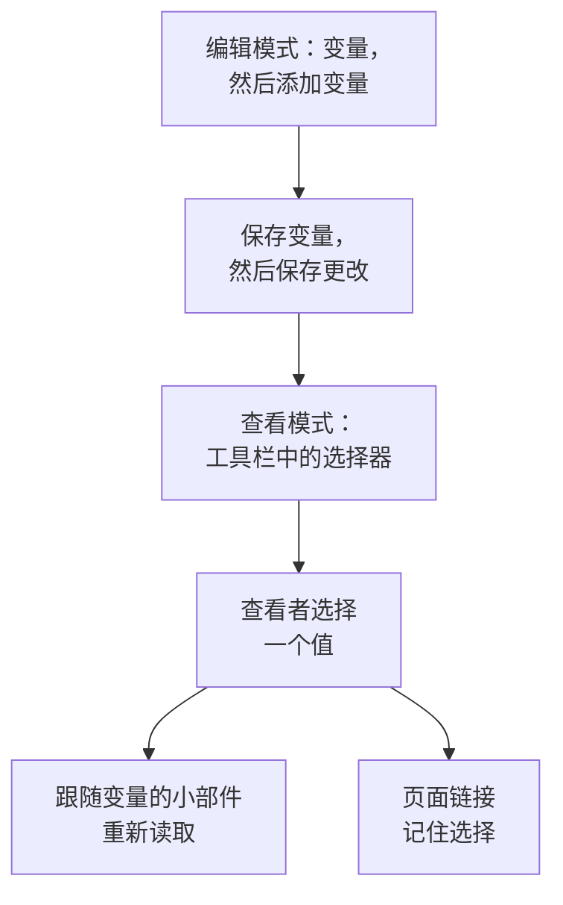

# 仪表板变量与过滤器

变量是仪表板工具栏中的选择器。添加一个 `service` 变量，同样的图表就能显示 `checkout` 、 `payments` 或 `search` ：查看者在工具栏中选择，而不需要你构建三个几乎一样的仪表板。

:::cards
- [添加变量](#添加变量): 命名、选择值的来源，然后保存。
- [变量来源](#变量来源): Telemetry Attribute、Project Labels、Custom List 和 Text Input。
- [小部件如何使用变量](#小部件如何使用变量): 哪些小部件跟随哪些变量。
- [保留选择的链接](#保留选择的链接): 发送一个打开即为同一服务的链接。
:::

## 变量如何工作

变量在编辑仪表板时定义，并随仪表板一起保存。在查看模式下，每个变量都是工具栏中的一个选择器。查看者选择一个值后，每个跟随该变量的小部件都会重新读取数据，页面链接也会记住这个选择。



## 添加变量

:::steps
### 打开变量对话框

打开仪表板，选择 **⋯ → 编辑仪表板** ，然后点击工具栏中的 **变量** 。 **仪表板变量** 对话框会列出仪表板的变量；工具栏中的按钮会显示变量的数量。

### 添加一个

点击 **添加变量** 。新变量读取一个遥测属性；如有需要，可以选择另一个 **来源** 。

### 填写

为它指定一个 **名称** ，供小部件和链接使用，例如 `service` ：只能包含字母、数字和下划线，以字母或下划线开头，且不能与仪表板的其他名称重复。如有需要，再为工具栏添加一个 **标签** 、设置一个起始的 **默认** 值，并勾选 **允许多选** 让查看者可以选择多个值。

### 保存

点击 **保存变量** ，然后点击工具栏中的 **保存更改** 。仪表板回到查看模式后，变量的选择器就会出现在工具栏中。
:::

之后要修改或删除变量，请再次打开对话框：修改它的字段，或点击旁边的垃圾桶图标。

## 变量来源

**来源** 决定变量的值从哪里来，以及哪些小部件跟随它。

| 来源 | 值从哪里来 | 多选 |
| --- | --- | --- |
| Telemetry Attribute | 指标中某一个属性键的值，例如 `service.name` | 是 |
| Project Labels | 你允许的项目标签，从 1 到 1,000 个 | 是 |
| Custom List | 你输入的以逗号分隔的值，例如 `prod, staging` | 是 |
| Text Input | 查看者输入的任何内容 | 否 |

### Telemetry Attribute

设置 **属性键** ，例如 `service.name` 、 `host.name` 或 `k8s.namespace.name` ；该字段会提示你的遥测数据中带有的键。选择器最多提供该键的 100 个值，这些值读取自过去一天的指标，因此新服务无需编辑仪表板就会出现在其中。

这是最常用的来源，因为它不需要单独的列表：值就是你已经在发送的那些。

### Project Labels

选择现有的项目标签，作为仪表板下拉列表提供。例如，创建一个名为 `UNIT` 的变量，把来源设为 **项目标签** ，然后选择标签 `0660` 和 `0661` 。

仪表板会保存所选标签的 ID 和显示名称。过滤使用的是 ID，因此重命名项目标签不会破坏它的绑定。显示名称随仪表板一起保存；要更新重命名后标签的显示名称，请在变量编辑器中重新选择该标签。公开仪表板也显示这些已保存的选项。

在 **监视器列表** 小部件中，打开 **过滤器 → 标签变量** 并选择 `UNIT` 。此后选择 `0660` 会显示带有该标签的监视器。其他小部件不受影响，除非它们明确支持并绑定该变量： **SLO 列表** 也有同样的 **标签变量** 设置。

小部件的固定过滤器仍然有效。例如，有固定标签 `network` 且 `UNIT` 设为 `0660` 时，监视器必须同时带有这两个标签。选择多个单元时，匹配其中任意一个即可。选择 **全部** 只会移除变量条件，固定的标签、状态和监视器类型过滤器仍然保留。

缺少变量，或所选内容不在配置的选项之内时，会显示错误。所选标签没有匹配的监视器时，会显示空列表。不再需要绑定时，请明确地将其从小部件中移除。

### Custom List 和 Text Input

Custom List 提供你输入的以逗号分隔的值。Text Input 让查看者输入任意值，例如 IP 地址或请求 ID。两者本身都不会过滤小部件：它们的值会填入你写 `{{name}}` 的地方（见下文）。

旧仪表板中的 Query 变量会被保留，并在工具栏中显示一个文本框：OneUptime 不再从查询加载它的值。

## 多选与默认值

勾选 **允许多选** 后，查看者可以选择一个或多个值，小部件会显示其中任意一个的数据。空选择表示 **全部** ，而多选变量总是从 **全部** 开始，因此它的 **默认** 值显示为灰色。

单选变量从它的 **默认** 值开始，没有默认值时从 **全部** 开始。 **全部** 会移除变量的过滤，因此小部件显示所有内容。

想在不离开仪表板的情况下比较"checkout 和 payments 合在一起"时，请使用多选。如果数字在各个值之间不能相加，例如平均值的平均值，请避免使用。

## 小部件如何使用变量

每种来源以自己的方式作用于小部件：

- **遥测属性** 变量无需在小部件上做任何设置即可过滤：每个指标图表、值、仪表和表格； **日志图表** 、 **日志流** 、 **追踪图表** 和 **追踪表** ；以及资源带有该属性的基础设施列表，例如主机列表上的 `host.name` 和 Kubernetes 列表上的 `k8s.namespace.name` 。没有该属性的指标图表在选中某个值时不显示数据：选择 **全部** 即可重新看到。 **跟踪列表** 以及事件和警报列表不跟随这类变量。
- **项目标签** 变量会过滤 **标签变量** 中指定了它的 **监视器列表** 或 **SLO 列表** 。
- **任何变量** 都可以以 `{{name}}` 的形式写入文本：在 [HTML 小部件](/docs/dashboards/widgets#html) 中、 [外部数据源](/docs/dashboards/data-sources) 的查询中，以及 **监视器列表** 或 **SLO 列表** 的标题中。像 `{{UNIT}} NETWORK` 这样的标题会显示为 `0660 NETWORK` 、 `0660, 0661 NETWORK` 或 `All NETWORK` 。标题只控制显示的文本；要过滤监视器查询，请配置 **标签变量** 。

[SLO 小部件](/docs/dashboards/widgets#slo) 可以跟随 `sloName` 键上的 Telemetry Attribute 变量，让查看者选择它显示哪个 SLO。

## 保留选择的链接

页面链接以 `?var-<name>=<value>` 的形式携带每个变量的选择，多个值用逗号分隔，因此复制的链接打开时会保留相同的选择，包括明确的 **全部** 。像下面这样的链接会打开 payments 服务：

```text title="A dashboard link with a variable"
https://oneuptime.com/dashboard/<project-id>/dashboards/<dashboard-id>?var-service=payments
```

链接还会以 `range` 和 `refresh` 携带你选择的时间范围和自动刷新，让收到链接的人看到与你相同的内容。它们的取值见 [发送链接](/docs/dashboards/sharing#发送链接)。

## 示例：每个服务一个仪表板

一个服务仪表板通常包含：

1. 一个 `service` 变量，来源为 Telemetry Attribute，属性键为 `service.name` ，默认值为你最繁忙的服务。保持多选关闭，让图表一次只显示一个服务。
2. 一个 `namespace` 变量，来源为 Telemetry Attribute，属性键为 `k8s.namespace.name` ，开启多选以便比较命名空间。
3. 一个 `environment` 变量，来源为 Custom List，值为 `prod, staging` ，在数据源查询中以 `{{environment}}` 的形式使用。
4. 读取这些属性的小部件：服务指标的图表和值、一个日志流，以及一个 Kubernetes Pod 列表。

结果：一个适用于每个服务的仪表板，顶部有三个选择器。

## 后续步骤

:::cards
- [仪表板小部件](/docs/dashboards/widgets): 哪些小部件跟随哪些变量。
- [外部数据源](/docs/dashboards/data-sources): 把变量放进 PromQL 或 SQL 查询。
- [共享与公开仪表板](/docs/dashboards/sharing): 公开仪表板上的变量。
- [创建仪表板](/docs/dashboards/authoring): 编辑模式、保存和时间范围。
:::
