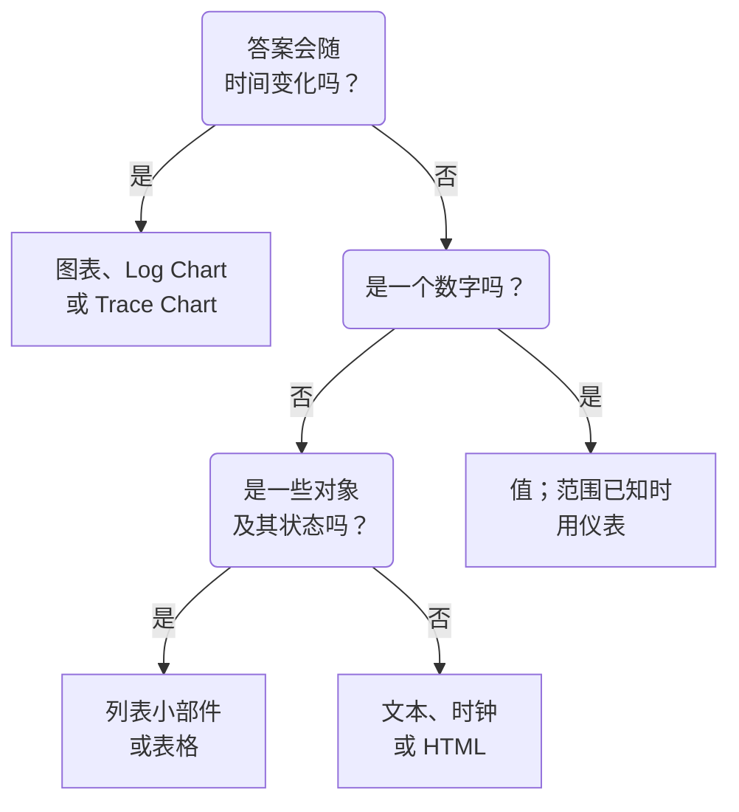

# 仪表板小部件

小部件是仪表板上的一个图块。本页按 **添加小部件** 目录自身的分组，列出其中每个小部件、它显示什么，以及重要的设置。关于如何把小部件放到网格上并保存，参见 [创建仪表板](/docs/dashboards/authoring) 。

:::cards
- [该用哪个小部件？](#该用哪个小部件): 按图块要回答的问题来选。
- [图表与数字](#图表与数字): 基于指标查询的图表、值、仪表和表格。
- [日志、链路与安全](#日志链路与安全): 数量图表、实时流和列表。
- [为列表和表格排序](#为列表和表格排序): 按某一列排序，并设定所有人看到的顺序。
- [小部件无法显示时](#小部件无法显示时): 出错的小部件会显示什么，以及如何修复。
:::

## 该用哪个小部件？

从图块需要回答的问题出发：

| 问题 | 小部件 |
| --- | --- |
| 某个指标随时间如何变化？ | **图表** |
| 各严重级别的日志随时间有多少？ | **日志图表** |
| 请求有多快、有多少失败，随时间如何变化？ | **追踪图表** |
| 此刻的某一个数字是多少？ | **值**，范围已知时用 **仪表** |
| 哪些主机、服务或端点比较突出？ | **表格** 或 **追踪表** |
| 此刻正在发生什么？ | **日志流**、**跟踪列表**、**事件列表** 或 **警报列表** |
| 我们的所有站点都正常吗？ | **监视器列表** |
| 我们是否守住了承诺的可靠性？ | **SLO** 或 **SLO 列表** |
| 我们的集群和主机处于什么状态？ | 基础设施分组中的小部件 |
| 我们的网络分布在世界何处，哪里出了故障？ | **网络地图** |
| 标题、备注、另一个办公室的时间？ | **文本** 或 **时钟** |
| 存放在 OneUptime 之外的数据？ | 外部数据源分组中的小部件 |
| 没有任何小部件能做的事？ | **HTML**，前提是确认其他小部件都做不到 |



大多数仪表板会组合几种：顶部一个图表，旁边一两个值，一个文本标题，下方一两个列表。

## 图表与数字

这四个小部件读取的指标查询，与指标浏览器的构建方式相同：选择一个指标和一种聚合，添加属性过滤器，再按某个属性分组，就能为每个值得到一条序列。

### 图表

仪表板时间范围内一个或多个指标查询的时间序列。 **Chart Type** 可将其绘制为折线图、柱状图、面积图、堆叠面积图或饼图。 **Additional Queries** 会在同一坐标轴上叠加更多指标， **Formulas** 则用 `+` 、 `-` 、 `*` 、 `/` 、 `%` 、 `^` 和括号把它们组合起来，例如 `(1 - a) * 100` 。每个查询的显示设置可以添加图例和单位、颜色、警告线和严重线，以及适用于只增不减的计数器的每秒速率。

当线条的形状能说明问题时使用它：延迟、错误、吞吐量或队列深度。

### 值

一个带迷你趋势线的大数字：查询在整个时间范围内的值，求和或计数时取总和，最大值时取最高值，最小值时取最低值，其他情况取平均值。箭头会把范围的后半段与前半段比较（两段按同样的方式计算），并按 **Trend Direction** 着色：数值越高越好还是越差，或根据指标名称判断。将指针悬停在箭头上可查看两段各自的值，悬停在迷你趋势线上可读取任意点的值和时间。值达到 **Warning Threshold** 时背景变黄，达到 **Critical Threshold** 时变红。

当一个数字就能回答问题时使用它：错误率、P95 延迟或今天处理的请求数。

### 仪表

介于最小值和最大值之间的表盘，未设置时为 0 和 100，从 **Warning Threshold** 起是黄色区域，从 **Critical Threshold** 起是红色区域。

当数值处于已知范围内时使用它：以百分比表示的 CPU 或磁盘使用率，或队列的容量。

### 表格

以行显示指标值。使用 **Group By Attributes** 时每个值一行，例如每个 `host.name` 一行；不使用时，每一行是一个时间段。 **Metrics & Columns** 用于设置列：指标，以及基于指标的公式，例如以百分比表示的可用性。分组时， **Reduce across time** 会把每一行的序列归约为一个值：最新值、平均值、总和、最小值或最大值。

需要看细分而不是趋势时使用它：最嘈杂的主机、各服务的错误、各端点的请求。

## 文本、时钟与 HTML

这些小部件不需要数据源。

### 文本

一行或一段文本，用作标题、备注或指向运行手册的链接。开启 **Markdown** 可以绘制标题、链接、列表、代码和表格；否则文本按输入原样显示，你也可以设为粗体、斜体或下划线。

### 时钟

以数字或模拟表盘显示任意时区的当前时间，并可加上"悉尼办公室"之类的标签。不指定时区时，显示每位查看者自己的时区。每个办公室加一个，就能看到谁还醒着。

### HTML

把你自己的 HTML、CSS 和 JavaScript 绘制为小部件。它的设置包括 HTML 正文、可选的样式表、可选的脚本，以及三个权限开关。

当你需要任何内置小部件都无法提供的内容时使用它：嵌入的第三方徽章、从内部 API 拉取的表格、自定义图例，或一组指向你自己工具的带样式链接。

#### 能做什么，不能做什么

该小部件在自己独立隔离的源上的沙箱框架中渲染。在这个框架内，你的代码几乎可以做任何事：构建 DOM、运行定时器、从任意 URL 获取数据、在 canvas 上绘图。

它不能做的是访问周围的 OneUptime 页面。它无法访问仪表板的 DOM、Cookie、本地存储或 API 会话，也不能让浏览器标签页跳转到别处。无论仪表板是私有的还是公开共享的，都是如此。

粘贴任何内容之前，有两点值得了解：

- 小部件发出的 `fetch` 是来自不透明源的跨源请求，因此你调用的服务器必须通过 CORS 允许它。不支持从这里调用 OneUptime API。
- 小部件起初是透明的。如果希望它填满卡片，请在 CSS 中为 `body` 设置背景。在深色主题下，它的文字起初为浅色，它的 `<html>` 元素带有 `dark` 类：以 `html.dark` 开头写 CSS 规则，即可只为深色主题设置样式。

#### 使用仪表板变量

在 HTML、CSS 或 JavaScript 的任意位置写入 `{{variableName}}` ，小部件渲染前它就会被替换为该变量的当前值。选择新值会重新渲染小部件。指向不存在变量的占位符会原样保留。

脚本还会在 `window.ONEUPTIME` 上获得相同的值，以及仪表板的时间范围：

```javascript title="window.ONEUPTIME"
window.ONEUPTIME.variables.environment; // current value, or "" if unset
window.ONEUPTIME.startDate; // ISO 8601 string, start of the dashboard's time range
window.ONEUPTIME.endDate; // ISO 8601 string, end of it
```

仪表板每次刷新时小部件都会重新加载，因此自行获取数据的小部件也能跟上刷新间隔。

#### 权限

**Run JavaScript** （默认开启）会运行你的脚本。关闭后只渲染标记和样式——此时脚本会被完全排除在小部件之外，而不仅仅是被阻止。

**Open links in a new tab** （默认开启）允许链接和 `window.open` 打开浏览器标签页。链接总是在新标签页中打开；小部件永远无法让仪表板本身跳转。

**Allow forms to submit** （默认关闭）允许小部件内的 `<form>` 提交。

能编辑仪表板的人决定这个小部件运行什么，而查看仪表板的每个人都会运行它——在公开仪表板上，这包括匿名访客。对待带有 HTML 小部件的仪表板的编辑权限，要像对待你发布的任何其他代码的访问权限一样。

## 日志、链路与安全

| 小部件 | 显示内容 | 重要设置 |
| --- | --- | --- |
| **日志图表** | 随时间变化的日志量，每个严重级别一条序列，以柱、线或面积显示。 | 严重级别、正文包含的文本、属性过滤器。 |
| **日志流** | 与过滤器匹配的最新日志行。 | 严重级别、正文包含的文本、属性过滤器（如 `@service.name:checkout` ）、行数。 |
| **追踪图表** | 随时间变化的请求数、错误数或响应时间（平均、最小、最大、P50 到 P99）。 | 指标、要统计的 span，以及用于拆分序列的属性。 |
| **跟踪列表** | 最新的链路及其持续时间和状态。 | 状态、行数。 |
| **追踪表** | 按请求数排列的主要 span 名称、状态或属性值，以及中位数、平均、最小和最大响应时间。 | 按什么对行分组，以及要统计哪些 span。 |
| **安全事件** | 最新的安全事件，及其严重级别、事件类别和主机。 | 严重级别、事件类别、消息包含的文本。 |
| **安全事件流向** | 安全事件从来源、经事件类别、到严重级别的流向。 | 严重级别、事件数量。 |

与链路浏览器一样，链路类小部件只统计根 span，除非你在设置中包含子 span。常见的布局是顶部放延迟图表，下方放慢链路列表。

## 事件、警报与监视器

| 小部件 | 显示内容 | 过滤器 |
| --- | --- | --- |
| **事件列表** | 事件及其状态和严重级别。 | 未解决、已确认或已解决；严重级别、状态、监视器和标签。 |
| **警报列表** | 警报及其状态和严重级别。 | 未解决、已确认或已解决；严重级别、状态、监视器和标签。 |
| **监视器列表** | 监视器及其当前状态。 | 是否正常运行、状态、监视器类型和标签，或查看者在工具栏中选择的 **标签变量** 。 |

与大多数列表小部件一样，这三个小部件可以绘制按状态着色的蜂窝格子，而不是表格：在 **查看模式** 下选择。无论仪表板的时间范围如何，它们显示的都是当前状态。

## 服务等级目标

### SLO

一个服务等级目标，以单个数字或随时间变化的线条绘制。

**设置**: 哪个 SLO（或在仪表板变量中选中的 SLO）；显示它的三个数字中的哪一个（SLI、Error Budget Remaining 或 Burn Rate）；以 Tile 还是图表方式显示；以及可选的标题。

- **Tile** 显示当前数字，有第二行时也一并显示——SLI 下方是目标，错误预算下方是剩余分钟数。状态标签为整体着色。
- **图表** 在仪表板的时间范围内绘制同一个数字，并在 SLI 序列上用虚线标出目标。历史数据由评估工作进程每隔几分钟写入一次，因此全新的 SLO 在第一次评估之前，图表是空的。

当仪表板回答的是"我们是否兑现了承诺？"而不是"此刻正在发生什么？"时使用它。

SLO 小部件可以在 [公开仪表板](/docs/dashboards/sharing) 上使用。发布的是 SLO 的关键数字——名称、目标、当前 SLI、剩余错误预算、消耗速率和状态——与小部件绘制的是哪一个无关。它的定义保持私密：它监控的监视器、标签、描述、查询和评估计划永远不会发送给公开查看者。Tile 小部件只发布这些当前数字；图表小部件还会发布它所绘制的那一条序列的历史，此外不发布任何内容。

### SLO List

列出每个 SLO 及其状态、SLI、错误预算和消耗速率，剩余预算最少的排在最前。可以按状态或标签过滤，或使用查看者在工具栏中选择的 **标签变量** 过滤。 [SLO 指标与仪表板](/docs/slo/metrics) 展示了两个 SLO 小部件的实际用法。

## 基础设施

这些小部件列出代理或采集器向 OneUptime 报告的资源。在过滤器中按集群、主机或命名空间缩小范围，并以列表或蜂窝格子显示。

| 分组 | 小部件 | 数据来源 |
| --- | --- | --- |
| **主机** | **主机**，含连接状态、操作系统、CPU 和内存 | 任何发送 `host.name` 的 OpenTelemetry 采集器 |
| **Kubernetes** | **Pod**、**节点**、**命名空间**、**部署**、**StatefulSets**、**DaemonSets**、**任务**、**CronJobs** | [Kubernetes 代理](/docs/monitor/kubernetes-agent) |
| **Docker** | **主机**、**容器**、**镜像**、**网络**、**卷** | Docker 代理 |
| **Docker Swarm** | **节点**、**服务** | Docker Swarm 代理 |
| **Podman** | **主机**、**容器**、**镜像**、**网络**、**卷** | Podman 代理 |
| **Proxmox** | **节点**、**客户机** | Proxmox 代理 |
| **VMware** | **主机**、**虚拟机** | VMware 代理，或你连接的 vCenter |
| **Ceph** | 以按状态着色的墙显示的 **OSD** ，以及 **存储池** | Ceph 代理 |
| **存储阵列** | **卷**，以及以按状态着色的墙显示的 **硬件** | Storage Array 代理 |

当你想在一个页面上同时看到基础设施的状态和其上运行的工作负载的遥测数据时，使用它们。

### Network Map

在世界地图上绘制你的网络站点，每个站点固定在自己的经纬度上，并按汇总到它的监视器状态着色。距离较近的站点共用一个标记，标记内标出数量；只代表一个站点的标记，点击后会打开该站点。

地图会根据绘制的站点自动取景——位于一个国家内的网络会以该国家填满画面，跨越多个大洲的网络则以整个世界打开。没有缩放或平移控件：仪表板图块是一张图片，要浏览层级请前往 Network 下的 Network Map 页面。

地图上方会显示有多少站点宕机，因为在两百个绿点中的一个两像素红点，在看仪表板的距离上没人能看清。地图下方的覆盖行说明地图没有显示的内容：没有坐标的站点，以及是否达到了行数上限。

**设置**: 标题、地图或列表视图、最多绘制的站点数、是否显示站点名称，以及按站点类型和状态的过滤器。当地图过于拥挤以致名称无法阅读时，站点名称会自动隐藏；工具提示仍会显示每个标记的名称。

站点只有在有坐标时才会显示。在站点上添加纬度和经度（或从 CSV 导入）即可将其固定在地图上。

## 外部数据源

外部数据源分组从不属于 OneUptime 的系统中绘制 **图表** 、 **值** 、 **仪表** 或 **表格** ：Prometheus、PostgreSQL、MySQL、SQL Server、ClickHouse、Loki、Elasticsearch 或任意 REST API。你只需连接系统一次，然后用该系统自己的语言编写每个小部件的查询。 [外部数据源](/docs/dashboards/data-sources) 说明了具体做法。

## 为列表和表格排序

点击某一列的标题，即可按该列为列表或表格排序：第一次点击按下表所示排序，下一次点击反向排序，再下一次点击让小部件回到它自己的顺序。如果小部件已经按这一列排序，点击会让顺序反过来。箭头标出行所依据的排序列。

| 列 | 第一次点击 | 下一次点击 |
| --- | --- | --- |
| 状态或严重程度 | 最差优先 | 最佳优先 |
| 时间 | 最新优先 | 最早优先 |
| 数字 | 最高优先 | 最低优先 |
| 文本 | A→Z | Z→A |

什么算最差，由你的项目自己的顺序决定：监控器状态看其优先级，事件或告警的严重程度和状态看你在项目中排列的顺序，宕机、未就绪或已关机的资源排在健康资源之前。Pod 的阶段按 Failed、Unknown、Pending、Running 和 Succeeded 的顺序排列。SLO 的 SLI 和错误预算，以及 Proxmox 访客的 VMID，按从低到高排列。

排序的是整个列表，而不只是屏幕上的行：一个显示 25 行、按最差优先排序的列表，显示的是全部中最差的 25 个。值相同的行保持小部件自己的顺序。无法对整个列表排序的列（例如安全事件的消息）不能排序。

### 你自己的排序

你的排序只属于你：浏览器会为该仪表板上的该小部件记住它，因此刷新页面或墙面屏幕重启后它仍然保留，其他人也看不到。让小部件回到自己顺序的那次点击会忘记你的排序，此后小部件遵循它自己的顺序，即使编辑者之后更改了这个顺序也是如此。

### 所有人看到的顺序

要设定小部件为所有人打开时的顺序，请编辑该小部件，在 **排序** 中选择顺序，或在其 **Live Preview** 中点击某一列的标题，然后点击 **保存更改**。你会立即看到新的顺序；自己为该小部件排过序的查看者会保留自己的排序。

仪表板模板会以最差优先的顺序打开主机、节点、Pod、Swarm 服务和网络设备列表。

通过 API 和 Terraform，顺序是小部件的 `arguments.sort`：一列加一个方向，例如 `status:desc`。列表小部件会拒绝它没有的列，错误信息会列出它可用的排序。

## 在公开仪表板上

[公开仪表板](/docs/dashboards/sharing) 会为访客绘制大多数小部件，每个小部件只显示它被设置为显示的内容。有少数小部件在没有登录会话时无法显示：

- **日志图表** 、 **追踪图表** 、 **追踪表** 、 **安全事件** 和 **安全事件流向** 会在原位置说明它们在公开仪表板上不可用。
- 外部数据源小部件会被完全排除在公开仪表板之外，因为它们的设置就是查询本身。

## 小部件无法显示时

无法绘制的小部件会在原位置显示 **无法显示此小部件** ，而仪表板的其余部分继续正常工作。当 OneUptime 没有该类型的小部件（已被移除、通过 API 编写仪表板时拼错，或由更新的版本添加），或者小部件在绘制时出错（例如保存的设置不完整）时，就会出现这种情况。

如果你可以编辑仪表板，请点击该小部件上的 **编辑小部件** 。仪表板会切换到编辑模式并打开该小部件的设置：修正设置，或点击 **删除小部件** ，然后点击 **保存更改** 。绘制时出错的小部件还会提供 **重试** ，并在下一次自动刷新或你更改时间范围时重新绘制。

公开仪表板的访客只会被告知该小部件无法显示。

## 后续步骤

:::cards
- [仪表板变量与过滤器](/docs/dashboards/variables): 让查看者把小部件指向某个服务、主机或客户。
- [外部数据源](/docs/dashboards/data-sources): 在你自己的数据旁边绘制 Prometheus、SQL、Loki 等的数据。
- [创建仪表板](/docs/dashboards/authoring): 添加、排列并保存小部件。
- [共享与公开仪表板](/docs/dashboards/sharing): 在团队之外共享仪表板。
:::
