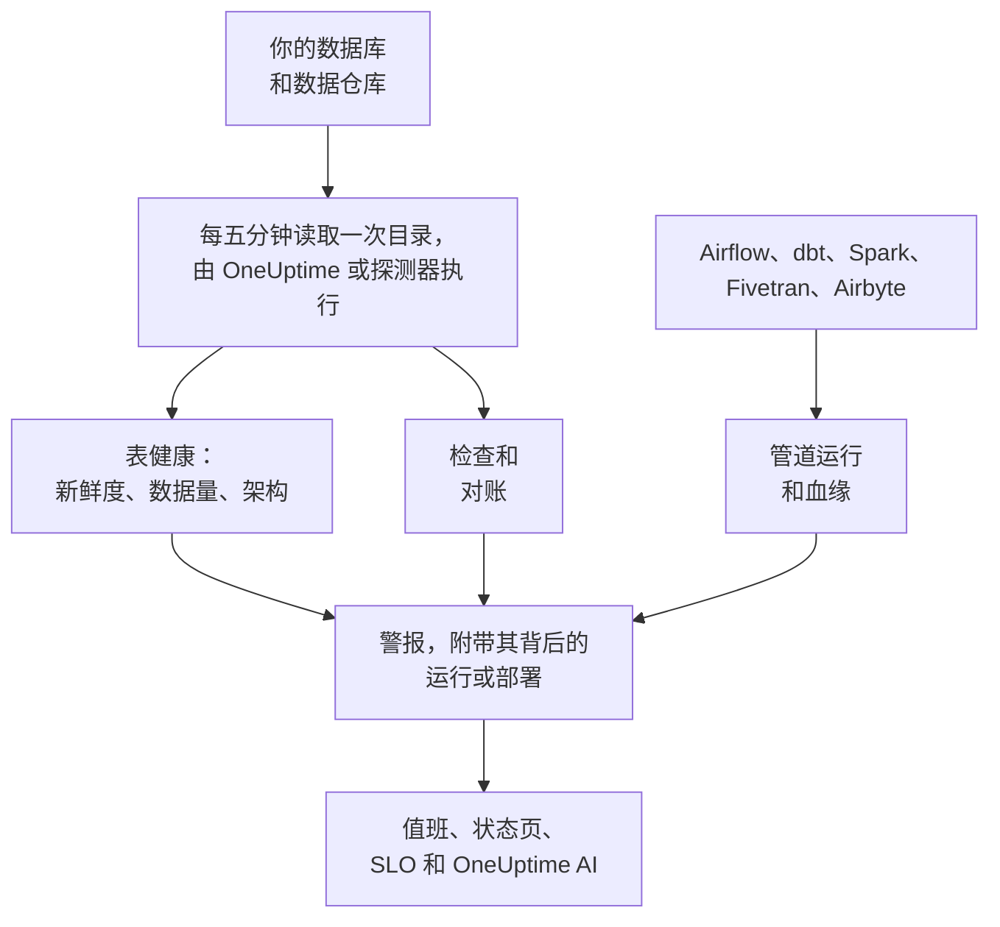

# 数据可观测性

数据可观测性会监视你的公司所依赖的表——无论它们位于 PostgreSQL、MySQL、SQL Server、Oracle、MongoDB、Redshift、Snowflake、BigQuery、ClickHouse、Databricks 还是 Athena 中——并在使用这些数据的人察觉之前，告诉你哪些数据延迟、缺失、错误或损坏。它会自行学习每个表的节奏，读取每个数据库的目录，因此任何值都不会离开它，并把每个数据问题关联到其背后的管道运行、部署或上游表。

它能解答四个疑问：

:::cards
- [数据是否新鲜？](/docs/data-observability/table-health): 每个表的最后更改时间、行数、大小和列，每五分钟读取一次，并在表延迟、缩小或结构改变时发出警报。
- [数据是否正确？](/docs/data-observability/checks): 针对表中内容的检查、表与其副本之间的对账，以及 dbt 的测试，失败时发出警报。
- [数据从哪里来，又流向哪里？](/docs/data-observability/lineage-and-pipelines): 来自你的管道、dbt、Fivetran、Airbyte、视图以及数据库自身查询历史的血缘，让一个问题只打开一个警报。
- [使用数据的人能否信赖它？](/docs/data-observability/data-products): 带有新鲜度 SLA 的数据产品，显示在状态页上并作为 SLO 跟踪，还附带“data as of”徽章。
:::

## 工作原理

1. 使用只读登录 **连接数据库**。数据安全已经知道的数据库无需任何操作就会受到监视，你的 Google Cloud 连接找到的每个 BigQuery 数据集也是如此。私有网络中的数据库由你在该网络中运行的探测器读取。
2. **每五分钟**，OneUptime 会读取每个数据库的目录和统计信息：每个表和视图、它的列、行数和大小，以及它最后一次更改的时间。不会扫描任何表，在 MongoDB 上只读取其最新文档的字段名称。存储桶中的路径也可以用同样的方式监视。
3. **学习每个表的节奏**：它通常多久更改一次。错过节奏的表即为延迟；行数下降或列发生变化的表也会如实报告。
4. **推荐警报** 会把以上每一项都变成一个由你决定是否添加的监视器，而你添加的检查会读取表中保存的内容。
5. **血缘** 说明哪些表为哪些表提供数据，因此当某个表的来源先出现故障时，该表上的警报会被视为该来源的后果：只有一个警报，而不是十个。

## 有何不同

- **它与 OneUptime 的其他部分融为一体。** 数据警报就是普通的警报：它会通过值班呼叫、打开事件、显示在状态页上，并计入 SLO。追踪表明正在写入某个表的服务，这些服务及其部署会显示在每个表警报的旁边。
- **无需逐表配置。** 节奏、计划和通常的运行时间，都从每个表和管道的实际行为中学习得出；为某个数据库推荐的监视器会覆盖其中的每个表，包括以后创建的表。
- **一个原因只有一个警报。** 如果某个警报的上游表、管道或数据库已有一个打开的警报，它会作为后果加入该警报，并且已被确认，因此一次失败的加载只会呼叫一次。
- **每个警报都会自我解释。** 它会对可能的原因排序，说明哪些内容依赖于该表以及谁拥有它，并从你对它的反馈中学习：把某个警报标记为 **不是问题**，下次同样的情况就会保持安静。
- **OneUptime AI 了解你的数据。** 对数据警报的调查从表的写入方、运行和上游表开始；询问 AI、Slack、Microsoft Teams 和 AI 代理都能查询某个表是否新鲜；还可以用一句话编写检查。请参阅 [OneUptime AI 与 API](/docs/data-observability/ai-and-api)。

## 开始之前

- **能够设置它的角色。** Project Owner、Project Admin 和 Telemetry Admin 可以连接数据库。任何可以编辑数据资产的人都可以添加检查、对账和数据产品；Viewer 可以读取它的发现。请参阅 [权限参考](/docs/permissions/reference)。
- **每个数据库上的只读登录。** [连接数据库](/docs/data-observability/connect) 列出了每种引擎至少需要的权限。OneUptime 会建议你的追踪、云账户和数据库监控已经知道的数据库。

## 快速入门

:::steps
### 连接数据库

打开 **数据可观测性**，前往 **数据库**，然后选择 **连接数据库**。选择引擎，并提供一个只读连接字符串，或者你的探测器从中读取连接字符串的环境变量名称。[连接数据库](/docs/data-observability/connect) 展示了每种引擎的登录。

### 查看它的表

五分钟内，它的表就会出现在 **表** 下，每个表都显示行数、大小和最后一次更改的时间。表更改两次后，就能知道它的新鲜度：保持节奏时为 **新鲜**，错过节奏后为 **延迟**。

### 添加推荐的警报

在 **数据库** 上，为该数据库选择 **推荐的警报**，然后添加你想要的警报：延迟的表、行数骤降或异常偏低的表、列发生变化的表，以及停止报告的数据库。每一个都是普通的监视器：值班、所有者、维护窗口和状态页的用法与其他监视器相同。
:::

## 费用

在 OneUptime Cloud 上，项目的前 100 张表免费。之后每张表每月 $1，超过 1,000 张的部分每张 $0.25。视图免费，您停止监控的数据库中的表也免费。带告警的检查按活动监视器计费。**数据库** 和 **概览** 显示您的项目监控的表数量及其费用，[定价](https://oneuptime.com/pricing) 页面提供计算器。

自托管的 OneUptime 不为表付费。

## 后续步骤

:::cards
- [连接数据库](/docs/data-observability/connect): 每种引擎的最小权限登录，以及适用于私有网络的探测器。
- [表健康](/docs/data-observability/table-health): 新鲜度、数据量、架构变更、未使用的表，以及每个表写入的指标。
- [检查与对账](/docs/data-observability/checks): 针对表中值的规则、表与其副本的比较，以及 dbt 的测试。
- [血缘与管道](/docs/data-observability/lineage-and-pipelines): OpenLineage、dbt、Fivetran 和 Airbyte，以及一个原因只有一个警报。
- [数据产品](/docs/data-observability/data-products): 为使用数据的人提供的新鲜度 SLA，显示在状态页上并作为 SLO 跟踪。
- [OneUptime AI 与 API](/docs/data-observability/ai-and-api): 调查、用一句话编写检查、供 AI 代理使用的新鲜度，以及每个端点。
:::
