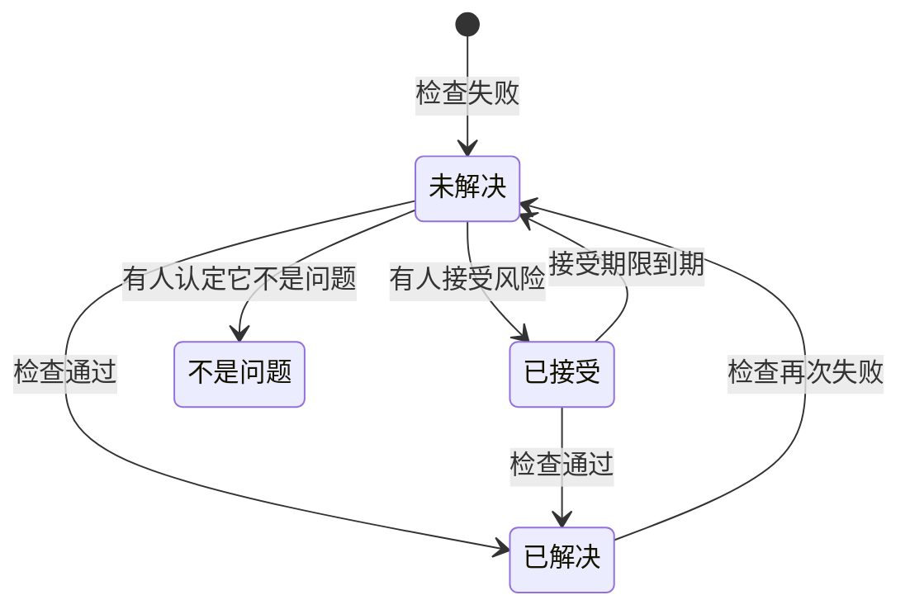

# 数据安全检查与问题

数据安全会对每个数据存储运行 32 项检查，分为九组。每项检查读取关于某个数据存储的已知信息——它的配置方式、在其中找到了什么、谁可以访问它、它位于何处——然后得出通过、失败或无法判断的结果。未通过的检查会在该数据存储上打开一个问题，检查通过后，问题会自行关闭。本页列出每项检查，说明问题的严重程度和风险评分是如何算出的，以及问题在其生命周期中会经历什么。

:::cards
- [检查如何做出判断](#检查如何做出判断): 通过、失败或无法判断，以及失败有多严重。
- [每项检查](#每项检查): 全部 32 项，包括每项检查的内容以及如何修复。
- [风险评分](#风险评分): 同一严重程度内的问题如何排序。
- [问题会经历什么](#问题会经历什么): 未解决、已解决、已接受、不是问题。
- [在此修复](#在此修复): 一键阻止公开的存储桶，或停止共享快照。
:::

## 检查如何做出判断

每项检查都会读取关于数据存储的事实，并以下列四种方式之一作答：

| 回答 | 含义 | 问题会怎样 |
| --- | --- | --- |
| 通过 | 检查没有发现任何不妥。 | 未解决或已接受的问题会被解决。 |
| 失败 | 检查发现了问题，并用一句话说明它看到了什么：这就是问题的证据。 | 打开一个问题，或更新当前未解决的问题。 |
| 无法判断 | 某个事实无法读取：角色没有某项权限，或某个调用失败了。 | 什么都不会改变：未解决的问题仍保持未解决，因为在 OneUptime 无法查看时，任何人都不能断定问题已修复。 |
| 不适用 | 该类型的数据存储没有这项设置。 | 未解决的问题会被解决。 |

### 严重程度取决于数据

同样的问题，出现在越敏感的数据上就越重要。每项检查都为每个敏感度级别给出一个严重程度，问题采用其数据存储所对应的那一个：存放卡号的公开存储桶为严重，存放网站图片的公开存储桶仅为低。短横线表示根本不会打开问题。数据存储的敏感度来自它的发现（请参阅 [敏感数据类型](/docs/data-security/data-types#敏感度)），因此内容样本能让严重程度准确无误。

有几项检查则根据它们看到的内容来设定严重程度。**其中存储了密钥** 在任何数据存储上都为高，在公开或与其他账户共享的数据存储上为严重。

## 每项检查

严重程度依次针对受限、机密、内部和公开数据给出。每个问题的页面都会显示针对其数据存储的完整修复方法（控制台步骤、CLI 命令，以及适用时的 Terraform），并已填好数据存储的名称和区域。

### 暴露

| 检查 | 适用于 | 检查内容 | 严重程度 | 如何修复 |
| --- | --- | --- | --- | --- |
| 互联网上的任何人都可以读取它（`public-read`） | 对象存储、数据仓库、搜索 | 数据存储的策略、ACL 或 IAM 绑定允许任何人无需登录即可读取其数据。 | 严重 / 严重 / 高 / 低 | 移除授予匿名主体或所有已认证主体的每项权限。必须公开的文件应放在一个标记为 **有意公开** 且不存放其他任何内容的数据存储中。 |
| 互联网上的任何人都可以更改它（`public-write`） | 对象存储、数据仓库、搜索 | 数据存储的策略、ACL 或 IAM 绑定允许任何人写入或删除其数据。 | 严重 / 严重 / 严重 / 高 | 移除授予匿名主体或所有已认证主体的每项写入或删除权限。 |
| 未阻止公开访问（`public-access-not-blocked`） | AWS S3 Bucket | 存储桶或其账户的 S3 Block Public Access 没有完全开启，因此只需一次策略更改就可能使其公开。 | 高 / 中 / 低 / — | 为存储桶开启全部四项 Block Public Access 设置。 |
| 数据库接受来自互联网的连接（`internet-reachable`） | 数据库、数据仓库、搜索、缓存 | 数据库开启了公共端点或公共网络访问。 | 高 / 高 / 中 / 低 | 关闭公共端点，并通过专用网络或堡垒机访问数据库。 |
| 它的防火墙允许所有地址进入（`open-to-all-addresses`） | 数据库、数据仓库、搜索、缓存 | 某条防火墙规则或授权网络允许 0.0.0.0/0 或整个地址范围。 | 严重 / 严重 / 高 / 中 | 用需要访问的地址或网络替换允许一切的规则。 |
| 任何人都可以恢复它的快照（`snapshot-public`） | 数据库、快照 | 数据库快照被公开共享，因此任何云账户都能恢复出一份完整副本。 | 严重 / 严重 / 严重 / 高 | 将快照设为私有。 |
| 它的快照与其他账户共享（`snapshot-shared-externally`） | 数据库、快照 | 数据库快照与你已连接账户以外的账户共享。 | 高 / 高 / 中 / 低 | 停止与不应拥有该快照的账户共享。 |
| 你的组织以外的账户可以访问它（`shared-with-external-accounts`） | 除遥测外的所有数据存储 | 数据存储的策略向未连接到 OneUptime 的账户、租户或项目授予了访问权限。 | 高 / 高 / 中 / 低 | 逐一审查每个外部主体，并移除不需要访问权限的主体。 |

### 加密

| 检查 | 适用于 | 检查内容 | 严重程度 | 如何修复 |
| --- | --- | --- | --- | --- |
| 它的数据未进行静态加密（`not-encrypted-at-rest`） | 除遥测外的所有数据存储 | 存储加密已关闭。 | 高 / 中 / 低 / — | 开启静态加密。RDS 实例无法就地加密：请从其快照恢复一份加密副本。 |
| 受限数据未使用你自己的密钥（`no-customer-managed-key`） | 除遥测外的所有数据存储 | 数据存储保存着受限数据，但使用的是提供商的默认密钥加密，而不是客户管理的密钥。 | 中 / — / — / — | 使用你在密钥服务中管理的密钥加密该数据存储。 |
| 允许未加密的连接（`encryption-in-transit-not-enforced`） | 除遥测外的所有数据存储 | 数据存储接受不使用 TLS 的连接。 | 高 / 中 / 低 / — | 要求每个连接都使用 TLS。在 S3 上，拒绝 `aws:SecureTransport` 为 false 的每个请求。 |
| 它接受低于 1.2 的 TLS 版本（`weak-tls`） | 除遥测外的所有数据存储 | 最低 TLS 版本为 1.0 或 1.1。 | 中 / 中 / 低 / — | 将最低 TLS 版本设为 1.2 或更高。 |

### 恢复

| 检查 | 适用于 | 检查内容 | 严重程度 | 如何修复 |
| --- | --- | --- | --- | --- |
| 它没有备份，或备份保留不足 7 天（`no-backups`） | 数据库、数据仓库 | 自动备份已关闭，或保留时间少于 7 天。 | 高 / 中 / 低 / — | 开启自动备份，并至少保留 7 天。 |
| 时间点恢复已关闭（`no-point-in-time-recovery`） | AWS DynamoDB Table、Azure Cosmos DB Account | 表或数据库无法恢复到出错之前的某个时刻。 | 中 / 低 / — / — | 开启时间点恢复。 |
| 它可以一步删除（`deletion-protection-off`） | 数据库、数据仓库 | 删除保护已关闭。 | 中 / 低 / — / — | 开启删除保护。 |
| 已删除或被覆盖的文件无法恢复（`deleted-data-not-recoverable`） | 对象存储 | 版本控制和软删除均已关闭。 | 中 / 低 / — / — | 开启版本控制或软删除。 |

### 可见性

| 检查 | 适用于 | 检查内容 | 严重程度 | 如何修复 |
| --- | --- | --- | --- | --- |
| 没有人会知道谁读取了它（`access-not-logged`） | 除遥测外的所有数据存储 | 对数据存储的读取没有被记录：没有访问日志，也没有数据访问审核日志。 | 高 / 中 / 低 / — | 为读取开启访问日志或审核日志：S3 服务器访问日志或 CloudTrail 数据事件、Azure StorageRead 诊断日志、Cloud Storage Data Access 审核日志。 |

### 访问

| 检查 | 适用于 | 检查内容 | 严重程度 | 如何修复 |
| --- | --- | --- | --- | --- |
| 任何拥有账户密钥的人都可以读取所有内容（`shared-key-access`） | Azure Storage Account | 存储账户允许共享密钥访问，这会绕过 Microsoft Entra ID，并且不会留下按人记录的审核轨迹。 | 中 / 低 / — / — | 将应用程序迁移到 Microsoft Entra ID，然后关闭存储账户密钥访问。 |
| 对象可以带有自己的访问规则（`object-acls-enabled`） | AWS S3 Bucket、Google Cloud Storage Bucket | 对象 ACL 已开启，因此存储桶看起来是私有的，单个对象却可能被设为公开。 | 低 / 低 / — / — | 在 S3 上，将 Object Ownership 设为 Bucket owner enforced。在 Cloud Storage 上，开启统一存储桶级访问权限。 |
| 超过 25 个身份可以读取受限数据（`many-readers`） | 除遥测外的所有数据存储 | 拥有该数据存储读取权限的身份，多到大多数团队都无法逐一审查。 | 中 / — / — / — | 打开数据存储的 **谁可以访问** 页面，移除未使用或超出需要的访问权限。 |

### 数据卫生

| 检查 | 适用于 | 检查内容 | 严重程度 | 如何修复 |
| --- | --- | --- | --- | --- |
| 其中存储了密钥（`secrets-stored`） | 除遥测外的所有数据存储 | 在数据存储的数据中找到了密码、API 密钥、令牌或私钥。 | 高 / 高 / 高 / 高 | 将找到的每个密钥都视为已泄露并进行轮换。将密钥移到密钥管理器中，并从数据存储中删除它们。 |
| 存储了银行卡安全码（`card-security-codes-stored`） | 除遥测外的所有数据存储 | 找到了 CVV 或 CVC 码。无论是否加密，PCI DSS 都禁止在支付获得授权后保留它们。 | 严重 / 严重 / 严重 / 严重 | 停止写入它们的代码，删除已存储的安全码，并检查备份中是否仍有残留。 |
| 银行卡号以可读形式存储（`card-numbers-readable`） | 除遥测外的所有数据存储 | 找到了可读形式的完整银行卡号。PCI DSS 要求它们无论存储在何处都不可读。 | 高 / 高 / 高 / 高 | 通过你的支付服务商对银行卡号进行令牌化，或在字段级别加密，并删除可读的副本。 |
| 密码以明文存储（`plaintext-passwords`） | 除遥测外的所有数据存储 | 密码字段保存的值不是密码哈希（bcrypt、argon2、scrypt 或 PBKDF2）。 | 严重 / 严重 / 严重 / 严重 | 用 bcrypt、scrypt 或 argon2 对密码进行哈希，迁移已存储的密码，并让每个账户重置密码。 |
| 生产数据被复制到了非生产数据存储中（`production-data-in-non-production`） | 除遥测外的所有数据存储 | 在生产数据存储中找到的值也出现在了这里，即某个开发、测试或预发布数据存储中。 | 高 / 中 / — / — | 用脱敏数据或合成数据替换该副本，并从非生产数据存储中删除真实数据。 |
| 90 天内无人使用的敏感数据（`stale-sensitive-data`） | 除遥测外的所有数据存储 | 数据存储保存着敏感数据，并且 90 天内没有任何读取或写入。 | 中 / 低 / — / — | 确认不再需要这些数据，然后为其设置保留日期并归档，或将其删除。 |
| 此敏感数据存储无人负责（`no-owner`） | 所有数据存储 | 数据存储保存着敏感数据，但没有所有者。 | 中 / 低 / — / — | 在数据存储的 **所有者** 页面上添加所有者，或添加与其标记匹配的所有者规则。 |

### 遥测

| 检查 | 适用于 | 检查内容 | 严重程度 | 如何修复 |
| --- | --- | --- | --- | --- |
| 敏感数据正在进入你的遥测（`sensitive-data-in-telemetry`） | 遥测 | 日志、追踪、异常、回放或 AI 对话中带有未被任何清除规则脱敏的敏感数据。 | 高 / 中 / 低 / — | 在每个发现上按 **清除**，在摄取时对数据脱敏，然后修复写入这些数据的代码。 |
| 密钥正在进入你的遥测（`secrets-in-telemetry`） | 遥测 | 密码、API 密钥或令牌出现在日志、追踪、异常或 AI 对话中。 | 严重 / 严重 / 严重 / 严重 | 先轮换密钥，然后按 **清除** 并修复写入它的代码。 |

### 数据驻留

| 检查 | 适用于 | 检查内容 | 严重程度 | 如何修复 |
| --- | --- | --- | --- | --- |
| 数据被存放在允许的区域之外（`residency-violation`） | 除遥测外的所有数据存储 | 数据存储所在的区域，或其数据被复制到的区域，违反了数据驻留规则。 | 高 / 高 / 中 / — | 将数据移到允许的区域，或停止将其复制到另一个区域。如果该传输合法，请接受该问题并记录原因。 |

### AI

| 检查 | 适用于 | 检查内容 | 严重程度 | 如何修复 |
| --- | --- | --- | --- | --- |
| 敏感数据正被发送给 AI 提供商（`sensitive-data-to-ai`） | AI 对话 | OneUptime 中记录的 AI 对话把敏感数据带给了模型提供商。 | 严重 / 高 / 低 / — | 在发送提示词之前遮盖敏感值，或将这些调用发送到你自己托管的模型。 |
| 受限数据位于用于 AI 的数据存储中（`sensitive-data-in-ai-store`） | 除遥测外的所有数据存储 | 带有 AI 训练或检索数据标记的数据存储中保存着受限数据。 | 高 / 中 / — / — | 在受限数据被用于训练模型或为模型提供依据之前，将其移除或脱敏。 |

## 风险评分

严重程度说明问题有多糟糕。风险评分的范围为 0 到 100，它根据会让同一问题变得更糟的因素，对同一严重程度内的问题进行排序：

```text
risk = severity + 10 × exposure + 6 × volume + 5 × activity + 4 × production, at most 100
```

| 因素 | 分数 |
| --- | --- |
| 严重程度 | 严重 75 分，高 50 分，中 25 分，低 0 分 |
| 暴露 | 公开 10 分，其他账户 8 分，可从互联网访问 6 分，未知 3 分，私有 0 分 |
| 数量 | 最多 6 分，按数据存储中估计的敏感记录数以对数刻度计算：10 条记录 1 分，1,000 条 3 分，一百万条 5 分，一千万条或以上 6 分 |
| 活动 | 安全运营在过去一周内看到该数据存储上有检测时为 5 分 |
| 生产 | 生产环境中的数据存储为 4 分 |

这些额外因素最多增加 25 分，因此一个问题的得分永远不会低于严重程度更低的问题。一个包含一百万条受限数据记录的公开生产存储桶，在严重级别的问题上得分为 75 + 10 + 5 + 4 = 94。每个问题都会列出为其得分加分的因素及其分数，数据存储则显示其最严重的未解决问题的得分。

数据存储的环境（生产、预发布、开发、测试或未知）来自其标记（`env`、`environment`、`stage`、`tier` 等）；如果没有这样的标记，则来自其名称中的词，例如 `prod`、`staging`、`dev` 或 `qa`。如果两者都无法说明，请在数据存储上设置它。

## 问题会经历什么



OneUptime 会在检查运行时打开、更新和解决问题。人对问题所做的，是决定接下来会发生什么：

| 状态 | 如何进入该状态 | 之后会怎样 |
| --- | --- | --- |
| **未解决** | 它的检查当前在该数据存储上失败。 | 在检查通过之前，它会计入概览、数据存储的摘要和合规情况。 |
| **已解决** | 它的检查在之后的某次运行中通过、不再适用或已被关闭，或者它的数据存储已被归档。也可以由人选择 **标记为已解决**：数据存储会立即重新检查。 | 如果检查再次失败，它会重新打开，问题会统计它被重新打开的次数。 |
| **已接受** | 有人选择了 **接受风险**，并填写了 **原因** 和 **接受截止日期** 中的日期，最长为一年后。 | 在该日期之前它保持关闭，之后如果检查仍然失败，它会重新打开。届时如果原因仍然成立，请再次接受它。 |
| **不是问题** | 有人选择了 **不是问题**：该发现有误。 | 即使检查失败，它也保持关闭。**重新打开** 会把它恢复为未解决。 |

Security Member、Security Admin、Project Admin 和 Project Owner 可以更改问题的状态，并将其 **分配** 给某个人或某个团队。每次更改都会写入问题的 **时间线**：它何时打开、每次严重程度变化、每次状态变化及其操作人、请求的重新检查，以及集成执行了哪些操作。

重新打开的问题会保留其历史记录。已接受的风险每天都会重新查看，因此即使没有进行任何扫描，它们也会按时到期。

## 在此修复

关于公开存储桶或共享快照的未解决问题，可以在其页面上直接修复。在控制台步骤上方，**在此修复** 会提供修复它的更改：

| 问题 | 其数据存储 | 按钮 | 它更改什么 |
| --- | --- | --- | --- |
| `public-read`、`public-write` 或 `public-access-not-blocked` | S3 存储桶、Azure 存储账户或 Cloud Storage 存储桶 | **阻止公开访问** | 开启存储桶的四项 Block Public Access 设置，关闭存储账户的匿名 Blob 访问，或强制执行存储桶的禁止公开访问 |
| `snapshot-public` 或 `snapshot-shared-externally` | RDS 快照、RDS 数据库，或 Aurora 或 DocumentDB 集群 | **撤销共享** | 停止与所有人以及你已连接账户以外的账户共享该快照，或该数据库的每个已共享手动快照 |

它会先询问你，说明会更改什么以及什么会停止工作。它只更改数据存储的共享方式，从不更改其数据，也不会更改任何已经关闭的内容。标记为 **有意公开** 的数据存储永远不会被阻止。

它通过数据存储的云连接执行操作，因此该连接需要开启 **数据安全响应**，并再次运行其设置命令（请参阅 [设置数据安全](/docs/data-security/setup#让数据安全关闭暴露)）。在此之前，面板会说明需要开启什么。之后数据存储会立即重新检查，一旦检查通过，问题就会自行解决。问题的 **时间线** 和数据存储的 **时间线** 会说明做了什么以及是谁做的。

## 检查设置

**数据安全 → 设置 → 检查** 按组列出每项检查，以及它查找的内容和在每个敏感度下失败时的严重程度。每项检查都可以针对项目进行调整，每次更改都会立即保存：

- **它的开关** 可在检查不适合你的工作方式时将其关闭。它的未解决和已接受的问题会被解决，并注明该检查已不再运行。
- **它的严重程度** 默认为 **按敏感度**，也可以设为一个固定的严重程度：无论数据存储中保存着什么，该检查的每次失败都采用这个严重程度。

如果只想让某项检查在一个数据存储上保持安静，请在该数据存储的问题上接受风险，或将该问题标记为不是问题。如果是发现本身有误，而不是问题无关紧要，请改为将该发现标记为不敏感（请参阅 [敏感数据类型](/docs/data-security/data-types#不敏感与从不敏感)）。

数据存储上的 **立即检查** 会重新读取其配置并运行其检查。**立即扫描** 会对其内容抽样，并在扫描结束时运行其检查。

## 后续步骤

:::cards
- [数据安全集成](/docs/data-security/integrations): 问题打开时的安全案例、警报和所有者电子邮件。
- [数据流、访问与数据驻留](/docs/data-security/flows-access-residency): 多项检查所读取的访问权限、副本和区域。
- [数据安全合规](/docs/data-security/compliance): 每项检查可作为证据的框架要求。
:::
