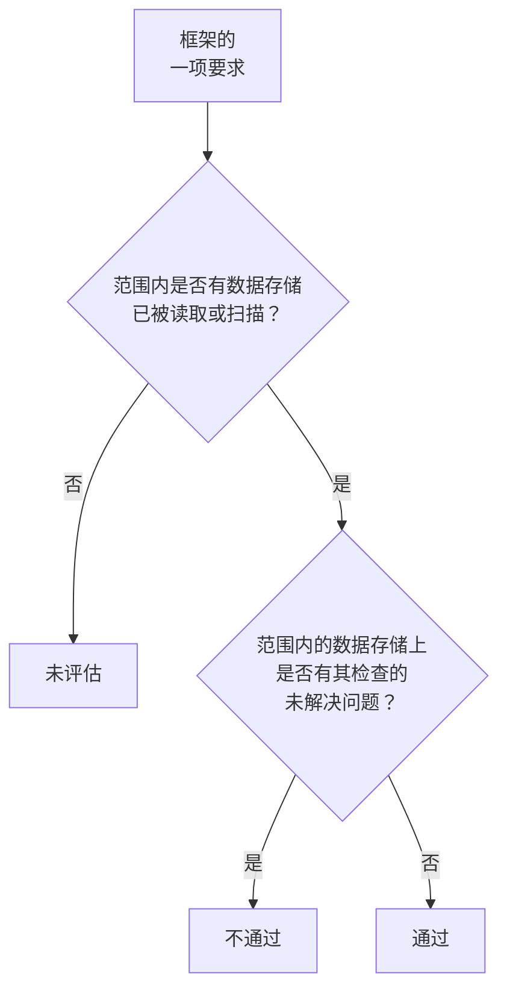

# 数据安全合规

数据安全根据扫描结果为九个框架评分。每个框架覆盖其规则所涉及的数据存储（GDPR 覆盖保存个人数据的数据存储，PCI DSS 覆盖发现了卡数据的数据存储，SOC 2 覆盖每个数据存储），其每项要求是否满足，由作为其证据的检查决定。**数据安全 → 合规** 显示每个框架的分数、它覆盖多少个数据存储，以及每项要求和导致其不通过的未解决问题数量。分数是审计的证据，而不是证书：它说明的是 OneUptime 在它读取的数据存储中能看到什么。

:::cards
- [框架](#框架): 九个框架，以及每个框架覆盖哪些数据存储。
- [框架如何评分](#框架如何评分): 通过、不通过和未评估的要求。
- [要求及其检查](#要求及其检查): 每项要求，以及作为其证据的检查。
- [处理活动记录](#处理活动记录): 根据你的数据存储写出的 GDPR 第 30 条记录。
:::

## 框架

| 框架 | 全称 | 范围内的数据存储 |
| --- | --- | --- |
| GDPR | 欧盟《通用数据保护条例》 | 保存个人数据的数据存储。 |
| CCPA | 《加州消费者隐私法》（经 CPRA 修订） | 保存个人信息的数据存储。 |
| HIPAA | HIPAA 安全规则 | 保存健康数据的数据存储。 |
| PCI DSS | PCI DSS v4.0 | 发现了卡号的数据存储。 |
| SOC 2 | SOC 2 信任服务准则 | 每个数据存储。 |
| ISO 27001 | ISO/IEC 27001:2022 | 每个数据存储。 |
| NIST CSF | NIST 网络安全框架 2.0 | 每个数据存储。 |
| LGPD | 巴西《通用数据保护法》 | 保存巴西人员个人数据的数据存储。 |
| DPDP | 印度《2023 年数字个人数据保护法》 | 保存印度人员个人数据的数据存储。 |

## 框架覆盖哪些数据存储

数据存储属于哪些框架的范围，取决于在其中发现的数据，因此会随着扫描发现更多内容而变化：

- **SOC 2、ISO 27001 和 NIST CSF** 是安全框架：它们覆盖每个数据存储，无论其中保存什么。
- **GDPR、CCPA、HIPAA 和 PCI DSS** 覆盖保存其所保护数据类型的数据存储。个人数据会纳入 GDPR 和 CCPA，健康数据还会纳入 HIPAA，卡号、卡安全码和卡有效期会纳入 PCI DSS。只保存密钥或业务文档的数据存储不属于其中任何一个。
- **LGPD 和 DPDP** 是各国自己的法律：它们覆盖保存巴西或印度人员个人数据的数据存储，这根据属于该国的数据类型来判断，例如巴西 CPF 或印度 Aadhaar 号码。

[敏感数据类型](/docs/data-security/data-types#内置数据类型) 列出了每种数据类型及其所属国家。

## 框架如何评分

- **要求通过** 的条件是：框架范围内的数据存储上没有映射到该要求的检查所产生的未解决问题；有则 **不通过**。
- **要求未评估** 的情况是：范围内还没有任何数据存储被读取配置或扫描内容。
- **有两项要求由数据安全本身满足**：GDPR 第 30 条（处理活动记录）和 ISO 27001 A.5.12（信息分类）。一旦范围内的每个数据存储都已被读取或扫描，它们就通过；只要还有一个没有，它们就不通过。
- **分数** 是框架已评估的要求中通过的比例，以整数百分比表示。没有任何已评估要求的框架没有分数。

只有未解决的问题才计入。风险已被接受的问题，或被认定为不是问题的问题，不会导致其要求不通过，因此接受风险是审计可以在问题上看到的一个决定：谁接受的、为什么，以及截止到何时。

## 要求及其检查

### GDPR

| 要求 | 要求内容 | 检查 |
| --- | --- | --- |
| 第 5(1)(c) 条 | 数据最小化 | `production-data-in-non-production`、`stale-sensitive-data`、`sensitive-data-in-telemetry`、`sensitive-data-to-ai`、`sensitive-data-in-ai-store` |
| 第 5(1)(e) 条 | 存储限制 | `stale-sensitive-data` |
| 第 25 条 | 通过设计和默认设置实现数据保护 | `production-data-in-non-production`、`stale-sensitive-data`、`sensitive-data-in-telemetry`、`sensitive-data-to-ai`、`sensitive-data-in-ai-store` |
| 第 28 条 | 处理者 | `sensitive-data-to-ai` |
| 第 30 条 | 处理活动记录 | 由数据安全本身满足 |
| 第 32 条 | 处理的安全性 | `public-read`、`public-write`、`public-access-not-blocked`、`internet-reachable`、`open-to-all-addresses`、`snapshot-public`、`snapshot-shared-externally`、`shared-with-external-accounts`、`not-encrypted-at-rest`、`no-customer-managed-key`、`encryption-in-transit-not-enforced`、`weak-tls`、`no-backups`、`no-point-in-time-recovery`、`deletion-protection-off`、`deleted-data-not-recoverable`、`access-not-logged`、`shared-key-access`、`object-acls-enabled`、`many-readers`、`secrets-stored`、`plaintext-passwords`、`secrets-in-telemetry` |
| 第 44-49 条 | 向第三国传输 | `residency-violation` |

### CCPA

| 要求 | 要求内容 | 检查 |
| --- | --- | --- |
| 1798.100(c) | 收集仅限于必要的内容 | `production-data-in-non-production`、`stale-sensitive-data`、`sensitive-data-in-telemetry`、`sensitive-data-to-ai`、`sensitive-data-in-ai-store` |
| 1798.150 | 合理的安全程序 | `public-read`、`public-write`、`public-access-not-blocked`、`internet-reachable`、`open-to-all-addresses`、`snapshot-public`、`snapshot-shared-externally`、`shared-with-external-accounts`、`shared-key-access`、`object-acls-enabled`、`many-readers` |

### HIPAA

| 要求 | 要求内容 | 检查 |
| --- | --- | --- |
| 164.308(a)(7) | 应急计划 | `no-backups`、`no-point-in-time-recovery`、`deletion-protection-off`、`deleted-data-not-recoverable` |
| 164.312(a)(1) | 访问控制 | `public-read`、`public-write`、`public-access-not-blocked`、`internet-reachable`、`open-to-all-addresses`、`snapshot-public`、`snapshot-shared-externally`、`shared-with-external-accounts`、`shared-key-access`、`object-acls-enabled`、`many-readers` |
| 164.312(a)(2)(iv) | 加密和解密 | `not-encrypted-at-rest`、`no-customer-managed-key` |
| 164.312(b) | 审计控制 | `access-not-logged` |
| 164.312(e)(1) | 传输安全 | `encryption-in-transit-not-enforced`、`weak-tls` |

### PCI DSS

| 要求 | 要求内容 | 检查 |
| --- | --- | --- |
| 3.3.1 | 授权后不保留敏感身份验证数据 | `card-security-codes-stored` |
| 3.4.1 | 显示卡号时对其掩码 | `card-numbers-readable`、`sensitive-data-in-telemetry` |
| 3.5.1 | 卡号无论存储在何处都不可读 | `not-encrypted-at-rest`、`no-customer-managed-key`、`card-numbers-readable` |
| 4.2.1 | 用强加密保护传输中的卡数据 | `encryption-in-transit-not-enforced`、`weak-tls` |
| 7.2 | 按需定义和分配访问权限 | `public-read`、`public-write`、`public-access-not-blocked`、`internet-reachable`、`open-to-all-addresses`、`snapshot-public`、`snapshot-shared-externally`、`shared-with-external-accounts`、`shared-key-access`、`object-acls-enabled`、`many-readers` |
| 8.3.2 | 身份验证因素在存储时不可读 | `plaintext-passwords` |
| 10.2 | 审计日志记录对卡数据的访问 | `access-not-logged` |

### SOC 2

| 要求 | 要求内容 | 检查 |
| --- | --- | --- |
| A1.2 | 备份和恢复 | `no-backups`、`no-point-in-time-recovery`、`deletion-protection-off`、`deleted-data-not-recoverable` |
| CC6.1 | 逻辑访问安全 | `public-read`、`public-write`、`public-access-not-blocked`、`internet-reachable`、`open-to-all-addresses`、`snapshot-public`、`snapshot-shared-externally`、`shared-with-external-accounts`、`not-encrypted-at-rest`、`no-customer-managed-key`、`shared-key-access`、`object-acls-enabled`、`many-readers`、`secrets-stored`、`plaintext-passwords`、`secrets-in-telemetry` |
| CC6.7 | 信息传输 | `encryption-in-transit-not-enforced`、`weak-tls` |
| CC7.2 | 系统组件的监控 | `access-not-logged` |

### ISO 27001

| 要求 | 要求内容 | 检查 |
| --- | --- | --- |
| A.5.9 | 信息及其他相关资产的清单 | `no-owner` |
| A.5.12 | 信息分类 | 由数据安全本身满足 |
| A.5.15 | 访问控制 | `public-read`、`public-write`、`public-access-not-blocked`、`internet-reachable`、`open-to-all-addresses`、`snapshot-public`、`snapshot-shared-externally`、`shared-with-external-accounts`、`shared-key-access`、`object-acls-enabled`、`many-readers` |
| A.5.34 | 隐私和 PII 保护 | `production-data-in-non-production`、`stale-sensitive-data`、`sensitive-data-in-telemetry`、`sensitive-data-to-ai`、`sensitive-data-in-ai-store` |
| A.8.11 | 数据脱敏 | `production-data-in-non-production`、`stale-sensitive-data`、`sensitive-data-in-telemetry`、`sensitive-data-to-ai`、`sensitive-data-in-ai-store` |
| A.8.12 | 数据泄露防护 | `secrets-stored`、`secrets-in-telemetry` |
| A.8.13 | 信息备份 | `no-backups`、`no-point-in-time-recovery`、`deletion-protection-off`、`deleted-data-not-recoverable` |
| A.8.15 | 日志记录 | `access-not-logged` |
| A.8.24 | 密码技术的使用 | `not-encrypted-at-rest`、`no-customer-managed-key`、`encryption-in-transit-not-enforced`、`weak-tls`、`plaintext-passwords` |

### NIST CSF

| 要求 | 要求内容 | 检查 |
| --- | --- | --- |
| ID.AM-07 | 维护数据和元数据清单 | `no-owner` |
| PR.AA-05 | 管理访问权限 | `public-read`、`public-write`、`public-access-not-blocked`、`internet-reachable`、`open-to-all-addresses`、`snapshot-public`、`snapshot-shared-externally`、`shared-with-external-accounts`、`shared-key-access`、`object-acls-enabled`、`many-readers` |
| PR.DS-01 | 保护静态数据 | `not-encrypted-at-rest`、`no-customer-managed-key`、`secrets-stored`、`secrets-in-telemetry` |
| PR.DS-02 | 保护传输中的数据 | `encryption-in-transit-not-enforced`、`weak-tls` |
| PR.DS-11 | 保留并测试数据备份 | `no-backups`、`no-point-in-time-recovery`、`deletion-protection-off`、`deleted-data-not-recoverable` |
| DE.CM-09 | 监控数据及其使用 | `access-not-logged` |

### LGPD

| 要求 | 要求内容 | 检查 |
| --- | --- | --- |
| 第 6 条 | 必要性和目的限制 | `production-data-in-non-production`、`stale-sensitive-data`、`sensitive-data-in-telemetry`、`sensitive-data-to-ai`、`sensitive-data-in-ai-store` |
| 第 33 条 | 数据的国际传输 | `residency-violation` |
| 第 46 条 | 安全措施 | `public-read`、`public-write`、`public-access-not-blocked`、`internet-reachable`、`open-to-all-addresses`、`snapshot-public`、`snapshot-shared-externally`、`shared-with-external-accounts`、`not-encrypted-at-rest`、`no-customer-managed-key`、`shared-key-access`、`object-acls-enabled`、`many-readers` |

### DPDP

| 要求 | 要求内容 | 检查 |
| --- | --- | --- |
| 第 8(5) 条 | 合理的安全保障措施 | `public-read`、`public-write`、`public-access-not-blocked`、`internet-reachable`、`open-to-all-addresses`、`snapshot-public`、`snapshot-shared-externally`、`shared-with-external-accounts`、`not-encrypted-at-rest`、`no-customer-managed-key`、`shared-key-access`、`object-acls-enabled`、`many-readers` |
| 第 8(7) 条 | 目的达成后删除 | `production-data-in-non-production`、`stale-sensitive-data`、`sensitive-data-in-telemetry`、`sensitive-data-to-ai`、`sensitive-data-in-ai-store` |
| 第 16 条 | 向印度境外传输 | `residency-violation` |

## 处理活动记录

GDPR 第 30 条要求你保存处理活动的记录。数据安全会写出其中关于个人数据存放位置的部分：每个保存个人数据的数据存储对应一行。

| 列 | 来源 |
| --- | --- |
| 数据存储、种类、提供商和区域 | 自动发现 |
| 环境 | 数据存储的标记或名称，或者你设置的值 |
| 敏感度、类别和数据类型 | 扫描所发现的内容，或你设置的敏感度 |
| 所有者 | 数据存储的所有者：个人以及其团队的成员 |
| 用途 | 你在数据存储的 **用途** 中填写的内容：它为什么保存个人数据 |
| 保留期 | 你在数据存储的 **保留期** 中填写的内容：数据在其中保留多久 |
| 框架 | 其数据类型使其纳入范围的框架 |

请在每个数据存储的 **设置** 中填写 **用途** 和 **保留期**：这是任何扫描都无法得知的两项内容。任何有权读取数据存储的人，也可以通过数据安全的 API 在 `/data-security/record-of-processing` 和 `/data-security/compliance` 获取该记录和分数（参见 [数据安全集成](/docs/data-security/integrations#apiterraform-和-mcp)）。

## 后续步骤

:::cards
- [数据安全检查与问题](/docs/data-security/checks-and-issues): 每项要求背后的检查，以及如何修复。
- [数据流、访问与数据驻留](/docs/data-security/flows-access-residency): 数据驻留规则，适用于 GDPR、LGPD 和 DPDP 中的数据传输。
- [敏感数据类型](/docs/data-security/data-types): 使数据存储纳入框架范围的数据类型。
:::
