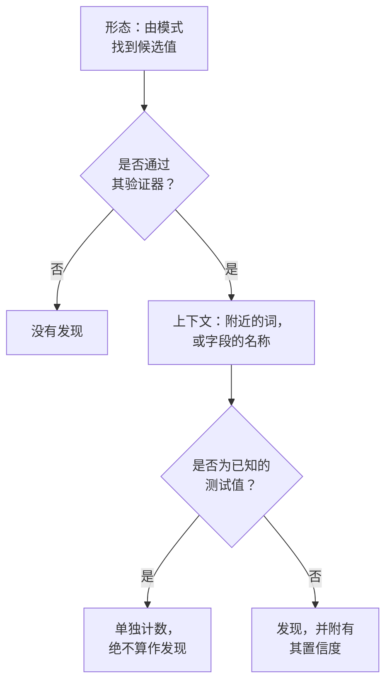

# 敏感数据类型

数据安全能识别 143 种敏感数据：银行卡号、银行账户、43 个国家的国民身份证号、健康标识符、API 密钥和令牌，以及特殊类别的个人数据。每种都有一个类别、一个敏感度；如果它属于某一个国家，还会标明该国家。本页说明如何找到一个值，并列出每种数据类型，让你能判断某项内容为什么会被找到，并决定如何处理。

:::cards
- [如何找到一个值](#如何找到一个值): 形态、验证器、上下文、测试值、置信度。
- [字段和列](#字段和列): 如何对整列或整个属性做出判断。
- [每种数据类型](#内置数据类型): 全部 143 种，按类别列出。
- [你自己的数据类型](#你自己的数据类型): 员工 ID、保单号，以及测试框。
:::

## 如何找到一个值

每次扫描——无论是一行日志、一个 CSV 单元格、一行数据库记录，还是对象开头的若干字节——都会执行相同的步骤：

1. **形态。** 每种数据类型都有用于找到候选值的模式：十六位数字，`AKIA` 加十六个字母，或者一个词、一个 `@` 加一个域名。模式绝不会在更长的词元内部匹配，因此不会在更长的一串数字中找到银行卡号。
2. **验证器。** 候选值必须通过其类型自身的规则：校验和（银行卡用 Luhn，IBAN 用 mod 97，Aadhaar 号码用 Verhoeff，大多数国民身份证号用校验位）、真实的日期、已知的前缀，或密钥所需的足够随机性。未通过的候选值根本不算发现。`000000000` 和 `123456789` 等占位符无法通过任何数字类型。
3. **上下文。** 候选值附近说明它是什么的词（默认为其前 64 个字符和后 32 个字符以内）会把它的置信度提高一级，名称指向该类型的字段也是如此。说明它是其他东西的词，例如订单号或运单号，会把置信度降低一级。没有校验和且形态常见的数字，例如护照号码或银行账户，只有在旁边有指明它的词时才会计入。
4. **已知测试值。** 公开发布的测试卡号（例如 Stripe 的 `4242 4242 4242 4242`）、示例 IBAN、`example.com` 及其他保留域名下的地址、文档用 IP 地址、政府文档中印出的示例 ID、`sk_test_` 等测试模式密钥以及占位密钥，都会单独计数。它们永远不会构成发现，因此满是这些值的数据存储会被视为测试环境，而不是数据泄露。
5. **置信度。** 剩下的就是发现，其确定程度取决于证据所能支持的程度。

| 置信度 | 含义 |
| --- | --- |
| **高** | 值通过了其验证器，并且它周围的词或它所在的字段说明了它是什么；对于字段而言，则是其大多数值都属于该类型。 |
| **中** | 值通过了其验证器，但周围没有任何内容可以确认它；或者字段的名称说明了它保存的内容，并且有一些值与之相符。 |
| **低** | 形态匹配，但没有任何内容可以确认它。 |

只有高和中置信度的发现才会计入：它们会使数据存储成为敏感数据存储，并可能打开问题。低置信度的发现会折叠列在数据存储上，供人判断。

当两种数据类型认领相同的字符时，更确定的发现胜出：先比较置信度，再比较哪个检测器自身的规则证明得更多，最后比较哪个匹配更长。

长值会以 64 KB 的窗口读取，窗口之间重叠 4 KB，因此值无论位于何处都能被完整找到；一个值最多读取 4 MB。

## 字段和列

列、JSON 字段或日志属性会作为一个整体来判断。它的名称暗示某种数据类型，它被抽样的值则加以证明。包含该类型的值所占的比例决定了发现的确定程度：

| 包含该类型的值 | 置信度 |
| --- | --- |
| 60% 或以上 | 高 |
| 25% 或以上 | 字段名称指向该类型时为高，否则为中 |
| 更少 | 字段名称指向该类型时为中，否则为低：一列其他内容中夹杂的几个电子邮件地址 |

值的平均长度超过 80 个字符的字段属于自由文本（备注、消息、描述），不应只保存一种类型。它的发现保留每个匹配各自获得的置信度，并注明是在自由文本中找到的。一个字段最多对 1,000 个值进行分类，每个值最多 16 KB。

字段的名称会被拆分成单词（`customerEmail`、`customer_email` 和 `customer-email` 都是“customer email”），当类型的名称提示中的单词按相同顺序相邻出现时即为匹配：“date of birth”匹配 `customer_date_of_birth`，而不匹配 `birth_city`。点分路径中只有最后一部分是字段自己的名称；当最后一部分是 `number`、`id` 或 `value` 这样的通用词时，还要加上它前面的部分：`customer.address.city` 不是街道地址，而 `card.number` 仍然是银行卡号。

有些数据类型无法通过其值来判断：没有任何模式能把人名和街道名区分开来，也没有任何模式能把宗教和其他词区分开来。当字段有值时，这些类型仅根据字段名称来查找：人名、用户名、性别、国籍、健康信息、种族或民族出身、宗教信仰、性取向、政治观点、工会会员身份、生物特征数据、基因数据和犯罪记录。此时，如果 60% 或以上的值看起来像姓名、用户名、性别或国籍，则为高，否则为中。

名称表明其保存密码的字段（`password`、`passwordHash`、`pwd`，而不是 `password_changed_at`）应该保存哈希：bcrypt、argon2、scrypt、PBKDF2 或数据存储可能使用的其他方案。空值、`********` 等占位符和加密值会被排除。如果其余的值中不是哈希的多于是哈希的，则该字段保存的是密码本身（任何模式都看不出来），数据存储将无法通过 [密码以明文存储](/docs/data-security/checks-and-issues#数据卫生) 这项检查。

## 敏感度

| 敏感度 | 含义 |
| --- | --- |
| **受限** | 一旦泄露就会造成损害：密钥、银行卡号、健康记录、政府身份证件号码。 |
| **机密** | 个人数据，以及标记为机密的文档。 |
| **内部** | 企业自己的数据，不应提供给外部人员。 |
| **公开** | 未找到任何敏感内容。 |

数据存储的敏感度，等于其中以至少为中的置信度找到的最敏感数据类型的敏感度。测试值和标记为不敏感的发现不计入，未找到任何内容的数据存储为公开。如果要让数据存储比其发现所显示的更敏感或更不敏感，请在数据存储的 **设置** 中自行设置其敏感度：之后检查会使用这个值。

## 类别

| 类别 | 涵盖内容 | 个人数据 |
| --- | --- | --- |
| 密钥和凭据 | 可解锁其他系统的密码、API 密钥、令牌和私钥。 | 否 |
| 财务 | 银行卡号、银行账户、IBAN 和加密货币钱包。 | 是 |
| 健康 | 病历号、健康标识符、诊断和处方。 | 是 |
| 政府身份证件 | 国民身份证号、税号、护照号码和社会保障号码。 | 是 |
| 特殊类别 | GDPR 第 9 条最严格保护的数据：种族、宗教、性取向、政治、工会会员身份、生物特征和基因数据。 | 是 |
| 联系方式和身份 | 某人是谁以及如何联系到他们：电子邮件、电话、地址、出生日期、IP 地址。 | 是 |
| 商业机密 | 标记为机密、仅限内部或受特权保护的文档。 | 否 |

个人数据是指 GDPR、CCPA、LGPD 和 DPDP 所定义的、关于某个人的数据。只保存密钥和商业文档的数据存储不在隐私框架的范围内，但绝不会不在安全框架的范围内（请参阅 [数据安全合规](/docs/data-security/compliance)）。

## 内置数据类型

属于某一个国家的数据类型会用 ISO 3166-1 代码标明该国家：数据驻留规则和与国家绑定的框架会读取它（请参阅 [数据驻留](/docs/data-security/flows-access-residency#数据驻留规则)）。ID 是 API 和发现用来指称该类型的名称。

### 联系方式和身份

| 数据类型 | ID | 说明 | 敏感度 | 国家 |
| --- | --- | --- | --- | --- |
| 电子邮件地址 | `email-address` | 某人的电子邮件地址。 | 机密 | — |
| 电话号码 | `phone-number` | 国际或国内格式的电话号码。 | 机密 | — |
| 人名 | `person-name` | 某人的名、姓或全名，根据字段名称找到。 | 机密 | — |
| 街道地址 | `postal-address` | 街道地址：门牌号、街道名称和街道类型。 | 机密 | — |
| 邮政编码 | `postal-code` | 邮政编码。仅凭它就能缩小某人居住地的范围。 | 内部 | — |
| 出生日期 | `date-of-birth` | 旁边有词说明它是某人出生日期的日期。 | 机密 | — |
| IP 地址 | `ip-address` | 公网 IPv4 或 IPv6 地址，GDPR 将其视为个人数据。 | 机密 | — |
| MAC 地址 | `mac-address` | 网卡的硬件地址，可识别一台设备。 | 机密 | — |
| 广告 ID | `advertising-id` | 跟踪某台设备的移动广告 ID（IDFA、GAID、AAID）。 | 机密 | — |
| 精确位置 | `geolocation` | 精确到足以找到某栋建筑的经纬度。 | 机密 | — |
| 用户名 | `username` | 某人的登录名或账户名，根据字段名称找到。 | 机密 | — |
| 性别 | `gender` | 某人的社会性别或生理性别，根据字段名称找到。 | 机密 | — |
| 国籍 | `nationality` | 某人的国籍或公民身份，根据字段名称找到。 | 机密 | — |
| 车辆识别号 | `vehicle-identification-number` | 带有有效校验位的 17 位 VIN。 | 机密 | — |

### 政府身份证件

| 数据类型 | ID | 说明 | 敏感度 | 国家 |
| --- | --- | --- | --- | --- |
| 美国社会安全号码 | `us-ssn` | 美国社会安全号码。 | 受限 | US |
| 美国纳税人识别号（ITIN） | `us-itin` | 美国个人纳税人识别号码。 | 受限 | US |
| 美国雇主识别号（EIN） | `us-ein` | 美国雇主识别号码，且旁边有说明这一点的词。 | 机密 | US |
| 美国护照号码 | `us-passport` | 美国护照号码，且旁边有说明这一点的词。 | 受限 | US |
| 美国驾照号码 | `us-drivers-license` | 美国驾照号码，且旁边有说明这一点的词。 | 受限 | US |
| 英国国民保险号码 | `uk-nino` | 英国国民保险号码。 | 受限 | GB |
| 英国护照号码 | `uk-passport` | 英国护照号码，且旁边有说明这一点的词。 | 受限 | GB |
| 英国驾照号码 | `uk-driving-licence` | 16 个字符的英国驾照号码。 | 受限 | GB |
| 加拿大社会保险号码 | `ca-sin` | 带有有效校验位的加拿大社会保险号码。 | 受限 | CA |
| 墨西哥 CURP | `mx-curp` | 墨西哥的 Clave Única de Registro de Población。 | 受限 | MX |
| 墨西哥 RFC | `mx-rfc` | 墨西哥的 Registro Federal de Contribuyentes 税号。 | 受限 | MX |
| 巴西 CPF | `br-cpf` | 巴西的 Cadastro de Pessoas Físicas 号码。 | 受限 | BR |
| 巴西 CNPJ | `br-cnpj` | 巴西公司注册号（CNPJ）。 | 机密 | BR |
| 阿根廷 CUIT / CUIL | `ar-cuit` | 阿根廷的税务或劳动识别代码。 | 受限 | AR |
| 智利 RUT | `cl-rut` | 带有有效校验位的智利 Rol Único Tributario。 | 受限 | CL |
| 西班牙 DNI | `es-dni` | 带有校验字母的西班牙国民身份证件号码。 | 受限 | ES |
| 西班牙 NIE | `es-nie` | 带有校验字母的西班牙外国人身份号码。 | 受限 | ES |
| 葡萄牙 NIF | `pt-nif` | 葡萄牙税务识别号。 | 受限 | PT |
| 法国社会保障号码（NIR） | `fr-nir` | 带有两位校验码的法国 INSEE 号码。 | 受限 | FR |
| 德国税号 | `de-tax-id` | 德国的 Steuerliche Identifikationsnummer。 | 受限 | DE |
| 意大利 codice fiscale | `it-codice-fiscale` | 带有有效校验字符的意大利税号。 | 受限 | IT |
| 荷兰 BSN | `nl-bsn` | 通过“十一检验”的荷兰公民服务号码。 | 受限 | NL |
| 比利时国民号码 | `be-national-number` | 比利时国民登记号码。 | 受限 | BE |
| 波兰 PESEL | `pl-pesel` | 波兰国民识别号码。 | 受限 | PL |
| 瑞典个人身份号码 | `se-personnummer` | 带有有效校验位的瑞典 personnummer。 | 受限 | SE |
| 挪威国民身份号码 | `no-fodselsnummer` | 带有两个校验位的挪威 fødselsnummer。 | 受限 | NO |
| 丹麦 CPR 号码 | `dk-cpr` | 丹麦公民登记号码，且旁边有说明这一点的词。 | 受限 | DK |
| 芬兰个人身份代码 | `fi-hetu` | 带有校验字符的芬兰 henkilötunnus。 | 受限 | FI |
| 爱尔兰 PPS 号码 | `ie-ppsn` | 爱尔兰个人公共服务号码。 | 受限 | IE |
| 瑞士 AHV 号码 | `ch-ahv` | 瑞士社会保障号码（AHV / AVS）。 | 受限 | CH |
| 罗马尼亚 CNP | `ro-cnp` | 罗马尼亚个人数字代码。 | 受限 | RO |
| 保加利亚 EGN | `bg-egn` | 保加利亚统一公民号码。 | 受限 | BG |
| 克罗地亚 OIB | `hr-oib` | 克罗地亚个人识别号码。 | 受限 | HR |
| 希腊 AMKA | `gr-amka` | 希腊社会保障号码。 | 受限 | GR |
| 土耳其身份号码 | `tr-tckn` | 土耳其 T.C. Kimlik 号码。 | 受限 | TR |
| 以色列身份号码 | `il-teudat-zehut` | 以色列 Teudat Zehut 号码。 | 受限 | IL |
| 南非身份号码 | `za-id` | 带有有效日期和校验位的南非身份号码。 | 受限 | ZA |
| 阿联酋 Emirates ID | `ae-emirates-id` | 阿拉伯联合酋长国身份证号码。 | 受限 | AE |
| 沙特阿拉伯国民身份证号 | `sa-national-id` | 沙特国民身份证号或 iqama 号码。 | 受限 | SA |
| 印度 Aadhaar 号码 | `in-aadhaar` | 通过 Verhoeff 校验的 12 位 Aadhaar 号码。 | 受限 | IN |
| 印度 PAN | `in-pan` | 印度永久账号。 | 受限 | IN |
| 中国居民身份证号码 | `cn-resident-id` | 18 位的中国居民身份证号码。 | 受限 | CN |
| 日本 My Number | `jp-my-number` | 带有有效校验位的日本个人编号。 | 受限 | JP |
| 韩国居民登录号码 | `kr-rrn` | 韩国居民登录号码。 | 受限 | KR |
| 新加坡 NRIC / FIN | `sg-nric` | 新加坡身份证号码或外国人识别号码。 | 受限 | SG |
| 香港身份证号码 | `hk-hkid` | 带有校验位的香港身份证号码。 | 受限 | HK |
| 台湾身份证号码 | `tw-national-id` | 台湾的身份证统一编号。 | 受限 | TW |
| 泰国国民身份证号 | `th-national-id` | 泰国公民身份识别号码。 | 受限 | TH |
| 马来西亚 MyKad 号码 | `my-mykad` | 马来西亚身份证号码。 | 受限 | MY |
| 印度尼西亚 NIK | `id-nik` | 印度尼西亚人口身份号码。 | 受限 | ID |
| 澳大利亚税务档案号 | `au-tfn` | 通过有效校验的澳大利亚税务档案号。 | 受限 | AU |
| 新西兰 IRD 号码 | `nz-ird` | 带有有效校验位的新西兰税务局号码。 | 受限 | NZ |
| 俄罗斯 SNILS | `ru-snils` | 带有校验数字的俄罗斯保险账户号码。 | 受限 | RU |
| 俄罗斯 INN | `ru-inn` | 俄罗斯纳税人识别号。 | 受限 | RU |
| 护照号码 | `passport-number` | 任何国家的护照号码，且旁边有说明这一点的词。 | 受限 | — |

### 财务

| 数据类型 | ID | 说明 | 敏感度 | 国家 |
| --- | --- | --- | --- | --- |
| 银行卡号 | `credit-card-number` | 通过 Luhn 校验且属于某个卡组织的支付卡号。 | 受限 | — |
| 银行卡安全码 | `card-verification-code` | CVV 或 CVC，PCI DSS 禁止在支付获得授权后保留它。 | 受限 | — |
| 银行卡有效期 | `card-expiration-date` | 银行卡的有效期，且旁边有说明这一点的词。 | 机密 | — |
| IBAN | `iban` | 通过 mod-97 校验的国际银行账号。 | 受限 | — |
| 银行账号 | `bank-account-number` | 银行账号，且旁边有说明这一点的词。 | 受限 | — |
| SWIFT / BIC 代码 | `swift-bic` | 银行的 SWIFT 或 BIC 代码，且旁边有说明这一点的词。 | 内部 | — |
| 美国银行路由号码 | `us-bank-routing-number` | 带有有效校验和的 ABA 路由号码，且旁边有说明这一点的词。 | 内部 | US |
| 英国银行分类代码 | `uk-sort-code` | 英国银行的 sort code，且旁边有说明这一点的词。 | 内部 | GB |
| 印度 IFSC | `in-ifsc` | 标识某个银行分行的印度金融系统代码。 | 内部 | IN |
| 澳大利亚 BSB | `au-bsb` | 澳大利亚的银行-州-分行号码，且旁边有说明这一点的词。 | 内部 | AU |
| 比特币地址 | `bitcoin-address` | 带有有效校验和的比特币地址。 | 机密 | — |
| 以太坊地址 | `ethereum-address` | 以太坊地址，且旁边有说明这一点的词。 | 机密 | — |

### 健康

| 数据类型 | ID | 说明 | 敏感度 | 国家 |
| --- | --- | --- | --- | --- |
| 英国 NHS 号码 | `uk-nhs-number` | 带有有效校验位的英国国家医疗服务体系号码。 | 受限 | GB |
| 美国 Medicare 受益人 ID | `us-medicare-mbi` | 美国 Medicare 受益人标识符。 | 受限 | US |
| 澳大利亚 Medicare 号码 | `au-medicare-number` | 带有有效校验位的澳大利亚 Medicare 卡号。 | 受限 | AU |
| 德国医疗保险号码 | `de-health-insurance-number` | 带有有效校验位的德国 Krankenversichertennummer。 | 受限 | DE |
| 病历号 | `medical-record-number` | 患者的病历号，且旁边有说明这一点的词。 | 受限 | — |
| 健康保险会员 ID | `health-plan-id` | 健康保险的会员号或保单号，且旁边有说明这一点的词。 | 受限 | — |
| 诊断代码（ICD-10） | `diagnosis-code` | ICD-10 诊断代码，且旁边有说明这一点的词。 | 受限 | — |
| 药品代码（NDC） | `drug-code` | 美国国家药品代码，且旁边有说明这一点的词。 | 机密 | — |
| 美国 DEA 号码 | `us-dea-number` | 处方者的缉毒局注册号码，带有有效校验位。 | 机密 | US |
| 美国医疗服务提供者 ID（NPI） | `us-npi` | 国家医疗服务提供者标识符。它标识的是医疗服务提供者，而不是患者。 | 内部 | US |
| 健康信息 | `health-information` | 诊断、病情、用药和其他健康详情，根据字段名称找到。 | 受限 | — |

### 密钥和凭据

| 数据类型 | ID | 说明 | 敏感度 | 国家 |
| --- | --- | --- | --- | --- |
| AWS 访问密钥 ID | `aws-access-key-id` | AWS 访问密钥的公开部分。与其秘密部分一起即可签署 AWS 请求。 | 受限 | — |
| AWS 秘密访问密钥 | `aws-secret-access-key` | AWS 访问密钥的秘密部分，且旁边有说明这一点的词。 | 受限 | — |
| Google API 密钥 | `google-api-key` | Google Cloud 或 Maps 的 API 密钥。 | 受限 | — |
| Google 服务账号密钥 | `google-service-account-key` | 包含私钥的 Google Cloud 服务账号密钥文件。 | 受限 | — |
| Google OAuth 客户端密钥 | `google-oauth-client-secret` | Google OAuth 客户端密钥。 | 受限 | — |
| Azure 存储账户密钥 | `azure-storage-account-key` | Azure 存储账户密钥，或包含该密钥的连接字符串。 | 受限 | — |
| Azure SAS 令牌 | `azure-sas-token` | Azure 共享访问签名，无需登录即可授予访问权限。 | 受限 | — |
| Azure 客户端密钥 | `azure-client-secret` | Microsoft Entra ID 应用程序的客户端密钥。 | 受限 | — |
| GitHub 令牌 | `github-token` | GitHub 个人访问令牌、OAuth 令牌、应用令牌或细粒度令牌。 | 受限 | — |
| GitLab 令牌 | `gitlab-token` | GitLab 个人访问令牌。 | 受限 | — |
| Slack 令牌 | `slack-token` | Slack 机器人令牌、用户令牌或应用令牌。 | 受限 | — |
| Slack Webhook URL | `slack-webhook-url` | Slack 传入 Webhook，任何人都可以用它向频道发帖。 | 受限 | — |
| Stripe 秘密密钥 | `stripe-secret-key` | Stripe 的正式环境秘密密钥或受限密钥，可以转移资金。 | 受限 | — |
| Twilio API 密钥 | `twilio-api-key` | 带有密钥的 Twilio API 密钥 SID。 | 受限 | — |
| SendGrid API 密钥 | `sendgrid-api-key` | SendGrid API 密钥。 | 受限 | — |
| Mailgun API 密钥 | `mailgun-api-key` | Mailgun API 密钥。 | 受限 | — |
| Mailchimp API 密钥 | `mailchimp-api-key` | Mailchimp API 密钥。 | 受限 | — |
| OpenAI API 密钥 | `openai-api-key` | OpenAI API 密钥，会消耗账户的额度。 | 受限 | — |
| Anthropic API 密钥 | `anthropic-api-key` | Anthropic API 密钥。 | 受限 | — |
| Hugging Face 令牌 | `huggingface-token` | Hugging Face 令牌。 | 受限 | — |
| npm 令牌 | `npm-token` | npm 访问令牌，可以发布软件包。 | 受限 | — |
| PyPI 令牌 | `pypi-token` | PyPI 上传令牌。 | 受限 | — |
| Docker Hub 令牌 | `docker-hub-token` | Docker Hub 个人访问令牌。 | 受限 | — |
| Shopify 令牌 | `shopify-token` | Shopify 访问令牌或应用令牌。 | 受限 | — |
| Square 令牌 | `square-token` | Square 访问令牌或密钥。 | 受限 | — |
| Braintree 访问令牌 | `braintree-access-token` | Braintree 生产环境访问令牌。 | 受限 | — |
| DigitalOcean 令牌 | `digitalocean-token` | DigitalOcean 个人访问令牌。 | 受限 | — |
| New Relic API 密钥 | `new-relic-api-key` | New Relic 用户 API 密钥。 | 受限 | — |
| Datadog API 密钥 | `datadog-api-key` | Datadog API 密钥或应用程序密钥，且旁边有说明这一点的词。 | 受限 | — |
| HashiCorp Vault 令牌 | `vault-token` | HashiCorp Vault 服务令牌。 | 受限 | — |
| Terraform Cloud 令牌 | `terraform-cloud-token` | Terraform Cloud 或 Terraform Enterprise 的 API 令牌。 | 受限 | — |
| Atlassian API 令牌 | `atlassian-api-token` | Atlassian API 令牌。 | 受限 | — |
| Linear API 密钥 | `linear-api-key` | Linear API 密钥。 | 受限 | — |
| JSON Web 令牌 | `json-web-token` | 已签名的 JWT，通常是会话令牌或访问令牌。 | 受限 | — |
| 私钥 | `private-key` | PEM、OpenSSH 或 PGP 私钥块。 | 受限 | — |
| URL 中的密码 | `password-in-url` | 包含用户名和密码的 URL，例如数据库连接字符串。 | 受限 | — |
| 连接字符串中的密码 | `connection-string-password` | 连接字符串中的 Password= 或 Pwd= 值。 | 受限 | — |
| Authorization 标头 | `authorization-header` | 从 HTTP Authorization 标头中复制的 Basic 或 Bearer 凭据。 | 受限 | — |
| 密码或密钥 | `generic-secret` | 赋给密码、密钥、API 密钥或令牌的值，看起来足够随机，像是真实的。 | 受限 | — |
| 比特币私钥 | `bitcoin-private-key` | 钱包导入格式的比特币私钥，带有有效校验和。 | 受限 | — |

### 特殊类别

| 数据类型 | ID | 说明 | 敏感度 | 国家 |
| --- | --- | --- | --- | --- |
| 种族或民族出身 | `racial-or-ethnic-origin` | 种族或民族，根据字段名称找到。 | 受限 | — |
| 宗教信仰 | `religious-belief` | 宗教或信仰，根据字段名称找到。 | 受限 | — |
| 性取向 | `sexual-orientation` | 性取向，根据字段名称找到。 | 受限 | — |
| 政治观点 | `political-opinion` | 政治观点或党派成员身份，根据字段名称找到。 | 受限 | — |
| 工会会员身份 | `trade-union-membership` | 工会会员身份，根据字段名称找到。 | 受限 | — |
| 生物特征数据 | `biometric-data` | 指纹、人脸模板、声纹和其他生物特征，根据字段名称找到。 | 受限 | — |
| 基因数据 | `genetic-data` | DNA 和基因组数据，根据字段名称找到。 | 受限 | — |
| 犯罪记录 | `criminal-record` | 刑事定罪和犯罪行为（GDPR 第 10 条），根据字段名称找到。 | 受限 | — |

### 商业机密

| 数据类型 | ID | 说明 | 敏感度 | 国家 |
| --- | --- | --- | --- | --- |
| 受法律特权保护的文档 | `privileged-document` | 标记为律师-客户特权或受法律特权保护的文档。 | 受限 | — |
| 标记为机密的文档 | `confidential-document` | 标记为机密、绝密或商业秘密的文档。 | 机密 | — |
| 标记为内部的文档 | `internal-document` | 标记为仅限内部使用或不得分发的文档。 | 内部 | — |

## 你自己的数据类型

为只有你的公司才有的内容添加一种数据类型：员工 ID、保单号、项目代码。前往 **数据安全 → 设置 → 数据类型**，在 **您的数据类型** 下添加它。从下一次扫描开始，它会像内置数据类型一样在存储桶、数据库和遥测中被扫描。

:::steps
### 说明它是什么

为它填写 **名称**（例如员工 ID）、**类别** 和 **灵敏度**：即保存它的数据存储有多敏感。**描述** 说明它是什么，供阅读它的发现的人参考。

### 说明如何找到它

输入 **模式**：匹配单个值的 JavaScript 正则表达式，例如 `EMP-\d{6}`。添加保存它的 **字段名称**（例如 `employee id`），以及出现在值附近时可确认它属于此类型的 **关键字**。将模式留空，则只根据字段名称查找该类型。

### 测试它

将示例文本粘贴到 **测试** 中，查看你的数据类型能在其中找到什么。它会在你的浏览器中对文本运行扫描器自己的代码：文本永远不会发送到 OneUptime，并且只测试其前 64 KB。
:::

在 **更多字段** 下，**忽略大小写** 会不区分字母大小写地匹配模式，**需要关键字** 只在值附近有关键字或字段名称表明它属于此类型时才计入该值，**校验和** 则要求值通过一项校验：**无**、**Luhn**（银行卡号带有的校验位）、**Mod97**（IBAN 的校验位）或 **Verhoeff**（Aadhaar 号码的校验位）。

模式会在你保存时被检查：它必须能编译、不匹配空文本，并且运行时间与文本长度呈线性关系。它由一个从不回溯的匹配器运行，因此无论模式怎么写，都不会拖住扫描。一种类型最多可有 50 个关键字和 50 个字段名称。

如果你的类型设置了校验和且值通过了校验，该值单独出现时为中，附近有关键字时为高；如果没有校验和，单独出现时为低，附近有关键字时为中。在列中，与每种类型一样，由匹配的值所占的比例决定。

## 不敏感与从不敏感

扫描找到的内容可能并非看上去的那样：一列碰巧通过 Luhn 校验的订单号，或每一行日志中都有的你自己的支持邮箱地址。告诉 OneUptime 这一点，它就不再计入：

- **将发现标记为不敏感。** 在数据存储的 **内容** 页面上，对该发现选择 **标记为不敏感** 并说明原因。它将不再计入数据存储的敏感度或其检查，数据存储也会立即重新检查。该发现会带着标记和你的原因保留在数据存储上，让下一个人看到当时的决定。
- **将值添加到“从不敏感”**，它位于数据安全的设置中，适用于在任何地方都永远不算发现的值，例如 `support@yourcompany.com`。扫描器先对值进行规范化，再忽略大小写进行比较。
- **关闭内置数据类型。** 在 **数据安全 → 设置 → 数据类型** 页面的 **内置数据类型** 下，每种数据类型都有一个开关，拨动后立即保存。项目的任何扫描都不会查找已关闭的类型。

## 后续步骤

:::cards
- [数据安全检查与问题](/docs/data-security/checks-and-issues): 数据存储的敏感度会如何影响它的问题。
- [遥测中的敏感数据](/docs/data-security/telemetry): 在你的日志、追踪和提示词中找到的数据类型。
- [数据安全合规](/docs/data-security/compliance): 每种数据类型会使哪些框架适用。
:::
