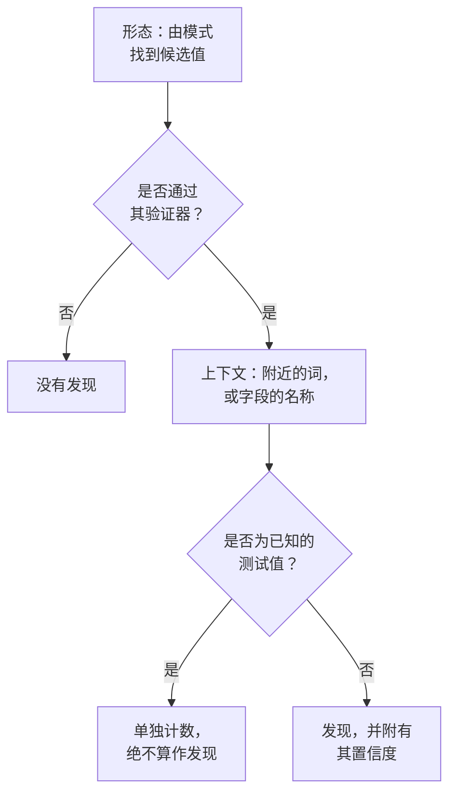

# 敏感数据类型

数据安全能识别 143 种敏感数据：银行卡号、银行账户、43 个国家的国民身份证号、健康标识符、API 密钥和令牌，以及特殊类别的个人数据。每种都有一个类别、一个敏感度；如果它属于某一个国家，还会标明该国家。本页说明如何找到一个值，并列出每种数据类型，让你能判断某项内容为什么会被找到，并决定如何处理。

:::cards
- [如何找到一个值](#如何找到一个值): 形态、验证器、上下文、测试值、置信度。
- [字段和列](#字段和列): 如何对整列或整个属性做出判断。
- [自由文本中的姓名和街道地址](#自由文本中的姓名和街道地址): 扫描器内运行的小模型，以及它的得分。
- [每种数据类型](#内置数据类型): 全部 143 种，按类别列出。
- [你自己的数据类型](#你自己的数据类型): 员工 ID、保单号，以及测试框。
- [OneUptime AI 找到的数据类型](#oneuptime-ai-找到的数据类型): 在没有任何检测器能归类的字段中找到的、你们公司自己的数据类型。
- [OneUptime AI 的判定](#oneuptime-ai-的判定): 对每个等待你处理的发现给出判定，并以你团队的决定作为先例。
:::

## 如何找到一个值



每次扫描——无论是一行日志、一个 CSV 单元格、一行数据库记录，还是对象开头的若干字节——都会执行相同的步骤：

1. **形态。** 每种数据类型都有用于找到候选值的模式：十六位数字，`AKIA` 加十六个字母，或者一个词、一个 `@` 加一个域名。模式绝不会在更长的词元内部匹配，因此不会在更长的一串数字中找到银行卡号。
2. **验证器。** 候选值必须通过其类型自身的规则：校验和（银行卡用 Luhn，IBAN 用 mod 97，Aadhaar 号码用 Verhoeff，大多数国民身份证号用校验位）、真实的日期、已知的前缀，或密钥所需的足够随机性。未通过的候选值根本不算发现。`000000000` 和 `123456789` 等占位符无法通过任何数字类型。
3. **上下文。** 候选值附近说明它是什么的词（默认为其前 64 个字符和后 32 个字符以内）会把它的置信度提高一级，名称指向该类型的字段也是如此。说明它是其他东西的词，例如订单号或运单号，会把置信度降低一级。没有校验和且形态常见的数字，例如护照号码或银行账户，只有在旁边有指明它的词时才会计入。国内电话号码也是如此，无论是连续书写，还是按其所在国家的分组方式书写，例如 `tel 03-1234-5678` 或 `phone 020 3123 4567`。call、cell 和 contact 只有在 call me on、cell number 或 contact number 这样的短语中，或位于带有国内长途冠码的号码之前时，才指明电话号码，因此 call 后面的 Unix 时间（例如 `call 1732752000`）不算电话号码。
4. **已知测试值。** 公开发布的测试卡号（例如 Stripe 的 `4242 4242 4242 4242`）、示例 IBAN、`example.com` 及其他保留域名下的地址、文档用 IP 地址、政府文档中印出的示例 ID、`sk_test_` 等测试模式密钥以及占位密钥，都会单独计数。它们永远不会构成发现，因此满是这些值的数据存储会被视为测试环境，而不是数据泄露。
5. **置信度。** 剩下的就是发现，其确定程度取决于证据所能支持的程度。

| 置信度 | 含义 |
| --- | --- |
| **高** | 值通过了其验证器，并且它周围的词或它所在的字段说明了它是什么；对于字段而言，则是其大多数值都属于该类型。 |
| **中** | 值通过了其验证器，但周围没有任何内容可以确认它；或者字段的名称说明了它保存的内容，并且有一些值与之相符。 |
| **低** | 形态匹配，但没有任何内容可以确认它。 |

只有高和中置信度的发现才会计入：它们会使数据存储成为敏感数据存储，并可能打开问题。低置信度的发现会折叠列在数据存储上，供人判断：对正确的发现点击 **确认** 会使其变为高置信度，并在之后的扫描中保持为高。

当两种数据类型认领相同的字符时，更确定的发现胜出：先比较置信度，再比较哪个检测器自身的规则证明得更多，最后比较哪个匹配更长。

值也会按人们书写它的方式读取。URL 的百分号转义会被读取，包括字符的 UTF-8 字节，因此查询字符串中的 IP 地址、电子邮件地址（例如 `jane%40example.com` 或 `jos%C3%A9%40example.com`）、令牌或密钥会被找到。URL 的查询字符串还会按表单的写法读取，即每个空格写成一个加号，因此分组书写的号码在各组之间是百分号编码的空格或加号时也会被找到，例如 `4111+1111+1111+1111` 或 `DE44%205001%200517%205407%203249%2031`；邮政编码、街道地址和出生日期也是如此，例如 `SW1A+2AA`、`10+Downing+Street` 或 `dob=12%2F03%2F1985`。号码的数字无论用哪种文字书写都会被读取，例如全角数字（`４１１１ １１１１ １１１１ １１１１`）或阿拉伯-印度数字：先按每种文字单独读取，再合在一起读取。卡号、银行卡安全码或有效期、电话号码、美国社会安全号码、IBAN、路由号码、银行账号、英国银行分类代码、BSB、BIC、IFSC、国民身份证号、NHS 号码等健康标识号码、邮政编码以及出生日期都是如此。这样的号码若完全以全角输入（就像日文和中文文本书写号码那样），其加号、连字符、括号、句点、斜杠和全角空格也会被读作 ASCII 字符，例如 `＋８１ ３－１２３４－５６７８` 或 `５３６－２２－８７３１`。各组之间用其他破折号分隔的号码也是如此，这种破折号只在两个数字之间才被读作连字符：日文文本用来代替连字符输入的长音符，例如 `＋８１ ３ー１２３４ー５６７８`，或者排版用连字符、数字破折号、短破折号或减号，例如 `536–22–8731`。以全角字母输入的值，其字母、数字和符号会被读作 ASCII 字符，例如电子邮件地址 `ｊａｎｅ＠ｅｘａｍｐｌｅ．ｃｏｍ`、IBAN `ＤＥ８９　３７０４　００４４　０５３２　０１３０　００` 或英国邮政编码 `ＳＷ１Ａ　２ＡＡ`，指明号码的词也是如此，例如 `ＴＥＬ`。不含以全角字母输入的值的文本（例如日文或中文的普通文本）按原样读取。电子邮件地址无论用哪种文字书写都会被找到，例如 `张伟@example.com` 或 `почта@пример.рф`，紧跟在键的冒号之后的 IPv6 地址（例如 `ip:2001:db8::1`）也会被找到。每个发现都是按原样书写的值，因此清理规则会在原处将其隐藏。

长值会以 64 KB 的窗口读取，窗口之间重叠 4 KB，因此值无论位于何处都能被完整找到；一个值最多读取 4 MB。

## 字段和列

列、JSON 字段或日志属性会作为一个整体来判断。它的名称暗示某种数据类型，它被抽样的值则加以证明。包含该类型的值所占的比例决定了发现的确定程度：

| 包含该类型的值 | 置信度 |
| --- | --- |
| 60% 或以上 | 高 |
| 25% 或以上 | 字段名称指向该类型时为高，否则为中 |
| 更少 | 字段名称指向该类型时为中，否则为低：一列其他内容中夹杂的几个电子邮件地址 |

值的平均长度超过 80 个字符的字段属于自由文本（备注、消息、描述），不应只保存一种类型。它的发现保留每个匹配各自获得的置信度，并注明是在自由文本中找到的。一个字段最多对 1,000 个值进行分类，每个值最多 16 KB。

字段的名称会被拆分成单词（`customerEmail`、`customer_email` 和 `customer-email` 都是“customer email”），当类型的名称提示中的单词按相同顺序相邻出现时即为匹配：“date of birth”匹配 `customer_date_of_birth`，而不匹配 `birth_city`。点分路径中只有最后一部分是字段自己的名称；当最后一部分是 `number`、`id` 或 `value` 这样的通用词时，还要加上它前面的部分：`customer.address.city` 不是街道地址，而 `card.number` 仍然是银行卡号。

有些数据类型无法通过其值来判断：没有任何模式能把人名和街道名区分开来，也没有任何模式能把宗教和其他词区分开来。当字段有值时，这些类型仅根据字段名称来查找：人名、用户名、性别、国籍、健康信息、种族或民族出身、宗教信仰、性取向、政治观点、工会会员身份、生物特征数据、基因数据和犯罪记录。此时，如果 60% 或以上的值看起来像姓名、用户名、性别或国籍，则为高，否则为中。在自由文本中，人名和街道地址还会由一个小模型找到：参见 [自由文本中的姓名和街道地址](#自由文本中的姓名和街道地址)。人名也会在 URL 的查询字符串中被找到，位于像这类字段那样命名的参数下，例如 `full_name`（位于 `/contacts?full_name=Jos%C3%A9%20Garc%C3%ADa` 中）：其值按 URL 的写法读取，看起来像人名时为高，并连同转义一起在其书写的位置被找到。仅命名为 `name` 的参数交给模型处理。

名称表明其保存密码的字段（`password`、`passwordHash`、`pwd`，而不是 `password_changed_at`）应该保存哈希：bcrypt、argon2、scrypt、PBKDF2 或数据存储可能使用的其他方案。空值、`********` 等占位符和加密值会被排除。如果其余的值中不是哈希的多于是哈希的，则该字段保存的是密码本身（任何模式都看不出来），数据存储将无法通过 [密码以明文存储](/docs/data-security/checks-and-issues#数据卫生) 这项检查。

### 没有任何检测器能归类的字段

名称不指向任何数据类型、值也不匹配任何检测器的列或字段，并不意味着它是安全的：它可能是你自己的客户编号，也可能是用另一种语言命名的列。项目开启 **启用 AI** 后，内容扫描会保留这类字段，每次扫描最多 200 个，并询问 OneUptime AI 每个字段包含项目的哪种数据类型，每个数据存储一次最多 40 个字段。它只会得到字段名、相邻字段的名称以及值的形状——每个字母写作 `a` 或 `A`，每个数字写作 `9`，因此 `AB-1234` 会变成 `AA-9999`——从不包含任何值。自由文本、少于 5 个值的字段、较小的整数，以及名称表示 ID、时间或状态的字段都不会被询问。

遥测扫描也以同样的方式保留没有任何检测器能归类的属性，来自服务的日志、Span、指标和其余遥测，每次扫描每个服务最多 50 个。它从不保留 OneUptime 自己的属性、OpenTelemetry 约定写在每条记录上用来说明记录来源的属性（例如服务、主机或 Pod），也从不保留自由文本，例如日志正文。

OneUptime AI 给出的每种类型都是一个低置信度发现，标记为 **由 OneUptime AI 建议**，并附上理由；理由以你项目的语言撰写，横跨该发现所在的整行显示。与任何低置信度发现一样，在有人在数据存储的 **内容** 页面上选择 **确认** 之前，它不计入任何内容；**标记为不敏感** 会将其驳回。已得到回答的字段在 30 天内不会再次询问，经人判断过的字段则不会再询问。

## 自由文本中的姓名和街道地址

没有任何模式能把人名和其他词区分开。因此，自由文本（支持备注、一行日志、一条异常消息、一个提示词）还会由一个小型语言模型读取，它能找到人名和街道地址。模型在扫描器内运行，在 OneUptime 的工作进程和你的探测器上：文本从不离开扫描器，运行时不下载任何东西，也不编写任何提示词。它不是 OneUptime AI，OneUptime AI 的开关不会打开或关闭它：控制它的是 **查找姓名和街道地址**。

- **它读取什么。** 值的平均长度超过 80 个字符的字段；名称表明有人在其中写自由文本的字段，无论其值多短，例如 `delivery_note`、`comentario`、`Lieferhinweis` 或 `opmerking`（见[短值](#短值)）；以及遥测中的每条日志正文、异常消息、堆栈追踪和 AI 对话，无论多短。它最多读取一个字段的 100 个不同值、总共 32 KB 文本，单个值最多读取 16 KB。它读取的内容中的 URL 会作为 URL 读取：读取其百分号转义，并把两个字母之间的 `+` 读作空格，因此 `/profile?name=Jos%C3%A9%20Garc%C3%ADa` 中的人名会被找到，并按其原本的写法隐藏。
- **它找到什么。** **人名** (`person-name`) 和 **街道地址** (`postal-address`)：模型在门牌号旁读到的地点，例如 `14 Calle Mayor`，以及其后的邮政编码和城市。单独的城市或国家不算街道地址。
- **它有多确定。** 模型找到的姓名或地址本身是中。字段名表明该字段存放姓名或地址，或者附近的词这样表明时（如 "customer"、"Kunde" 或 "dirección"），是高。模型不确定时，即得分低于 0.6，是低。每个发现保留它自己获得的置信度，所以一千行日志中的一个人名仍然是中。
- **测试值。** `Jane Doe`、`John Smith`、`Max Mustermann` 和 `123 Main Street` 这样的占位值会单独计数，和每种类型的测试值一样。
- **它保留什么。** 它的样本和通过字段名找到的姓名一样脱敏：保留第一个字符，加四个星号，即 `M****`。它们从不生成指纹。在数据存储的 **内容** 页面上，这样的发现会显示 **由扫描器的模型在自由文本中找到**。
- **它的记录和规则。** 它做出的发现会列出发现它的记录，每一行都围绕姓名或地址截取，其中的每个姓名和地址都已脱敏；而且和任何发现一样， **清除** 会在这些记录上证明一条规则：这些记录会用模型重新读取，每次最多用它 20 秒的时间。它没有时间读取的记录不会列出，列表会说明有多少个值它没有时间读取。在模型无法运行的地方，列表会说明这一点，该发现的规则也不会被证明。

| 模型 | 许可证 | 大小 | 修订版本 | 测量过的语言 |
| --- | --- | --- | --- | --- |
| [openmasq/ner-multilingual](https://huggingface.co/openmasq/ner-multilingual)：六层多语言 BERT，int8 ONNX | Apache 2.0 | 98 MB | `8cf7273` | 英语、西班牙语、德语、法语、意大利语、葡萄牙语、荷兰语 |

### 它找得有多准

它通过扫描器自己的代码，在为此编写的测试集上测量：七种语言的 392 个虚构句子（日志行、支持备注、邮件、提示词），其中 168 个既没有姓名也没有地址。一个发现与同类型的姓名或地址重叠即为正确。门槛在测量任何模型之前就已写下：所有语言合计每种类型的精确率至少 0.90、每种语言至少 0.85，召回率至少 0.70，并且在两者都不含的值中每 1,000 个最多 20 个误报。测量的四个模型中有两个达到门槛，选了其中较小的一个。这些得分由测试守住：对模型或扫描器的改动只要让任一得分下降，测试就会失败。

| 语言 | 姓名：精确率 | 姓名：召回率 | 地址：精确率 | 地址：召回率 |
| --- | --- | --- | --- | --- |
| 英语 | 0.96 | 0.96 | 1.00 | 1.00 |
| 西班牙语 | 0.96 | 0.96 | 1.00 | 1.00 |
| 德语 | 1.00 | 0.93 | 1.00 | 1.00 |
| 法语 | 0.96 | 0.96 | 1.00 | 1.00 |
| 意大利语 | 0.96 | 0.96 | 1.00 | 1.00 |
| 葡萄牙语 | 0.93 | 0.89 | 1.00 | 1.00 |
| 荷兰语 | 0.96 | 0.89 | 1.00 | 1.00 |
| 七种语言合计 | 0.96 | 0.94 | 1.00 | 1.00 |

在测试集中两者都不含的 168 个句子上，它每 1,000 个有 18 个误报。在公开基准 [gretelai/synthetic_pii_finance_multilingual](https://huggingface.co/datasets/gretelai/synthetic_pii_finance_multilingual)（Apache 2.0）的一部分上：七种语言各 15 份金融文档，标签由机器生成且不完整，所以请和上表一起看，而不要单独看：

| 语言 | 姓名：精确率 | 姓名：召回率 | 地址：精确率 | 地址：召回率 |
| --- | --- | --- | --- | --- |
| 英语 | 0.91 | 0.90 | 0.83 | 1.00 |
| 西班牙语 | 0.89 | 0.37 | 0.58 | 0.70 |
| 德语 | 0.93 | 0.58 | 0.75 | 0.70 |
| 法语 | 0.84 | 0.50 | 0.42 | 0.83 |
| 意大利语 | 0.73 | 0.61 | 0.79 | 0.69 |
| 荷兰语 | 0.91 | 0.49 | 1.00 | 0.89 |
| 瑞典语 | 1.00 | 0.61 | 1.00 | 0.93 |
| 七种语言合计 | 0.89 | 0.54 | 0.77 | 0.82 |

测量的四个模型，在编写的测试集上，在同一台机器上依次运行，每个都用 onnxruntime 的原生代码在一个核心上计时。OneUptime 用 onnxruntime 的 WebAssembly 运行选中的模型，它能在每个镜像中运行，速度慢五到八倍：

| 模型 | 许可证 | 大小 | 姓名：精确率 / 召回率 | 地址：精确率 / 召回率 | 每 1,000 个的误报 | 每 1,000 个 75 / 1,181 字符值的耗时 |
| --- | --- | --- | --- | --- | --- | --- |
| openmasq/ner-multilingual（选中） | Apache 2.0 | 98 MB | 0.963 / 0.939 | 1.000 / 1.000 | 18 | 5.9 秒 / 82 秒 |
| Wismut/nym-pii-multilingual-small | MIT | 121 MB | 0.995 / 0.974 | 0.985 / 1.000 | 12 | 7.4 秒 / 103 秒 |
| jkomyno/minilmv2-l6-h384-ner-en-it-q8 | MIT | 34 MB | 0.704 / 0.929 | 0.839 / 1.000 | 369 | 3.7 秒 / 68 秒 |
| balticml/mmbert-small-pii-redaction | Apache 2.0 | 38 MB | 0.712 / 0.995 | 0.762 / 0.992 | 589 | 7.8 秒 / 159 秒 |

### 短值

只有当字段的名称表明有人在其中写自由文本时，才会读取短字段。这条规则在选定之前经过了测量：在七种语言的数据库的 49 个列上，共 588 个值，包括商品名称、标题、标签、职位名称和门店名称（其中品牌、角色或街道的名称都不算发现），以及包含 91 个姓名和 28 个街道地址的简短配送备注、支持评论和客户备注。最先考虑的规则是读取每个包含四个或更多单词的字段，它读取了目录中的 108 个值，并从中得出 53 个错误的姓名，例如 polo 衫名称中的 `Ralph Lauren` 和书名中的 `Tom Sawyer`：

| 规则 | 读取的目录值 | 姓名：精确率 | 姓名：召回率 | 地址：精确率 | 每 1,000 个的误报 |
| --- | --- | --- | --- | --- | --- |
| 四个或更多单词的字段（未选中） | 108 | 0.62 | 0.99 | 1.00 | 222 |
| 名称表明自由文本的字段（选中） | 0 | 0.98 | 0.99 | 1.00 | 14 |

选中规则的各语言得分。一项测试锁定这些得分，以及选择模型时所用的标准：

| 语言 | 姓名：精确率 | 姓名：召回率 | 地址：精确率 | 地址：召回率 |
| --- | --- | --- | --- | --- |
| 英语 | 1.00 | 1.00 | 1.00 | 1.00 |
| 西班牙语 | 1.00 | 1.00 | 1.00 | 1.00 |
| 德语 | 1.00 | 1.00 | 1.00 | 1.00 |
| 法语 | 1.00 | 1.00 | 1.00 | 1.00 |
| 意大利语 | 1.00 | 1.00 | 1.00 | 1.00 |
| 葡萄牙语 | 0.86 | 0.92 | 1.00 | 1.00 |
| 荷兰语 | 1.00 | 1.00 | 1.00 | 1.00 |
| 七种语言合计 | 0.98 | 0.99 | 1.00 | 1.00 |

只看字段自身的名称：`orders.delivery_note` 会被读取，`notes.author` 不会，以 ID、计数、类型、状态或时间结尾的名称也不会，例如 `message_id`。描述不会因其名称而被读取：商品的描述是目录文本。

### 它在哪里运行，成本是多少

- **在每个镜像中。** 运行工作进程的 App 镜像和 Probe 镜像都带有模型、它的词表和运行时，离线（air-gapped）镜像和 Iron Bank 镜像也一样：磁盘上约 114 MB。它们在构建镜像时从固定的修订版本获取，并按各自的 SHA-256 校验。扫描运行时不下载任何东西。
- **内存。** 扫描第一次需要它时加载，每个进程一次：约 550 MB，没有扫描 10 分钟后释放。
- **时间。** 在一个核心上，每 1,000 个日志行长度的值需要 30 秒到一分钟，每 1,000 个 1,200 字符的值约 9 分钟。一次数据存储的内容扫描最多给它 2 分钟。每小时的遥测扫描总共最多给它 1 分钟、每个数据存储 6 秒，每小时轮到不同的一组数据存储。
- **轮流。** 每次内容扫描的模型都从上一次停下的地方开始：从它没有读取自由文本的第一个表或容器开始，并先于其他所有对象重新读取它没有时间读取的存储桶对象。它开始了却没能完成的那个不会再次排在最前，因此没有哪个会一次又一次地占用它的时间，无论数据存储中有多少自由文本，每个表和对象都会轮到。
- **当它的时间用完时**，扫描会带着模型已读取的内容完成，扫描的警告会说明它读取了多少个自由文本值，但从不说明读到了什么。没有模型的工作进程或探测器照常扫描，并说明原因：

```text
Names and street addresses were looked for in 120 of 500 free-text values: this store's 6 seconds of model time ran out.
Names and street addresses in free text were not looked for: the model's model_quantized.onnx is not installed on this probe.
```

扫描详情会以读者的语言显示这些警告，以及内容或遥测扫描的其他所有警告。

**查找姓名和街道地址** 在每个项目中默认开启：存储桶、数据库和 BigQuery 数据集的内容扫描会在工作进程和探测器上用模型读取自由文本。它下面的 **在遥测中查找姓名和街道地址** 默认关闭：把一个有 200 个服务的繁忙项目的每条日志正文、异常和对话读一遍，需要一个核心约 48 分钟，而扫描每小时的一分钟只能读其中约 4%。打开它，让每次每小时的扫描读取其中一部分。两者都在 **数据安全 → 设置 → 扫描设置** 的 **数据安全读取的内容** 下。 **测试** 在你的浏览器中运行，不带模型：模型会找到的内容不会显示在那里。模型会让下载增加约 113 MB（压缩后 67 MB），并让标签页的内存增加约 440 MB，因此它只在扫描器中运行。

## 敏感度

| 敏感度 | 含义 |
| --- | --- |
| **受限** | 一旦泄露就会造成损害：密钥、银行卡号、健康记录、政府身份证件号码。 |
| **机密** | 个人数据，以及标记为机密的文档。 |
| **内部** | 企业自己的数据，不应提供给外部人员。 |
| **公开** | 未找到任何敏感内容。 |

数据存储的敏感度，等于其中以至少为中的置信度找到的最敏感数据类型的敏感度。测试值和标记为不敏感的发现不计入，未找到任何内容的数据存储为公开。如果要让数据存储比其发现所显示的更敏感或更不敏感，请在数据存储的 **设置** 中自行设置其敏感度：之后检查会使用这个值。

## 类别

| 类别 | 涵盖内容 | 个人数据 |
| --- | --- | --- |
| 密钥和凭据 | 可解锁其他系统的密码、API 密钥、令牌和私钥。 | 否 |
| 财务 | 银行卡号、银行账户、IBAN 和加密货币钱包。 | 是 |
| 健康 | 病历号、健康标识符、诊断和处方。 | 是 |
| 政府身份证件 | 国民身份证号、税号、护照号码和社会保障号码。 | 是 |
| 特殊类别 | GDPR 第 9 条最严格保护的数据：种族、宗教、性取向、政治、工会会员身份、生物特征和基因数据。 | 是 |
| 联系方式和身份 | 某人是谁以及如何联系到他们：电子邮件、电话、地址、出生日期、IP 地址。 | 是 |
| 商业机密 | 标记为机密、仅限内部或受特权保护的文档。 | 否 |

个人数据是指 GDPR、CCPA、LGPD 和 DPDP 所定义的、关于某个人的数据。只保存密钥和商业文档的数据存储不在隐私框架的范围内，但绝不会不在安全框架的范围内（请参阅 [数据安全合规](/docs/data-security/compliance)）。

## 内置数据类型

属于某一个国家的数据类型会用 ISO 3166-1 代码标明该国家：数据驻留规则和与国家绑定的框架会读取它（请参阅 [数据驻留](/docs/data-security/flows-access-residency#数据驻留规则)）。ID 是 API 和发现用来指称该类型的名称。

### 联系方式和身份

| 数据类型 | ID | 说明 | 敏感度 | 国家 |
| --- | --- | --- | --- | --- |
| 电子邮件地址 | `email-address` | 某人的电子邮件地址。 | 机密 | — |
| 电话号码 | `phone-number` | 国际或国内格式的电话号码。 | 机密 | — |
| 人名 | `person-name` | 某人的名、姓或全名，通过字段名找到，或在自由文本中由扫描器的模型找到。 | 机密 | — |
| 街道地址 | `postal-address` | 街道地址：门牌号、街道名称和街道类型。 | 机密 | — |
| 邮政编码 | `postal-code` | 邮政编码。仅凭它就能缩小某人居住地的范围。 | 内部 | — |
| 出生日期 | `date-of-birth` | 旁边有词说明它是某人出生日期的日期。 | 机密 | — |
| IP 地址 | `ip-address` | 公网 IPv4 或 IPv6 地址，GDPR 将其视为个人数据。 | 机密 | — |
| MAC 地址 | `mac-address` | 网卡的硬件地址，可识别一台设备。 | 机密 | — |
| 广告 ID | `advertising-id` | 跟踪某台设备的移动广告 ID（IDFA、GAID、AAID）。 | 机密 | — |
| 精确位置 | `geolocation` | 精确到足以找到某栋建筑的经纬度。 | 机密 | — |
| 用户名 | `username` | 某人的登录名或账户名，根据字段名称找到。 | 机密 | — |
| 性别 | `gender` | 某人的社会性别或生理性别，根据字段名称找到。 | 机密 | — |
| 国籍 | `nationality` | 某人的国籍或公民身份，根据字段名称找到。 | 机密 | — |
| 车辆识别号 | `vehicle-identification-number` | 带有有效校验位的 17 位 VIN。 | 机密 | — |

### 政府身份证件

| 数据类型 | ID | 说明 | 敏感度 | 国家 |
| --- | --- | --- | --- | --- |
| 美国社会安全号码 | `us-ssn` | 美国社会安全号码。 | 受限 | US |
| 美国纳税人识别号（ITIN） | `us-itin` | 美国个人纳税人识别号码。 | 受限 | US |
| 美国雇主识别号（EIN） | `us-ein` | 美国雇主识别号码，且旁边有说明这一点的词。 | 机密 | US |
| 美国护照号码 | `us-passport` | 美国护照号码，且旁边有说明这一点的词。 | 受限 | US |
| 美国驾照号码 | `us-drivers-license` | 美国驾照号码，且旁边有说明这一点的词。 | 受限 | US |
| 英国国民保险号码 | `uk-nino` | 英国国民保险号码。 | 受限 | GB |
| 英国护照号码 | `uk-passport` | 英国护照号码，且旁边有说明这一点的词。 | 受限 | GB |
| 英国驾照号码 | `uk-driving-licence` | 16 个字符的英国驾照号码。 | 受限 | GB |
| 加拿大社会保险号码 | `ca-sin` | 带有有效校验位的加拿大社会保险号码。 | 受限 | CA |
| 墨西哥 CURP | `mx-curp` | 墨西哥的 Clave Única de Registro de Población。 | 受限 | MX |
| 墨西哥 RFC | `mx-rfc` | 墨西哥的 Registro Federal de Contribuyentes 税号。 | 受限 | MX |
| 巴西 CPF | `br-cpf` | 巴西的 Cadastro de Pessoas Físicas 号码。 | 受限 | BR |
| 巴西 CNPJ | `br-cnpj` | 巴西公司注册号（CNPJ）。 | 机密 | BR |
| 阿根廷 CUIT / CUIL | `ar-cuit` | 阿根廷的税务或劳动识别代码。 | 受限 | AR |
| 智利 RUT | `cl-rut` | 带有有效校验位的智利 Rol Único Tributario。 | 受限 | CL |
| 西班牙 DNI | `es-dni` | 带有校验字母的西班牙国民身份证件号码。 | 受限 | ES |
| 西班牙 NIE | `es-nie` | 带有校验字母的西班牙外国人身份号码。 | 受限 | ES |
| 葡萄牙 NIF | `pt-nif` | 葡萄牙税务识别号。 | 受限 | PT |
| 法国社会保障号码（NIR） | `fr-nir` | 带有两位校验码的法国 INSEE 号码。 | 受限 | FR |
| 德国税号 | `de-tax-id` | 德国的 Steuerliche Identifikationsnummer。 | 受限 | DE |
| 意大利 codice fiscale | `it-codice-fiscale` | 带有有效校验字符的意大利税号。 | 受限 | IT |
| 荷兰 BSN | `nl-bsn` | 通过“十一检验”的荷兰公民服务号码。 | 受限 | NL |
| 比利时国民号码 | `be-national-number` | 比利时国民登记号码。 | 受限 | BE |
| 波兰 PESEL | `pl-pesel` | 波兰国民识别号码。 | 受限 | PL |
| 瑞典个人身份号码 | `se-personnummer` | 带有有效校验位的瑞典 personnummer。 | 受限 | SE |
| 挪威国民身份号码 | `no-fodselsnummer` | 带有两个校验位的挪威 fødselsnummer。 | 受限 | NO |
| 丹麦 CPR 号码 | `dk-cpr` | 丹麦公民登记号码，且旁边有说明这一点的词。 | 受限 | DK |
| 芬兰个人身份代码 | `fi-hetu` | 带有校验字符的芬兰 henkilötunnus。 | 受限 | FI |
| 爱尔兰 PPS 号码 | `ie-ppsn` | 爱尔兰个人公共服务号码。 | 受限 | IE |
| 瑞士 AHV 号码 | `ch-ahv` | 瑞士社会保障号码（AHV / AVS）。 | 受限 | CH |
| 罗马尼亚 CNP | `ro-cnp` | 罗马尼亚个人数字代码。 | 受限 | RO |
| 保加利亚 EGN | `bg-egn` | 保加利亚统一公民号码。 | 受限 | BG |
| 克罗地亚 OIB | `hr-oib` | 克罗地亚个人识别号码。 | 受限 | HR |
| 希腊 AMKA | `gr-amka` | 希腊社会保障号码。 | 受限 | GR |
| 土耳其身份号码 | `tr-tckn` | 土耳其 T.C. Kimlik 号码。 | 受限 | TR |
| 以色列身份号码 | `il-teudat-zehut` | 以色列 Teudat Zehut 号码。 | 受限 | IL |
| 南非身份号码 | `za-id` | 带有有效日期和校验位的南非身份号码。 | 受限 | ZA |
| 阿联酋 Emirates ID | `ae-emirates-id` | 阿拉伯联合酋长国身份证号码。 | 受限 | AE |
| 沙特阿拉伯国民身份证号 | `sa-national-id` | 沙特国民身份证号或 iqama 号码。 | 受限 | SA |
| 印度 Aadhaar 号码 | `in-aadhaar` | 通过 Verhoeff 校验的 12 位 Aadhaar 号码。 | 受限 | IN |
| 印度 PAN | `in-pan` | 印度永久账号。 | 受限 | IN |
| 中国居民身份证号码 | `cn-resident-id` | 18 位的中国居民身份证号码。 | 受限 | CN |
| 日本 My Number | `jp-my-number` | 带有有效校验位的日本个人编号。 | 受限 | JP |
| 韩国居民登录号码 | `kr-rrn` | 韩国居民登录号码。 | 受限 | KR |
| 新加坡 NRIC / FIN | `sg-nric` | 新加坡身份证号码或外国人识别号码。 | 受限 | SG |
| 香港身份证号码 | `hk-hkid` | 带有校验位的香港身份证号码。 | 受限 | HK |
| 台湾身份证号码 | `tw-national-id` | 台湾的身份证统一编号。 | 受限 | TW |
| 泰国国民身份证号 | `th-national-id` | 泰国公民身份识别号码。 | 受限 | TH |
| 马来西亚 MyKad 号码 | `my-mykad` | 马来西亚身份证号码。 | 受限 | MY |
| 印度尼西亚 NIK | `id-nik` | 印度尼西亚人口身份号码。 | 受限 | ID |
| 澳大利亚税务档案号 | `au-tfn` | 通过有效校验的澳大利亚税务档案号。 | 受限 | AU |
| 新西兰 IRD 号码 | `nz-ird` | 带有有效校验位的新西兰税务局号码。 | 受限 | NZ |
| 俄罗斯 SNILS | `ru-snils` | 带有校验数字的俄罗斯保险账户号码。 | 受限 | RU |
| 俄罗斯 INN | `ru-inn` | 俄罗斯纳税人识别号。 | 受限 | RU |
| 护照号码 | `passport-number` | 任何国家的护照号码，且旁边有说明这一点的词。 | 受限 | — |

### 财务

| 数据类型 | ID | 说明 | 敏感度 | 国家 |
| --- | --- | --- | --- | --- |
| 银行卡号 | `credit-card-number` | 通过 Luhn 校验且属于某个卡组织的支付卡号。 | 受限 | — |
| 银行卡安全码 | `card-verification-code` | CVV 或 CVC，PCI DSS 禁止在支付获得授权后保留它。 | 受限 | — |
| 银行卡有效期 | `card-expiration-date` | 银行卡的有效期，且旁边有说明这一点的词。 | 机密 | — |
| IBAN | `iban` | 通过 mod-97 校验的国际银行账号。 | 受限 | — |
| 银行账号 | `bank-account-number` | 银行账号，且旁边有说明这一点的词。 | 受限 | — |
| SWIFT / BIC 代码 | `swift-bic` | 银行的 SWIFT 或 BIC 代码，且旁边有说明这一点的词。 | 内部 | — |
| 美国银行路由号码 | `us-bank-routing-number` | 带有有效校验和的 ABA 路由号码，且旁边有说明这一点的词。 | 内部 | US |
| 英国银行分类代码 | `uk-sort-code` | 英国银行的 sort code，且旁边有说明这一点的词。 | 内部 | GB |
| 印度 IFSC | `in-ifsc` | 标识某个银行分行的印度金融系统代码。 | 内部 | IN |
| 澳大利亚 BSB | `au-bsb` | 澳大利亚的银行-州-分行号码，且旁边有说明这一点的词。 | 内部 | AU |
| 比特币地址 | `bitcoin-address` | 带有有效校验和的比特币地址。 | 机密 | — |
| 以太坊地址 | `ethereum-address` | 以太坊地址，且旁边有说明这一点的词。 | 机密 | — |

### 健康

| 数据类型 | ID | 说明 | 敏感度 | 国家 |
| --- | --- | --- | --- | --- |
| 英国 NHS 号码 | `uk-nhs-number` | 带有有效校验位的英国国家医疗服务体系号码。 | 受限 | GB |
| 美国 Medicare 受益人 ID | `us-medicare-mbi` | 美国 Medicare 受益人标识符。 | 受限 | US |
| 澳大利亚 Medicare 号码 | `au-medicare-number` | 带有有效校验位的澳大利亚 Medicare 卡号。 | 受限 | AU |
| 德国医疗保险号码 | `de-health-insurance-number` | 带有有效校验位的德国 Krankenversichertennummer。 | 受限 | DE |
| 病历号 | `medical-record-number` | 患者的病历号，且旁边有说明这一点的词。 | 受限 | — |
| 健康保险会员 ID | `health-plan-id` | 健康保险的会员号或保单号，且旁边有说明这一点的词。 | 受限 | — |
| 诊断代码（ICD-10） | `diagnosis-code` | ICD-10 诊断代码，且旁边有说明这一点的词。 | 受限 | — |
| 药品代码（NDC） | `drug-code` | 美国国家药品代码，且旁边有说明这一点的词。 | 机密 | — |
| 美国 DEA 号码 | `us-dea-number` | 处方者的缉毒局注册号码，带有有效校验位。 | 机密 | US |
| 美国医疗服务提供者 ID（NPI） | `us-npi` | 国家医疗服务提供者标识符。它标识的是医疗服务提供者，而不是患者。 | 内部 | US |
| 健康信息 | `health-information` | 诊断、病情、用药和其他健康详情，根据字段名称找到。 | 受限 | — |

### 密钥和凭据

| 数据类型 | ID | 说明 | 敏感度 | 国家 |
| --- | --- | --- | --- | --- |
| AWS 访问密钥 ID | `aws-access-key-id` | AWS 访问密钥的公开部分。与其秘密部分一起即可签署 AWS 请求。 | 受限 | — |
| AWS 秘密访问密钥 | `aws-secret-access-key` | AWS 访问密钥的秘密部分，且旁边有说明这一点的词。 | 受限 | — |
| Google API 密钥 | `google-api-key` | Google Cloud 或 Maps 的 API 密钥。 | 受限 | — |
| Google 服务账号密钥 | `google-service-account-key` | 包含私钥的 Google Cloud 服务账号密钥文件。 | 受限 | — |
| Google OAuth 客户端密钥 | `google-oauth-client-secret` | Google OAuth 客户端密钥。 | 受限 | — |
| Azure 存储账户密钥 | `azure-storage-account-key` | Azure 存储账户密钥，或包含该密钥的连接字符串。 | 受限 | — |
| Azure SAS 令牌 | `azure-sas-token` | Azure 共享访问签名，无需登录即可授予访问权限。 | 受限 | — |
| Azure 客户端密钥 | `azure-client-secret` | Microsoft Entra ID 应用程序的客户端密钥。 | 受限 | — |
| GitHub 令牌 | `github-token` | GitHub 个人访问令牌、OAuth 令牌、应用令牌或细粒度令牌。 | 受限 | — |
| GitLab 令牌 | `gitlab-token` | GitLab 个人访问令牌。 | 受限 | — |
| Slack 令牌 | `slack-token` | Slack 机器人令牌、用户令牌或应用令牌。 | 受限 | — |
| Slack Webhook URL | `slack-webhook-url` | Slack 传入 Webhook，任何人都可以用它向频道发帖。 | 受限 | — |
| Stripe 秘密密钥 | `stripe-secret-key` | Stripe 的正式环境秘密密钥或受限密钥，可以转移资金。 | 受限 | — |
| Twilio API 密钥 | `twilio-api-key` | 带有密钥的 Twilio API 密钥 SID。 | 受限 | — |
| SendGrid API 密钥 | `sendgrid-api-key` | SendGrid API 密钥。 | 受限 | — |
| Mailgun API 密钥 | `mailgun-api-key` | Mailgun API 密钥。 | 受限 | — |
| Mailchimp API 密钥 | `mailchimp-api-key` | Mailchimp API 密钥。 | 受限 | — |
| OpenAI API 密钥 | `openai-api-key` | OpenAI API 密钥，会消耗账户的额度。 | 受限 | — |
| Anthropic API 密钥 | `anthropic-api-key` | Anthropic API 密钥。 | 受限 | — |
| Hugging Face 令牌 | `huggingface-token` | Hugging Face 令牌。 | 受限 | — |
| npm 令牌 | `npm-token` | npm 访问令牌，可以发布软件包。 | 受限 | — |
| PyPI 令牌 | `pypi-token` | PyPI 上传令牌。 | 受限 | — |
| Docker Hub 令牌 | `docker-hub-token` | Docker Hub 个人访问令牌。 | 受限 | — |
| Shopify 令牌 | `shopify-token` | Shopify 访问令牌或应用令牌。 | 受限 | — |
| Square 令牌 | `square-token` | Square 访问令牌或密钥。 | 受限 | — |
| Braintree 访问令牌 | `braintree-access-token` | Braintree 生产环境访问令牌。 | 受限 | — |
| DigitalOcean 令牌 | `digitalocean-token` | DigitalOcean 个人访问令牌。 | 受限 | — |
| New Relic API 密钥 | `new-relic-api-key` | New Relic 用户 API 密钥。 | 受限 | — |
| Datadog API 密钥 | `datadog-api-key` | Datadog API 密钥或应用程序密钥，且旁边有说明这一点的词。 | 受限 | — |
| HashiCorp Vault 令牌 | `vault-token` | HashiCorp Vault 服务令牌。 | 受限 | — |
| Terraform Cloud 令牌 | `terraform-cloud-token` | Terraform Cloud 或 Terraform Enterprise 的 API 令牌。 | 受限 | — |
| Atlassian API 令牌 | `atlassian-api-token` | Atlassian API 令牌。 | 受限 | — |
| Linear API 密钥 | `linear-api-key` | Linear API 密钥。 | 受限 | — |
| JSON Web 令牌 | `json-web-token` | 已签名的 JWT，通常是会话令牌或访问令牌。 | 受限 | — |
| 私钥 | `private-key` | PEM、OpenSSH 或 PGP 私钥块。 | 受限 | — |
| URL 中的密码 | `password-in-url` | 包含用户名和密码的 URL，例如数据库连接字符串。 | 受限 | — |
| 连接字符串中的密码 | `connection-string-password` | 连接字符串中的 Password= 或 Pwd= 值。 | 受限 | — |
| Authorization 标头 | `authorization-header` | 从 HTTP Authorization 标头中复制的 Basic 或 Bearer 凭据。 | 受限 | — |
| 密码或密钥 | `generic-secret` | 赋给密码、密钥、API 密钥或令牌的值，看起来足够随机，像是真实的。 | 受限 | — |
| 比特币私钥 | `bitcoin-private-key` | 钱包导入格式的比特币私钥，带有有效校验和。 | 受限 | — |

### 特殊类别

| 数据类型 | ID | 说明 | 敏感度 | 国家 |
| --- | --- | --- | --- | --- |
| 种族或民族出身 | `racial-or-ethnic-origin` | 种族或民族，根据字段名称找到。 | 受限 | — |
| 宗教信仰 | `religious-belief` | 宗教或信仰，根据字段名称找到。 | 受限 | — |
| 性取向 | `sexual-orientation` | 性取向，根据字段名称找到。 | 受限 | — |
| 政治观点 | `political-opinion` | 政治观点或党派成员身份，根据字段名称找到。 | 受限 | — |
| 工会会员身份 | `trade-union-membership` | 工会会员身份，根据字段名称找到。 | 受限 | — |
| 生物特征数据 | `biometric-data` | 指纹、人脸模板、声纹和其他生物特征，根据字段名称找到。 | 受限 | — |
| 基因数据 | `genetic-data` | DNA 和基因组数据，根据字段名称找到。 | 受限 | — |
| 犯罪记录 | `criminal-record` | 刑事定罪和犯罪行为（GDPR 第 10 条），根据字段名称找到。 | 受限 | — |

### 商业机密

| 数据类型 | ID | 说明 | 敏感度 | 国家 |
| --- | --- | --- | --- | --- |
| 受法律特权保护的文档 | `privileged-document` | 标记为律师-客户特权或受法律特权保护的文档。 | 受限 | — |
| 标记为机密的文档 | `confidential-document` | 标记为机密、绝密或商业秘密的文档。 | 机密 | — |
| 标记为内部的文档 | `internal-document` | 标记为仅限内部使用或不得分发的文档。 | 内部 | — |

## 你自己的数据类型

为只有你的公司才有的内容添加一种数据类型：员工 ID、保单号、项目代码。前往 **数据安全 → 设置 → 数据类型**，在 **您的数据类型** 下添加它。从下一次扫描开始，它会像内置数据类型一样在存储桶、数据库和遥测中被扫描。

:::steps
### 说明它是什么

为它填写 **名称**（例如员工 ID）、**类别** 和 **灵敏度**：即保存它的数据存储有多敏感。**描述** 说明它是什么，供阅读它的发现的人参考。

### 说明如何找到它

输入 **模式**：匹配单个值的 JavaScript 正则表达式，例如 `EMP-\d{6}`。添加保存它的 **字段名称**（例如 `employee id`），以及出现在值附近时可确认它属于此类型的 **关键字**。将模式留空，则只根据字段名称查找该类型。

### 测试它

将示例文本粘贴到 **测试** 中，查看你的数据类型能在其中找到什么。它会在你的浏览器中对文本运行扫描器自己的代码：文本永远不会发送到 OneUptime，并且只测试其前 64 KB。
:::

在 **更多字段** 下，**忽略大小写** 会不区分字母大小写地匹配模式，**需要关键字** 只在值附近有关键字或字段名称表明它属于此类型时才计入该值，**校验和** 则要求值通过一项校验：**无**、**Luhn**（银行卡号带有的校验位）、**Mod97**（IBAN 的校验位）或 **Verhoeff**（Aadhaar 号码的校验位）。

模式会在你保存时被检查：它必须能编译、不匹配空文本，并且运行时间与文本长度呈线性关系。它由一个从不回溯的匹配器运行，因此无论模式怎么写，都不会拖住扫描。一种类型最多可有 50 个关键字和 50 个字段名称。

如果你的类型设置了校验和且值通过了校验，该值单独出现时为中，附近有关键字时为高；如果没有校验和，单独出现时为低，附近有关键字时为中。在列中，与每种类型一样，由匹配的值所占的比例决定。

### 描述

在新数据类型表单的顶部， **描述** 会为你填写表单。写下数据的样子，例如“我们的员工 ID 形如 EMP-123456，有时没有连字符”，愿意的话再添加几个示例，每行一个，然后选择 **填写表单** 。OneUptime AI 只会收到你的句子和示例的形态，绝不会收到示例本身：示例留在你的浏览器中， **测试** 会显示它的模式找到了其中几个。阅读它填写的内容，修改你想改的地方，然后保存：在你保存之前什么都不会保存，模式也会像你自己写的一样接受检查。使用描述需要为项目打开 **启用 AI** 。

## OneUptime AI 找到的数据类型

没有任何检测器能归类的字段中，常常有你们公司自己的数据类型，以含义相同的名称保存在很多地方：例如一家保险公司的保单号，在它所有的数据库中都放在名为 `policy_no`、`policyNumber` 和 `police_nr` 的列里。为项目打开 **启用 AI** 后，OneUptime AI 会在扫描保留的字段中找到这样的数据类型，并且只在你自己的扫描证实它之后才询问你。

:::steps
### 找到一组字段

当两个或更多数据存储中的三个或更多字段的大多数值具有同一种形态（各部分之间有没有分隔符都可以），并且它们的名称共享一个说明其内容的词时，这些字段组成一组。没有数字的形态、日期、时间或小数永远不会组成一组，而像 `id`、`no` 或 `number` 这样的词本身说明不了什么。

### 起草数据类型

OneUptime AI 为每个新组起草一个数据类型，一次最多 3 个，依据是字段的名称和值的形态，绝不使用任何值。草稿必须通过与已保存类型相同的检查，并能找到起草它所依据的形态。达不到要求的草稿会再请求一次，并附上原因。

### 接下来的扫描证实它

草稿在其组中每个数据存储的下一次扫描中运行，最长 48 小时或一个扫描间隔，以较长者为准。它不会产生任何发现：每次扫描都会统计它在组内字段和同一数据存储的其他所有字段中会找到多少个值。当它找到自身字段中至少 80% 的值、而其他值最多只找到 1% 时，才会被建议。在别处它几乎找到所有值的字段，以其他名称保存着相同的数据：这样的字段会被列出，而不会被算作它的缺点。
:::

每个草稿同时也会以收窄的形式计数：在组内字段之外，收窄的草稿只有在值旁边有其某个关键字，或值位于指向它的字段名称下时，才会找到该值。在别处找到太多值的草稿，如果收窄后足够，就以收窄的形式被建议。两种形式都不够的草稿会被放弃，它所在的组在 30 天内不会再被起草。

它建议的每个数据类型都在 **数据安全 → 设置 → 数据类型** 顶部以及 **数据安全 → 人工智能** 上的 **待审核的数据类型** 中等待，并附有扫描统计的结果，例如“匹配这 11 个字段中 98% 的值，以及同一数据存储中其他位置 0.1% 的值。” **添加数据类型** 会打开已用它填好的数据类型表单，供你修改和测试；保存后即添加该类型，扫描从下一次运行起就会找到它。 **不是数据类型** 会拒绝它：它永远不会再为这些字段被建议。添加需要一个可以创建数据类型的角色。

## 不敏感与从不敏感

扫描找到的内容可能并非看上去的那样：一列碰巧通过 Luhn 校验的订单号，或每一行日志中都有的你自己的支持邮箱地址。告诉 OneUptime 这一点，它就不再计入：

- **将发现标记为不敏感。** 在数据存储的 **内容** 页面上，对该发现选择 **标记为不敏感** 并说明原因。它将不再计入数据存储的敏感度或其检查，数据存储也会立即重新检查。该发现会带着标记和你的原因保留在数据存储上，让下一个人看到当时的决定。
- **将值添加到“从不敏感”**，它位于数据安全的设置中，适用于在任何地方都永远不算发现的值，例如 `support@yourcompany.com`。扫描器先对值进行规范化，再忽略大小写进行比较。
- **关闭内置数据类型。** 在 **数据安全 → 设置 → 数据类型** 页面的 **内置数据类型** 下，每种数据类型都有一个开关，拨动后立即保存。项目的任何扫描都不会查找已关闭的类型。

## OneUptime AI 的判定

项目开启 **启用 AI**，并在 **数据安全 → 人工智能** 下开启 **处理新问题** 后，OneUptime AI 会在每次扫描数据存储之后，对每个等待人来处理的发现给出判定。当扫描对某个发现没有把握时——低置信度发现，或 OneUptime AI 的某条建议——或者当中或高置信度的发现显示出错误匹配的迹象时，该发现就会等待处理：

- 匹配到的内容大多是已知的测试值；
- 字段的名称指向另一种数据类型，而不是这一种；
- ID 字段（例如 `order_number`、`invoice_no` 或 `ref_id`）中保存着一种用 Luhn 算法校验的类型（任意数字串中每十个就有一个能通过该校验），而字段的名称并不指向该类型。

判定为 **建议确认**、**不敏感** 或 **无法判断**，并附有以你项目的语言撰写的理由。判定横跨该发现所在的整行显示，位于数据存储的 **内容** 页面和 **遥测中** 页面上，并附上它所依据的你团队的决定，例如“您的团队已在 4 个数据存储中将 `order_number` 标记为不敏感”。**显示决定** 会逐一列出这些决定：其数据存储、其字段以及你的团队给出的原因。

### 作为先例的团队决定

OneUptime AI 会得到你的团队此前对同一数据类型的发现所做的决定，最多十条。首先是任何数据存储上同名字段中的决定：`order_number`、`orderNumber` 和 `public.orders.order_number` 都是“order number”。其中同一位置的决定排在最前，其次按决定的新旧排列，最新的在前。然后是名称或为其给出的原因表达了相同含义的字段，例如原因为“Shopify 订单号”的 `order_ref`。它会得知每个发现所在的位置、所做的决定以及给出的原因，原因中的任何值都会被去掉。它绝不会得到任何值、脱敏样本或记录。

自由文本中的发现，例如日志正文或消息中的发现，没有可供匹配的字段名称。它的先例是另一个数据存储上的同一位置，例如另一个服务的日志正文。

### OneUptime AI 自行决定的事

- **它绝不会将发现标记为不敏感**，无论规则如何。这由人来做，并附上自己的原因。当判定为 **不敏感** 时，**标记为不敏感** 会以 OneUptime AI 起草的原因开始，你可以修改它。
- **只有在 AI 规则允许时，它才会自行确认发现**：需要有一条针对该数据存储和数据类型、且 **判定** 为 **自动** 的数据安全 AI 规则。它还需要你的团队亲自确认过类似的发现，或者字段以该类型命名。该确认会记录在数据存储的 **时间线** 上以及 **数据安全 → 人工智能** 的 **由 AI 完成** 中，**撤销** 可以将其撤回。

否则，判定会在该发现所在的行上等待。如果项目有 AI 规则，只有当针对其数据存储和数据类型的规则开启了 **判定** 时，发现才会得到判定；仅限于某些检查或严重程度的规则针对的是问题，不会判定任何发现。每次扫描后，OneUptime AI 最多判定一个数据存储的 40 个发现，先判定从未判定过的发现，其余的在下一次扫描后判定。在之后的扫描中，只有当判定所依据的内容发生变化时（例如对类似发现做出了新的决定），才会再次询问该发现。

## 类似发现

在你确认某个发现或将其标记为不敏感后，**应用到类似发现** 会列出尚无人决定的类似发现：同一数据类型、位于同名字段中，在此数据存储以及你有权读取的所有其他数据存储上。每一项都已勾选。取消勾选你想单独判断的项，其余的项就会作为你自己的更改得到相同的决定，并附上你的原因；你无权更改的发现会保持原样。**暂不** 会让它们全部保持原样。自由文本中的发现永远没有类似发现：一段文本包含的内容并不能说明另一段文本的任何情况。

## 你的决定对扫描说明了什么

当你的团队将发现标记为不敏感时，OneUptime AI 会在 **数据安全 → 人工智能** 的 **等待您处理** 下提议对扫描的更改：

- **关闭内置数据类型**：当它的每个发现都被标记为不敏感，且至少有 2 个数据存储上的至少 3 个发现时。OneUptime AI 仅建议过的发现不计入。
- **将某个位置排除在数据存储的扫描之外**：当那里的每个发现都被标记为不敏感，且至少有 2 个时。它针对的是数据库列或遥测属性，扫描可以单独排除它们。

每项提议始终等待人来批准：停止查找的扫描会错过之后到来的真实数据。**从不敏感** 永远不会被提议，因为它保存的是值，而 OneUptime AI 从不会看到任何值。

## 后续步骤

:::cards
- [数据安全检查与问题](/docs/data-security/checks-and-issues): 数据存储的敏感度会如何影响它的问题。
- [遥测中的敏感数据](/docs/data-security/telemetry): 在你的日志、追踪和提示词中找到的数据类型。
- [数据安全合规](/docs/data-security/compliance): 每种数据类型会使哪些框架适用。
:::
