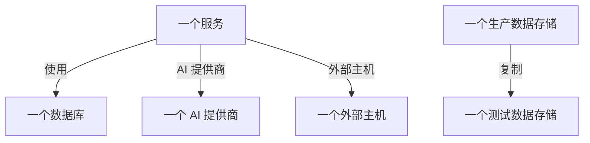

# 数据流、访问与数据驻留

知道数据存储中保存了什么只是事情的一半。数据安全还会弄清这些数据去了哪里（哪些服务使用该数据存储、数据到达了哪些 AI 提供商和外部主机，以及它被复制到了哪里）、谁可以访问每个数据存储，以及数据是否存放在允许的区域中。所有这些都来自 OneUptime 已有的证据：你的追踪、你的云自身的访问设置，以及扫描所发现内容的指纹。

:::cards
- [数据流](#数据流): 服务、AI 提供商、外部主机和副本。
- [谁可以访问数据存储](#谁可以访问数据存储): 你的云报告的每项授权，以及数据存储的暴露程度。
- [数据驻留规则](#数据驻留规则): 每种数据允许存放的区域。
:::

## 数据流

| 数据流 | 含义 | 来源 |
| --- | --- | --- |
| **使用** | 服务与数据存储通信。 | 服务地图，由 OneUptime 每十分钟根据你的服务的客户端 span 计算得出。地图上的每个数据库都按名称、地址或端点与其数据存储对应，因此没有其他来源列出的数据库会成为独立的数据存储。 |
| **AI 提供商** | 服务向 AI 提供商发送数据。 | 该服务过去 7 天的追踪中的 AI 调用，它们会写明所到达的提供商。 |
| **外部主机** | 服务调用你的系统之外的主机。 | 服务地图中的远程服务，按调用它们所用的地址识别。 |
| **复制** | 一个数据存储保存着另一个数据存储的值。 | 每次扫描所发现的值的指纹：当两个数据存储针对同一数据类型的指纹重叠一半或更多时，它们就共享数据。 |

数据流携带其来源所保存的数据类型及其敏感度。当扫描证明数据确实存在，而不仅仅是存在通往它的路径时，数据流即被确认：副本总是已确认的，而当服务的 AI 对话含有机密或受限数据时，AI 提供商数据流即被确认。30 天内未再出现的数据流会被删除。

有两项检查会读取数据流。[生产数据被复制到了非生产数据存储中](/docs/data-security/checks-and-issues#数据卫生) 会在副本的目标数据存储上失败。当两者中只有一个处于生产环境时，副本的方向是从生产数据存储出发，否则从 OneUptime 先发现的那个数据存储出发。[敏感数据正被发送给 AI 提供商](/docs/data-security/checks-and-issues#ai) 会在服务的 AI 对话含有敏感数据时在其上失败，并写明它们到达的提供商。

### 指纹如何保持私密

发现副本时不需要任何一个数据存储的值。对于扫描以高置信度找到的每种数据类型，它会把读取到的值概括为一个 MinHash：128 个槽位，每个槽位是某个哈希函数在这些值上的最小值，且只保留其低 16 位。两个概要中一致的槽位比例，大约等于它们两组值的重叠比例，因此比较概要即可估计一个数据存储有多少内容在另一个之中。

- **值使用项目自己的密钥进行哈希**（HMAC-SHA256），因此没有该密钥的人无法用已知值去比对概要，两个项目的概要也永远无法相互比较。
- **每个最小值只有 16 位会离开扫描。** 无法从概要中读回任何值，也无法读回任何值的哈希。
- **概要针对的是数据类型，而不是字段。** 数据存储中以高置信度找到的每种数据类型各有一个概要，仅此而已。

## 谁可以访问数据存储

配置读取会把每个云自身的访问设置（存储桶策略和 ACL、Azure 角色分配、Google Cloud IAM 绑定、快照共享）汇总为一份谁可以访问该数据存储的列表，显示在它的 **谁可以访问** 页面上：

| 列 | 含义 |
| --- | --- |
| **主体** | 拥有访问权限的人或对象，使用云自己的命名：`*`、账户 ID、ARN、电子邮件、服务账号。 |
| **主体类型** | 公开、账户、角色、用户、组、服务主体、服务账号或服务。 |
| **访问级别** | 读取、写入或管理员。 |
| **授予方式** | 授予访问权限的方式：存储桶策略、ACL、角色分配、IAM 绑定或快照共享。 |
| **外部** | 该主体位于已连接到 OneUptime 的账户、订阅和项目之外。 |
| **Public** | 该主体是互联网上的任何人。 |

每次配置读取都会重新读取该列表，云不再报告的授权会被移除。[超过 25 个身份可以读取受限数据](/docs/data-security/checks-and-issues#访问) 会统计列表中的读取者。使用某个数据存储的服务就是它的 **使用** 数据流。

根据读取到的内容，每个数据存储都会得到一个暴露级别：

| 暴露 | 含义 |
| --- | --- |
| **Public** | 互联网上的任何人都可以读取它。 |
| **其他账户** | 你已连接的账户之外的账户可以访问它。 |
| **可从互联网访问** | 它的网络端点接受来自互联网的连接。 |
| **私有** | 只有你自己的账户和网络可以访问它。 |
| **未知** | OneUptime 无法读取足够的配置来判断。 |

公开优先于共享，共享优先于可访问：同时与另一个账户共享的公开存储桶，其暴露为公开。暴露会计入问题的 [风险评分](/docs/data-security/checks-and-issues#风险评分)。

## 数据驻留规则

数据驻留规则规定某种数据可以存放在哪里。请在 **数据安全 → 设置 → 数据驻留规则** 中添加：

| 字段 | 作用 |
| --- | --- |
| **名称** | 规则是什么，例如“欧盟个人数据留在欧盟”。 |
| **允许的区域** | 该数据可以存储和复制到的区域，按你的云对区域的命名书写。没有任何区域的规则不检查任何内容。 |
| **数据类别** | 规则覆盖的数据类别。留空则覆盖所有类型的个人数据。 |
| **以下地区人员的数据** | 仅限关于这些国家人员的数据，使用 ISO 3166-1 代码，例如 `DE` 或 `IN`。留空则覆盖关于任何地方人员的数据。 |
| **描述** | 规则的用途，例如“我们欧盟客户的数据只存储在欧盟”。 |
| **已启用** | 是否根据该规则检查数据存储。 |

当数据存储保存着规则覆盖的数据，而它自己的区域或其数据被复制到的区域与所有允许的区域都不匹配时，它就违反了该规则。副本所在区域是指数据存储的数据被复制到的区域：S3 复制、存储账户的异地冗余副本、数据库的副本。随后该数据存储的 [数据被存放在允许的区域之外](/docs/data-security/checks-and-issues#数据驻留) 检查会失败，并写明区域和它违反的规则。

### 区域和通配符

允许的区域中的 `*` 代表任意字符，不区分大小写，并且模式必须匹配整个区域：

| 允许的区域 | 匹配 | 不匹配 |
| --- | --- | --- |
| `eu-*`（AWS） | `eu-west-1`、`eu-central-1` | `us-east-1`、`us-eu-1` |
| `europe-*`（Google Cloud） | `europe-west1`、`europe-north1` | `us-central1` |
| `westeurope`（Azure） | `westeurope` | `northeurope` |

为你使用的每个云各列出一个模式：`eu-*`、`europe-*`、`westeurope` 和 `northeurope` 合在一起，就能在全部三种云上把数据留在欧洲。

### 数据存储保存的是谁的数据

OneUptime 从数据本身判断数据存储保存的是谁的数据。属于某个国家的数据类型表明其人员在该国：德国税号表示 `DE`，印度 Aadhaar 号码表示 `IN`，英国 NHS 号码表示 `GB`。数据存储会把这些国家列为其数据主体所在国家，而仅限于某些国家人员的规则只覆盖保存他们数据的数据存储。[敏感数据类型](/docs/data-security/data-types#内置数据类型) 写明了每种有所属国家的数据类型对应的国家。

## 后续步骤

:::cards
- [数据安全检查与问题](/docs/data-security/checks-and-issues): 这些数据流、授权和规则为之提供信息的每项检查。
- [数据安全合规](/docs/data-security/compliance): 数据驻留和访问如何计入 GDPR、LGPD 和 DPDP。
- [拓扑](/docs/telemetry/topology): 数据流所来自的服务地图。
:::
