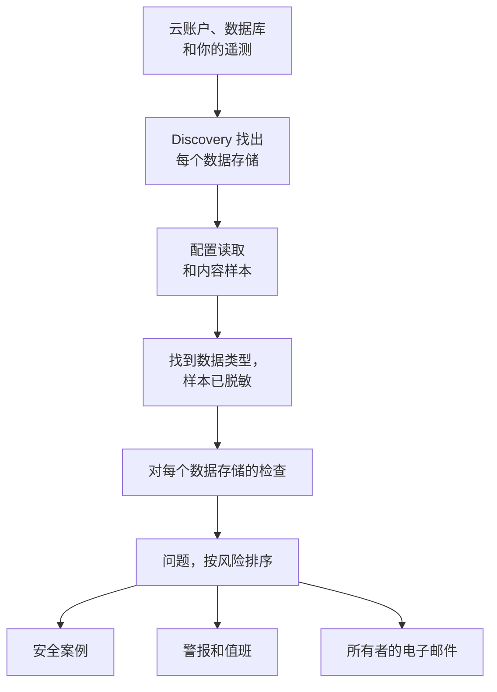

# 数据安全

数据安全会找出你的公司所保存的敏感数据——无论是在云存储桶、数据库和数据仓库中，还是在你发送给 OneUptime 的遥测中——并告诉你它们的保存方式有哪些不妥。它会自行找到这些数据存储，读取每个数据存储的设置方式，对其中保存的内容抽样，并为每处不妥打开一个问题，按风险排序。

它能解答四个疑问：

:::cards
- [我们的敏感数据在哪里？](/docs/data-security/data-types): 143 种数据类型，从卡号、国民身份证号到 API 密钥，可在存储桶、表和遥测中找到。
- [它是否暴露？](/docs/data-security/checks-and-issues): 对每个数据存储的 32 项检查：公开访问、加密、备份、日志记录、密钥和副本。
- [谁可以访问它，它又流向哪里？](/docs/data-security/flows-access-residency): 谁可以读取每个数据存储，哪些服务使用它，以及它的数据会到达哪些 AI 提供商和主机。
- [它是否符合我们的规则？](/docs/data-security/compliance): 数据驻留规则，以及根据扫描结果评分的九个合规框架。
:::

## 工作原理

1. **Discovery** 会找出 OneUptime 已经知道的数据存储：你的云资源清单、Database 产品监控的数据库、服务地图上你的服务所连接的数据库，以及每个服务的遥测。只有在没有任何来源列出某个数据存储时，你才需要手动添加它。
2. **配置读取** 会向每个云询问每个数据存储的设置方式：谁可以访问它，以及它如何加密、备份和记录日志。它只读取设置，从不读取数据。
3. **内容样本** 会在你允许的地方读取数据存储中的少量内容：存储桶中每种类型的几个对象、每个表的若干行、每个服务遥测中最新的记录。
4. **分类** 会在样本中找出敏感值，只保留计数和脱敏样本，从不保留值本身。
5. **检查** 会判断每个数据存储有哪些不妥，以及对其中保存的数据而言有多严重。每个未通过的检查都会打开一个问题，检查通过后，问题会自行关闭。

## 有何不同

- **你的遥测也是数据存储。** 每个服务的日志、追踪、异常、会话回放和 AI 对话都会像存储桶一样每小时检查一次。日志行中的电子邮件地址就是一个发现，而 **清除** 会从此在摄取时对它脱敏。请参阅 [遥测中的敏感数据](/docs/data-security/telemetry)。
- **数据流来自真实流量。** 服务地图说明哪个服务使用哪个数据库，AI 调用会写明它们访问的提供商，生产数据的副本则通过比较指纹找出。请参阅 [数据流、访问与数据驻留](/docs/data-security/flows-access-residency)。
- **证据始终经过脱敏。** 一个发现只保留计数和最多三个脱敏样本，例如 `j***@e******.com`，这些样本在任何内容离开扫描器之前就已在扫描器内部完成脱敏。关闭样本后，它只保留计数。
- **扫描器是开源的。** 每种数据类型的模式、校验和、上下文词和测试值都在 OneUptime 的源代码中，所以你可以准确读到是什么构成了一个发现。同一份代码运行在 OneUptime 的工作进程上、探测器上，以及 **测试** 框中。
- **它与 OneUptime 的其他部分协同工作。** 严重级别的问题会针对该数据存储打开一个安全案例，这样 [安全运营](/docs/telemetry/security-cases) 就会像处理任何其他威胁一样处理它。它可以触发警报来呼叫值班人员，还会给数据存储的所有者发送电子邮件。请参阅 [数据安全集成](/docs/data-security/integrations)。
- **OneUptime AI 帮助修复。** **用 AI 解释** 会告诉数据存储的所有者哪里不对，以及如何在他们的云上修复，**用 AI 修复** 会在你的基础设施代码中打开一个拉取请求。

## 开始之前

- **能够设置它的角色。** Project Owner、Project Admin 和 Security Admin 可以更改数据安全的设置。Security Member 处理问题并扫描数据存储，Security Viewer 读取它的发现。除非其团队被授予相应权限，否则其他角色什么都看不到：哪些存储桶保存着卡号，恰恰是攻击者想知道的。请参阅 [角色](/docs/permissions/reference#角色)。
- **一个可供读取的云账户，或一个数据库。** 数据安全通过 [云连接](/docs/telemetry/cloud-accounts) 读取云账户，并通过只读连接字符串读取你运行的数据库。遥测无需任何设置：它每小时都会被扫描。

## 快速入门

:::steps
### 连接云账户

前往 **云 → 连接**，然后选择你的云。如果该账户已经连接，请改为在它的连接上选择 **编辑**。[连接云账户](/docs/telemetry/cloud-accounts) 会逐一介绍每种云。

### 选择数据安全级别

在 **更多字段** 下，将 **数据安全** 设为 **仅配置** 以检查每个数据存储的设置方式，或设为 **配置和内容样本** 以同时找出其中的敏感数据。表单显示的命令会随你的选择而变化：按表单的说明，在你的云的终端中运行它。[设置数据安全](/docs/data-security/setup) 准确列出了每个级别授予的权限，[连接云账户](/docs/telemetry/cloud-accounts#数据安全) 则给出了每个级别的命令。

### 查看问题

打开 **数据安全**。Discovery 每 15 分钟查找一次数据存储，找到的数据存储会出现在 **数据存储** 下，连接的配置会在一小时内读取。读取或扫描一完成，问题就会在 **问题** 下打开，每个都带有风险评分，**概览** 会显示风险最高的五个。每个问题都会说明哪里不对、为什么重要以及如何修复，并附上适用于你的云的命令。
:::

## 什么算作数据存储

| 位置 | 数据存储 | 内容样本 |
| --- | --- | --- |
| AWS | AWS S3 Bucket、AWS RDS Instance、AWS Aurora Cluster、AWS RDS Snapshot、AWS DynamoDB Table、AWS Redshift Cluster、AWS DocumentDB Cluster、AWS OpenSearch Domain、AWS ElastiCache Cluster、AWS EFS File System | AWS S3 Bucket |
| Azure | Azure Storage Account、Azure SQL Database、Azure Cosmos DB Account、Azure PostgreSQL Server、Azure MySQL Server | Azure Storage Account |
| Google Cloud | Google Cloud Storage Bucket、Google Cloud SQL Instance、Google BigQuery Dataset、Google Firestore Database、Google Spanner Instance、Google Bigtable Instance | Google Cloud Storage Bucket、Google BigQuery Dataset |
| 你运行的数据库 | PostgreSQL、MySQL、MongoDB、SQL Server、Oracle、Redis、Elasticsearch | PostgreSQL、MySQL |
| OneUptime | 日志、追踪、异常、会话回放、AI 对话 | 日志、追踪、异常、会话回放、AI 对话 |

每个数据存储都会接受适用于其类型的检查。无法对内容抽样的数据存储仍会被检查：公开的存储桶或未加密的数据库，无论其中保存着什么，都是隐患。

一旦来源不再列出某个数据存储，它就会连同其历史记录一起被归档，其未解决的问题也会被解决：数据安全菜单末尾的 **已归档的数据存储** 会保留它。如果来源再次列出它，它会自行恢复，检查仍然失败的问题会再次打开。

数据存储的 **时间线** 会说明它经历了什么以及是谁做的：它何时被发现或添加、对其设置和所有者的每次更改、它何时被归档或恢复，以及通过问题或剧本关闭的每次暴露。

## 运行频率

| 任务 | 时间 |
| --- | --- |
| 查找新的数据存储 | 每 15 分钟 |
| 读取云连接的配置 | 每天一次；CloudTrail 记录到 AWS 数据存储的访问、加密、备份或共享发生更改后，还会在一小时内读取 |
| 对数据存储的内容抽样 | 每 24 小时一次，或按 **扫描间隔（小时）** 设置的频率 |
| 对每个服务的遥测抽样 | 每小时一次，抽取最近一小时的遥测 |
| 重新检查每个数据存储 | 每次读取和扫描之后、你更改了检查所依赖的任何内容之后，以及每天一次 |

数据存储上的 **立即扫描** 会立即对其内容抽样，**立即检查** 会重新读取其配置。

## 后续步骤

:::cards
- [设置数据安全](/docs/data-security/setup): 三个级别、每个级别授予的权限，以及扫描你自己的数据库。
- [敏感数据类型](/docs/data-security/data-types): 如何找到一个值，以及数据安全知道的每种数据类型。
- [数据安全检查与问题](/docs/data-security/checks-and-issues): 每项检查、风险评分，以及问题会经历什么。
- [数据安全集成](/docs/data-security/integrations): 安全案例、警报、所有者、工作流和 OneUptime AI。
:::
