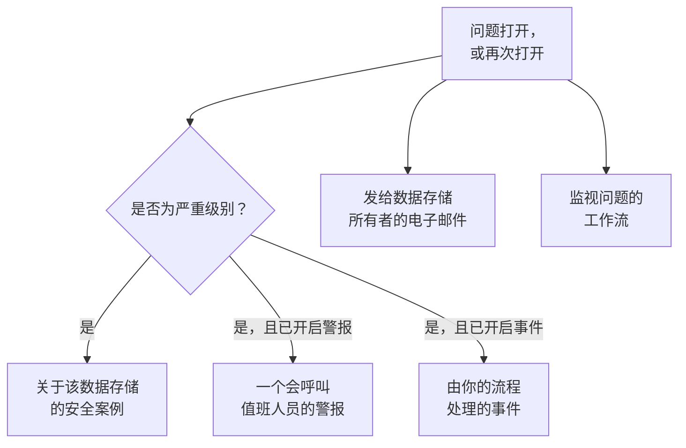

# 数据安全集成

数据安全没有自己的呼叫系统或安全队列。它把发现的内容交给 OneUptime 中已承担这些工作的部分：严重级别的问题会成为安全案例，它可以呼叫值班人员或声明事件，并且每个新问题都会通过电子邮件发送给数据存储的所有者。工作流、OneUptime AI、API、Terraform 和 MCP 服务器都能访问它保存的一切。

:::cards
- [安全运营](#安全运营): 为每个有严重问题的数据存储打开一个安全案例。
- [警报和值班](#警报和值班): 在严重问题打开时呼叫值班人员。
- [事件](#事件): 为需要走事件流程的数据泄露声明事件。
- [所有者](#所有者): 每个数据存储归谁所有（手动设置或由规则设置），以及他们收到的电子邮件。
- [OneUptime AI](#oneuptime-ai): 解释问题、打开修复它的拉取请求，或通过询问 AI 了解你的数据。
- [消除暴露](#消除暴露): 从问题或剧本中阻止公开访问或停止共享。
:::

## 工作原理

每当评估打开问题或再次打开问题时，以上各项都会运行。每一项都是尽力而为：问题已经打开并记录在其时间线上，因此失败的集成会被记录并跳过，绝不会因重试而产生第二个案例或第二次呼叫。每一项做了什么都会写入问题的 **时间线**，问题的页面会链接到它所引发的案例、警报和事件。

| 设置 | 默认值 | 作用 |
| --- | --- | --- |
| **打开安全案例** | 开启 | 严重问题会打开一个安全案例，按数据存储分组。 |
| **触发警报** | 关闭 | 严重问题会触发一个警报，由它呼叫值班人员。 |
| **警报严重性** | 空 | 这些警报的严重程度。留空则使用项目中最严重的级别。 |
| **声明事件** | 关闭 | 严重问题会声明一个事件，由你的事件流程处理。 |
| **事件严重性** | 空 | 这些事件的严重程度。留空则使用项目中最严重的级别。 |
| **通知所有者** | 开启 | 每个新问题都会通过电子邮件发送给其数据存储的所有者。 |

## 安全运营

在安全运营中，每个数据存储都是一个独立的实体，类型为 **数据存储**。开启 **打开安全案例** 后，严重问题会作为关于该数据存储的检测发送到安全运营：

- 它的来源是 **数据安全**，它的规则以检查命名，例如 `Data Security: public-read`；
- 它是严重级别的，因此它打开的案例采用项目的严重优先级；
- 它按数据存储分组：同一数据存储上的第二个严重问题会并入关于它的未结案例，而不会再打开一个。

此后，该案例会像其他案例一样处理：分配、添加备注、关闭，并由项目的剧本做出响应。与任何实体一样，该数据存储的检测会计入它在 [实体风险](/docs/telemetry/security-entity-risk) 中的风险。请参阅 [安全案例与剧本](/docs/telemetry/security-cases)。

## 警报和值班

开启 **触发警报** 后，严重问题会触发一个警报，名称为“Data Security:”加上问题的标题和数据存储。与其他警报一样，该警报按其自身的规则呼叫值班人员（参见 [警报](/docs/alerts/index) 和 [值班](/docs/on-call/index)）。无论问题被评估多少次，同一时间最多只有一个未解决的警报。**警报严重性** 设置警报的严重程度；留空时，使用项目中最严重的级别。

警报随其问题一同结束：一旦问题不再处于未解决状态（其检查通过，或有人将其标记为已解决、接受其风险或认定它不是问题），警报就会被解决，问题的 **时间线** 会记录这一点。再次打开的问题会触发新的警报。

警报默认关闭，因为大多数团队希望数据安全的发现首先进入安全案例。当一个保存卡号的公开存储桶需要把人叫醒时，请开启警报。

## 事件

开启 **声明事件** 后，严重问题会声明一个与其警报同样命名的事件，用于需要走事件流程的数据泄露：值班、工作区频道、状态页面和事后分析（参见 [事件](/docs/incidents/index)）。一个问题同一时间最多只有一个未解决的事件。**事件严重性** 设置事件的严重程度；留空时，使用项目中最严重的级别。

即使问题已解决，数据安全也从不解决事件：事件可能关联着状态页面和事后分析，因此由负责它的人来关闭。安全案例是通往事件的另一条途径：案例上的 **声明事件** 会打开一个与之关联的事件（参见 [声明事件](/docs/telemetry/security-cases#声明事件)）。

## 所有者

数据存储的所有者是个人和团队，列在数据存储的 **所有者** 页面上。问题就是给他们看的：他们会收到电子邮件，而对于没有所有者的敏感数据存储，**此敏感数据存储无人负责** 检查会失败。

开启 **通知所有者** 后，每次在某个数据存储上打开问题的评估，都会向其所有者（拥有它的个人，以及拥有它的团队的成员，最多 50 人）发送一封电子邮件，标题写明该数据存储有多少个新问题，例如“Data Security: 2 new issues on orders-db”。邮件列出每个新问题的严重程度和标题以及数据存储的敏感度，并链接到该数据存储。邮件中绝不包含样本。

### 所有者规则和标签规则

规则会在发现数据存储时替你设置所有者和标签：

| 规则 | 位置 | 作用 |
| --- | --- | --- |
| **所有者规则** | **数据安全 → 规则 → 所有者规则** | 为每个匹配的数据存储添加所有者用户和团队 |
| **标签规则** | **数据安全 → 规则 → 标签规则** | 为每个匹配的数据存储添加标签 |

规则按数据存储的标签、名称或描述的模式，或按 **云标记模式** 匹配数据存储：这是一个与数据存储的每个云标记（写作 `key=value`）进行匹配的模式。`^team=payments$` 匹配每个带有 `team=payments` 标记的数据存储，`^env=` 匹配每个带有 `env` 标记的数据存储。新数据存储一经发现就会应用项目的规则，所有者规则的 **通知所有者** 决定是否通知它添加的所有者。[标签与所有者规则](/docs/configuration/label-and-owner-rules) 说明了每条规则如何匹配以及规则何时运行。

## 工作流

**数据存储** 和 **数据安全问题** 是工作流触发器，各自有 **创建时**、**更新时**、**创建或更新时** 和 **删除时**。在 **添加触发器** 面板的 **OneUptime 资源** 下选择它们。

- **数据安全问题 → 创建时** 在问题首次打开时运行。在 **如果 / 否则** 块中读取其严重程度，把严重问题发布到频道，或在你的工单跟踪系统中创建工单。
- **数据安全问题 → 更新时**（将 **要监视的字段** 设为其状态）会在问题被解决、被接受或再次打开时运行。
- **数据存储 → 创建时** 在发现过程找到数据存储时运行，例如把每个新存储桶告知某个团队。

每个触发器传递的字段请参阅 [工作流触发器](/docs/workflows/triggers)。

## OneUptime AI

问题上有两个操作会请 OneUptime AI 帮忙。两者都会向 OneUptime AI 发送问题的标题和严重程度，数据存储的名称、种类、区域和云 ID，它的敏感度和数据类型，证据，该检查为何重要，以及针对该数据存储所在云的修复方法，但绝不发送发现的样本。两者都受项目的 OneUptime AI 开关和限制约束。

- **用 AI 解释** 会为数据存储的所有者写出问题所在、可能造成的后果，以及在其云上修复它的确切步骤。解释会保存在问题的 **时间线** 上。任何能读取数据安全的人都可以使用。
- **用 AI 修复** 会请 OneUptime AI 用能让检查通过的最小更改，在你的基础设施代码（Terraform、CloudFormation、Bicep 等）中修复该问题，并打开一个拉取请求。它需要在 **代码** 下连接保存该数据存储基础设施代码的存储库：项目有多个存储库时，请在 **存储库** 下选择它。拉取请求会出现在 **代码** 下（参见 [代码](/docs/ai/ai-agent)）。Security Member 及以上角色可以使用。

### 询问 AI

**询问 AI** 也会读取数据安全。在任何数据安全页面上，你都可以询问哪些数据存储保存着卡号、应该先修复什么，或者某个角色泄露后可以访问哪些数据存储；在数据存储或问题的页面上，它会先读取该记录。它使用三个读取工具作答，并以你自己的权限运行：

| 工具 | 读取的内容 |
| --- | --- |
| `query_data_stores` | 数据存储，风险最高的在前，可按敏感度、数据类型、暴露、提供商或名称筛选；或者某一个数据存储，包括在哪里发现了什么、谁可以访问它以及它的未解决问题 |
| `query_data_security_issues` | 问题，风险最高的在前，可按状态、严重程度、数据存储或检查筛选；或者某一个问题，包括其证据和针对其云的修复方法 |
| `query_data_store_access` | 谁可以访问某个数据存储，或某个主体可以访问的每个数据存储 |

它们读取数据类型、位置和计数，绝不读取发现的样本，无论是否脱敏。询问 AI 不会更改数据安全中的任何内容。

## 消除暴露

有两项更改可以消除云数据存储的暴露，每项都通过开启了 **数据安全响应** 的数据存储云连接执行（参见 [设置数据安全](/docs/data-security/setup#让数据安全关闭暴露)）：

- **阻止公开访问**，适用于 S3 存储桶、Azure 存储账户或 Cloud Storage 存储桶。
- **撤销共享**，适用于 RDS 快照，或 RDS 数据库、Aurora 集群或 DocumentDB 集群的已共享手动快照。

人员可以在它所修复的未解决问题上，通过 **在此修复** 运行其中一项（参见 [数据安全检查与问题](/docs/data-security/checks-and-issues#在此修复)）。安全运营剧本会把它们作为 **遏制** 类别的步骤运行，即 **阻止对数据存储的公开访问** 和 **撤销数据存储共享**：作用于案例涉及的每个数据存储，最多 10 个，每个步骤默认开启 **需要批准**。标记为 **有意公开** 的数据存储永远不会被阻止。无论哪种方式，数据存储的时间线都会记录所做的操作，并且会立即重新检查该数据存储，因此更改生效后问题就会解决。

## API、Terraform 和 MCP

数据安全保存的一切都是 OneUptime API 的记录，读取时使用与仪表板中相同的权限（参见 [API 参考](/docs/api-reference/api-reference)）：

| 记录 | API 路径 |
| --- | --- |
| 数据存储、它们的时间线、它们的发现以及谁可以访问它们 | `/data-store`、`/data-store-feed`、`/data-store-finding`、`/data-store-access` |
| 问题、它们的时间线以及数据流 | `/data-security-issue`、`/data-security-issue-feed`、`/data-security-flow` |
| 扫描 | `/data-security-scan` |
| 自定义数据类型、检查设置和数据驻留规则 | `/data-security-custom-data-type`、`/data-security-check-setting`、`/data-security-residency-rule` |
| 项目的设置 | `/data-security-setting` |
| 所有者、所有者规则和标签规则 | `/data-store-owner-user`、`/data-store-owner-team`、`/data-store-owner-rule`、`/data-store-label-rule` |

有几项结果是在请求时计算出来的，而不是存储的。每项都是一个 `POST`：

| 路径 | 作用 |
| --- | --- |
| `/data-security/overview` | 概览中的数据：按敏感度和类别统计的数据存储、按严重程度统计的未解决问题、风险最高的问题，以及它们最近 30 天的情况 |
| `/data-security/compliance` | 每个框架的分数和要求 |
| `/data-security/record-of-processing` | GDPR 处理活动记录，每个保存个人数据的数据存储对应一行 |
| `/data-store/<id>/scan-now` | **立即扫描**：立即对数据存储的内容采样 |
| `/data-store/<id>/check-now` | **立即检查**：重新读取数据存储的配置并运行其检查 |
| `/data-store-finding/<id>/scrub` | 对遥测发现执行 **清除** |
| `/data-security-issue/<id>/explain` | 对问题执行 **用 AI 解释** |
| `/data-security-issue/<id>/fix-with-ai` | 对问题执行 **用 AI 修复** |
| `/data-store/<id>/response-actions` | 数据存储当前可以执行哪些响应操作，以及不能执行的原因 |
| `/data-store/<id>/respond` | 对数据存储执行 **阻止公开访问** 或 **撤销共享**，并附上发起它的问题 |

[Terraform 提供程序](/docs/terraform/index) 为你创建的每种记录（你自己添加的数据存储、自定义数据类型、检查设置、数据驻留规则、所有者规则和标签规则）都提供一个以该记录命名的资源，例如 `oneuptime_residency_rule`。

[MCP 服务器](/docs/ai/mcp-server) 为以下记录提供创建、获取、列出、更新、删除和计数工具：数据存储、数据存储发现、数据存储访问条目、数据流、数据安全问题、数据安全扫描、自定义数据类型、检查设置、数据驻留规则和数据安全设置。这样，AI 助手就能以你的权限询问哪些数据存储保存着卡号，或者某个存储桶上有哪些未解决的问题。

## 后续步骤

:::cards
- [安全案例与剧本（SOAR）](/docs/telemetry/security-cases): 处理数据安全打开的案例。
- [标签与所有者规则](/docs/configuration/label-and-owner-rules): 规则如何匹配，以及何时运行。
- [工作流触发器](/docs/workflows/triggers): 在问题打开或发现数据存储时运行工作流。
- [数据安全检查与问题](/docs/data-security/checks-and-issues): 每个问题的含义，以及如何修复。
:::
