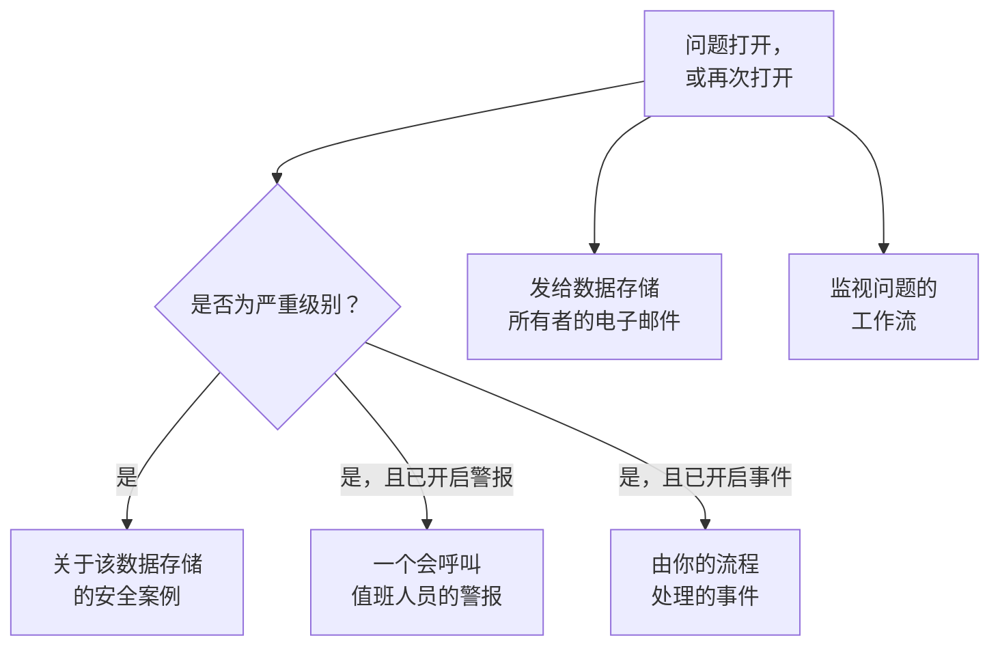

# 数据安全集成

数据安全没有自己的呼叫系统或安全队列。它把发现的内容交给 OneUptime 中已承担这些工作的部分：严重级别的问题会成为安全案例，它可以呼叫值班人员或声明事件，并且每个新问题都会通过电子邮件发送给数据存储的所有者。工作流、OneUptime AI、API、Terraform 和 MCP 服务器都能访问它保存的一切。

:::cards
- [安全运营](#安全运营): 为每个有严重问题的数据存储打开一个安全案例。
- [是否构成泄露？](#是否构成泄露): 评估每个严重暴露：开放了多久、谁能读取、是谁的数据，以及可能适用的泄露通知法。
- [警报和值班](#警报和值班): 在严重问题打开时呼叫值班人员。
- [事件](#事件): 为需要走事件流程的数据泄露声明事件。
- [所有者](#所有者): 分析问题，打开修复它的拉取请求，或者就你的数据向询问 AI 提问，并在你批准后让它执行操作。
- [OneUptime AI](#oneuptime-ai): 解释问题、打开修复它的拉取请求，或通过询问 AI 了解你的数据。
- [消除暴露](#消除暴露): 从问题或剧本中阻止公开访问或停止共享，并从问题中开启缺失的保护。
:::

## 工作原理

每当评估打开问题或再次打开问题时，以上各项都会运行。每一项都是尽力而为：问题已经打开并记录在其时间线上，因此失败的集成会被记录并跳过，绝不会因重试而产生第二个案例或第二次呼叫。每一项做了什么都会写入问题的 **时间线**，问题的页面会链接到它所引发的案例、警报和事件。

| 设置 | 默认值 | 作用 |
| --- | --- | --- |
| **打开安全案例** | 开启 | 严重问题会打开一个安全案例，按数据存储分组。 |
| **触发警报** | 关闭 | 严重问题会触发一个警报，由它呼叫值班人员。 |
| **警报严重性** | 空 | 这些警报的严重程度。留空则使用项目中最严重的级别。 |
| **声明事件** | 关闭 | 严重问题会声明一个事件，由你的事件流程处理。 |
| **事件严重性** | 空 | 这些事件的严重程度。留空则使用项目中最严重的级别。 |
| **通知所有者** | 开启 | 每个新问题都会通过电子邮件发送给其数据存储的所有者。 |

## 安全运营

在安全运营中，每个数据存储都是一个独立的实体，类型为 **数据存储**。开启 **打开安全案例** 后，严重问题会作为关于该数据存储的检测发送到安全运营：

- 它的来源是 **数据安全**，它的规则以检查命名，例如 `Data Security: public-read`；
- 它是严重级别的，因此它打开的案例采用项目的严重优先级；
- 它按数据存储分组：同一数据存储上的第二个严重问题会并入关于它的未结案例，而不会再打开一个。

此后，该案例会像其他案例一样处理：分配、添加备注、关闭，并由项目的剧本做出响应。与任何实体一样，该数据存储的检测会计入它在 [实体风险](/docs/telemetry/security-entity-risk) 中的风险。请参阅 [安全案例与剧本](/docs/telemetry/security-cases)。

任何安全案例，无论由什么打开，都会在其 **影响** 中显示面临风险的数据：案例涉及的含敏感数据的数据存储，以及其用户和角色可以访问的每个数据存储，最敏感的排在前面，并注明各自存放的内容、大约多少条记录、暴露程度，以及有多少个身份可以访问它。案例提到的已代入角色的会话按其角色计算，电子邮件地址则按其所属的云用户计算。读取使用查看者自己的权限，因此无法读取数据安全的角色会看到这一部分被省略。

## 是否构成泄露？

存有 **受限** 或 **机密** 数据的数据存储发生严重暴露（对互联网上的任何人开放、与你的账户以外的账户共享，或是他人可以恢复的快照）时，其案例会在打开时自动得到评估。关于数据存储的其他案例，则在有人点击其 **概览** 上的 **评估此暴露** 时得到评估。评估由普通代码根据 OneUptime 记录的内容计算得出，并在每次读取时重新计算：

- **开放了多长时间**：从你的云日志中使该数据存储暴露的那次更改算起（前提是该更改记录于发现前的 30 天内），否则至少从数据安全发现它时算起；直到数据安全自身的响应将其关闭、某次更改将其关闭，或某次检查发现它已关闭为止。
- **谁可以读取**：该数据存储是否记录了读取。如果没有记录，评估会显示“读取未被记录。请将数据视为已被读取。”它会统计你公司之外可以读取该数据存储的账户，以及其中有多少个账户在其开放期间使用了访问权限，但绝不列出它们的名称。
- **是谁的数据**：该数据存储保存了什么、大约多少条记录、这些记录涉及哪些人，以及这些人住在哪里，包括数据显示的地点和有人说明的地点。
- **需要轮换的密钥**：数据存储开放期间在其中发现的每个密钥，按类型和发现位置列出，绝不显示其值。
- **可能适用的泄露通知法**：OneUptime 泄露通知法表格中的每一行，包括它要求做什么、通知谁、从数据安全发现该暴露时起算的期限，以及在它适用之前仍需人工核对的事项。

该表格涵盖 GDPR 第 33 条和第 34 条、UK GDPR 第 33 条和第 34 条、HIPAA 的泄露通知规则（Breach Notification Rule）、PCI DSS 要求 12.10.1、巴西的 LGPD、印度的 DPDP 规则和 CERT-In 指令，以及加利福尼亚州、科罗拉多州、佛罗里达州、纽约州、得克萨斯州和华盛顿州的泄露通知法。每一行都链接到该法律本身的文本，即其来源，并注明最后一次对照它核对的日期。对于表格未涵盖的内容（其他国家、美国其他州、你的组织的设立地点、你的合同），评估会用平实的语言说明。

OneUptime AI 会在你的数据安全 AI 规则允许时，或在有人请求时，把评估整理成文：这意味着什么、致监管机构的通知、致受影响人员的通知，以及内部摘要（参见 [数据安全中的 OneUptime AI](/docs/data-security/ai)）。每份草稿都必须以评估的事实为准：草稿中只要出现任何事实都不支持的数字或法律，就会被丢弃。不会向任何地方发送任何内容：通知只是由人编辑和复制的文本，评估和每份草稿都会注明它们不是法律建议。

同时有权读取该数据存储及其发现的案例读者才能看到评估，因为评估会写明该数据存储保存了什么。评估、起草、编辑通知以及说明这些人住在哪里，还需要编辑该案例的权限。案例上的卡片请参阅 [是否构成泄露？](/docs/telemetry/security-cases#是否构成泄露)。

## 警报和值班

开启 **触发警报** 后，严重问题会触发一个警报，名称为“Data Security:”加上问题的标题和数据存储。与其他警报一样，该警报按其自身的规则呼叫值班人员（参见 [警报](/docs/alerts/index) 和 [值班](/docs/on-call/index)）。无论问题被评估多少次，同一时间最多只有一个未解决的警报。**警报严重性** 设置警报的严重程度；留空时，使用项目中最严重的级别。

警报随其问题一同结束：一旦问题不再处于未解决状态（其检查通过，或有人将其标记为已解决、接受其风险或认定它不是问题），警报就会被解决，问题的 **时间线** 会记录这一点。再次打开的问题会触发新的警报。

警报默认关闭，因为大多数团队希望数据安全的发现首先进入安全案例。当一个保存卡号的公开存储桶需要把人叫醒时，请开启警报。

## 事件

开启 **声明事件** 后，严重问题会声明一个与其警报同样命名的事件，用于需要走事件流程的数据泄露：值班、工作区频道、状态页面和事后分析（参见 [事件](/docs/incidents/index)）。一个问题同一时间最多只有一个未解决的事件。**事件严重性** 设置事件的严重程度；留空时，使用项目中最严重的级别。

即使问题已解决，数据安全也从不解决事件：事件可能关联着状态页面和事后分析，因此由负责它的人来关闭。安全案例是通往事件的另一条途径：案例上的 **声明事件** 会打开一个与之关联的事件（参见 [声明事件](/docs/telemetry/security-cases#声明事件)）。

## 所有者

数据存储的所有者是个人和团队，列在数据存储的 **所有者** 页面上。问题就是给他们看的：他们会收到电子邮件，而对于没有所有者的敏感数据存储，**此敏感数据存储无人负责** 检查会失败。

开启 **通知所有者** 后，每次在某个数据存储上打开问题的评估，都会向其所有者（拥有它的个人，以及拥有它的团队的成员，最多 50 人）发送一封电子邮件，标题写明该数据存储有多少个新问题，例如“Data Security: 2 new issues on orders-db”。邮件列出每个新问题的严重程度和标题以及数据存储的敏感度，并链接到该数据存储。邮件中绝不包含样本。

当 OneUptime AI 自行处理新问题时，电子邮件最多会等待 10 分钟以获取其分析，并为每个已分析的问题多附两行：它的结论及原因，以及最短修复路径。每位所有者只会收到其有权读取的行：无权读取该问题的所有者收不到任何一行，依据其无权读取内容的行会被省略。

### 所有者规则和标签规则

规则会在发现数据存储时替你设置所有者和标签：

| 规则 | 位置 | 作用 |
| --- | --- | --- |
| **所有者规则** | **数据安全 → 规则 → 所有者规则** | 为每个匹配的数据存储添加所有者用户和团队 |
| **标签规则** | **数据安全 → 规则 → 标签规则** | 为每个匹配的数据存储添加标签 |

规则按数据存储的标签、名称或描述的模式，或按 **云标记模式** 匹配数据存储：这是一个与数据存储的每个云标记（写作 `key=value`）进行匹配的模式。`^team=payments$` 匹配每个带有 `team=payments` 标记的数据存储，`^env=` 匹配每个带有 `env` 标记的数据存储。新数据存储一经发现就会应用项目的规则，所有者规则的 **通知所有者** 决定是否通知它添加的所有者。[标签与所有者规则](/docs/configuration/label-and-owner-rules) 说明了每条规则如何匹配以及规则何时运行。

### OneUptime AI 提议的所有者

没有所有者的数据存储可以从 OneUptime AI 获得所有者。它会读取已经指向所有者的信息（数据存储的云标签、使用它的服务、声明它的文件的代码所有者，以及更改或添加它的人），并据此提议您项目自己的团队和人员。在有人于 **数据存储** 或 **数据安全 → 人工智能** 的 **待审核的所有者** 中批准之前，什么都不会改变，添加的所有者会像其他所有者一样收到通知。当三个或更多数据存储的所有者基于同一个标签或同样的名称开头时，它还会提议一条所有者规则，让下一个类似的数据存储也有所有者，批准后该规则会加入 **所有者规则**。 [数据安全中的 OneUptime AI](/docs/data-security/ai) 说明了它发送什么以及何时运行。

## 工作流

**数据存储** 和 **数据安全问题** 是工作流触发器，各自有 **创建时**、**更新时**、**创建或更新时** 和 **删除时**。在 **添加触发器** 面板的 **OneUptime 资源** 下选择它们。

- **数据安全问题 → 创建时** 在问题首次打开时运行。在 **如果 / 否则** 块中读取其严重程度，把严重问题发布到频道，或在你的工单跟踪系统中创建工单。
- **数据安全问题 → 更新时**（将 **要监视的字段** 设为其状态）会在问题被解决、被接受或再次打开时运行。
- **数据存储 → 创建时** 在发现过程找到数据存储时运行，例如把每个新存储桶告知某个团队。

每个触发器传递的字段请参阅 [工作流触发器](/docs/workflows/triggers)。

## 拉取请求

泄露在合并前修复成本最低。在 **代码** 下连接且开启了生产审查的存储库中，每个拉取请求的审查都有一个从其 diff 读取的 **敏感数据** 部分：把个人数据或密钥写入遥测（日志、span、指标、异常的消息或错误追踪工具的报告）的代码、公开数据存储或关闭其加密、备份或日志的基础设施代码，以及为个人数据、密码或卡数据添加列的迁移。每个要点都会说明更改上线后会不通过的数据安全检查，你自己的数据类型会像扫描那样按其名称提示读取。参见 [拉取请求的生产审查](/docs/ai/ai-agent#拉取请求的生产审查)。

数据安全所知道的会让这些要点更准确，体现在私有存储库的评论中，以及代码中面向可以读取数据安全发现的人：服务的遥测在过去 7 天中保存同类数据的位置、在摄取时屏蔽它的清除规则，以及资源所对应的数据存储及其敏感度。对于迁移，仅在私有存储库中，还会说明表所在的数据存储、该数据存储保存的内容、它是否可从外部访问或是否未进行静态加密，以及该表中已发现保存同类数据的列。标记为 **有意公开** 的数据存储不会因为公开而成为要点。公开存储库的评论只说 diff 显示的内容。

**项目设置 → 人工智能 → AI 成效** 中的 **合并前发现的泄露** 会统计审查在拉取请求中发现的泄露（无论是否已在那里修复），并与代码上线后扫描针对同样检查打开的问题并列。

## OneUptime AI

问题上有两个操作会请 OneUptime AI 帮忙。两者都会向 OneUptime AI 发送问题的标题和严重程度，数据存储的名称、种类、区域和云 ID，它的敏感度和数据类型（各用其名称，你自己的数据类型用你给它们起的名称），证据，该检查为何重要，以及针对该数据存储所在云的修复方法，但绝不发送发现的样本。两者都受项目的 OneUptime AI 开关和限制约束。每个操作发送什么、绝不发送什么以及运行在哪个模型上，请参见 [数据安全中的 OneUptime AI](/docs/data-security/ai)。

- 问题页面顶部的 **分析问题** 会让 OneUptime AI 撰写分析：问题是否真实存在、它让什么面临风险、修复会破坏什么，以及最短修复路径（参见 [数据安全检查与问题](/docs/data-security/checks-and-issues)）。它还会发送谁能访问该存储（每项授权及其大致最后一次使用的时间，以及被发现正在使用它的服务）、其数据在其他存储中的副本、其安全案例、修复该问题的响应操作、声明该存储的代码仓库和文件，以及它有多少所有者（绝不包括他们是谁）。分析保存在问题上，其结论记录在问题的 **时间线** 中。发送的内容和回答都不会保存在 **项目设置 → 人工智能 → AI 日志** 中，任何项目成员和查看者都能读取该日志：那一行只说明发生了调用及其花费。任何能读取该问题的人都可以请求分析，而通过 API 和 MCP 服务器使用的 **用 AI 解释** 也会返回同一份分析。
- **用 AI 修复** 会请 OneUptime AI 用能让检查通过的最小更改，在你的基础设施代码（Terraform、CloudFormation、Bicep 等）中修复该问题，并打开一个拉取请求。它需要在 **代码** 下连接保存该数据存储基础设施代码的存储库：你能在多个存储库中使用时，请在 **存储库** 下选择它。拉取请求会出现在 **代码** 下（参见 [代码](/docs/ai/ai-agent)）。安全成员及以上角色可以在他们能在 **代码** 下更改的存储库中使用，这与在那里请 AI 工作所需的权限相同：安全角色本身不读取也不更改任何存储库，因此还要给他们的团队 **Read Code Repository** 和 **Edit Code Repository**。当 AI 现在无法工作时（已关闭、项目的 AI 额度已用完、已达到每日限制，或没有在线的 Runner），用 AI 修复会说明需要解决什么，并且不启动任何内容。 对于服务遥测中的问题，它会先显示一个针对该服务所有泄露的拉取请求，并附上记录所指的每个泄露的写入位置（绝不包含值）；当数据在超过三处写入时，它会改为添加一个带测试的脱敏步骤：请参阅 [在代码中修复](/docs/data-security/telemetry#在代码中修复)。

OneUptime AI 还会按照您的 AI 规则，自动处理每个新问题：请参阅[数据安全中的 OneUptime AI](/docs/data-security/ai)。

### 询问 AI

**询问 AI** 读取数据安全，并在你批准后在其中执行操作。在任意数据安全页面上，你可以问哪些数据存储保存了卡号、应先修复什么，或者某个角色泄露后能触及哪些数据存储；在数据存储或问题的页面上，它会先读取该记录。它使用以下工具读取，全部以你自己的权限运行：

| 工具 | 读取的内容 |
| --- | --- |
| `query_data_stores` | 数据存储，风险最高的在前，可按敏感度、数据类型、暴露、提供商或名称筛选；或者某一个数据存储，包括在哪里发现了什么、谁可以访问它以及它的未解决问题 |
| `query_data_security_issues` | 问题，风险最高的在前，可按状态、严重程度、数据存储或检查筛选；或者某一个问题，包括其证据和针对其云的修复方法 |
| `query_data_store_access` | 谁可以访问某个数据存储，或某个主体可以访问的每个数据存储 |

它们读取数据类型、位置和数量，从不读取发现的样本，无论是否脱敏。另外两个工具读取 OneUptime AI 正在处理的内容：`query_data_security_proposals` 列出它的提议，以及它发现但扫描尚未查找的数据类型，每个都附带证明方式和所在字段，从不包含值；`draft_data_security_rule` 根据你的句子起草规则，并说明它今天匹配哪些数据存储。它不保存任何内容。

询问 AI 做的就是数据安全按钮所做的事，每项操作都以你的身份、你的权限，进行与其按钮完全相同的更改：

| 操作 | 作用 | 先询问你 |
| --- | --- | --- |
| `scrub_data_security_finding` | 对遥测中的发现执行 **清除**：使用经过验证、范围精确的清除规则 | 在 **执行前询问** 中询问，且当有内容读取它要隐藏的数据时，在每种模式下都询问 |
| `judge_data_security_finding` | **确认**，或附上理由标记为 **不敏感**，并对类似的发现作出相同决定 | **不敏感** 在每种模式下都询问；当项目中的严重问题会呼叫某人时，**确认** 在每种模式下都询问 |
| `change_data_security_issue` | 附上理由和结束日期 **接受风险**，附上理由标记为 **不是问题**，**重新打开** 或 **分配** | **接受风险** 和 **不是问题** 在每种模式下都询问 |
| `set_data_store_owners` | 添加或移除数据存储的所有者 | 每种模式下 |
| `save_data_security_rule` | 保存根据你的句子起草的数据驻留、所有者或标签规则，并将所有者规则或标签规则应用到它今天匹配的数据存储 | 每种模式下 |
| `respond_on_data_store` | 通过数据存储的云连接执行的响应操作，例如 **阻止公开访问** | 每种模式下 |
| `fix_data_security_issue_with_ai` | **用 AI 修复**：由某人审查并合并的拉取请求。已在进行中的修复不会启动两次 | 在 **执行前询问** 中 |
| `decide_data_security_proposal` | 对 OneUptime AI 的提议选择 **批准** 或 **隐藏**。发现的数据类型要在 **设置 → 数据类型** 的表单中添加，因此在这里只能拒绝 | 每种模式下 |

每项操作都会先显示一张卡片，用简单的话说明会更改什么、什么会停止工作以及成本是什么。在 **执行前询问** 中，你可以允许或跳过每项操作。在 **自动执行** 中，上表中在每种模式下都询问的操作仍会等待你：它们会改变谁能触及你的数据，让一个发现或问题不再计入，改变谁会收到某个数据存储的通知，或者会让 OneUptime AI 批准自己的提议。数据存储名称、发现的位置和证据来自你的云以及任何向其中写入的人，因此询问 AI 从不会因为这类文本的要求而执行操作，并且每项操作在运行时都会以你的权限再次检查。

## 消除暴露

有两项更改可以消除云数据存储的暴露，每项都通过开启了 **数据安全响应** 的数据存储云连接执行（参见 [设置数据安全](/docs/data-security/setup#让数据安全关闭暴露)），另有六项更改会开启保护数据存储的设置，只能从其问题中执行：

- **阻止公开访问**，适用于 S3 存储桶、Azure 存储账户或 Cloud Storage 存储桶。
- **撤销共享**，适用于 RDS 快照，或 RDS 数据库、Aurora 集群或 DocumentDB 集群的已共享手动快照。
- **开启版本控制**、**开启软删除**、**关闭对象 ACL**、**开启统一访问**、**要求安全传输** 和 **开启时间点恢复**，适用于 [在此修复](/docs/data-security/checks-and-issues#在此修复) 列出的数据存储。

人员可以在它所修复的未解决问题上，通过 **在此修复** 运行其中一项（参见 [数据安全检查与问题](/docs/data-security/checks-and-issues#在此修复)）。安全运营剧本会把它们作为 **遏制** 类别的步骤运行，即 **阻止对数据存储的公开访问** 和 **撤销数据存储共享**：作用于案例涉及的每个数据存储，最多 10 个，每个步骤默认开启 **需要批准**。标记为 **有意公开** 的数据存储永远不会被阻止。无论哪种方式，数据存储的时间线都会记录所做的操作，并且会立即重新检查该数据存储，因此更改生效后问题就会解决。

剧本模板 **封堵数据泄露** 会响应数据安全打开的案例：它会给数据存储的所有者发送电子邮件，在有人批准每个步骤后阻止公开访问并撤销共享，并把响应检查清单作为任务添加到案例中——暴露期间谁读取了数据、这是否属于必须上报的泄露、需要轮换哪些密钥，以及关闭案例时要写些什么。可以在项目剧本中通过 **从模板创建** 添加它。案例的 **是否构成泄露？** 卡片会回答其中每一项任务（参见 [是否构成泄露？](#是否构成泄露)）。

## API、Terraform 和 MCP

数据安全保存的一切都是 OneUptime API 的记录，读取时使用与仪表板中相同的权限（参见 [API 参考](/docs/api-reference/api-reference)）：

| 记录 | API 路径 |
| --- | --- |
| 数据存储、它们的时间线、它们的发现、谁可以访问它们，以及每个可以访问的身份 | `/data-store`、`/data-store-feed`、`/data-store-finding`、`/data-store-access`、`/data-security-identity` |
| 问题、它们的时间线、关联的拉取请求以及数据流 | `/data-security-issue`、`/data-security-issue-feed`、`/data-security-issue-pull-request`、`/data-security-flow` |
| 扫描 | `/data-security-scan` |
| 自定义数据类型、检查设置、合规设置和数据驻留规则 | `/data-security-custom-data-type`、`/data-security-check-setting`、`/data-security-compliance-setting`、`/data-security-residency-rule` |
| 项目的设置 | `/data-security-setting` |
| 所有者、所有者规则和标签规则 | `/data-store-owner-user`、`/data-store-owner-team`、`/data-store-owner-rule`、`/data-store-label-rule` |
| OneUptime AI 为问题提出的提议，以及它对问题采取或未采取行动的原因 | `/data-security-ai-proposal`、`/data-security-ai-decision` |

有几项结果是在请求时计算出来的，而不是存储的。每项都是一个 `POST`：

| 路径 | 作用 |
| --- | --- |
| `/data-security/overview` | 概览中的数据：按敏感度和类别统计的数据存储、按严重程度统计的未解决问题、风险最高的问题，以及它们最近 30 天的情况 |
| `/data-security/compliance` | 每个框架的分数和要求 |
| `/data-security/resource-scope` | 单个资源（Kubernetes 集群、Docker 或 Podman 主机、数据库、服务或云资源）的数据存储，以及它们遵循哪个资源的合规开关 |
| `/data-security/resource-compliance` | 单个资源的框架：它们针对该资源数据存储的分数，以及为该资源关闭了哪些内容 |
| `/data-security/record-of-processing` | GDPR 处理活动记录，每个保存个人数据的数据存储对应一行。OneUptime 为你的安全保留的数据存储带有 `declared` 对象：它自己的用途和保留期，以及谁可以读取它 |
| `/data-store/<id>/declared` | 记录对 OneUptime 为你的安全保留的数据存储的说明：保存什么、为什么、保留多久以及谁可以读取 |
| `/data-store/<id>/scan-now` | **立即扫描**：立即对数据存储的内容采样 |
| `/data-store/<id>/check-now` | **立即检查**：重新读取数据存储的配置并运行其检查 |
| `/data-store-finding/<id>/scrub` | 对遥测发现执行 **清除** |
| `/data-store-finding/<id>/drop-metric-impact` | 对指标名称中的发现执行 **丢弃此指标** 会丢弃什么：多少个指标，以及读取它们的监视器、仪表板、SLO 和记录规则 |
| `/data-store-finding/<id>/drop-metric` | **丢弃此指标**：一条永久丢弃该服务这些指标新数据点的指标管道规则。它接受 `{"confirmDataLoss": true}` |
| `/data-security-issue/<id>/explain` | **用 AI 解释**：OneUptime AI 对问题的分析，与 **分析问题** 撰写的相同。若其依据没有变化，则返回问题上保存的分析，否则撰写新的分析；`{"force": true}` 会像 **重新分析** 一样撰写新的分析 |
| `/data-security-issue/<id>/analysis` | 问题上保存的分析，按你有权读取的范围返回。它从不询问 OneUptime AI |
| `/data-security-issue/<id>/fix-with-ai` | 对问题执行 **用 AI 修复** |
| `/data-store/<id>/response-actions` | 数据存储当前可以执行哪些响应操作，以及不能执行的原因 |
| `/data-store/<id>/respond` | 对数据存储执行一项响应操作，例如 **阻止公开访问** 或 **开启版本控制**，并附上发起它的问题 |
| `/data-security-ai-proposal/<id>/approve` | 对 OneUptime AI 提议的更改执行 **批准**，以你自己的权限进行该更改。它接受你看到的提议的 `expectedPlanFingerprint`，并拒绝此后已发生变化的提议 |
| `/data-security-ai-proposal/<id>/dismiss` | **忽略提议**，接受 `{"reason": "..."}`，原因会写入问题的时间线 |
| `/data-security-ai-proposal/<id>/undo` | 对 OneUptime AI 所做的更改执行 **撤销**：撤回该更改，并重新检查数据存储 |
| `/security-case/<id>/exposure-assessment` | 安全案例的暴露评估，按你有权读取的范围返回：普通代码根据案例所涉数据存储计算出的内容，以及 OneUptime AI 撰写的文稿 |
| `/security-case/<id>/exposure-assessment/assess` | **评估此暴露**：开始对案例进行评估；当案例涉及多个数据存储时，评估 `{"dataStoreId": "..."}` 指定的那一个 |
| `/security-case/<id>/exposure-assessment/draft` | **使用 OneUptime AI 起草**：OneUptime AI 为每个无人编辑过的部分撰写草稿。不会发送任何内容 |
| `/security-case/<id>/exposure-assessment/edit` | 用某人自己的话写成的一个部分，例如 `{"part": "regulatorNotice", "markdown": "..."}`，该部分永远不会再被起草 |
| `/security-case/<id>/exposure-assessment/people` | 数据所涉及的人员住在哪里，例如 `{"places": ["EEA", "GB"]}`；空列表会撤回该回答 |

[Terraform 提供程序](/docs/terraform/index) 为你创建的每种记录（你自己添加的数据存储、自定义数据类型、检查设置、合规设置、数据驻留规则、所有者规则和标签规则）都提供一个以该记录命名的资源，例如 `oneuptime_residency_rule`。

[MCP 服务器](/docs/ai/mcp-server) 为以下记录提供创建、获取、列出、更新、删除和计数工具：数据存储、数据存储发现、数据存储访问条目、数据安全身份、数据流、数据安全问题、数据安全扫描、自定义数据类型、检查设置、合规设置、数据驻留规则和数据安全设置。这样，AI 助手就能以你的权限询问哪些数据存储保存着卡号，或者某个存储桶上有哪些未解决的问题。 它还提供 [询问 AI 的操作](#询问-ai)，每项一次调用，每项都以你的身份进行与其按钮完全相同的更改。MCP 服务器无法向任何人显示卡片，因此询问 AI 在每种模式下都会询问的操作会在那里被拒绝：回答会说明原因，并指出你在 OneUptime 中进行更改的页面。对这些记录之一进行同样更改的写入也会被拒绝，例如通过 `update_data_security_issue` 将问题的 `status` 设为 `Accepted`、关闭数据类型，或将某个位置排除在数据存储的扫描之外；其他所有字段都照常更改。

## 后续步骤

:::cards
- [安全案例与剧本（SOAR）](/docs/telemetry/security-cases): 处理数据安全打开的案例。
- [标签与所有者规则](/docs/configuration/label-and-owner-rules): 规则如何匹配，以及何时运行。
- [工作流触发器](/docs/workflows/triggers): 在问题打开或发现数据存储时运行工作流。
- [数据安全检查与问题](/docs/data-security/checks-and-issues): 每个问题的含义，以及如何修复。
:::
