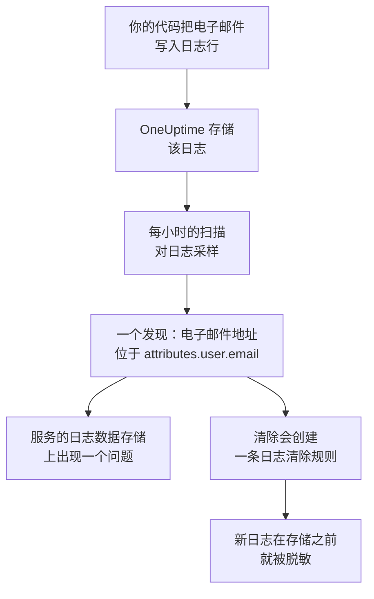

# 遥测中的敏感数据

遥测中保存着你的代码写入的一切：日志行中的电子邮件地址、span 属性中的卡号、堆栈跟踪中的令牌、提示词中客户的提问。数据安全把每个服务的日志、追踪、异常和 AI 对话，以及每个 RUM 应用程序的会话，都视为独立的数据存储。它每小时对它们采样一次，像在存储桶中一样在其中查找敏感数据，而 **清除** 会把一个发现变成一条清除规则，从此在摄取时对该数据脱敏。

无需任何设置：每个服务的遥测每小时扫描一次，除非项目设置中的 **扫描遥测** 已关闭。

:::cards
- [读取哪些内容](#读取哪些内容): 每种信号的属性、正文、消息和提示词。
- [扫描如何采样](#扫描如何采样): 每小时读取每个服务的最新记录。
- [清除](#清除): 一键在摄取时对某个发现脱敏。
- [什么算作已清除](#什么算作已清除): 清除规则何时已经覆盖某个发现。
:::

## 工作原理

被清除规则覆盖的发现会标记为已清除：该数据剩下的部分是等待保留期结束的旧数据，而不是仍在持续的泄露。两项遥测检查只统计没有任何规则覆盖的部分，因此一旦每个发现都已清除，它们的问题就会解决（参见 [遥测检查](/docs/data-security/checks-and-issues#遥测)）。

## 读取哪些内容

| 数据存储 | 读取哪些内容 | 发现指向的位置 |
| --- | --- | --- |
| 日志 | 每个属性，以及正文 | `attributes.<key>`、`body` |
| 追踪 | 每个 span 属性，以及每个 span 事件的属性 | `attributes.<key>`、`events.<event>.<key>` |
| 异常 | 消息、堆栈跟踪和属性 | `message`、`stackTrace`、`attributes.<key>` |
| AI 对话 | 每次 AI 调用的提示词和回答（位于 GenAI 约定存放它们的键下），以及其他所有属性 | 它们所在的键，例如 `gen_ai.input.messages` 或 `gen_ai.prompt[].content` |
| 会话回放 | RUM 应用程序的 span 和日志的属性、其会话的属性、`identify()` 为其用户提供的特征，以及它被告知的用户标识 | `spans.attributes.<key>`、`logs.attributes.<key>`、`sessions.attributes.<key>`、`sessions.identifiedUserTraits.<key>`、`sessions.identifiedUserLabel` |

带编号的键会合并为一个位置：`gen_ai.prompt.3.content` 即 `gen_ai.prompt[].content`，因此一次对话中的二十条消息是一个发现，而不是二十个。OneUptime 自己添加的属性（以 `oneuptime.` 开头）不会被读取。

### 为什么从不读取回放的录制内容

会话回放的录制内容包含人们看到的页面文本。观看它需要单独的权限，而从中读出的发现会把脱敏后的页面文本展示给每个能读取数据安全的人。因此，回放只按其属性读取：录制内容旁边的 span、日志和会话详细信息。录制器在浏览器中录制时就已经对内容脱敏，日志清除规则也会作用于录制内容（参见 [会话回放](/docs/telemetry/session-replay)）。

### AI 对话

AI 调用的提示词携带着此人最新消息之前的整段对话，因此 AI 调用的每个值最多读取 16,384 个字符。当 AI 对话中含有敏感数据时，还会带来两件事：这些调用所发往的 AI 提供商成为该数据的一个数据流，并且该数据存储上的 [敏感数据正被发送给 AI 提供商](/docs/data-security/checks-and-issues#ai) 检查会失败。

[公司 AI 工具](/docs/telemetry/ai-company-tools) 的对话不在读取范围内。只有 Project Owner 和 Project Admin 可以读取它们，而发现会出现在每个能读取数据安全的人都能看到的地方，因此这些服务的 span 从不被读取，它们的 AI 对话会报告为未读取。

## 扫描如何采样

每小时读取每种信号在过去一小时内的最新记录，并像其他数据存储一样逐字段分类（参见 [字段和列](/docs/data-security/data-types#字段和列)）：

| 限制 | 值 |
| --- | --- |
| 每个服务和信号的记录数 | **遥测样本大小**，默认 500，最多 1,000 |
| 每种信号读取的服务或 RUM 应用程序 | 最繁忙的 200 个 |
| 一次读取的记录数 | 5,000，由各服务共享；AI 调用为 500 |
| 日志正文、异常消息或堆栈跟踪的字符数 | 8,192 |
| 属性值的字符数 | 4,096 |
| AI 调用中一个值的字符数 | 16,384 |
| 一条记录的属性数 | 128；AI 调用为 64 |
| 一个 span 的事件数，以及一个事件的属性数 | 16 和 32 |
| 一个数据存储的位置数 | 500 |

每个值都会在数据库中截短，因此不会有长值离开数据库，并且每次读取在 30 秒后停止。读取失败时，会在它所针对的数据存储上显示为一条警告；扫描会继续进行下一次读取。

要排除某些内容，请将其添加到数据存储的 **扫描排除项** 中：完整写出的位置（`attributes.http.url`）、某个位置下的所有内容（`attributes.http`），或单独写出的属性键（`http.url`）。

## 清除

发现上的 **清除** 会创建一条清除规则，从此在该位置隐藏该数据类型；如果已有启用的规则这样做，则会指向该规则：

:::steps
### 打开发现

打开遥测数据存储（例如某个服务的 **日志**），再打开该发现。

### 点击清除

点击 **清除**。OneUptime 会在发现所在的记录部分上创建规则：日志和 RUM 应用程序的日志使用日志清除规则，span、异常和 AI 调用使用追踪清除规则。

### 同时修复代码

该规则会在新数据被存储之前对其脱敏。已存储的数据会一直保留到保留期结束，因此请修复写入它的代码：发现中写明了服务和属性。
:::

规则以它隐藏的内容命名，例如“Data Security: Email address in attributes.user.email”，并与你的其他清除规则列在一起（参见 [丢弃过滤器与清除规则](/docs/telemetry/drop-filters-and-scrub-rules#清理敏感数据)）。它是以下几种之一：

| 发现 | 清除创建的规则 |
| --- | --- |
| 电子邮件地址、卡号、美国社会安全号码、电话号码或 IP 地址 | 该类型的内置模式。卡号、社会安全号码和电话号码会被遮盖，其余的会被完全隐去。 |
| 看起来敏感的键（例如 `password` 或 `token`）下的值 | 一条 **Sensitive Attribute Keys** 规则，它会隐去每个此类属性的整个值 |
| 模式能找到的任何其他数据类型 | 一条根据该数据类型自身模式生成的 **自定义正则表达式** 规则，它会隐去所有符合该形态的值 |

有些发现无法用规则清除，**清除** 会说明原因：

- 仅凭字段名找到的数据类型，例如人名：没有任何模式能找到它。请把该属性重命名为敏感键规则会隐藏的键，或停止发送它。
- 只能通过周围的词语与其他值区分开的数据类型，例如银行路由号码：规则隐藏的内容会远远超出该数据类型。
- 文档标记：隐藏这个词并不能隐藏文档。
- 你自己的数据类型：请自行用它的模式添加一条自定义清除规则。
- 会话自身的详细信息（`sessions.*`）：会话回放的摄取不运行任何清除规则。

**清除** 以你的身份、按你自己的权限创建规则：Project Owner 和 Project Admin 可以点击它，能创建日志清除规则的团队也可以；对于 span、异常和 AI 调用，则需要能创建追踪清除规则。

## 什么算作已清除

只有当摄取时会对某个发现运行一条已启用的规则，并且该规则能找到其数据类型时，该发现才会标记为已清除：

- **正确的记录。** 日志规则覆盖日志和 RUM 应用程序的日志。追踪规则覆盖 span、异常和 AI 调用：异常是其 span 的异常事件的副本，因此清除事件的规则也会清除它。
- **正确的部分。** 规则的 **要清除的字段** 包含发现所在的记录部分，或者规则将其保留为默认值。
- **能找到该类型的模式。** 内置的 **模式类型** 能找到它自己的数据类型：**电子邮件地址** 找到电子邮件地址，**信用卡卡号** 找到卡号，**SSN（社会安全号码）** 找到美国社会安全号码，**电话号码** 找到电话号码，**IP 地址** 找到 IP 地址。**Sensitive Attribute Keys** 覆盖看起来敏感的键下的每个值，无论值是什么。
- **你自己的自定义模式永远不算数。** 只有当 **自定义正则表达式** 与 **清除** 为该类型创建的模式完全相同时，它才覆盖该发现。发现只保留脱敏样本，无法在其上试用任何模式，因此 OneUptime 无法证明你的模式能隐藏该数据，而被错误地认定为已清除的发现，就是一个没人关注的泄露。

已关闭的规则，或什么也不清除的规则，永远不算数。每次扫描后都会重新计算覆盖情况，因此你手动添加或删除的规则会在一小时内改变哪些发现标记为已清除。

## 后续步骤

:::cards
- [丢弃过滤器与清除规则](/docs/telemetry/drop-filters-and-scrub-rules): 每个清除规则选项，以及你自己编写的规则。
- [数据安全检查与问题](/docs/data-security/checks-and-issues): 两项遥测检查和 AI 检查。
- [数据流、访问与数据驻留](/docs/data-security/flows-access-residency): 你的服务向哪些 AI 提供商和主机发送数据。
:::
