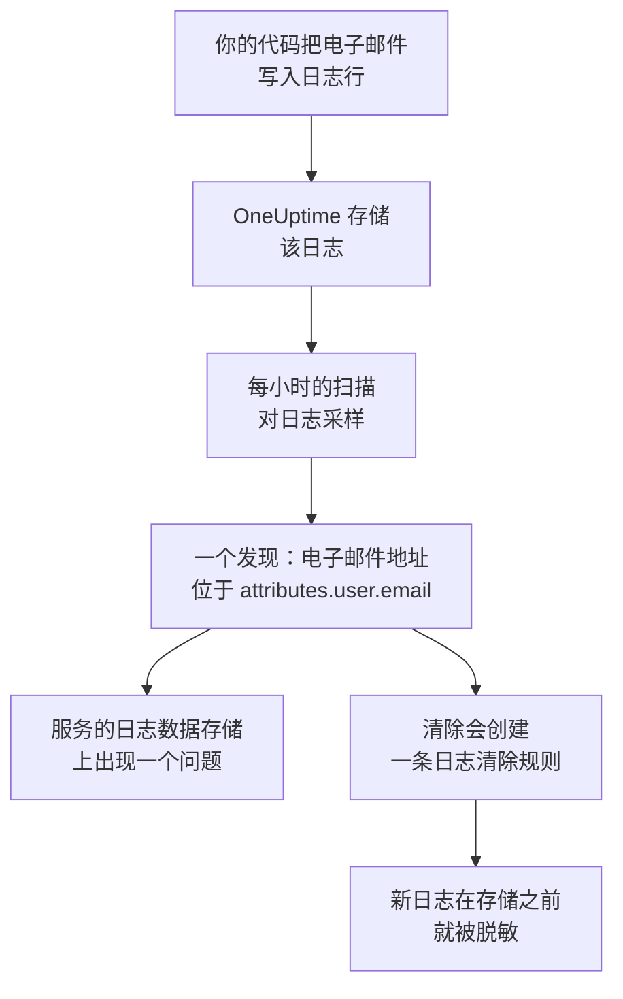

# 遥测中的敏感数据

遥测中保存着你的代码写入的一切：日志行中的电子邮件地址、span 属性中的卡号、堆栈追踪中的令牌、提示词中客户的提问、指标标签中用户的 IP 地址。数据安全把每个服务的日志、追踪、指标、异常和 AI 对话，以及每个 RUM 应用程序的会话，都视为独立的数据存储。它每小时对它们采样一次，像在存储桶中一样在其中查找敏感数据，而 **清除** 会把一个发现变成一条规则，从此在发现它的服务中于摄取时隐藏该数据。

无需任何设置：每个服务的遥测每小时扫描一次，除非项目设置中的 **扫描遥测** 已关闭。要排除某个服务的日志、链路或其他信号，请在该数据存储的 **设置** 中关闭 **扫描内容**：从下一次扫描起，其中的任何内容都不会被读取。

:::cards
- [读取哪些内容](#读取哪些内容): 每种信号的属性、正文、消息和提示词。
- [扫描如何采样](#扫描如何采样): 每小时读取每个服务的最新记录。
- [清除](#清除): 在发现它的服务中，于摄取时隐藏某个发现。
- [自行遏制](#自行遏制): 在已证明安全的情况下，无需任何人点击任何内容即可隐藏机密。
- [丢弃此指标](#丢弃此指标): 停止存储名称中含有敏感数据的指标。
- [什么算作已清除](#什么算作已清除): 清除规则何时已经覆盖某个发现。
:::

## 工作原理

被清除规则覆盖的发现会标记为已清除：OneUptime 存储的该数据是等待保留期结束的旧数据。但代码仍在写入它，因此两项遥测检查会把它算作已遏制，而不是已修复：一旦每个发现都已清除，它们的问题就会以 **已在摄取时遏制** 解决；只有当代码修复的新版本不再写入该数据时，才会以 **已在代码中修复** 解决（参见 [问题会经历什么](/docs/data-security/checks-and-issues#问题会经历什么)）。

## 读取哪些内容

| 数据存储 | 读取哪些内容 | 发现指向的位置 |
| --- | --- | --- |
| 日志 | 每个属性，以及正文 | `attributes.<key>`、`body` |
| 追踪 | 每个 span 属性，以及每个 span 事件的属性 | `attributes.<key>`、`events.<event>.<key>` |
| 异常 | 消息、堆栈追踪和属性 | `message`、`stackTrace`、`attributes.<key>` |
| AI 对话 | 每次 AI 调用的提示词和回答（位于 GenAI 约定存放它们的键下），以及其他所有属性 | 它们所在的键，例如 `gen_ai.input.messages` 或 `gen_ai.prompt[].content` |
| 会话回放 | RUM 应用程序的 span 和日志的属性、其会话的属性、`identify()` 为其用户提供的特征，以及它被告知的用户标识 | `spans.attributes.<key>`、`logs.attributes.<key>`、`sessions.attributes.<key>`、`sessions.identifiedUserTraits.<key>`、`sessions.identifiedUserLabel` |
| 指标 | 数据点的每个属性（包括其资源的属性），以及指标的名称 | `attributes.<key>`、`attributes.resource.<key>`、`name` |

带编号的键会合并为一个位置：`gen_ai.prompt.3.content` 即 `gen_ai.prompt[].content`，因此一次对话中的二十条消息是一个发现，而不是二十个。OneUptime 自己添加的属性（以 `oneuptime.` 开头）不会被读取。

### 指标

指标的属性就是其序列的标签。它们在一个序列的每个数据点上都相同，因此一个每分钟写入一千个数据点的指标可能只有三个值，而一个泄露用户电子邮件的标签增加的是一条序列，而不是一个数据点。因此，指标按序列采样，而不是按数据点采样：

- **每条序列一个数据点。** 每个指标都在它过去一小时内写入数据的最新一分钟被读取：从该分钟最多 100 条序列中，每条读取一个数据点，无论该指标发送得多频繁，因此繁忙的序列永远不会挤掉安静的序列。无论有多少条序列重复同一个值，该值都只分类一次，因此发现统计的是其所在位置上互不相同的值。
- **新指标优先，其余的轮流读取。** 一个服务写入了哪些指标，以及每个指标在过去一天内何时首次写入，都来自指标表保存的按分钟汇总，而从不来自其数据点。每次扫描都会读取一个服务最繁忙的指标（它们最可能有很多序列）。接着读取它在过去 2 小时内开始写入的指标，因为新的泄露通常来自新代码；然后按固定顺序，从上次扫描停下的位置开始，读取它其他指标中的下一批。新指标最多占用这些名额的一半，因此其他指标总能保有自己的名额。
- **每个指标都在固定时间内读到。** 每次扫描给每个服务分配 10 次读取，项目的服务超过 10 个时会更少。服务因指标较少而用不完的读取，会逐一分给仍有指标在等待轮次的服务，因此不会浪费任何读取，也没有服务会少于它应得的份额。每个服务最繁忙的 5 个指标占用其中 5 次读取，其余读取轮流读取它的其他指标：一个有 M 个指标、轮流获得 r 次读取的服务，其每个指标至少每 M ÷ r 小时（向上取整）被读取一次。有 300 个指标的服务只获得自己的 5 次时为 60 小时；当另外两个有 300 个指标的服务与它共用一个项目时，每个服务会获得 28 或 29 次，因此为 11 小时。只要它每小时都在开始写入新指标，这个时间最多翻倍。
- **每个指标各自的范围。** 这些指标会一起读取，每个指标按它在该表主键中各自的范围读取。最新一分钟包含超过 16,384 个数据点的指标（例如以每个用户的电子邮件作为标签的指标）会单独读取，并且读取在它的前几个数据点处就会停止，因此它的开销不会超过任何其他指标。

发现会写明属性，例如 `attributes.user.email`；对于指标名称中的数据，则写明 `name`。它的记录就是发现它的那些数据点：每条记录都显示它的指标和该属性的值（已脱敏），并会在 **指标** 中打开该指标，按该属性分组。当指标名称中含有敏感数据时，名称也会被脱敏，记录则改为打开该服务的指标。

### 为什么从不读取回放的录制内容

会话回放的录制内容包含人们看到的页面文本。观看它需要单独的权限，而从中读出的发现会把脱敏后的页面文本展示给每个能读取数据安全的人。因此，回放只按其属性读取：录制内容旁边的 span、日志和会话详细信息。录制器在浏览器中录制时就已经对内容脱敏，日志清除规则也会作用于录制内容（参见 [会话回放](/docs/telemetry/session-replay)）。

### AI 对话

AI 调用的提示词携带着此人最新消息之前的整段对话，因此 AI 调用的每个值最多读取 16,384 个字符。当 AI 对话中含有敏感数据时，还会带来两件事：这些调用所发往的 AI 提供商成为该数据的一个数据流，并且该数据存储上的 [敏感数据正被发送给 AI 提供商](/docs/data-security/checks-and-issues#ai) 检查会失败。

[公司 AI 工具](/docs/telemetry/ai-company-tools) 的对话不在读取范围内。只有项目所有者和项目管理员可以读取它们，而发现会出现在每个能读取数据安全的人都能看到的地方，因此这些服务的 span 从不被读取，它们的 AI 对话会报告为未读取。

## 扫描如何采样

每小时读取每种信号在过去一小时内的最新记录，并像其他数据存储一样逐字段分类（参见 [字段和列](/docs/data-security/data-types#字段和列)）：

| 限制 | 值 |
| --- | --- |
| 每个服务和信号的记录数 | **遥测样本大小**，默认 500，最多 1,000 |
| 每种信号读取的服务或 RUM 应用程序 | 最繁忙的 200 个 |
| 一次读取的记录数 | 5,000，由各服务共享；AI 调用为 500 |
| 日志正文、异常消息或堆栈追踪的字符数 | 8,192 |
| 属性值的字符数 | 4,096 |
| AI 调用中一个值的字符数 | 16,384 |
| 一条记录的属性数 | 128；AI 调用为 64 |
| 一个 span 的事件数，以及一个事件的属性数 | 16 和 32 |
| 一个数据存储的位置数 | 500 |
| 一次扫描读取的指标数 | 100，由各服务共享，每个服务至少一个；每个服务 10 个，一半是它最繁忙的指标，一半是轮流读取的新指标和其他指标，服务用不完的读取会轮流分给其他服务 |
| 新指标 | 过去 24 小时内的首个数据点出现在过去 2 小时内的指标 |
| 一个指标的序列数 | 其最新一分钟内每条序列一个数据点，最多 100 条 |

每个值都会在数据库中截短，因此不会有长值离开数据库，并且每次读取在 30 秒后停止。读取失败时，会在它所针对的数据存储上显示为一条警告；扫描会继续进行下一次读取。

要排除某些内容，请将其添加到数据存储的 **扫描排除项** 中：完整写出的位置（`attributes.http.url`）、某个位置下的所有内容（`attributes.http`），或单独写出的属性键（`http.url`）。

## 清除

发现上的 **清除** 会创建一条规则，从此在该位置隐藏该数据类型；如果已有启用的规则这样做，则会指向该规则：

:::steps
### 打开发现

打开问题（**发现位置** 列出了其背后的每个发现），或打开 **数据安全 > 遥测中**，在那里，**显示记录** 会在列表旁边打开发现所在的记录。

### 点击清除

点击 **清除**。在创建任何内容之前，对话框会说明规则将做什么：它会更改谁的记录、如何处理找到的内容，以及哪些内容读取它将隐藏的值。在对话框中点击 **清除** 即可创建规则。OneUptime 会在发现所在的记录部分上创建规则：日志和 RUM 应用程序的日志使用日志清除规则，span、异常和 AI 调用使用追踪清除规则，指标的属性则使用指标管道规则。

### 同时修复代码

该规则会在新数据被存储之前将其隐藏。已存储的数据会一直保留到保留期结束，因此请修复写入它的代码：发现中写明了服务和属性。
:::

规则以它隐藏的内容命名，例如“Data Security: Email address in log attributes of checkout”，对于指明其属性的规则则如“Data Security: Password or secret in db.password of checkout”，并与你的其他清除规则列在一起（参见 [丢弃过滤器与清除规则](/docs/telemetry/drop-filters-and-scrub-rules#清理敏感数据)）。它是能隐藏该发现数据的最窄的规则，即以下各项中第一个适用的：

| 发现 | 清除创建的规则 |
| --- | --- |
| 电子邮件地址、卡号、美国社会安全号码、电话号码或 IP 地址 | 该类型的内置模式，会被遮盖。IP 地址会被完全隐去；在 [安全事件](/docs/telemetry/security-events) 读取这些记录的地方则会被哈希，这样它仍能指出要封禁的地址。 |
| 模式自身就能找到的任何其他数据类型，例如 GitHub 令牌 | 一条根据该数据类型自身模式生成的 **自定义正则表达式** 规则。机密会被完全隐去。 |
| 你自己的、带有模式的数据类型 | 该模式，仅在发现它的属性中 |
| 靠周围词语区分的数据类型，例如银行路由号码 | 它的形态，仅在发现它的属性中 |
| 根据字段名找到的数据类型，例如 `customer_name` 下的人名，或位于指明机密的键下的值 | 一条 **指定属性** 规则，它会隐藏该属性的整个值 |
| 看起来敏感的键下的值，且没有更窄的规则能隐藏它 | 一条 **敏感属性键** 规则，它会隐去每个此类属性的整个值 |
| 指标属性中的任何数据类型 | 针对该服务的一条 **脱敏属性** 指标管道规则，它会把该属性中符合该数据类型形态的值替换为 `[REDACTED]`；如果没有任何模式能找到该数据类型，则替换该属性的每个值 |

### 在发现它的记录上验证

在对话框说明规则会做什么之前，OneUptime 会用摄取时运行的同一段代码，在发现所在的记录上，以及其服务中在该位置有值的最新记录上，逐一运行它可能创建的每条规则，并询问扫描器还剩下什么。第一条能在每个含有该数据的值中隐藏数据、且对那里其他值的更改不超过每 100 个中的 5 个的规则，就是选中的规则。对话框会说明它在多少条记录上运行过、多少个值含有该数据，以及它更改了多少个其他值。会更改更多内容的模式永远不会被提供：提供的是指明该属性的规则，并说明它还会更改什么。

验证结果会与规则一起保存，在规则被更改之前，清除规则列表会在其所在行显示 **已验证**。如果没有剩余记录可用来运行规则，例如异常或会话回放的记录，或超过保留期的记录，规则会按计划创建，对话框也会如此说明。

日志或追踪规则针对发现所在的服务：它清除该服务的日志或跨度，其他服务的保持不变，因此读取它们的任何内容都不会改变。清除规则列表的 **范围** 列显示规则针对哪个服务。在 RUM 应用的会话回放中发现的内容会为项目中的所有服务和应用创建规则，因为日志规则也会清除回放，对话框也会这样说明。如果服务已不存在，**清除** 会说明这一点，并且不创建规则。

对话框会以链接形式逐一列出读取规则将隐藏的值的监视器、带有其小部件的仪表板、已保存的视图、记录规则和 SLO，并说明它们会受到什么影响：针对隐藏值的筛选将不再匹配，按其分组将不再显示真实值。它还会说明读取这些记录的 [安全事件](/docs/telemetry/security-events) 将失去什么：IP 地址被隐藏后，其事件无法指出要封禁的地址。你无权查看的内容只计数，不显示名称。对话框从不阻止规则：它只说明，由你决定。清除规则表单在保存或启用规则之前也会显示同样的内容。

有些发现无法用规则清除，**清除** 会说明原因。指标的属性则总是可以清除，因为它的规则可以隐藏该属性的每个值：

- 在日志正文中仅凭字段名找到的数据类型，例如人名：没有任何规则能把它与消息的其余部分区分开。请把它作为属性发送，由 **指定属性** 规则隐藏，或停止发送它。
- 尝试过的每条规则隐藏的内容都远远超出该数据：每条规则都在发现它的记录上运行过，并更改了太多其他内容。请在写入它的代码中停止发送它。
- 文档标记：隐藏这个词并不能隐藏文档。
- 会话自身的详细信息（`sessions.*`）：会话回放的摄取不运行任何清除规则。
- 指标的名称（`name`）：它由创建该指标的代码设定，而管道规则只能把指标整个重命名。请重命名该指标，并改为把名称中变化的部分作为属性发送。在此之前，**丢弃此指标** 可以停止存储这些指标。

**清除** 以你的身份、按你自己的权限创建规则：项目所有者和项目管理员可以点击它，能创建日志清除规则的团队也可以；对于 span、异常和 AI 调用，则需要能创建追踪清除规则；对于指标，则需要能创建指标管道规则。

## 自行遏制

在 OneUptime AI 处理数据安全问题期间（参见 [数据安全中的 OneUptime AI](/docs/data-security/ai)），只要已证明安全，遥测问题就会在无人点击任何内容的情况下被遏制。对于问题统计的每个位置，OneUptime AI 会规划 **清除** 将创建的规则，并以同样的方式加以验证，只有在以下各项全部成立时才会自行创建：

- **数据是机密**，例如密码、令牌或密钥。
- **规则已验证**：在发现该数据的记录上，它在每个含有该数据的值中隐藏了数据。
- **它不会更改那里的其他任何内容**：不会更改其位置上的任何其他值。
- **没有任何内容读取它隐藏的内容**：没有监视器、仪表板、已保存的视图、记录规则或 SLO，也没有安全事件需要的内容。
- **它针对发现该数据的服务**。

其他一切都会改为提议，显示在 **数据安全 → 人工智能** 和问题页面上，并说明规则是如何验证的，以及什么读取它将隐藏的内容：个人数据、有内容读取的规则、会更改其他值的规则、没有剩余记录可运行的规则、针对所有服务的规则、指标的管道规则，以及任何有人撤销或忽略过先前规则的位置。为某个问题把 **遏制** 设为 **自动** 的数据安全 AI 规则，也会让已验证的个人数据自行隐藏。没有任何规则会让未证明安全的更改自行运行。

当 **清除** 的所有规则都无法隐藏该数据时，例如你自己的数据类型没有模式，OneUptime AI 会编写一条：该数据的模式，或要整体隐藏的属性。它获知的是数据类型、数据所在位置、旁边属性的名称以及值的形态，例如 `AB-1234` 对应 `AA-9999`，从不获知任何值；它编写的规则在被提议或创建之前，会像其他任何规则一样在记录上验证。

OneUptime AI 自行做出的更改：

- **显示在问题的时间线上**，附有它创建的规则、每条规则的验证方式，以及删除这些规则的 **撤销**。**数据安全 → 人工智能** 上也有同样的 **撤销**。你撤销了其规则的位置，永远不会再被自行遏制：OneUptime AI 会改为提议。
- **通过电子邮件发送** 给数据存储的所有者和服务的所有者。
- **提示轮换机密。** 隐藏机密只能阻止新的副本：机密仍然有效，规则生效前存储的记录会一直保留它，直到保留期结束。时间线和电子邮件会说明在哪里看到了它。

在问题已处于打开状态的服务中出现的新发现，一旦每小时的扫描发现它们，也会以同样的方式被遏制。

## 丢弃此指标

没有任何规则能把数据从指标名称中去掉，因此在为指标命名的代码修复之前，数据会一直到来。在指标名称中的发现上使用 **丢弃此指标**，会停止存储名称中含有该数据的指标，代价是失去它们的数据，因此只有在你要求时才会执行：

- **一个服务的指标。** 它会为发现所在的服务创建一条 **丢弃** 指标管道规则：名称中含有该数据类型的指标，其每个新数据点都会在存储之前被丢弃。它的过滤条件就是 **清除** 用于该类型的模式，因此任何模式都找不到的类型（例如人名）无法丢弃，对话框会说明原因。
- **执行前先说明。** 对话框会说明：这些数据点将永久丢失；该服务过去一天写入的指标中有多少个具有这样的名称；哪些内容读取这些指标，因而不再获得新数据；已存储的内容会保留到其保留期结束；以及如何撤销。在你勾选表示理解之前，不会丢弃任何内容。
- **读取它们的内容，以及它会怎样。** 对话框会以链接列出每个监视器、每个仪表板及其读取这些指标的小部件、该服务的每个指标 SLO，以及读取这些指标的每条指标记录规则。监视器将无法再根据其值发出警报，小部件不再显示新数据，SLO 不再统计这些指标的新事件，记录规则的输出指标也不再包含这些指标。在每条记录规则下，它还会列出读取该规则输出指标的内容，以及再读取它们输出指标的内容，沿链条最多三个输出指标。小部件的链接会在该小部件处打开其仪表板。你无法查看的内容只计数，从不显示名称。
- **以你的身份，并留下记录。** 规则按你自己创建指标管道规则的权限创建：项目所有者和项目管理员可以创建，能创建指标管道规则的团队也可以。审计日志会记录是谁创建的。
- **删除规则即可撤销。** 规则以它丢弃的内容命名，例如“Data Security: drop metrics named with Email address”，并与你的其他指标管道规则一起列在 **指标 → 设置 → 管道规则** 下。删除或关闭它后，这些指标从那时起会重新被存储。在此期间丢弃的内容不会回来。

之后该发现会标记为 **已丢弃**，并算作已清除：这些数据不会再被存储。

## 什么算作已清除

只有当摄取时会对某个发现运行一条已启用的规则，并且该规则能找到其数据类型时，该发现才会标记为已清除：

- **正确的记录。** 日志规则覆盖日志和 RUM 应用程序的日志。追踪规则覆盖 span、异常和 AI 调用：异常是其 span 的异常事件的副本，因此清除事件的规则也会清除它。
- **正确的部分。** 规则的 **要清除的字段** 包含发现所在的记录部分，或者规则将其保留为默认值。
- **正确的服务。** 针对某个服务的日志或追踪规则只覆盖该服务的发现。没有服务的规则覆盖所有服务的发现。
- **能找到该类型的模式。** 内置的 **模式类型** 能找到它自己的数据类型：**电子邮件地址** 找到电子邮件地址，**信用卡卡号** 找到卡号，**SSN（社会安全号码）** 找到美国社会安全号码，**电话号码** 找到电话号码，**IP 地址** 找到 IP 地址。**敏感属性键** 覆盖看起来敏感的键下的每个值，无论值是什么。
- **在发现的记录上验证过的规则。** OneUptime 在发现所在的记录上创建并验证的规则，无论其模式如何，只要它仍是被验证的那条规则，就覆盖该发现：更改它的模式、属性、操作、字段或服务后，它就不再覆盖。
- **指定属性规则** 覆盖其指定的属性中的发现，或嵌套在该属性下的属性中的发现。
- **除此之外，你自己的自定义模式永远不算数。** 只有当你自己编写的 **自定义正则表达式** 与 **清除** 为该类型创建的模式完全相同时，它才覆盖该发现。发现只保留脱敏样本，无法在其上试用任何模式，因此 OneUptime 无法证明你的模式能隐藏该数据，而被错误地认定为已清除的发现，就是一个没人关注的泄露。
- **指标的属性。** 针对该属性键的 **脱敏属性** 或 **移除属性** 指标管道规则，无论针对的是发现所在的服务还是整个项目，只要它没有过滤条件，或者其过滤条件与 **清除** 创建的完全相同，就覆盖该发现。出于同样的原因，你自己编写的过滤条件永远不算数。
- **指标的名称。** 针对发现所在服务或整个项目的 **丢弃** 指标管道规则，只要其过滤条件与 **丢弃此指标** 创建的完全相同，或者根本没有过滤条件（此时它不存储该服务的任何指标），就覆盖该发现。这样一条没有过滤条件的规则会覆盖这些指标中的每个发现。

已关闭的规则，或什么也不清除的规则，永远不算数。每次扫描后都会重新计算覆盖情况，因此你手动添加或删除的规则会在一小时内改变哪些发现标记为已清除。

## 后续步骤

:::cards
- [丢弃过滤器与清除规则](/docs/telemetry/drop-filters-and-scrub-rules): 每个清除规则选项，以及你自己编写的规则。
- [数据安全检查与问题](/docs/data-security/checks-and-issues): 两项遥测检查和 AI 检查。
- [数据流、访问与数据驻留](/docs/data-security/flows-access-residency): 你的服务向哪些 AI 提供商和主机发送数据。
:::
