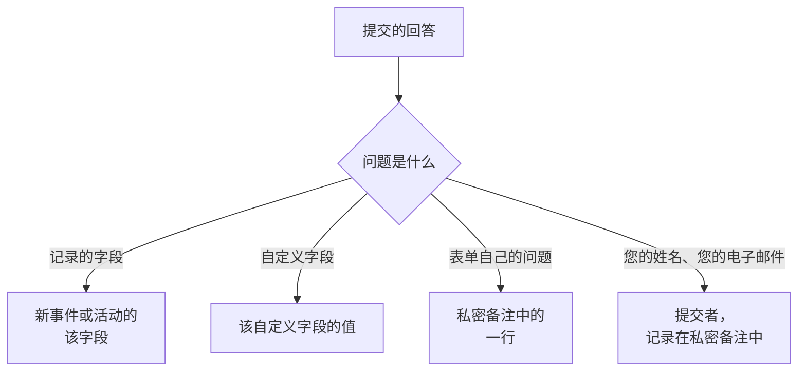

# 构建表单

表单的 **构建** 页面用于决定表单询问什么，以及其页面的外观。问题位于左侧，按公开页面显示的顺序排列；右侧的 **添加问题** 列出您可以添加的所有内容。问题上方折叠着表单的 [品牌](#品牌)：它的徽标和网站图标。人们可以作为表单起点的命名答案集（每个答案集还可以针对自己的情况把问题设为必填、可选或隐藏）位于表单的 **模板** 页面：请参阅 [模板](#模板)。

:::cards
- [构建器](#构建器): 添加、编辑、移动和保存问题。
- [可以添加的内容](#可以添加的内容): 您自己的问题、记录的字段、自定义字段和提交者。
- [隐藏的问题](#隐藏的问题): 由模板回答，从不由提交的人回答。
- [模板](#模板): 为团队经常报告的每种情况提供一个表单和一个链接。
:::

## 每个回答的去向

每个回答也会随提交记录一起保存在表单的 **提交记录** 页面上。表单没有询问的字段，或留空的字段，会由表单的 [提交时设置](/docs/forms/on-submit) 填写。

## 构建器

:::steps
### 添加问题

在 **添加问题** 中选择要添加的内容。新问题会插入到所选问题之后（或末尾），并处于选中状态。

### 就地编辑

选择一张卡片进行编辑：问题、帮助文本、回答类型和选项、是否必填或隐藏，以及复制和删除按钮。 **完成** 会关闭它。

### 放到合适的位置

拖动卡片的把手来移动它，或在所选卡片上使用 **上移** 和 **下移** ——在手机上或通过键盘也可以。

### 保存表单

**保存更改** 会一次保存所有更改。在您保存之前，构建器会显示 **未保存的更改** 并提供 **放弃更改**，而且浏览器会在您离开页面前进行确认。
:::

- **表单的页眉** 会像公开页面那样显示表单的名称和描述。 **编辑名称和描述** 用于更改它们。
- **问题** 是一张张卡片。每张卡片都按人们将看到的样子显示问题，并带有说明其关联对象的徽章—— **事件 · 严重程度**、 **自定义字段 · Region**、 **提交者 · 电子邮件**，对于表单自己的问题则是其回答类型。红色星号标记必填问题， **隐藏** 徽章标记 [隐藏的](#隐藏的问题) 问题。
- **限制。** 一个表单最多可以有 50 个问题。可以读取但不能编辑表单的人会以只读方式看到构建器。

## 品牌

折叠在问题上方的 **品牌** 决定表单页面的外观：页面顶部、表单名称上方的徽标，以及表单打开期间浏览器标签页中的网站图标。在您上传自己的之前，表单会显示 OneUptime 的徽标和网站图标。

折叠时，该部分会列出 **徽标** 和 **网站图标** （表单有自己的图像后会显示为已设置），并说明哪些 OneUptime 的图像仍在使用。展开它即可按页面显示的样子查看两者：徽标在页面顶部的样子，以及网站图标在浏览器标签页中、位于表单名称（即标签页标题）旁边的样子。

**编辑品牌** 在一个对话框中更改它们：

| 字段 | 说明 |
| --- | --- |
| **徽标** | 显示在表单页面顶部、名称上方，替代 OneUptime 徽标。不超过 512 KB 的 PNG、JPEG、GIF、WebP 或 SVG 图像。移除后恢复为 OneUptime 徽标。 |
| **Logo Alt Text** | 屏幕阅读器朗读的徽标内容：通常是您组织的名称。有徽标时会询问。留空时屏幕阅读器会跳过徽标——反正表单名称会紧随其后。移除徽标也会清空它。 |
| **网站图标** | 表单打开期间浏览器标签页中的图标，替代 OneUptime 网站图标。不超过 128 KB 的 PNG、JPEG、GIF、WebP、SVG 或 ICO 图像；正方形的 PNG、SVG 或 ICO 效果最好。移除后恢复为 OneUptime 网站图标。 |

徽标会保持其所替代的 OneUptime 徽标的高度，较宽的徽标会适应页面的宽度。每张图像都会在保存时检查（无论来自仪表板、API、Terraform 还是工作流）：它必须是在表单自己的项目中上传的，属于上述类型之一，并且不超过其限制。不属于这些图像的徽标会被以 "The logo must be a PNG, JPEG, GIF, WebP or SVG image." 拒绝，过大的徽标会被以 "The logo must be 512 KB or smaller." 拒绝，上传已不存在（或在其他项目中上传）的徽标会被以 "The logo's file could not be found. Upload the logo again." 拒绝。网站图标也会以同样的方式被拒绝： "The favicon must be a PNG, JPEG, GIF, WebP, SVG or ICO image."、 "The favicon must be 128 KB or smaller." 和 "The favicon's file could not be found. Upload the favicon again."。

**预览** 会像页面一样显示徽标。可以读取但不能编辑表单的人会看到其品牌，但没有 **编辑品牌**。徽标和网站图标只会在表单本身之内到达表单页面——请参阅 [分享与安全](/docs/forms/sharing-and-security#什么在保护表单)。

## 可以添加的内容

**添加问题** 列出四组：表单自己的 **问题**、表单所创建内容的 **事件字段** 或 **计划维护字段**、 **自定义字段** 以及 **提交者**。

### 表单自己的问题

| 回答类型 | 提交者提供的内容 |
| --- | --- |
| **简短回答** | 一行文本。 |
| **段落** | 多行文本。 |
| **富文本** | 带格式和链接的文本。 |
| **数字** | 一个数字。 |
| **下拉列表** | 从列表中选择一项。 |
| **多选** | 从列表中选择任意多项。 |
| **复选框** | 一个用于勾选的方框，例如用于确认。 |
| **日期** | 一个日期。 |
| **日期和时间** | 一个日期和时间。 |

下拉列表或多选会列出您提供的 **选项**，每个选项可以带一个可选颜色（选项旁的按钮会打开一组命名颜色，使用 **自定义颜色** 可以指定精确的代码），数量在 1 到 100 个之间。在 **下拉列表** 和 **多选** 之间切换问题会保留其选项；变为其中一种类型的问题会以两个可以重命名的选项开始，不再是这些类型的问题则会丢弃选项。 **复制** 会将表单自己的问题复制到其正下方。

对这些问题的回答会随提交记录一起保存，并列在表单所创建内容的私密备注中——它们不会填写任何字段。要填写字段，请从接下来的两组中添加该字段本身。

### 表单所创建内容的字段

提交者可以回答的事件或计划维护活动的字段。回答会成为该字段的值。

| 事件字段 | 回答内容 |
| --- | --- |
| **标题** | 一行，最多 500 个字符。 |
| **描述** | 富文本，最多 20,000 个字符。 |
| **严重程度** | 您的事件严重程度之一。 |
| **监视器** | 您提供的任意监视器——事件受影响的监视器。 |
| **标签** | 您提供的任意标签。 |
| **影响开始时间** | 日期和时间：提交者记得的问题开始时间。 |

| 计划维护字段 | 回答内容 |
| --- | --- |
| **标题** | 一行，最多 100 个字符。 |
| **描述** | 富文本，最多 20,000 个字符。 |
| **开始** | 日期和时间。总是询问，并且总是必填。 |
| **结束** | 晚于 **开始** 的日期和时间。总是询问，并且必填。 |
| **监视器** | 您提供的任意监视器。 |
| **状态页面** | 您提供的任意状态页。 |
| **标签** | 您提供的任意标签。 |

每个字段只能询问一次；列表会将已在表单上的字段标记为 **已添加**。表单没有询问的字段（或留空的字段）会由表单的 [提交时设置](/docs/forms/on-submit) 填写。

**提供的选项。** 公开页面不能向陌生人列出您的整个项目，因此通过选择记录来回答的字段只提供您选择的记录。 **监视器**、 **标签** 和 **状态页面** 只列出您提供的选项，并且在您至少提供一个之前不会询问。由于严重程度并不保密， **严重程度** 会提供所有事件严重程度，除非您缩小范围。超出所提供选项的回答会被拒绝。

### 自定义字段

您的事件自定义字段（对于维护表单，则是计划维护自定义字段），每个都是一个问题，其回答会成为该字段的值。问题从自定义字段获取类型和选项，并以其名称作为问题、以其描述作为帮助文本开始，这些都可以更改。

无论 **创建时显示** 如何设置，表单只询问您添加到其中的自定义字段：表单询问的每个字段都会向任何拥有链接的人显示其名称、描述和选项。删除自定义字段后，其问题会留在表单上但不再被询问，并且其卡片会说明这一点——请删除该问题。以相同名称重新创建的字段是一个新字段：请再次添加它。

从监视器自定义字段复制值的自定义字段会在其卡片上说明这一点：当事件或活动的监视器在该字段的值上一致时，该值会替换提交者的回答。

### 提交者

**你的姓名** 和 **你的邮箱** 询问是谁在提交。它们会随提交记录一起保存并写入私密备注，以便您的团队跟进，而且永远不会显示在事件或活动本身上。OneUptime 从不向提交者发送电子邮件。省略它们或将其设为可选，即可接受匿名提交。

电子邮件必须是一个普通地址，例如 `ada@example.com` ——不能是带尖括号地址的名字，也不能是地址列表。姓名和电子邮件各自最多 100 个字符。

## 新表单的问题

新表单以它几乎总是应该询问的问题开始，因此创建后立即可用：必填的 **标题**；**描述**；对于维护表单，还有 **开始** 和 **结束**；以及必填的 **你的姓名** 和 **你的邮箱**。它们的措辞使用您仪表板的语言。您可以随意更改、隐藏或删除它们——维护活动的开始和结束除外，没有它们就无法安排任何活动。当您自己的问题已经说明了一切时，请隐藏 **描述**，而不是留下一个不应有人填写的输入框：请参阅 [隐藏的问题](#隐藏的问题)。

## 必填问题

**必填** 表示没有回答就无法提交表单。只包含空格、制表符或换行符的回答视为没有回答，必填的 **复选框** 必须勾选。提交表单时，服务器会再次检查每个必填问题，因此不经过页面发出的请求同样受其约束。

非必填的问题可以留空：其字段随后会由提交时设置填写，就像表单没有询问它一样。

## 隐藏的问题

在卡片上开启 **隐藏**，问题就不再显示在表单上。不会有人被询问，因此它永远不是必填的，提交也无法回答它——甚至不会从请求中读取它。只有提交所起始的 [模板](#模板) 会回答它；当提交者不从任何模板开始，或从将其留空的模板开始时，它会保持未回答。模板也可以为自己的情况询问隐藏的问题：请参阅 [模板如何询问每个问题](#模板如何询问每个问题)。

当回答应由您的团队而不是提交者决定时，请隐藏问题：

- **事件的描述**，当您添加的问题已经说明了一切时。隐藏后，它不再邀请任何人在那里填写；为每个模板提供您针对其情况发送的标准文本，或让事件在没有描述的情况下开始。
- **您的工作流或规则读取的自定义字段**，例如由每个模板设置的通知类型。
- **表单自己的问题**，其回答只有您的团队需要在私密备注中看到。

隐藏的问题会保留其位置、标签和设置，因此您可以随时再次显示它。表单目标在缺少时无法创建的字段——维护活动的 **开始** 和 **结束** ——不能被隐藏。隐藏问题的回答会与输入的回答完全一样地被检查和存储，并随提交记录一起保存。

## 模板

表单的 **模板** 页面保存人们可以作为表单起点的命名答案集——为团队经常报告的每种情况各准备一个，例如 **应用程序故障**、 **计划内维护** 或 **服务已恢复** ——这样一个表单和一个链接就能满足所有情况。

:::steps
### 添加模板

点击 **添加模板**。编辑器分为两部分。 **问题** 列出表单的每个问题以及此模板询问它的方式——请参阅 [模板如何询问每个问题](#模板如何询问每个问题)。 **回答** 再次列出这些问题，包括隐藏的问题，并且都不是必填的：填写模板应回答的内容，其余的留给提交的人。对模板不询问的问题的回答会在其下方注明——它会按原样使用。

### 选择默认模板

**默认** 会使其成为表单打开时使用的模板。只有一个模板可以是默认模板，而唯一模板就是默认模板的表单，其实就是一个预先填写好的表单。

### 分享其链接

**复制链接** 会复制模板自己的链接，该链接会打开已用此模板填写好的表单。请参阅 [分享与安全](/docs/forms/sharing-and-security#每个模板的链接)。
:::

每个模板会列出它填写的内容以及它以自己的方式询问的问题，例如 **计划维护日期 · 隐藏**，并有 **编辑**、 **复制** （紧随其后创建一个副本，名称类似 **应用程序故障 2** ）、用于调整表单中排列顺序的 **上移** 和 **下移**，以及 **删除**。

在公开页面上，带有模板的表单会在其问题上方、 **从模板开始** 下列出这些模板。选择一个模板会填写表单，并按该模板的方式询问问题；提交者在提交前仍可更改任何回答，选择另一个模板则会从该模板重新开始表单。页面会以其链接指定的模板打开，否则以默认模板打开，否则不使用模板。 **预览** 也会列出模板，并以默认模板打开。

> [!IMPORTANT]
> 打开链接的每个人都能看到每个模板的名称，以及它对其所询问问题的回答——页面正是这样自动填写的。模板对其不询问的问题的回答永远不会离开服务器，因此请将任何内部信息放在隐藏的问题中。

保存模板时，每个模板的每个回答都会与其问题进行核对——问题提供的选项、表单提供的记录、合适的文本——模板以自己的方式询问的每个问题也是如此；无论来自仪表板、API 还是 Terraform，保存都会被拒绝，并显示指明模板和问题的消息。模板名称最多 100 个字符且在表单内唯一，一个表单最多可以有 50 个模板。如果您之后更改了问题，模板对已删除问题或不再适用问题的回答只是不再被使用，下次保存该模板时会将其丢弃。保存其他模板绝不会因此被拒绝：模板已有的内容不会被再次检查。

### 模板如何询问每个问题

不同的情况需要不同的问题：故障需要受影响的应用程序，而不需要维护窗口；计划内维护则需要维护窗口。与其为每种情况构建一个表单，不如让每个模板以自己的方式询问表单的问题。在模板的 **问题** 中，每个问题都有以下设置之一：

| 设置 | 有人从该模板开始时 |
| --- | --- |
| **表单默认** | 问题按表单的方式询问——必填、可选或隐藏，与其在构建器中的卡片一致。选择器会显示是哪一种，例如 **表单默认（隐藏）** ，并在您更改卡片时随之变化。 |
| **必填** | 会询问该问题，没有回答就无法提交表单。 |
| **可选** | 会询问该问题，并且可以留空。 |
| **隐藏** | 不会询问该问题。如果模板有自己的回答，就以它为回答，与表单隐藏的问题一样。 |

这样，一个事件表单就能同时满足两种情况：

| 问题 | 应用程序故障 | 计划内维护 |
| --- | --- | --- |
| 应用程序名称 | 必填 | 必填 |
| 受影响的设施 | 必填 | 可选 |
| 计划维护日期 | 隐藏 | 必填 |

每个问题都从 **表单默认** 开始，之后添加到表单的每个问题在每个模板中也是如此。维护活动的 **开始** 和 **结束** 总是询问且总是必填：任何模板都无法更改它们。模板可以隐藏其他所有问题并自行回答：这样它的链接就成了只有一个按钮 **提交** 的表单——适用于 **服务已恢复** 这样的情况。

页面会跟随提交者选择的模板：选择另一个模板会用该模板的问题重新绘制表单， **预览** 也是如此。无论由什么发送，服务器都会按提交所指定的模板询问的问题来约束每个提交：模板要求必填的问题必须回答，模板隐藏的问题不会从请求中读取——而是使用模板自己的回答。未指定模板，或指定了之后已被删除的模板的提交，会按表单自己的设置来约束。表单隐藏的问题只有在模板询问它时才会显示给公开页面。

## 构建器标记问题时

有问题的卡片会以琥珀色说明问题所在：

| 卡片显示 | 问题所在 |
| --- | --- |
| **此自定义字段已被删除，因此不会询问此问题。请删除该问题。** | 公开页面会省略该问题。 |
| **请至少选择一个要提供的选项，否则不会询问此问题。** | 通过选择记录来回答的字段没有提供任何记录：请选择它提供的监视器、标签或状态页。 |
| **请至少添加一个选项。** | 下拉列表或多选没有可选择的内容。 |
| **请填写问题。** | 问题没有文本。 |

只要有问题带有后三种情况之一，表单就无法保存： **保存更改** 会说明是哪个问题以及问题所在，预览会省略这样的问题。保存时还会整体检查问题，并在例如两个问题询问同一个字段，或维护表单没有询问维护何时开始和结束时，以指明问题的消息拒绝保存——无论问题来自构建器、API、Terraform 还是工作流。

## 预览

**预览** 会完全按人们通过链接看到的样子打开表单——相同的徽标、问题、输入框、选项和检查、其模板列表，并且只显示所选模板询问的问题——并让您填写。您在那里输入的任何内容都不会被提交： **提交** 只检查您的回答， **重新填写** 会重新开始。预览会按构建器中的样子显示问题，无论是否已保存，并在省略被标记的问题时加以说明。

## 提交者看到的内容

公开页面会显示表单的徽标（在您上传自己的之前是 OneUptime 徽标），然后是表单的名称和描述、其模板（如果有）、它询问的问题（按所选模板的方式询问；未选择模板时则是它未隐藏的问题），以及 **提交**，浏览器标签页则会显示表单的名称和网站图标。当 OneUptime 支持提交者的语言时，页面使用该语言（即提交者在该浏览器上最后一次在 OneUptime 中选择的语言，否则为其浏览器请求的语言），否则使用英语。您的问题、选项和帮助文本会按您编写的样子显示。

提交后，页面会显示 "谢谢——您的回复已提交。"，并给出所创建内容的编号—— "您的参考编号是 INC-42。" ——随后是表单的感谢消息（如果您在 **分享** 页面上写了的话）。 **提交另一份回复** 会打开一个空表单。提交者不会收到电子邮件，也无法返回到事件或活动。

## 大小限制

| 回答 | 限制 |
| --- | --- |
| 事件的 **标题** | 500 个字符，不计两端的空格。 |
| 维护活动的 **标题** | 100 个字符。 |
| **描述** | 20,000 个字符。 |
| 其他任何文本回答 | 10,000 个字符。 |
| 多选回答 | 100 个选项。 |
| **你的姓名**、 **你的邮箱** | 各 100 个字符。 |

超出限制、遗漏必填回答或给出不符合其问题的回答的提交，会被拒绝并显示说明原因的消息，并且不会创建任何内容。对表单未询问的问题的回答会被忽略。

## 后续步骤

:::cards
- [提交会创建什么](/docs/forms/on-submit): 回答和提交时设置如何成为事件或维护活动。
- [分享与安全](/docs/forms/sharing-and-security): 分享链接、每个模板的链接，以及保护它们的机制。
- [事件设置与自动化](/docs/incidents/settings): 事件自定义字段和模板。
:::
