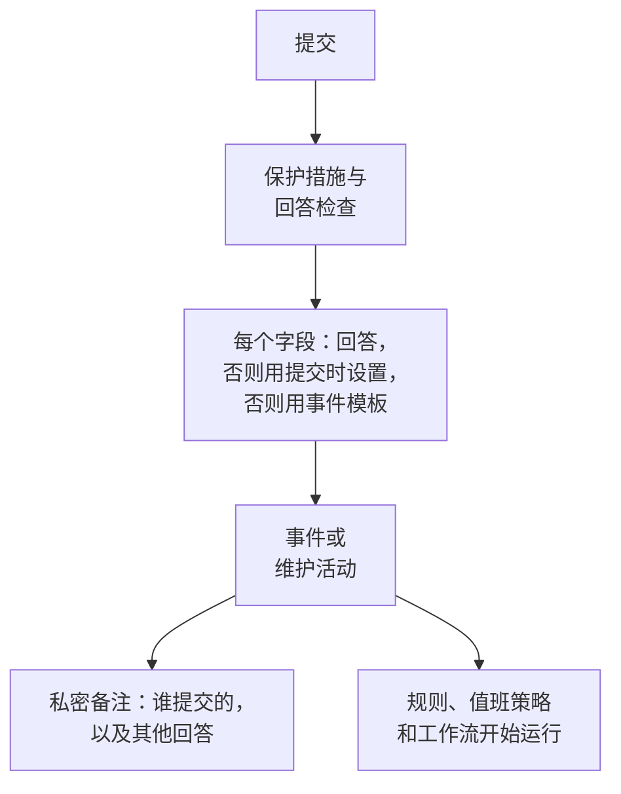

# 提交会创建什么

通过表单的每次提交都会在您的项目中创建一条记录： **事件** 或 **计划维护活动**。表单的 **提交时** 页面会显示创建的是哪一种，以及新记录的每个字段如何填写——来自回答、来自默认值、来自始终适用的设置，或来自事件模板。 **编辑设置** 用于更改默认值和始终适用的内容。

:::cards
- [提交如何成为事件](#提交如何成为事件): 新事件的每个字段，以及其值的来源。
- [提交如何成为计划维护活动](#提交如何成为计划维护活动): 维护请求的情况也一样。
- [提交时设置](#提交时设置): 默认值、始终附加的内容、所有者和发布。
- [私密备注](#私密备注): 谁提交的，以及没有任何字段保存的回答。
:::

## 提交时会发生什么

未通过检查的提交不会创建任何内容。请参阅 [什么在保护表单](/docs/forms/sharing-and-security#什么在保护表单)。

## 每次提交会创建什么

**每次提交创建的内容** 卡片保存着您创建表单时所做的选择：

- **事件** ——每次提交都会声明一个事件，因此您的值班团队会立即收到通知。用于问题报告。
- **计划维护** ——每次提交都会安排一个维护活动。用于变更和维护请求。

选择另一种会要求您确认，因为表单会随之改变：

- 标题、描述、监视器和标签保持关联：两种记录都有它们。
- 其他所有关联的问题（严重程度、状态页选择、旧类型的自定义字段）都会变成表单自己的问题，措辞不变，其回答会列在私密备注中。
- 提交时设置会重新开始，因为事件和活动的设置不同。
- 现在创建维护活动的表单会询问维护何时开始和结束。

问题会随更改一起立即保存。请在 **构建** 页面上检查它们。

## 提交如何成为事件

卡片会列出新事件的每个字段及其值的来源：

| 字段 | 来源 |
| --- | --- |
| **标题** | 对 **标题** 问题的回答。表单未询问或回答留空时：使用 **默认标题**，否则使用表单的名称。 |
| **描述** | 对 **描述** 问题的回答。未询问或留空时，如果表单有模板，则使用事件模板的描述。 |
| **严重程度** | 表单询问时为提交者的选择。否则使用表单的 **严重程度** 设置，再否则使用事件模板的严重程度。 |
| **监视器** | 提交者选择的监视器，以及设置始终附加的监视器。两者都没有时，使用事件模板的。 |
| **标签** | 提交者选择的标签，以及设置始终添加的标签。两者都没有时，使用事件模板的。 |
| **影响开始时间** | 表单询问时，对 **影响开始时间** 的回答。 |
| **事件 模板** | 表单的 **事件 模板** 设置。它会填写回答和设置未确定的所有内容。 |
| **值班策略** | 设置中指定的策略，会为表单声明的每个事件执行。没有时，使用事件模板的。 |
| **所有者** | 设置中指定的人员和团队，以及模板的所有者。他们会收到每个事件的通知。 |
| **自定义字段** | 每个自定义字段问题的回答——除非该字段从监视器自定义字段复制其值，并且事件的监视器具有该值；其余由模板填写。 |
| **状态页面** | 在您团队中有人发布之前，永远不会显示在状态页上，订阅者也不会收到通知。 |
| **其他回答** | 连同提交者一起列在事件的私密备注中。 |

> [!IMPORTANT]
> **没有严重程度，就没有事件。** 事件需要严重程度。当表单没有询问严重程度，其设置也没有指定（或指定的已被删除），并且其模板也没有设置时， **严重程度** 行会向您发出警告，并且每次提交都会被以 "此表单没有设置严重程度，因此无法创建事件。请告知分享此表单的团队。" 拒绝。请在 **编辑设置** 中选择一个严重程度，或选择一个设置了严重程度的模板。

### 事件模板

在设置中选择一个 **事件 模板**，表单声明的每个事件都会以它为基础声明，方式与服务器在任何地方应用模板相同——请参阅 [模板如何被应用](/docs/incidents/settings#模板如何被应用)。回答和表单的设置优先，模板会填写其余所有内容：初始状态、描述、严重程度、受影响的资源、值班策略、所有者、标签、自定义字段值以及监视器状态变更。

> [!WARNING]
> **注意监视器。** 通过表单在监视器上声明事件，对监视器的影响与手动在其上声明事件完全相同：监视器的主动监控会暂停，直到事件解决；模板的 **将监视器状态更改为** 会立即更改监视器的状态——在列出该监视器的每个状态页上都会更改，即使事件本身处于隐藏状态。有了表单，任何拥有链接的人都能做到这一点。只有当每次提交都应暂停监视器时，才通过表单附加监视器。

### 事件的样子

通过表单声明的事件是一个普通的事件，只是有几项自己的设置：

- **在状态页上隐藏。** **在状态页面上可见** 处于关闭状态， **通知状态页订阅者** 也是。在响应人员发布它之前，事件的任何内容都不会到达状态页或订阅者——上文所述模板的监视器状态变更除外。
- **无人声明。** 提交者不是 OneUptime 用户，因此不会有用户被记录为声明该事件的人。
- **会通知其所有者。** 设置和模板指定的所有者会在事件的 Slack 和 Microsoft Teams 频道创建后立即被添加，并收到通知——事件的 **事件已创建** 通知会等到他们成为所有者后才发出，因此会发给他们，而不是项目的所有者。
- **私密备注会记录提交** ——请参阅 [私密备注](#私密备注)。

为新事件运行的所有内容也会为这些事件运行：隐私、所有者、标签、值班和 Runbook 规则、值班策略，以及 **On Create Incident** 工作流。值班规则会像匹配其他事件一样匹配表单的事件——包括按提交者写的标题和描述匹配。

:::steps
#### 阅读提交者写的内容

事件发布后，标题和描述会显示在状态页上。

#### 发布事件

在事件的 **设置** 页面上开启 **在状态页面上可见**。

#### 如果订阅者需要知道，就通知他们

由于事件是在 **通知状态页订阅者** 关闭的情况下声明的，发布它不会发送"事件已创建"通知。要通知订阅者，请发布一条勾选了 **通知状态页订阅者** 的公开备注——请参阅 [发布公开备注](/docs/incidents/notes-owners-and-feed#发布公开备注)。
:::

## 提交如何成为计划维护活动

| 字段 | 来源 |
| --- | --- |
| **标题** | 对 **标题** 问题的回答。表单未询问或回答留空时：使用 **默认标题**，否则使用表单的名称。 |
| **描述** | 对 **描述** 问题的回答。 |
| **开始**、 **结束** | 对 **开始** 和 **结束** 的回答，每个维护表单都会询问并要求必填。结束时间必须晚于开始时间。 |
| **监视器** | 提交者选择的监视器，以及设置始终附加的监视器。 |
| **状态页面** | 提交者选择的状态页，以及设置中指定的状态页。 |
| **标签** | 提交者选择的标签，以及设置始终添加的标签。 |
| **所有者** | 设置中指定的人员和团队。他们是表单安排的每个活动的所有者。 |
| **在状态页面上显示** | 除非设置开启，否则为 **否**。 |
| **通知订阅者** | 除非设置开启，否则为 **否**。 |
| **自定义字段** | 每个自定义字段问题的回答——除非该字段从监视器自定义字段复制其值，并且活动的监视器具有该值。 |
| **其他回答** | 连同提交者一起列在活动的私密备注中。 |

活动从您项目的 **Scheduled** 状态开始，并像其他活动一样推进：开始时变为进行中，结束时随之结束。

提交是某人的请求，而请求在发布前要经过审核。因此，除非您更改设置，否则在您团队中有人显示该活动之前，它不会出现在其状态页上，并且在它创建、开始或结束时也不会通知其订阅者。设置中 **发布** 步骤里的 **在状态页面上显示** 和 **通知订阅者** 可以为表单安排的每个活动更改这一点——只有在您信任每个拥有链接的人时才开启它们。

## 提交时设置

**编辑设置** 会分步骤打开设置： **下一步** 进入下一步， **保存更改** 位于最后一步。每一步都已填好，因此表单旁边的步骤列表可以打开其中任意一步，包括最后一步：在对应的步骤中更改设置，然后打开最后一步并保存。

| 步骤 | 事件表单 | 维护表单 |
| --- | --- | --- |
| **默认值** | **默认标题**、 **严重程度**、 **事件 模板** | **默认标题** |
| **始终附加** | **监视器**、 **标签**、 **值班策略** | **监视器**、 **状态页面**、 **标签** |
| **所有者** | **所有者** | **所有者** |
| **发布** | — | **在状态页面上显示**、 **通知订阅者** |

**所有者** 是用于人员和团队的同一个选择器： **添加所有者** 会打开一个同时包含两者的搜索列表，每个选择都会显示为一个可以移除的标签。设置中指定的所有内容都必须属于表单的项目，所有者必须是该项目的成员。选择之后被删除的记录会在创建提交时被跳过，其余部分仍然适用。

## 私密备注

每次提交都会在其创建的内容上留下私密备注：

> Submitted through the form **Report a Problem** by Ada Lovelace (<ada@example.com>).
>
> **Which office are you in?**\
> Berlin

它会写明表单和提交者（当表单没有询问提交者是谁时，为 "Submitted anonymously through the form **Report a Problem**." ），然后，当提交从表单的某个模板开始时，写明是哪个模板（ "Started from the template **Application Outage**." ），接着按表单的顺序列出对表单自己问题的回答，每个回答位于其问题之下。对关联问题的回答已经在记录上：其标题、严重程度、自定义字段。由于是私密的，该备注永远不会到达状态页，但它会像其他备注一样发布到记录的 Slack 和 Microsoft Teams 频道。

地址是一个链接，会准确地写信给该地址——在仪表板、Slack 以及发给所有者的电子邮件中都是如此。

## 隐藏的问题和模板

[隐藏的问题](/docs/forms/building#隐藏的问题) 由提交所起始的 [模板](/docs/forms/building#模板) 回答——从不由请求回答——其回答的去向与输入的回答完全相同：隐藏的 **描述** 会成为事件的描述，隐藏的自定义字段会成为其值，表单自己的隐藏问题会成为私密备注中的一行。没有从任何模板开始的提交会让隐藏的问题保持未回答，其字段会像任何留空的问题一样由提交时设置填写。在有人打开表单期间删除的模板不会阻止其提交：提交会按其回答创建，但不包含模板的隐藏回答。

模板可以 [以自己的方式](/docs/forms/building#模板如何询问每个问题) 询问表单的问题，服务器会按提交所指定模板的询问方式来约束提交。模板隐藏的问题会像隐藏问题一样由模板回答，即使表单询问了它；模板询问的问题会从请求中读取，即使表单隐藏了它；模板要求必填的问题必须回答，否则提交会被拒绝，并且不会创建任何内容。

模板在页面上填写的回答，一旦提交就归提交者所有：无论模板写了什么，服务器都会采用请求为页面所询问问题发送的回答。

## 提交者写的文本

提交会直接进入文本可以自行起作用的地方——Slack 和 Microsoft Teams 频道、每个响应人员的浏览器、所有者的电子邮件——而且没有人会事先阅读。因此，在创建记录之前：

| 提交者写的内容 | 存储的内容 |
| --- | --- |
| 标题、描述或任何文本回答中的提及，例如 \<!channel\>、 \<!here\> 或 \<@U0123ABC\> | **提及不会通知任何人。** Slack 视为提及的任何内容都会在其左括号之后加入一个不可见字符。它在任何地方读起来都一样，但没有聊天工具会对其作出反应。 |
| 描述或 **富文本** 回答中的图像 | **图像会变成链接。** 每张图像都会变成指向同一地址的链接，因此在响应人员点击之前，不会从提交者选择的地方加载任何内容。 |
| 语言为 `mermaid` 的代码块（无论如何书写） | **图表会变成代码。** 它会以纯代码存储，因此显示的是其文本，而不是绘制图表。 |
| 标题中的图像语法或图表代码块 | **标题是纯文本。** 它们同样会加入不可见字符，因此无论标题出现在哪里——片段、聊天消息、备注模板——都不会加载任何内容，也不会绘制任何内容。不可见字符计入标题的限制。 |

其他所有内容——链接、其余的 Markdown、下拉列表选择、数字、日期、已勾选的复选框——都会按提交者提供的样子存储，提交也会保留提交者输入的姓名和电子邮件。

## 后续步骤

:::cards
- [构建表单](/docs/forms/building): 填写这些字段的问题、隐藏的问题和模板。
- [事件设置与自动化](/docs/incidents/settings): 事件模板和自定义字段。
- [事件备注、负责人与动态](/docs/incidents/notes-owners-and-feed): 私密备注、公开备注和所有者。
- [分享与安全](/docs/forms/sharing-and-security): 谁可以提交，以及提交的频率。
:::
