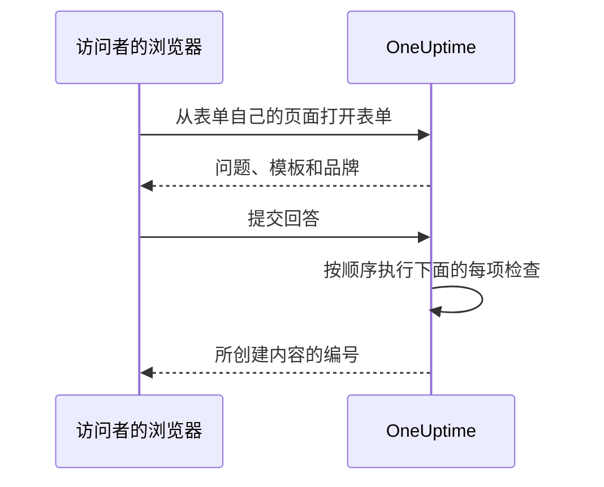

# 分享与安全

表单对任何拥有其链接的人开放，每次提交都可能呼叫您的值班团队，或在您的日历上排入一个维护窗口。本页介绍表单的 **分享** 页面——链接、关闭表单、提交后的消息以及 IP 允许列表——以及请求一路上要通过的其他所有检查。 本页还介绍如何在您自己的域名上提供表单。

:::cards
- [分享链接](#分享链接): 复制它、打开它，并在传播过广时重置它。
- [每个模板的链接](#每个模板的链接): 每种情况一个书签，背后都是同一个表单。
- [自定义域名](#自定义域名): 在您自己的域名上提供表单，并附带免费证书。
- [什么在保护表单](#什么在保护表单): 按顺序列出请求要通过的每项检查。
- [故障排除](#故障排除): 表单页面上每条消息的含义，以及该怎么做。
:::

## 分享页面

| 卡片 | 包含的内容 |
| --- | --- |
| **状态** | **接受提交** ——表单的链接是否可用。 |
| **分享链接** | 表单响应的每个地址，每个都带 **复制链接**，以及 **重置链接**。 |
| **提交之后** | 人们提交后在表单所创建内容的编号下方看到的 **感谢消息**。 |
| **更多设置** | **IP 允许列表**，展开前保持折叠。 |

## 分享链接

**分享链接** 卡片列出表单响应的每个地址：先是它的 [自定义域名](#自定义域名)，然后是它在 OneUptime 上的链接，例如 `https://oneuptime.com/accounts/form/<share-key>`：

- 每个地址都会在新标签页中按他人所见的样子打开表单，旁边的 **复制链接** 会复制该地址。
- 尚不能使用的自定义域名会标为 **尚未生效**，并注明原因。没有自定义域名时，链接下方的一行会提供 **添加自定义域名**。
- **重置链接** 在您确认后为表单生成新链接。旧链接会立即失效并显示不可用的消息，因此您分享过的每个人都需要新链接。当链接传播得比应有的更广时使用它。 表单的自定义域名不含任何密钥，会继续生效。

任何拥有链接的人都可以打开并提交表单，无需 OneUptime 账户，也无需登录。登录与否没有任何区别：OneUptime 只能从表单中输入的姓名和电子邮件得知是谁提交的。因此，请像对待值班团队的电话号码一样对待这个链接。把它分享到应该使用它的人能找到的地方——内网页面、支持 Runbook、聊天中的置顶消息——而不要放在公开网站上，除非您希望接受任何人的提交。

链接带有自己的随机密钥，而不是表单的 ID。在自托管安装中，它由您自己的 OneUptime 主机提供，并且只在 `HTTP_PROTOCOL` 和 `HOST` 配置的地址上有效：如果用服务器的其他名称或其 IP 地址打开，表单的请求会被当作来自其他网站而遭到拒绝。

指向旧事件表单的链接 `/accounts/incident-form/<share-key>` 会在新地址打开同一个表单。

### 每个模板的链接

表单的每个 [模板](/docs/forms/building#模板) 都有自己的链接：表单的链接加上 `?template=` 和模板的 ID，例如 `https://oneuptime.com/accounts/form/<share-key>?template=<template-id>`。表单 **模板** 页面上的 **复制链接** 会复制它。它会打开已用该模板填写好的表单，因此团队可以为每种情况保存一个书签，而您只需维护一个表单。当提交者选择另一个模板时，其浏览器中的地址会随之改变，因此他们复制的链接就是他们所看到的表单。 在 [自定义域名](#自定义域名) 上，模板的链接是带有同样 `?template=` 的域名，例如 `https://report.acme.com/?template=<template-id>`，并且 **重置链接** 之后仍然有效。

模板的链接就是表单的链接：只要表单处于 **接受提交**，它就有效，并且 **重置链接** 会连同其余链接一起将其作废。指向已删除模板的链接会像没有指定模板一样打开表单——如果有默认模板，则使用默认模板。

### 关闭表单

要在不删除表单的情况下停止接受提交，请关闭 **接受提交**。此时链接会显示 "此表单不可用。它可能已被关闭，或者链接已过期。"，并且 **分享链接** 卡片会提醒您表单已关闭。重新开启后，同一个链接会再次生效。 表单关闭期间，它的自定义域名也显示同样的消息。

### 感谢消息

提交后，页面会显示 "谢谢——您的回复已提交。" 并给出所创建内容的编号，然后显示您用 Markdown 编写的 **感谢消息**。用它说明接下来会发生什么，以及遇到紧急情况时该找谁。没有填写时，页面只显示标准消息。

表单描述或感谢消息中的图像，在表单处于 **接受提交** 期间会显示给每个打开链接的人。关闭表单或移除图像后，该图像会再次成为私密的，除非所有人都能看到的其他内容中仍然包含它。

## 自定义域名

默认情况下，表单通过它的链接、在 OneUptime 自己的地址上提供。要在您自己的域名上提供它，例如 `report.acme.com`，请打开表单的 **自定义域名** 页面，它在表单侧边菜单中紧随 **分享** 之后。它的工作方式与 [状态页的自定义域名](/docs/status-pages/branding-and-domains#自定义域名) 相同。

把表单放到您自己的域名上需要三步，只有前两步需要您来做：

1. **添加域名**：一个子域名和一个您已验证的域名。
2. **添加它的 CNAME 记录**：在您的 DNS 服务商处添加。添加域名后，**DNS 设置** 对话框会立即打开并显示该记录。
3. **免费的 SSL 证书会自动签发**：一旦找到记录就会签发。没有需要点击的按钮。

域名生效后，**分享链接** 卡片会把它列在表单链接的上方。两者打开的是同一个表单。

### 添加域名

点击 **创建表单域名**。对话框只有一页：

- **子域名**：只填标签，占位文字为 `report (leave blank for root)`。只输入 `report`，而不是完整的主机名。留空或输入 `@` 即使用根域名。
- **域名**：在 **项目设置** > **高级** > **域名** 中已验证的域名之一，您在那里用 TXT 记录证明域名归您所有。字段旁边的 **添加域名** 链接会在新标签页中打开该页面。
- **更多字段**：已折叠。只有在使用您自己的证书时才打开它：开启 **上传自定义证书**，然后粘贴 **证书** 和它的 **证书私钥**。

再次点击 **创建表单域名** 即可添加。对话框关闭，新域名的 **DNS 设置** 随即打开。域名的名称和它的表单在添加后即固定，因此 **编辑** 只能更改它的证书：要更改其中任何一项，请添加新域名并删除旧域名。

一个域名只显示一个状态页、仪表板或表单，因此任何项目中已被其中之一使用的名称都会被拒绝："report.acme.com is already in use: a domain can show only one status page, dashboard or form. Choose another subdomain, or remove report.acme.com where it is used first."

### DNS 设置与立即检查

**DNS 设置** 对话框显示要在 DNS 服务商处添加的记录，每个字段都带复制按钮：**类型** 为 `CNAME`，**名称** 为您添加的完整域名，**值** 为您安装的 CNAME 记录。对于根域名，许多 DNS 服务商不允许 CNAME 记录：请改用服务商的 ALIAS、ANAME 或 CNAME 扁平化记录，值保持不变。

OneUptime 每 15 分钟检查一次每个未验证的域名，找到记录后，会在同一次检查中为该域名订购免费的 Let's Encrypt 证书。要立即检查，请点击 **立即检查**。在域名生效之前，它的行上有一个打开同一对话框的 **DNS 设置** 操作，其中的 **立即检查** 也会重新订购失败或已过期的证书，每个域名每 15 分钟最多一次。续期是自动的，会在证书过期之前很久完成。

**状态** 列显示每个域名在通往 HTTPS 的路上走到了哪一步，状态与状态页的域名相同，共八种：请参阅 [解读域名的状态列](/docs/status-pages/branding-and-domains#解读域名的状态列)。订购失败时，原因显示在下面一行：通常是您域名上不允许 `letsencrypt.org` 的 CAA 记录，或者在自托管安装中，Let's Encrypt 无法通过 80 端口访问的服务器。

为某个域名订购了免费证书后，它的行上会显示 **Reissue SSL**，它会在自动续期之前向 Let's Encrypt 申请一个全新的证书，每个域名每 24 小时一次。在此期间，表单继续使用当前证书在线。您上传的证书需要您自己续期：编辑该域名并粘贴新证书。

### 域名显示什么

域名在其根路径显示它的表单，例如 `https://report.acme.com`，不显示 OneUptime 的其他任何内容：没有登录页面，也没有其他表单。域名上的任何其他地址都会在根路径打开表单，并保留其查询参数，因此模板的链接在那里同样有效。页面是表单自己的：表单的徽标或不显示徽标，绝不显示 OneUptime 的徽标，标签页标题是表单的名称，使用浅色主题，并且不带 OneUptime 的分析。验证码、文件和感谢消息在那里与通过链接时一样工作，[什么在保护表单](#什么在保护表单) 中的每项检查都适用，并以该域名作为表单自己的页面。

- **重置链接** 只更改表单在 OneUptime 上的链接：它的域名不含任何密钥，因此会继续生效。
- 关闭 **接受提交** 也会在其域名上关闭表单，并显示不可用的消息。
- 删除表单会删除它的域名，而 **复制表单** 不会复制任何域名。已删除的域名会立即停止显示表单。

### 在自托管安装中

表单使用状态页的 CNAME 记录：`config.env` 中的 `STATUS_PAGE_CNAME_RECORD`，或 Helm chart 中的 `statusPage.cnameRecord`。要为表单的域名设置单独的目标，请设置 `FORM_CNAME_RECORD`：Docker Compose 在 `config.env` 中设置，Helm chart 则用整个 chart 的 `extraEnv` 设置。两者都没有时，**自定义域名** 页面不会显示记录，而是提示未启用自定义域名，OneUptime 也不会验证表单的域名或为其订购证书。

服务器必须在 80 端口响应，Let's Encrypt 在那里检查每个域名。没有 Let's Encrypt 账户密钥 `LETS_ENCRYPT_ACCOUNT_KEY`（Helm chart 中为 `letsEncrypt.accountKey`）的安装不会订购证书：表单的域名在其记录验证后即可生效，并通过您自己代理的 HTTPS 或您上传的证书提供服务。开启验证码时，如果站点密钥列出了它可用的主机名，也必须列出表单的域名。

### 谁可以管理域名

项目所有者和管理员，以及拥有 **Edit Form** 的任何人，都可以添加表单的域名、检查它们、重新签发它们的证书并删除它们。仅针对表单域名的权限也可以，例如 **Edit Form Domain**：[表单概览](/docs/forms/index#权限) 列出了这些权限。能读取表单的人都能看到它的域名、域名的 **状态** 以及 **DNS 设置** 中的记录；对他们来说，**立即检查** 和 **Reissue SSL** 处于锁定状态，并会说明需要哪项权限。API 密钥在 `/form-domain` 上的工作方式相同：`verify-cname`、`order-ssl` 和 `reissue-ssl` 需要 **Edit Form Domain** 或 **Edit Form**。

## 什么在保护表单

每个请求都会按以下顺序通过这些检查：

1. 请求必须来自表单自己的页面，而不是其他网站——请参阅 [来自其他网站的请求](#来自其他网站的请求)。
2. 它必须在速率限制之内。
3. 表单必须存在、处于 **接受提交**，并且属于套餐包含表单的项目。
4. 当表单有 **IP 允许列表** 时，请求必须来自其中的地址。
5. 当实例开启了验证码时，提交必须通过验证码。
6. 每个回答都必须在大小限制之内并符合其问题——请参阅 [构建表单](/docs/forms/building#大小限制)。
7. 由回答和设置组成的内容必须可以创建：事件需要严重程度，活动需要晚于开始时间的结束时间。
8. 提交必须在表单的每小时额度之内——请参阅 [速率限制](#速率限制)。
9. 其文件必须在保存之前，处于表单的每小时文件额度之内。

表单的徽标和网站图标是表单的一部分：只有在请求通过前四项检查之后，它们才会以 base64 形式包含在打开表单的响应中发送，并且从不通过它们自己的地址发送。没有表单就无法获取它们，也无法通过表单按 ID 获取任何文件；文件本身保持私密。表单只显示在其自己的项目中上传的图像：其他项目的文件会在保存表单时被拒绝，并且永远不会发送到其页面。

### IP 允许列表

要将表单限制在您自己的网络中：

:::steps
1. 打开表单的 **分享** 页面。
2. 展开 **更多设置**，点击 **编辑 IP 允许列表**。
3. 每行输入一个网络，然后保存。随后卡片会在 **IP 允许列表** 下列出它们。
:::

每一行是以下之一：

| 条目 | 示例 | 说明 |
| --- | --- | --- |
| IPv4 地址 | `203.0.113.7` | |
| IPv6 地址 | `2001:db8::7` | 无论如何书写都能匹配，大写或完整写出零均可。 |
| CIDR 表示法的 IPv4 范围 | `10.0.0.0/8` | 不支持 IPv6 范围——请将每个 IPv6 地址单独写在一行。 |

IPv4 地址必须按 IPv4 的方式书写：如果按 IPv6 的方式书写，例如 `::ffff:203.0.113.7`，会被拒绝。每次保存列表时（无论来自仪表板、API、Terraform 还是工作流）都会检查它，永远无法匹配的行会被拒绝，并显示指明该行的消息。将列表留空即可允许所有网络。一旦列表中有条目，无法确定地址的请求就会被拒绝。

在 OneUptime Cloud 上，设置 IP 允许列表需要 **Scale** 套餐——通过 API 创建带有允许列表的表单时和编辑表单时都是如此——与 [公开仪表板](/docs/dashboards/sharing) 的 IP 允许列表相同。清空列表在任何套餐上都可以进行。自托管时，更改它属于 Enterprise Edition：在 Community Edition 上，已设置的列表会继续生效，且只能移除。

### 来自其他网站的请求

浏览器会告诉服务器是哪个页面发送了请求。当其他网站的页面让访问者的浏览器打开或提交表单时，请求会被以 "This form can only be used from its own page." 拒绝——这发生在任何速率限制计数之前，并且与链接无关，因此响应不会透露存在哪些表单。

当请求的 `Sec-Fetch-Site` 标头存在且其值不是 `same-origin` 或 `none` 时，或其 `Origin` 标头存在且不是您的 OneUptime 地址（ `HTTP_PROTOCOL` 和 `HOST`，如果 `HOST` 带有端口则包括端口）时，请求会被拒绝。提交还必须以 JSON（ `application/json` ）发送；以网页表单字段或纯文本发送的提交会被以 "The request must be a JSON object holding the form's answers in "data"." 拒绝。读取表单还需要表单页面添加到其发出的每个请求中的标头 `X-OneUptime-Form: 1`：页面无法在没有脚本的情况下让浏览器添加标头，而添加该标头的其他网站的脚本会通过其 `Origin` 暴露自己。

### 速率限制

打开表单和提交表单都按网络地址进行限制，提交还会按表单进行限制：

- **打开表单** ——按来自同一地址的每个表单，以及按跨所有表单的每个地址进行限制，并留有让整个办公室同时打开链接的余量。超过其中任何一个时，页面会显示 "请求过多。请稍后重试。" 如果无法连接到速率限制器，表单仍然可以打开。
- **提交（按地址）** ——按来自同一地址的每个表单，以及按跨所有表单的每个地址进行限制。超过其中任何一个时，提交者会看到 "来自您网络的提交过多。请等待几分钟后重试。" 同一地址背后的所有人（办公室网络、VPN 网关）共享这些限制，并且每次提交都会计数，即使之后因回答错误而被拒绝的提交也是如此。
- **提交（按表单）** ——一个表单在一小时内可以创建的记录数，所有地址合计，因此即使同时来自许多地址的提交，每小时也只能呼叫您有限的次数。只有通过所有其他检查的提交才会计数，计数发生在其记录创建之前。超过后，在时间窗口结束之前，每个人都会看到 "此表单目前收到的提交过多。请稍后重试。" **重置链接** 会让新链接以全新的额度开始。
- **文件（按表单）** ——一个表单在一小时内可以接收多少兆字节的文件，所有地址合计。只有通过所有其他检查的提交，其文件才会在保存之前计入。超过之后，带文件的提交会被拒绝，提示 "此表单目前收到的文件过多。请稍后重试。"，直到该时间窗口结束；不带文件的提交仍会通过。

每项限制都会以 `429` 响应，并附带以秒为单位的 `Retry-After` 标头，页面会告诉提交者何时重试。时间窗口是固定的，而不是滚动的。每项按地址的限制还会把同一个 IPv6 /64 中的地址合并计数，上限为其数值的十倍。如果无法连接到速率限制器，提交会被拒绝，而不是不计数地放行：API 会以 `503` 响应，提交者会看到 "目前无法接受提交。请几分钟后重试。"

在自托管安装中，OneUptime 应用的以下环境变量用于更改限制：

| 变量 | 默认值 | 设置的内容 |
| --- | --- | --- |
| `FORM_RATE_LIMIT_WINDOW_SECONDS` | `60` | 打开表单的时间窗口，以秒为单位。 |
| `FORM_RATE_LIMIT_PER_FORM_AND_IP_PER_WINDOW` | `120` | 一个地址在每个时间窗口内打开一个表单的次数。 |
| `FORM_RATE_LIMIT_PER_IP_PER_WINDOW` | `600` | 一个地址在每个时间窗口内打开表单的次数，所有表单合计。 |
| `FORM_SUBMIT_RATE_LIMIT_WINDOW_SECONDS` | `900` | 按地址的提交限制的时间窗口，以秒为单位。 |
| `FORM_SUBMIT_RATE_LIMIT_PER_FORM_AND_IP_PER_WINDOW` | `10` | 每个时间窗口内从一个地址向一个表单的提交次数。 |
| `FORM_SUBMIT_RATE_LIMIT_PER_IP_PER_WINDOW` | `30` | 每个时间窗口内来自一个地址的提交次数，所有表单合计。 |
| `FORM_SUBMIT_RATE_LIMIT_PER_FORM_WINDOW_SECONDS` | `3600` | 按表单限制的时间窗口，以秒为单位。 |
| `FORM_SUBMIT_RATE_LIMIT_PER_FORM_PER_WINDOW` | `60` | 一个表单在每个时间窗口内可以创建的记录数，所有地址合计。 |
| `FORM_SUBMIT_FILE_RATE_LIMIT_WINDOW_SECONDS` | `3600` | 按表单的文件限制的时间窗口，以秒为单位。 |
| `FORM_SUBMIT_FILE_RATE_LIMIT_MEGABYTES_PER_FORM_PER_WINDOW` | `200` | 一个表单每个时间窗口可以接收的文件兆字节数，所有地址合计。 |

每个变量也会读取其旧名称，即前缀为 `INCIDENT_FORM_` 而不是 `FORM_` 的名称——例如 `INCIDENT_FORM_SUBMIT_RATE_LIMIT_PER_FORM_PER_WINDOW` ——因此调整过事件表单的安装会保留其限制；两者都设置时以新名称为准。 `config.env` 和 Helm chart 的值都不会传递它们：请自行将它们添加到 `app` 容器的环境中——在 Helm chart 中使用 `app.extraEnv` 或 chart 级别的 `extraEnv`，对于 Docker Compose 则使用 `docker-compose.override.yml`。 `TRUSTED_PROXY_HOPS` 决定按地址的限制计算的是哪个地址。

### 验证码

当您的 OneUptime 实例开启了 hCaptcha 时，表单会显示验证码，未通过验证码的提交会被拒绝。没有按表单的设置。自托管安装通过 `CAPTCHA_ENABLED`、 `CAPTCHA_SITE_KEY` 和 `CAPTCHA_SECRET_KEY` 开启验证码——与保护注册的设置相同。没有验证码时，由速率限制和 IP 允许列表承担负载。

## 故障排除

:::details 链接提示表单不可用
"此表单不可用。它可能已被关闭，或者链接已过期。" 无论原因是什么，页面都会给出相同的回答，因此它永远不会告诉陌生人某个表单是否存在：

- **分享** 页面上的 **接受提交** 已关闭。
- 链接已通过 **重置链接** 被替换。请分享新链接。
- 表单已被删除。
- 在 OneUptime Cloud 上，项目低于 **Growth** 套餐，或其订阅未付款。
- 复制链接时链接被截断了。
:::

:::details 表单的域名不显示表单
打开表单的 **自定义域名** 页面，查看该域名的 **状态** 列：在其记录验证、证书就绪之前，浏览器会显示证书警告，或者什么都不显示。因域名本身或其表单被删除而不再出现在该页面上的域名，会显示未找到页面；父域名不再处于已验证状态的域名，会显示不可用的消息。在自托管安装中，请检查记录是否指向您的 OneUptime 服务器，以及服务器是否在 80 和 443 端口响应。
:::

:::details 只能从允许的网络打开表单
"此表单只能从允许的网络中打开。" 提交者的地址不在表单的 **IP 允许列表** 中：添加其网络，或清空列表。在位于代理或负载均衡器之后的自托管安装中，请检查 `TRUSTED_PROXY_HOPS` ——当它过小时，OneUptime 看到的是您代理的地址，而不是提交者的地址。当表单在您 OneUptime 自己的地址以外的地址上打开时，页面也会显示同样的内容：请完全按 **分享链接** 卡片显示的样子打开链接。
:::

:::details 提交过多
"来自您网络的提交过多。请等待几分钟后重试。" 同一地址背后的所有人共享按地址的限制，这在大规模故障期间、许多人同时报告时尤为重要。页面会说明何时重试。 "此表单目前收到的提交过多。请稍后重试。" 则是按表单的额度：它与提交者的网络无关，时间窗口结束后会再次接受报告。如果由于链接传播过广而出现不真实的提交， **重置链接** 会立即停用旧链接。
:::

:::details 现在无法接受提交
"目前无法接受提交。请几分钟后重试。" 无法连接到速率限制器，因此提交会被拒绝，而不是不计数地放行。打开表单仍然可用。在自托管安装中，请检查速率限制器用于计数的缓存 Valkey 是否正在运行，并且可以从 OneUptime 应用访问。
:::

:::details 此表单无法创建事件，因为它没有严重程度
表单没有询问严重程度，其设置也没有指定（或指定的已被删除），并且其事件模板也没有设置。请在表单的 **提交时** 页面上选择一个严重程度。请参阅 [没有严重程度，就没有事件](/docs/forms/on-submit#提交如何成为事件)。
:::

:::details 提交被拒绝
消息会说明问题所在：缺少必填回答或回答只有空格、回答过长或不符合其问题、电子邮件地址不是单个普通地址，或维护窗口在开始之前就结束了。 "验证码验证失败。请重试。" 表示验证码未通过或已过期：请重新完成验证。在每次提交都无法通过验证码的自托管安装中，请检查 `CAPTCHA_SITE_KEY` 和 `CAPTCHA_SECRET_KEY` 是否都已设置。
:::

:::details 问题不在表单上
构建器会标记它从公开表单中省略的问题（例如已被删除的自定义字段），并且 **预览** 会在省略问题时加以说明。请参阅 [构建器标记问题时](/docs/forms/building#构建器标记问题时)。带有 **隐藏** 徽章的问题是有意省略的：只有模板会回答它。请参阅 [隐藏的问题](/docs/forms/building#隐藏的问题)。一个问题也可能对某个模板在表单上，对另一个模板则不在：每个模板都可以隐藏问题，或询问表单隐藏的问题。打开模板的 **编辑** 并检查其 **问题**。请参阅 [模板如何询问每个问题](/docs/forms/building#模板如何询问每个问题)。
:::

:::details 模板没有填写某个问题
只有当模板的回答仍然符合其问题时才会被使用：问题仍然提供的选项、表单仍然提供的记录、不过长的文本。编辑模板，重新回答该问题并保存。请参阅 [模板](/docs/forms/building#模板)。
:::

:::details 事件或活动没有出现在状态页上
这是设计如此：来自表单的事件以隐藏状态声明，而维护活动会保持隐藏，除非表单的 **发布** 设置另有规定。请参阅 [提交会创建什么](/docs/forms/on-submit)。
:::

:::details 没有呼叫任何人
表单的事件会像其他事件一样，执行其设置和模板指定的值班策略，以及您的值班规则添加的内容。如果这些都没有，就不会呼叫任何人。请在表单的 **提交时** 页面上添加值班策略，或编写一条匹配其事件的值班规则——例如按表单始终添加的标签匹配。
:::

## 后续步骤

:::cards
- [表单概览](/docs/forms/index): 表单的用途、权限和 API。
- [构建表单](/docs/forms/building): 问题、隐藏的问题和模板。
- [提交会创建什么](/docs/forms/on-submit): 每次提交所创建的事件或活动。
:::
