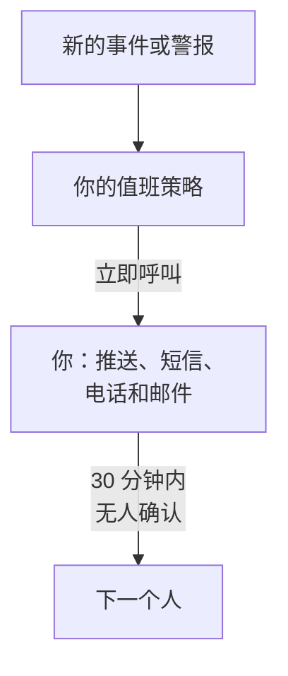

# 通过电话、短信或推送接收呼叫

完成本指南后，项目中的每个新事件和警报都会通过推送通知、短信或电话在你的手机上呼叫你，30 分钟内无人确认时会呼叫下一个人，而一次由你确认的测试呼叫证明这一切都能正常工作。本指南按照引导式设置 **出现故障时呼叫合适的人** 进行，大约需要 10 分钟。

## 你需要什么

- 一个你拥有的项目：开启短信和电话需要项目所有者，创建值班策略需要所有者或管理员。
- 你的手机。
- 你想呼叫的团队成员，他们须是项目成员：[邀请成员](/docs/permissions/inviting-people) 介绍了如何邀请。

:::tabs
@tab OneUptime Cloud
推送通知在所有套餐中都免费。短信和电话从项目的余额中支付，余额初始为 0.00 USD；添加电话号码时会发送一条短信，因此余额必须先高于 1.00 USD。充值会从项目的卡上扣款。Free 套餐只限一人和一条升级规则：只有你会被呼叫，呼叫会重复进行，不会转给其他人。
@tab 自托管
你的服务器必须能够发送电子邮件和短信，并能拨打电话。服务器的主管理员在 `/admin/setup` 中设置它们，每一项都附带测试，如 [自托管指南](/docs/installation/self-hosting-guide) 所述。推送通知通过 OneUptime 推送中继送达应用，无需任何设置。
:::

## 步骤

:::steps
### 打开引导式设置

在项目的 **首页** 上，点击 **欢迎使用 OneUptime 👋** 清单中的 **设置值班策略**。新项目的首页会先问 **您想先做什么？**：勾选 **出现故障时呼叫合适的人** 并点击 **继续**。如果清单中没有这一步，或这一步已经完成，请按 `Ctrl+K`（Mac 上为 `Cmd+K`），输入 `get paged` 并选择 **出现故障时呼叫合适的人**。

### 在手机上安装应用

从 App Store 或 Google Play 安装 OneUptime On-Call 并登录：应用会为你的手机注册推送通知。回到引导式设置中，点击 **重新检查**：**我们该如何联系你？** 下的 **移动应用或浏览器** 现在会列出你的手机。

### 开启短信和电话

新项目中的短信和电话默认关闭。如果你是项目所有者，请点击 **开启短信和电话**；其他人会看到谁可以开启。在 OneUptime Cloud 上，如果余额不超过 1.00 USD，请点击 **充值余额**，在 **金额（USD）** 下输入 20 到 1,000 USD，然后点击 **充值**。

### 添加你的电话号码

在 **你的电话号码** 中输入带国家代码的手机号码，例如 `+15551234567`，然后点击 **通过短信发送验证码**。输入短信中的验证码并点击 **验证**：呼叫时也会拨打这个号码。点击 **继续**。如果只想通过应用和电子邮件接收呼叫，请不要填写号码，直接点击 **继续**。

### 选择还要呼叫谁

在 **还有谁值班？** 下，你已经在 **首先呼叫** 中。点击 **添加团队成员**，让其他人和你一起被呼叫，然后点击 **保存并继续**。在还没有值班策略的项目中，这会创建 `Default on-call policy`，它会在每个新事件和警报发生时呼叫他们。在已有值班策略的项目中，请改为在 **值班策略** 下选择它，并在 **添加到第一条升级规则** 下添加人员。如果暂时还联系不到某人，这一步会停留在 **呼叫能联系到他们吗？**：为他们点击 **发送设置提醒**，然后点击 **继续**。

### 决定无人响应时怎么办

在 **如果无人响应怎么办？** 下，保留 **呼叫其他人**，在 **接着呼叫** 下选择要呼叫的人，并将 **等待分钟数** 保留为 `30` 或修改它。点击 **保存并继续**。在 Free 套餐中，这一步改为提供 **再次呼叫同一批人**，**重新呼叫次数** 为 `2`。

### 发送测试呼叫

在 **发送测试呼叫** 下，点击 **测试此策略**。选择 **严重程度** 并点击 **发送测试呼叫**。策略第一条升级规则中的人员会像真实事件发生时那样被呼叫，每条消息都会注明 TEST。不会创建事件，也不会通知任何状态页面或订阅者。

### 确认测试呼叫

打开短信或电子邮件中的链接，在那里确认呼叫，或者在电话中按 1。应用会显示呼叫已送达，但无法确认测试呼叫。然后在对话框中点击 **完成**，再点击 **继续**。
:::

## 检查是否生效

- 测试步骤会显示谁确认了呼叫、通过什么方式以及用了多长时间。
- 引导式设置以 **呼叫已设置** 结束，其中的内容来自实际记录：**呼叫对象**、**如果无人响应** 和 **已测试**。策略本身的问题，例如有它联系不到的人，会列在 **需要关注** 下。
- 在 **首页** 上，清单会把 **设置值班策略** 标记为已完成。如果这是最后一步，清单就会消失。

如果策略还会呼叫其他人，你也可以观察升级过程：在摘要中点击 **打开值班策略**，然后点击 **测试此策略**。开启 **逐级经过每个升级级别**，发送测试，并且不要确认第一次呼叫：最多 2 分钟后，下一个人就会被呼叫。

## 可能出现的问题

:::details 没有“通过短信发送验证码”按钮
短信已关闭或无法发送，这一步会说明原因。只有项目所有者或管理账单的人才会看到 **开启短信和电话**。在 OneUptime Cloud 上，余额不超过 1.00 USD 时，该字段会被隐藏。在无法发送短信的自托管服务器上，服务器的主管理员会看到 **设置短信和电话**，它会打开 Admin Dashboard 以添加 Twilio，如 [Twilio 集成](/docs/self-hosted/twilio-integration) 所述。
:::

:::details 充值余额时提示找不到支付方式
充值会从项目的卡上扣款。请在 **项目设置 → 账单和发票 → 账单** 中通过 **添加支付方式** 添加一张卡，然后再次充值。在此之前，应用和电子邮件仍会呼叫你。
:::

:::details 自托管：因为未设置 Twilio 账户，号码被拒绝
只有主管理员会事先收到服务器无法发送短信的提醒。请让主管理员在 `/admin/setup` 中设置短信和电话。在此期间，点击 **继续**：应用和电子邮件仍会呼叫你。
:::

:::details 一直收不到验证码或测试呼叫
先检查号码的国家代码。测试呼叫之后，用 **完成** 关闭对话框，并点击 **我没有收到**：它会说明要检查什么，而 **打开我的通知方式** 会列出可以联系到你的所有方式。在自托管服务器上，从 `/admin/setup` 发送一条测试短信，并在服务器上运行 `npm run doctor`。
:::

## 后续步骤

:::cards
- [值班计划](/docs/on-call/schedules): 轮流值班，让每次呼叫都送到正在值班的人。在 Cloud 上，从 Growth 套餐起提供。
- [升级规则](/docs/on-call/escalation-rules): 为策略添加级别、团队和值班计划。
- [如何联系我](/docs/notifications/on-call-rules): 选择先用哪种方式联系你，以及何时联系。
- [发布状态页面](/docs/guides/status-page): 在你自己的域名上告诉客户正在发生什么。
:::
