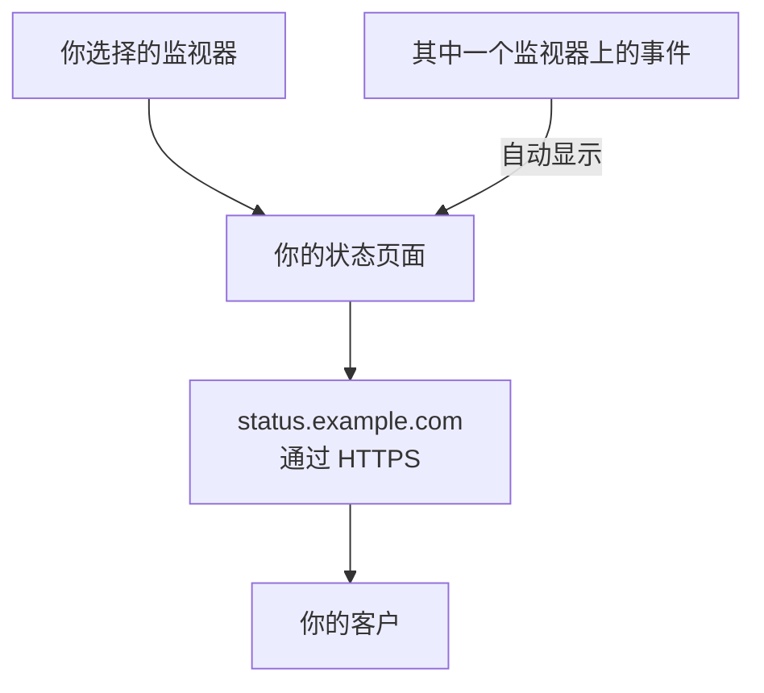

# 发布状态页面

完成本指南后，你的客户可以通过 HTTPS 在你自己的地址（例如 `status.example.com`）上打开状态页面。页面显示你选择的监视器及其状态和正常运行时间，其中任何一个监视器上的事件都会自动显示在页面上。本指南按照引导式设置 **发布状态页面** 进行，然后在页面的 **自定义域名** 中添加你的域名：大约需要 15 分钟，外加 DNS 服务商所需的时间。

## 你需要什么

- 至少一个监视器：状态页面显示的就是监视器。如果还没有，引导式设置会先提供 **设置监视器**。
- 项目所有者或管理员角色：创建页面需要创建状态页面的权限，添加你的域名需要添加和验证项目域名的权限。
- 一个由你控制的域名，并能在 DNS 服务商处管理它的 DNS 记录。

:::tabs
@tab OneUptime Cloud
所有套餐都包含自定义域名及其免费的 SSL 证书。Free 套餐每个项目只有一个状态页面：如果你已经有一个，请打开它的 **自定义域名**，从添加域名的那一步开始。新的状态页面是公开的；要将其设为私有，需要 Growth 套餐。
@tab 自托管
你的服务器需要一个专属的主机名，例如 `oneuptime.example.com`，它有一条指向服务器的 A 记录，并在 80 和 443 端口上响应。在 `config.env` 中把它设为 `STATUS_PAGE_CNAME_RECORD`（在 Helm chart 中为 `statusPage.cnameRecord`），替换那里的示例值。免费证书还需要 `LETS_ENCRYPT_ACCOUNT_KEY`（`letsEncrypt.accountKey`）：一个用 openssl 生成并以 base64 编码的私钥。修改后重启 OneUptime。**添加自定义域名** 会先检查服务器，并列出仍然缺少的内容。
:::

## 步骤

:::steps
### 打开引导式设置

在项目的 **首页** 上，点击 **欢迎使用 OneUptime 👋** 清单中的 **发布状态页面**。新项目的首页会先问 **您想先做什么？**：勾选 **用状态页面告知我的客户** 并点击 **继续**。如果清单中没有这一步，或这一步已经完成，请按 `Ctrl+K`（Mac 上为 `Cmd+K`），输入 `status page` 并选择 **发布状态页面**。

### 命名并选择要显示的内容

在 **命名并选择要显示的内容** 下，保留它建议的 **状态页名称**，或输入你自己的名称。在 **显示的内容** 下，勾选客户应该看到的监视器，或点击 **全选**。点击 **创建状态页**。从这一刻起，页面就可以通过它的链接公开访问，只显示你勾选的监视器。

### 查看客户看到的内容

在 **这是客户看到的内容** 下，打开 **公开链接** 下的地址：你的监视器会连同各自的状态一起列出。回到引导式设置中，点击 **看起来不错**。

### 打开自定义域名

引导式设置以一个摘要结束。在 **打造专属风格（可选）** 下，点击 **您自己的域名**。状态页面的 **自定义域名** 随即打开。

### 添加你的域名

点击 **添加自定义域名**。在 **域名** 中输入客户将要打开的地址，例如 `status.example.com`，然后点击 **继续**。**DNS 设置** 随即打开，列出要添加的记录。

### 添加 DNS 记录

在你的 DNS 服务商处，添加 **DNS 设置** 列出的每条记录，包括它的 **类型**、**名称** 和 **值**：一条把该地址指向 OneUptime 的 CNAME 记录，以及在项目第一次使用此域名时，一条证明项目拥有该域名的 TXT 记录。如果你的服务商会自动在每个名称后加上域名，请只输入域名之前的部分，例如 `status`；域名本身则输入 `@`。

### 检查记录

保持 **DNS 设置** 打开，然后点击 **立即检查**。它会在每条记录下方说明查询了什么、得到了什么。TXT 记录最先检查：找到它之前，域名不会被添加，因此请再次点击 **立即检查**，直到找到为止。找到 CNAME 记录后，对话框会显示 **您的 CNAME 记录已验证。** 随后会签发免费的 SSL 证书，通常在 15 分钟内完成。
:::

## 检查是否生效

- 打开 `https://status.example.com`（换成你自己的地址）：你的状态页面会打开，并且没有证书警告。
- 在 **自定义域名** 上，域名的 **状态** 显示 **证书已签发，将自动续期。** 在页面已经能打开后的一段时间内，它仍可能显示 **正在签发免费证书，通常在 15 分钟内完成。**
- 在 **首页** 上，清单会把 **发布状态页面** 标记为已完成：只要有状态页面显示了监视器，这一步就算完成。如果这是最后一步，清单就会消失。

无需其他操作：OneUptime 会自动续期证书。域名一旦出现在列表中，OneUptime 就会每 15 分钟检查一次它的 CNAME 记录，并在记录生效时完成验证，即使你已经关闭了 **DNS 设置** 也是如此。

## 可能出现的问题

:::details 关闭 DNS 设置后，域名不在列表中
**DNS 设置** 在找到 TXT 记录之前就被关闭了，因此域名从未被添加。点击 **添加自定义域名**，输入同一个地址，点击 **继续**，然后点击 **立即检查**，直到对话框找到两条记录。
:::

:::details 域名一直停留在“等待 DNS”
从域名所在的行打开 **DNS 设置** 并点击 **立即检查**：它会说明找到了什么。检查记录的名称是否为完整地址，例如 `status.example.com`，以及它的值是否与 **DNS 设置** 显示的一致。如果该名称以地址应答，说明它有一条 A 记录，或者你的 DNS 服务商对它进行了代理：请替换 A 记录，或把该名称设为“仅 DNS”。对于根域名，例如 `example.com`，请使用你的服务商提供的 ALIAS、ANAME 或拉平的 CNAME 记录。
:::

:::details 状态显示无法签发免费证书
如果你的域名上有一条未包含 `letsencrypt.org` 的 CAA 记录，它会阻止签发证书。在自托管服务器上，Let's Encrypt 必须能通过 80 端口访问服务器。修复原因即可：OneUptime 会自行不断重试，**DNS 设置** 中的 **立即检查** 也会重新订购证书，每个域名每 15 分钟最多一次。
:::

:::details 自托管：服务器尚未准备好使用自定义域名
**添加自定义域名** 会显示 **此服务器尚未准备好使用自定义域名**，并为每项仍缺少的内容列出一行，说明要修改什么：也就是 [你需要什么](#你需要什么) 中的设置。没有 `LETS_ENCRYPT_ACCOUNT_KEY` 时，已验证的域名会显示 **已验证。正在使用您自己的代理提供的 HTTPS。** 这时请通过你自己的代理为它提供 HTTPS。[状态页品牌与域名](/docs/status-pages/branding-and-domains#开始之前) 中有详细说明。
:::

## 后续步骤

:::cards
- [状态页品牌与域名](/docs/status-pages/branding-and-domains): 你的徽标、颜色、页眉链接和页脚。
- [订阅者与公告](/docs/status-pages/subscribers): 让客户订阅，并发布公告。
- [计划维护概览](/docs/scheduled-maintenance/index): 在计划内的工作开始之前告知客户。
- [通过电话、短信或推送接收呼叫](/docs/guides/paging): 在其中某个监视器宕机时收到呼叫。
:::
