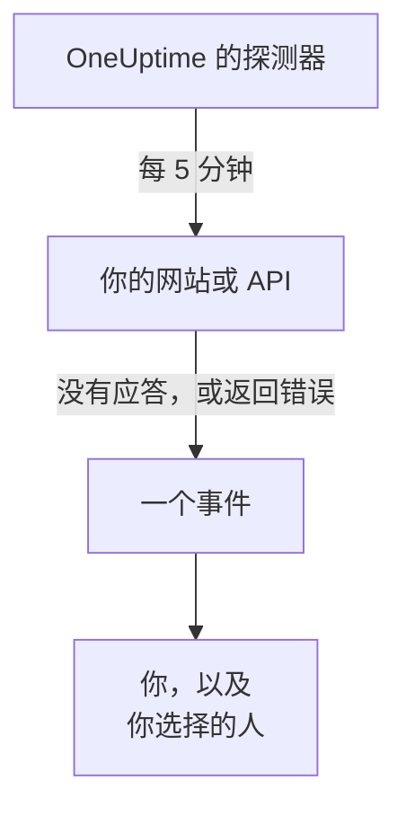

# 在网站或 API 宕机时收到通知

完成本指南后，OneUptime 会每 5 分钟检查一次你的网站或 API，在它停止应答或返回错误时创建事件并通知你，而一次由你确认的测试呼叫证明消息能够送达你。本指南按照引导式设置 **在我的网站或 API 宕机时知道** 进行，大约需要 5 分钟。

## 你需要什么

- 一个你可以在其中创建监视器的 OneUptime 项目：所有者、管理员或成员都可以创建。要创建账户和项目，请按照 [快速开始](/docs/introduction/quickstart#创建项目) 的第一部分操作。
- 要检查的地址，例如 `https://example.com`。对于 API，请选择一个无需密钥、用普通的 `GET` 请求即可应答的端点，例如健康检查：像 `401` 这样的应答会被算作宕机。

:::tabs
@tab OneUptime Cloud
位于多个地区的探测器会检查该地址，因此它必须能从互联网访问；只有当所有探测器都发现它宕机时，才会创建事件。Free 套餐包含 10 个活跃监视器。监视器按用量计费，因此项目需要先有付款方式：没有付款方式时，第一步会说明这一点，并提供 **添加支付方式**。
@tab 自托管
该地址由你服务器自己的探测器检查，因此它必须能从那里访问。要通过电子邮件收到通知，服务器必须能够发送电子邮件：服务器的主管理员在 `/admin/setup` 中进行设置，如 [自托管指南](/docs/installation/self-hosting-guide) 所述。
:::

## 步骤

:::steps
### 打开引导式设置

新项目的 **首页** 会先问 **您想先做什么？**：勾选 **在我的网站或 API 宕机时知道** 并点击 **继续**。然后点击 **欢迎使用 OneUptime 👋** 清单中的 **创建您的第一个监视器**。如果清单中没有这一步，请按 `Ctrl+K`（Mac 上为 `Cmd+K`），输入 `website down` 并选择 **在我的网站或 API 宕机时知道**。**监视器** 也提供它：空列表和 **工作原理** 中都有 **引导式设置**，选择 **网站** 或 **API** 后，**创建监视器** 上也会出现一行提示。也可以点击 **改为用一句话描述**：询问 AI 会打开，输入框中已写好这项任务，可以直接发送。

### 输入地址

在 **我们要检查什么？** 下，这一步会说明将从多少个位置检查该地址。在 **网站或 API 地址** 中输入地址。如果是 API 端点，请勾选 **这是一个 API 端点**。点击 **开始检查**：探测器会立即检查它，并用一句话说明发现了什么。点击 **继续**。

如果某位队友的监视器，或者通过 API、Terraform 或导入创建的监视器，已经在检查该地址，这一步会在创建任何内容之前告诉你。点击 **打开监视器** 查看它会通知谁，或点击 **创建我自己的监视器** 用你自己的监视器继续。它只会提到你有权打开的监视器。

### 选择要通知谁

在 **要通知谁？** 下，你看到的内容取决于项目：

- 如果还没有值班策略或值班规则，你已经在 **呼叫对象** 中。点击 **添加团队成员**，添加已在项目中的人员，然后点击 **保存并继续**。这会创建 **默认值班策略**，它会在项目中每个新事件和警报发生时呼叫他们。每个人都会按其 **如何联系我** 的设置被呼叫：该链接会在新标签页中打开你自己的设置。
- 如果已有值班策略或规则，则由项目自己的规则决定呼叫谁：点击 **继续**。
- 作为成员，你不能设置呼叫，这一步会告诉你将以监视器所有者的身份收到电子邮件：点击 **继续**。

### 给自己发送测试

在 **发送测试** 下，点击 **给我发送测试呼叫**。选择 **严重程度**：其下方的一行说明，测试会按你针对该严重程度的 **如何联系我** 送达。点击 **发送测试呼叫**。测试会像真实呼叫那样送达你，每条消息都会注明 TEST。不会创建事件。

### 确认测试呼叫

打开电子邮件中的链接，在那里确认呼叫。在项目开启短信和电话后，也可以使用已验证的电话号码：打开短信中的链接，或者在电话中按 1。然后在对话框中点击 **完成**，再点击 **继续**。

### 向客户展示

如果项目有状态页面，并且你可以向其中添加监视器，接下来还有一步。在 **向客户展示？** 下，在 **状态页面** 中选择页面并点击 **添加到状态页面**，或点击 **暂不**。还没有状态页面的项目会跳过这一步：摘要会改为提供 **在状态页上显示**，并已勾选你的监视器。
:::

## 检查是否生效

- 引导式设置以摘要结束，其中的内容来自实际记录：**检查时间**、**宕机时**、**会通知谁** 和 **已测试**，当有状态页面显示该监视器时还有 **状态页面**。
- 在 **下一步** 下，**通过 SMS 或电话接收呼叫** 会打开添加你电话的引导式设置 **出现故障时呼叫合适的人**。
- 点击 **打开监视器**，然后点击其 **宕机时** 卡片上的 **显示通知链**：它会显示从监视器到它能联系到的人员的整条通知链，并在没有任何因素会中断这条链时显示 **没有任何因素会中断通知链。**
- 在 **首页** 上，收到第一次检查结果后，清单会把 **创建您的第一个监视器** 标记为已完成。如果这是最后一步，清单就会消失。

以后要设置另一个地址，请再次打开引导式设置并点击 **检查其他地址**。

## 可能出现的问题

:::details 第一次检查一直没有结果
如果那句话说没有任何位置在检查该地址，说明监视器没有探测器；如果它一直说正在检查，说明它的探测器没有连接。打开 **监视器 → 设置 → 探测器** 查看每个探测器的状态。在自托管服务器上，由主管理员在 `/admin/setup` 中检查服务器的探测器。然后打开监视器，为它添加一个已连接的探测器，再重新打开引导式设置。
:::

:::details 网站正常，但监视器显示它已宕机
监视器会把没有应答，或应答状态码不在 200 到 399 之间的情况视为宕机。阻止探测器的防火墙看起来就像没有应答：在 OneUptime Cloud 上，请放行 [IP 地址](/docs/configuration/ip-addresses) 中列出的地址；在自托管服务器上，请放行运行探测器的机器。要修改这条规则，请参阅 [网站监控](/docs/monitor/website-monitor) 或 [API 监控](/docs/monitor/api-monitor)。
:::

:::details 无法确认测试呼叫
没有收到任何可以用来确认呼叫的消息。在自托管服务器上，这通常意味着服务器还不能发送电子邮件：这一步会说明这一点，服务器的主管理员会看到 **设置电子邮件**。设置好后，点击 **再发送一次测试**，或者点击 **跳过测试**，稍后再回来。测试之后，用 **完成** 关闭对话框，并点击 **我没有收到**：它会说明要检查什么。
:::

## 后续步骤

:::cards
- [通过电话、短信或推送接收呼叫](/docs/guides/paging): 在手机上接收呼叫，并在无人响应时呼叫下一个人。
- [发布状态页面](/docs/guides/status-page): 在你自己的域名上向客户展示这个监视器。
- [条件与状态](/docs/monitor/criteria-and-statuses): 精确决定监视器何时算作宕机。
:::
