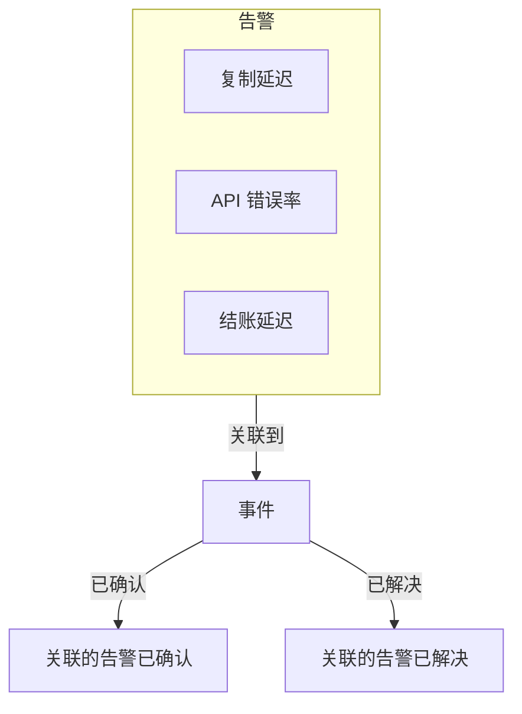
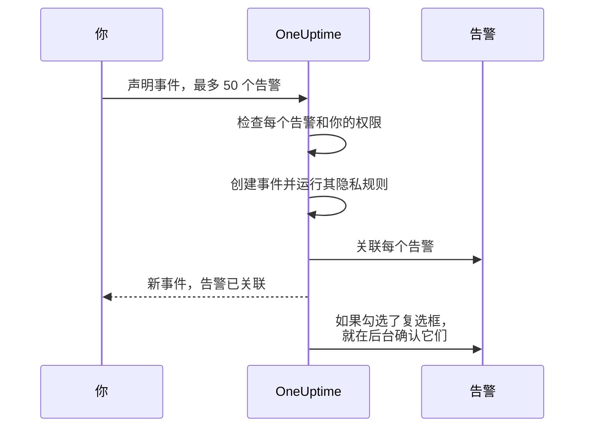

# 关联的警报

一次故障很少只引发一个警报。主数据库宕机时，复制延迟监视器会触发，API 错误率监视器会触发，结账延迟 SLO 开始消耗预算——三个警报，一个问题。把这些警报关联到事件上，就说明了这一点：事件是进行响应的地方，而每个警报都会显示是哪个事件解释了它。

关联只是关联。警报保留它自己的状态、所有者、值班策略、备注和信息流；事件也保留它自己的。关联不会合并或复制任何东西，单凭它本身也绝不会确认、解决或静音警报。（从警报声明新事件则不同：新事件会按这些警报预先填写，并以它们的所有者作为所有者开始，如 [下文所述](#从警报声明事件)，并且除非你取消勾选表单上的复选框，这些警报会在你声明时被确认，从而停止它们的升级——参见 [声明时确认警报](#声明时确认警报)。）两个在新项目中默认开启的项目开关，会在事件被确认和解决时，让关联的警报随之推进——参见 [下文](#让警报状态与事件保持同步)。

:::cards
- [把警报关联到事件](#从事件关联警报): 从事件、从警报，或一次关联多个。
- [从警报声明事件](#从警报声明事件): 一个新事件，一次性预填并关联好。
- [让警报状态保持同步](#让警报状态与事件保持同步): 随事件一起确认和解决警报。
- [权限](#权限): 谁可以关联，以及关联让他们能做什么。
:::

> [!TIP]
> 如果你来自 Opsgenie，这就是 OneUptime 版本的“把警报关联到事件”。

## 一览

- **多对多** —— 一个事件可以有任意数量的关联警报，一个警报也可以关联到多个事件。
- **三个关联入口** —— 事件的 **已关联警报** 页面、警报的 **已关联事件** 页面，以及主要警报列表上的 **关联到事件** 批量操作，每次最多 **50** 个警报。
- **从警报声明事件** —— 在警报列表、警报页眉或其 **已关联事件** 页面上使用 **声明事件**，会按警报预先填写一个新事件，并在创建时关联它们。表单上一个默认勾选的复选框还会确认它们，从而停止它们自己的值班升级。
- **两侧都有记录** —— 每次关联和取消关联都会在事件和警报上各写一条信息流条目，只是从警报声明的事件只会得到一条列出所有警报的条目。只有事件的条目会发布到 Slack 和 Microsoft Teams，并且私密警报或事件的标题永远不会写到另一侧。
- **警报状态跟随事件** —— 两个在新项目中都默认开启的项目开关，会在事件被确认和解决时确认和解决关联的警报。可在 **事件 → 设置 → 已关联警报** 中关闭其中任意一个。
- **可自动化** —— 关联是一种普通的 API 资源：`/api/incident-alert`。

## 工作原理

警报是信号：监视器的条件匹配了、SLO 开始消耗预算了、某条安全规则触发了。事件是针对一个问题的协同响应（参见 [事件概览](/docs/incidents/index)）。大多数问题会产生多个信号，而没有关联时，把它们与响应联系起来的只有某个人的记忆。



警报关联之后：

- 事件的响应者可以在一个列表中看到哪些警报属于它，以及每个警报处于什么状态。
- 打开其中某个警报的人会看到它已经在某个事件下被处理，而不会为同一次故障再声明第二个事件。
- 事件的信息流会记录每个警报是何时、由谁关联的，所以时间线能展示全貌是如何拼凑起来的。
- 开关开启时，确认事件会停止这些警报的值班升级，处理事件的人就不会再因为它的症状被重复呼叫。

## 关联如何工作

一个关联把一个警报连接到一个事件。关联是双向的——同一个关联会同时出现在事件的 **已关联警报** 页面和警报的 **已关联事件** 页面上。

- **一个警报可以关联到多个事件。** 一个共享依赖的故障可能是两个独立事件的症状。每个事件都会列出这个警报，警报也会列出这两个事件。
- **每一对只关联一次。** 把警报关联到它已经关联的事件，会以“This alert is already linked to this incident.”被拒绝——即使两个人在同一时刻关联同一对也是如此。
- **关联只能创建或删除，不能编辑。** 除了它的事件、它的警报、创建时间和创建者之外，关联没有任何自己的字段。要把警报移到另一个事件，先把它关联到新事件，再从旧事件取消关联。
- **关联限于项目之内。** 警报和事件必须属于同一个项目。

## 从事件关联警报

:::steps
### 打开事件的已关联警报页面

打开事件，在其侧边菜单的 **调查** 部分选择 **已关联警报**。表格列出已经关联到它的每个警报。

### 选择警报

点击 **关联警报**，从 **警报** 下拉列表中选择它。下拉列表最先列出最近的警报，每个都带编号——例如 `ALT-63: Checkout API is offline`——这样标题相同的警报（比如同一个监视器重复产生的警报）也能区分开。要查找较早的警报，直接输入：下拉列表会按标题搜索所有警报。

### 保存关联

在对话框中点击 **关联警报**。警报会出现在表格中，两侧的信息流都会记录这次关联。如果关联被拒绝，例如因为警报已经关联，对话框会保持打开并说明原因。
:::

| 列                  | 显示内容                                         |
| ------------------- | ------------------------------------------------ |
| **警报 #**          | 警报编号，例如 `#17` 或 `ALT-17`。               |
| **标题**            | 警报的标题，链接到该警报。                       |
| **当前状态**        | 警报自己的状态，例如 **已确认**。                |
| **关联时间**        | 警报被关联的时间。                               |
| **关联者**          | 是谁关联的。                                     |

每一行都有用于打开警报的 **查看警报** 和用于删除关联的 **取消关联**。

## 从警报关联事件

警报一侧与事件一侧相互对应。打开一个警报，在其侧边菜单的 **调查** 部分选择 **已关联事件**。表格列出该警报所关联的每个事件，包括事件编号、标题和当前状态，以及何时、由谁关联。

- **关联事件** 把这个警报关联到一个现有事件。它的下拉列表与事件一侧的一样：最近的事件排在前面，每个都带编号——例如 `INC-42: Checkout is down`——输入时会按标题搜索所有事件。
- **查看事件** 打开一个已关联的事件。
- **取消关联** 删除一个关联。
- **声明事件** 从这个警报开始一个新事件。同样的按钮也位于警报页眉中 **确认** 和 **解决** 的旁边。参见 [从警报声明事件](#从警报声明事件)。

## 一次关联多个警报

主要的警报列表为此提供了两个批量操作：**所有警报** 和 **活动警报**、首页上的活动警报，以及监视器、服务、主机、Kubernetes 集群、SLO 或任何其他拥有 **警报** 页面的资源的该页面。警报片段的 **成员警报** 列表没有这些操作——请改为在某个主要列表中选择警报。选中警报，然后选择：

- **关联到事件** —— 在 **事件** 下拉列表中选择事件，然后点击 **关联所选警报**。最近的事件排在前面并带有编号，输入时会按标题搜索所有事件。OneUptime 会关联每个选中的警报，并显示进度。已经关联到该事件的警报会算作完成而不是失败，所以重复执行这个操作也无妨。
- **声明事件** —— 打开一个按选中警报预先填写的新事件的声明表单。参见下一节。

两个操作每次最多处理 **50** 个警报。选得更多时它们会被禁用，并有提示说明原因。设置这个上限，是因为每个关联都会写入两侧的信息流，而通过 **关联到事件** 创建的每个关联还会发布到事件的 Slack 和 Microsoft Teams 频道——一次选中一千个警报会把它们淹没。

## 从警报声明事件

当一阵警报被证明是一个还没有人声明的事件时，就从这些警报声明它。有三个入口：

- 在某个主要警报列表中选择警报，然后选择 **声明事件**。
- 打开一个警报，点击其页眉中 **确认** 和 **解决** 旁边的 **声明事件**。警报被确认或解决之后，按钮依然在那里，所以你仍然可以事后为警报声明一个事件——比如为了对它进行事后分析。
- 打开某个警报的 **已关联事件** 页面，点击 **声明事件**。

三者都需要创建事件以及把警报关联到事件的权限。没有这些权限时，按钮会被锁定，其提示会指出缺少的权限。

无论使用哪个入口，你都会进入常规的 **声明新事件** 表单，警报会作为将要关联的对象列出，并且以下字段已预先填写：

| 字段                       | 预填内容                                                                                                                                                                                                                                                                               |
| -------------------------- | -------------------------------------------------------------------------------------------------------------------------------------------------------------------------------------------------------------------------------------------------------------------------------------- |
| **标题**                   | 一个警报时：它的标题。多个时：最严重警报的标题。                                                                                                                                                                                                                                       |
| **描述**                   | 一个警报时：它的描述。多个时：一个列表，每个警报一行，给出其编号和标题。                                                                                                                                                                                                               |
| **事件严重性**             | 最严重警报的严重性，转换为事件严重性。名称相同（忽略大小写）的事件严重性优先。否则，OneUptime 取严重性顺序中相同位置的事件严重性；如果你的事件严重性更少，就取最后一个。                                                                                                               |
| **受影响的资源**           | 所选警报的所有监视器、主机、Kubernetes 集群、Docker 主机、Podman 主机和服务的合集。监视器放在 **监视器** 下，其余放在 **其他受影响的资源** 下。其他资源，例如 SLO，或 VMware、Proxmox 和 Ceph 集群，不会被复制——如果事件影响到它们，请自行添加。 |
| **标签**                   | 所有选中警报的所有标签。                                                                                                                                                                                                                                                               |
| **所有者**                 | 拥有其中任一警报的每个人员和团队，各一次——但不包括已离开项目的人。横幅会列出他们。参见 [警报的所有者也是事件的所有者](#警报的所有者也是事件的所有者)。 |
| **私密事件**               | 只要有任一警报是私密的就开启。表单会说明这一点——见下文。 |

“最严重”遵循你的警报严重性顺序：列表中的第一个警报严重性就是最严重的。使用每个项目一开始拥有的严重性时，**高** 警报会成为 **严重事件**，**低** 警报会成为 **重大事件**。

提交之前一切都可以编辑。**标签**、**私密事件** 和 **所有者** 位于表单第一步的 **更多字段** 下，其折叠的标题会在它们各自被设置时显示出来。

**已经有事件的警报会被标记。** 由于每个警报的页面上都有 **声明事件**，被同一次故障呼叫的两名响应者可能会各自声明。因此，列出警报的横幅会标记每个已经关联到事件的警报——“(already linked to Incident INC-42)”，并链接到那个事件——并根据已关联警报的数量添加一条措辞不同的说明：

- 全部警报，且只有一个：“This alert is already linked to an incident. If it is the same problem, update that incident instead of declaring another one.”
- 全部警报，且有多个：“These alerts are already linked to incidents. If it is the same problem, update that incident instead of declaring another one.”
- 只有其中一部分：“Some of these alerts are already linked to an incident. If it is the same problem, link the other alerts to that incident from the alerts list instead of declaring another one.”

事件链接会在新标签页中打开，所以你可以查看现有事件，而不会丢失已经在表单中填写的内容。这条说明只是提醒，而不是阻止，并且只会列出你有权查看的事件。

**值班策略不会被复制。** 警报在创建时已经运行了它们自己的值班策略，所以把它们复制到事件上会再次呼叫同一批人。事件的值班策略就是你在 **值班和角色** 步骤中选择的，加上你的事件值班规则所添加的——与任何其他事件完全一样。

**警报的监视器会被预填为受影响的监视器。** 与任何手动声明的事件一样，事件监视器的主动监视会暂停，直到事件被解决，因此产生这些警报的监视器不会再产生新的警报。要让它继续接受检查，请在提交前在 **受影响的资源** 步骤中取消勾选 **暂停监控**，或在监视器的 **设置** 中打开 **事件期间保持监控**：事件仍会列出该监视器，其状态页也仍会显示它。参见 [事件未解决期间的监控](/docs/incidents/declaring-incidents#事件未解决期间的监控)。

**私密警报会产生私密事件。** 只要有任一警报是私密的，**私密事件** 就会以开启状态开始，列出警报的横幅也会这样说明。私密事件只对其所有者、项目所有者和项目管理员可见——而警报的所有者一开始就是它的所有者，所以除非你把他们移除，能看到这些警报的人也能看到事件。和你声明的任何事件一样，你也是所有者。



提交后，服务器会在创建任何东西之前检查这些警报：最多 50 个，每个都是本项目中你有权查看的警报，并且你必须有权把警报关联到事件。任何一项检查失败，请求都会被拒绝，不会创建事件——因此错误的警报 ID 永远不会耗掉一个事件编号。事件一旦存在——并且它的隐私规则已经运行，让关联知道它是否私密——每个警报都会在请求返回之前完成关联，所以事件的 **已关联警报** 页面上已经列出了它们。如果单个关联失败——比如因为警报恰好在前一刻被删除——事件仍然会被声明，其他警报仍然会被关联。

事件的信息流会得到一条列出这些警报的 **警报已关联** 条目，而不是每个警报一条，它是信息流的第一条条目，在 **事件已创建** 之前——参见 [信息流、Slack 和 Microsoft Teams](#信息流slack-和-microsoft-teams)。

### 警报的所有者也是事件的所有者

处理警报的人就是处理事件的人，所以事件从他们开始。**更多字段** 下的 **所有者** 字段一开始就包含拥有其中任一警报的每个人员和团队——各一次；如果你从模板声明，则排在事件模板的所有者之后——列出警报的横幅会列出他们："警报的所有者也会成为事件的所有者。宣布前可在“更多字段”中更改。" 提交前可以移除其中任何人，或添加其他人；无论是否为私密事件，事件的所有者都正是届时字段中的内容。摘要会列出他们，以及将添加更多所有者的所有者规则。

- **已离开项目的人不会被带入**，邀请从未被接受的人也不会。已删除的团队不再拥有该警报，因此也不会被带入。
- **他们只会收到一次通知。** 警报的所有者会像事件开始时拥有的每个所有者一样被添加——就在事件的 Slack 和 Microsoft Teams 频道创建之后，因此会被邀请进这些频道，并且在其 **事件已创建** 通知发出之前——所以他们会按照自己的通知规则，从这条通知得知该事件，而不会再额外收到“已添加为所有者”的通知。同时被所有者规则添加或被选择了两次的所有者只会被添加一次。
- **如果你无权添加事件所有者**，仍然可以声明事件：字段保持原样，OneUptime 会在声明时自行添加警报的所有者，横幅会显示 "警报的所有者在事件宣布后也会成为事件的所有者。" 当你无权读取警报的所有者时，横幅也会显示同样的话，但不列出他们。
- **没有所有者的警报** 不会添加任何人，横幅也不会提及所有者。

以任何其他方式从警报声明的事件也会获得警报的所有者：通过 API（参见 [通过 API 声明](#通过-api-声明)）、通过 [事件规则](/docs/alerts/settings#事件规则)，以及在警报的 [Slack](/docs/workspace-connections/slack) 或 [Microsoft Teams](/docs/workspace-connections/microsoft-teams) 频道中使用 `/oneuptime incident`。把警报关联到已存在的事件不会复制任何所有者。

### 声明时确认警报

声明事件本身并不会让它的警报停止呼叫：警报的值班升级只有在警报本身被确认后才会停止。因此，当任何一个警报尚未被确认时，表单上的横幅会有一个默认勾选的复选框——一个警报时为 **确认这 1 个警报以停止其升级**，多个时为 **确认这 3 个警报以停止其升级**。如果其中一些已经被确认，它只会列出其余的警报，并说明已确认的保持原样。

保持勾选，那么在事件声明、警报关联之后：

- **警报会以你的身份被确认。** 每个警报都会移到你的警报 **已确认** 状态，就像你自己在它上面点击了 **确认** 一样：警报的 **状态时间线** 和信息流会写上你的名字，警报的所有者会收到通知，这次变化也会像任何其他警报状态变化一样发布到警报的 Slack 和 Microsoft Teams 频道。原因写作“Acknowledged because Incident INC-42 was declared from this alert.”——对于私密事件，则写作“Acknowledged because a private incident was declared from this alert.”，这样私密事件永远不会在警报的读者能看到的地方被提及。
- **它们自己的值班升级会在大约一分钟内停止。** 下一个升级步骤会看到一个已确认的警报并停止。已经发出的呼叫不会被撤回。
- **只有当提醒规则如此规定时，提醒才会停止。** 只有当警报的提醒规则把 **停止提醒的时机** 设为 **已确认** 时，警报的提醒才会在确认时停止；否则它们会一直持续到警报被解决。
- **警报片段会继续升级。** 如果某个警报属于一个通过自己的值班策略进行呼叫的片段，该片段会继续升级，直到片段本身被确认。
- **已经确认或解决的警报保持不动。** 与其他所有地方一样，状态按顺序比较，所以处于 **已确认** 之后某个自定义状态的警报被视为已确认，任何东西都绝不会被往回移。

取消勾选复选框，即可在不确认的情况下声明。只要警报将保持未确认——复选框未勾选或被锁定——表单就会这样说明：“声明事件不会确认该警报：在被确认之前，它会继续升级。”如果你确认了警报，却没有为事件选择值班策略，**值班和角色** 步骤的摘要会指出：“声明事件所依据的警报也会被确认，因此它们自己的升级会停止。它们所属的警报片段会继续升级，直到该片段被确认；如果有事件值班规则，它仍可能呼叫。”

**你需要有确认这些警报的权限。** 在声明时确认它们，所需的与在每个警报自己的页面上确认它时相同：**Create Alert State Timeline**，而不需要 **Edit Alert**（参见 [更改状态](/docs/permissions/index#更改状态)）。项目所有者、项目管理员、项目成员、警报管理员和警报成员拥有该权限，而能够从警报声明事件的事件管理员和事件成员没有。标签、所有者和私有警报会像在警报自己的页面上一样限制该权限：每个将被确认的警报都必须是你能读取、且你的权限所及的警报——只检查尚未确认的警报。已经确认或解决的警报不需要权限，也绝不会阻止声明。没有该权限时，复选框会被锁定，提示会指出该权限，而你仍然可以声明事件。服务器在创建任何东西之前，会对它将要确认的每个警报再检查一次：如果你不能确认其中某个，就不会创建事件，表单会说明原因——取消勾选复选框后再提交一次。

**项目需要一个已确认的警报状态。** 每个项目一开始都有一个。如果你的项目没有，就不会提供这个复选框。

警报会在关联之后立即在后台被确认，每次处理几个——最多同时 5 个——所以事件页面可能会在它们被确认之前稍早打开，而从许多警报声明时，最后的警报也不必排在其他所有警报之后等待。无法确认的警报——比如它在此期间被删除了——会被记录到日志中，绝不会阻止其他警报或事件；在此期间被别人确认或解决的警报，则保持对方留下的样子。

**当项目的关联警报开关开启时，可能改由开关来推动警报。** 如果事件一开始就以已确认或已解决的状态声明，而某个 [关联警报开关](#让警报状态与事件保持同步) 作用于该状态，那么开关会在关联时推动这些关联的警报，复选框则把这些警报交给开关处理，这样每个警报只有一个写入者。它们会以开关的方式被确认或解决——带着开关的原因，例如“Acknowledged because linked Incident INC-42 was acknowledged.”，即使事件是私密的，它也会以编号指明事件——不会记在你的名下，它们的所有者也不会收到通知。像往常一样以你的第一个事件状态声明，或者开关处于关闭状态时，每个警报都交给复选框处理。

### 通过 API 声明

`POST /api/incident` 在 `miscDataProps` 的 `alertIdsToLink` 中接受要关联的警报 ID，在 `acknowledgeAlertsToLink` 中接受是否确认这些警报，并在 `carryOverAlertOwners` 中接受它们的所有者是否成为事件的所有者：

```bash
curl -X POST https://oneuptime.com/api/incident \
  -H "apikey: $ONEUPTIME_API_KEY" \
  -H "Content-Type: application/json" \
  -d '{
    "data": {
      "title": "Primary database unavailable",
      "incidentSeverityId": "<incident-severity-id>"
    },
    "miscDataProps": {
      "alertIdsToLink": ["<alert-id>", "<another-alert-id>"],
      "acknowledgeAlertsToLink": true
    }
  }'
```

`alertIdsToLink` 是一个包含 1 到 50 个警报 ID 的数组。重复项会被忽略，并且在事件创建之前适用与仪表板相同的检查。通过 API 不会预填任何内容——请发送你想要的标题、严重性和资源。API 密钥需要创建事件和把警报关联到事件的权限，并且必须能读取这些警报。API 密钥不是用户，所以用它创建的关联没有 **关联者**。请求体的其余部分参见 [声明事件](/docs/incidents/declaring-incidents)。

`acknowledgeAlertsToLink` 是可选的，不发送时为关闭。把它设为 `true`，即可像表单的复选框一样，在警报关联后确认它们——已经确认或解决的警报保持不动，也不需要权限。省略它或发送 `false`，即可在不确认它们的情况下声明。它会与警报 ID 一起在事件创建之前进行检查，在以下情况下请求会以 400 被拒绝：

- 它是 `true` 或 `false` 以外的任何值；
- 发送它时没有 `alertIdsToLink`；
- 项目没有已确认的警报状态；
- API 密钥无法确认每一个尚未确认的警报——这需要 **Create Alert State Timeline**，以及能覆盖每一个这些警报的标签和所有者范围，与逐个确认这些警报时相同。

API 密钥不是用户，所以用它确认的警报不会记在任何人名下，正如它的关联没有 **关联者** 一样。

`carryOverAlertOwners` 是可选的，除非你发送 `false`，否则默认开启：拥有其中任一警报的每个人员和团队都会在事件创建后成为事件的所有者，与表单中一样——已离开项目的人会被跳过——并通过事件的 **事件已创建** 通知收到一次通知。他们由 OneUptime 添加，因此 API 密钥无需为他们拥有添加所有者的权限。发送 `false` 可自行在 `ownerUsers` 和 `ownerTeams` 中选择所有者。当它不是 `true` 或 `false`，或者为 `true` 但没有 `alertIdsToLink` 时，请求会被以 400 拒绝。

## 通过 API 关联和取消关联

关联是位于 `/api/incident-alert` 的标准 CRUD 资源。要把警报关联到事件，就创建一个关联：

```bash
curl -X POST https://oneuptime.com/api/incident-alert \
  -H "apikey: $ONEUPTIME_API_KEY" \
  -H "Content-Type: application/json" \
  -d '{
    "data": {
      "incidentId": "<incident-id>",
      "alertId": "<alert-id>"
    }
  }'
```

要列出事件的关联警报，按 `incidentId` 查询。改为按 `alertId` 查询，则可以找到某个警报所关联的事件：

```bash
curl -X POST https://oneuptime.com/api/incident-alert/get-list \
  -H "apikey: $ONEUPTIME_API_KEY" \
  -H "Content-Type: application/json" \
  -d '{
    "query": { "incidentId": "<incident-id>" },
    "select": { "_id": true, "alertId": true, "createdAt": true },
    "limit": 50,
    "skip": 0
  }'
```

要取消关联，就按关联自己的 ID 删除它——是关联的 `_id`，而不是警报或事件的：

```bash
curl -X DELETE https://oneuptime.com/api/incident-alert/<link-id> \
  -H "apikey: $ONEUPTIME_API_KEY"
```

两个 ID 都是必需的。当警报或事件属于另一个项目，或者是你看不到的对象时，关联请求也会被拒绝。无论警报或事件是不存在还是只是对你隐藏，错误信息都一样，所以它永远不会泄露某个私密对象的存在。

同一个资源驱动着生成的工作流组件——**创建Incident Alert时** 在警报被关联时触发，**删除Incident Alert时** 在取消关联时触发——以及 MCP 服务器的 Incident Alert 工具。完整的请求和响应结构见 [API 参考](/reference)。

## 取消关联

可以从任意一侧取消关联：在事件的 **已关联警报** 页面或警报的 **已关联事件** 页面的某一行上点击 **取消关联**，然后确认。要一次取消多个关联，选中这些行并选择批量 **取消关联** 操作。它只会删除关联——警报和事件本身不会被删除。

取消关联只删除关联，别无其他。警报和事件保持各自的状态，因事件而被确认或解决的警报也保持原样——警报状态永远不会往回走。两侧的信息流都会记录这次取消关联。

## 权限

关联在 [权限参考](/docs/permissions/reference) 的 **Incident** 组中有四个自己的细粒度权限：

| 权限                      | 允许的操作                                                                                                             | 包含它的角色                                                                                             |
| ------------------------- | ---------------------------------------------------------------------------------------------------------------------- | -------------------------------------------------------------------------------------------------------- |
| **Create Incident Alert** | 把警报关联到事件，包括从警报声明事件时。你还必须能够读取两者。                                                         | 项目所有者, 项目管理员, 项目成员, 事件管理员, 事件成员, 警报管理员, 警报成员 |
| **Delete Incident Alert** | 取消关联。                                                                                                             | 项目所有者, 项目管理员, 项目成员, 事件管理员, 事件成员, 警报管理员, 警报成员 |
| **Read Incident Alert**   | 查看 **已关联警报** 和 **已关联事件** 列表。                                                                           | 以上所有角色，外加查看者、事件查看者和警报查看者                                               |
| **Edit Incident Alert**   | 实际上什么也不能做——关联没有可以更改的字段。                                                                           | 项目所有者, 项目管理员, 项目成员, 事件管理员, 事件成员, 警报管理员, 警报成员 |

包含警报角色，是为了让处理警报的人能够关联警报；包含事件角色，是为了让处理事件的人也能这样做。两者单独都不够，因为只有在你能读取两侧时才会创建关联：

- **警报角色还需要事件的读取权限** —— 添加查看者、事件查看者或 Read Incident。
- **事件角色还需要警报的读取权限** —— 添加查看者、警报查看者或 Read Alert。

在此之上还有三条规则：

- **你必须能看到两侧。** 只有在你能读取警报和事件两者时，才会创建关联。私密警报和事件以及标签限制照常适用。
- **关联属于它的事件。** 你能否看到一个关联，取决于你对其事件的访问权限：事件上的标签限制和所有者范围同样适用于关联。
- **关联只需要警报的读取权限，而不需要编辑权限。** 当项目的关联警报开关开启时（新项目中默认如此），这就足以让一个关联确认或解决警报——参见 [谁会推动关联的警报](#谁会推动关联的警报)。

从警报声明事件还需要创建事件的权限，而在声明时确认其警报，需要对其中每个尚未确认的警报都有 **Create Alert State Timeline**，与在每个警报自己的页面上确认它时相同——参见 [声明时确认警报](#声明时确认警报)。在仪表板中，你缺少权限的操作会被锁定，其提示会指出缺少的权限。这也包括对另一侧的读取权限：如果你不能读取警报，**关联警报** 会被锁定；如果你不能读取事件，**关联事件** 和 **关联到事件** 会被锁定。角色、细粒度权限、标签和所有者范围如何组合，参见 [用户、团队与权限](/docs/permissions/index)。

## 信息流、Slack 和 Microsoft Teams

每次关联和取消关联都会写入两侧的信息流，记在做出更改的人名下：

| 变更        | 事件信息流                                   | 警报信息流                                          |
| ----------- | -------------------------------------------- | --------------------------------------------------- |
| 关联        | **警报已关联**（`AlertLinked`）              | **已关联到事件**（`LinkedToIncident`）              |
| 取消关联    | **警报已取消关联**（`AlertUnlinked`）        | **已取消与事件的关联**（`UnlinkedFromIncident`）    |

每条条目都以编号指明另一侧并链接到它，这样你就可以从事件的信息流跳到警报再跳回来。它也会给出另一侧的标题，除非那一侧是私密的：

- **私密警报的标题不会写入事件的条目**，因此也不会出现在 Slack 和 Microsoft Teams 中。条目写作，例如，“Linked Alert #12 (private alert) to Incident #5”。
- **私密事件的标题不会写入警报的条目**，条目写作“Linked to Incident #5 (private incident)”。

即使两者都是私密的也是如此，因为私密警报和私密事件可能有不同的所有者。打开关联的警报或事件，照常受其自身隐私的约束。

**只有事件的条目会到达 Slack 和 Microsoft Teams。** **警报已关联** 和 **警报已取消关联** 会发布到事件其他信息流更新所去的地方。警报一侧的条目留在仪表板中，所以一次关联只产生一条消息，而不是两条。这些频道的设置，参见 [Slack](/docs/workspace-connections/slack) 和 [Microsoft Teams](/docs/workspace-connections/microsoft-teams)。

**从警报声明事件只写一条条目，而不是每个警报一条。** 声明事件时创建的关联不会各自写入 **警报已关联** 条目。相反，事件会得到一条 **警报已关联** 条目：“Declared from 3 alerts:”，后面每个警报一行，列出其编号和标题（私密警报不含标题）。事件正是因为从这些警报声明才产生的，所以这是其信息流的第一条条目，在 **事件已创建** 之前，也在声明时得到的所有者和角色之前。这就是发布到 Slack 和 Microsoft Teams 的唯一一条消息，在那里它跟在 **事件已创建** 之后。每个警报仍然会得到它自己的 **已关联到事件** 条目。

两个信息流的 **按事件类型过滤** 对话框（位于每个信息流的 **⋯** 菜单中）都会列出这些事件类型，所以你可以像其他任何类型的条目一样显示或隐藏关联活动。关于事件信息流的更多内容，参见 [事件备注、负责人与动态](/docs/incidents/notes-owners-and-feed)。

## 让警报状态与事件保持同步

两个项目开关让事件带着它的关联警报一起前进。两者在新项目中都默认开启。在它们默认开启之前创建的项目会保留原来的设置，除非有人打开过，否则是关闭的。它们有自己的设置页面 **事件 → 设置 → 已关联警报**，在其 **已关联警报** 卡片上，每一个都是一个一切换就会保存的开关。只有项目所有者和项目管理员可以更改它们；对其他所有人，开关是锁定的，并会说明需要什么权限：

- **事件确认时确认已关联的警报** —— 当事件到达你的确认状态时，每个尚未确认的关联警报都会移到你的警报 **已确认** 状态。正是这一点停止了这些警报的值班升级：下一个升级步骤会看到一个已确认的警报，并在大约一分钟内停止。已经发出的呼叫不会被撤回。当警报的提醒规则把 **停止提醒的时机** 设为 **已确认** 时，警报提醒也会停止；否则它们会一直持续到警报被解决。
- **事件解决时解决已关联的警报** —— 当事件到达你的解决状态时，每个尚未解决的关联警报都会移到你的警报 **已解决** 状态，但仍关联着另一个尚未解决的事件的警报除外。那个警报会为另一个事件保持未解决——如果确认开关也开启，则处于已确认——并在它的最后一个事件被解决时解决。

两个开关都关闭时，关联不会改变警报状态的任何方面。关联的警报会停留在原处，直到有人推动它，它的值班策略会继续升级，它的提醒也会继续到来。唯一的例外是在保持表单复选框勾选的情况下从警报声明事件，这会在你声明时确认它们——参见 [声明时确认警报](#声明时确认警报)。

### 开关的行为

- **看顺序，不看名称。** “到达”意味着事件的当前状态在你的状态顺序中处于或越过了确认状态或解决状态。确认状态和解决状态之间的自定义状态，例如 **监控** 状态，被视为已确认。警报也以同样的方式比较，所以处于 **已确认** 之后某个自定义状态的警报已经被视为已确认。
- **绝不倒退。** 只有落后于目标状态的警报才会被推动。已经确认的警报不受确认开关影响，已解决的警报永远不会被触碰。
- **只开启确认开关时解决事件**，会确认关联的警报，因为已解决越过了已确认。
- **关联到一个已经确认或解决的事件**，会立即对新警报应用这些开关，就好像事件刚刚改变了状态一样。
- **重新打开事件不会重新打开它的警报。** 警报不能移到更早的状态。
- **只有当前状态才算数。** 向事件的 **状态时间线** 添加一条过去的条目——带有 **结束** 的那种——不会推动任何警报。
- **单凭关联绝不会改变警报的状态。** 两个开关都关闭时，事件永远不会推动它的警报。

警报会在事件之后立即在后台改变状态。每次变化都会经过警报自己的状态时间线，并带有诸如“Acknowledged because linked Incident INC-42 was acknowledged.”的原因，所以警报的 **状态时间线** 和信息流会显示它为什么被推动。警报的所有者不会因此收到状态变更通知，但这次状态变化会像任何其他警报状态变化一样发布到 Slack 和 Microsoft Teams。一个警报推动失败不会阻止其他警报。

### 谁会推动关联的警报

打开一个开关，就是有意把关联警报的状态交给事件：事件是进行响应的地方，所以主持事件的人也主持它的警报。从那时起：

- **能改变事件状态的人会推动它的关联警报。** 确认或解决事件会确认或解决它们。
- **能关联警报的人就能推动它。** 把警报关联到一个已经确认或解决的事件，会在关联时推动该警报。

两者都不需要编辑警报的权限。OneUptime 自己推动它们，而关联只需要警报的读取权限。因此，在确认开关开启时，任何能关联警报或改变事件状态的人，都可以确认他们能看到的任何警报——并停止它的值班升级；在解决开关开启时，他们还可以解决它。这就是为什么只有项目所有者和项目管理员可以更改这些开关。它们在新项目中是开启的，所以如果警报状态只应由能编辑警报的人更改，请关闭它们。

### 解决来自监视器的警报

对监视器的警报来说，确认总是安全的：已确认的警报仍然算作未解决，所以监视器会继续使用它，而不是再打开一个新的。

> [!WARNING]
> 解决则不同。如果在警报被解决时监视器仍然失败，监视器的下一次检查会打开一个新的警报——而这个新警报并没有关联到事件。如果你的事件经常在其监视器恢复之前就被解决，请关闭解决开关、只保留确认开关，或者只在监视器恢复正常后再解决事件。

## 删除警报和事件

- **删除警报** 会把它从它所关联的每个事件中移除。事件的其他方面保持不变。
- **删除事件** 会删除它的关联。警报的其他方面保持不变，并保留它们的状态。
- **删除项目** 会连同其他一切删除它的所有关联。

这些操作都不会写入 **警报已取消关联** 或 **已取消与事件的关联** 信息流条目——只有显式的取消关联才会。

## 后续步骤

:::cards
- [声明事件](/docs/incidents/declaring-incidents): 声明表单、模板、监视器条件和 API。
- [事件状态与严重级别](/docs/incidents/states-and-severities): 开关所对照的状态顺序。
- [事件设置与自动化](/docs/incidents/settings): 事件设置页面，已关联警报也在其中。
- [用户、团队与权限](/docs/permissions/index): 角色、细粒度权限和范围。
:::
