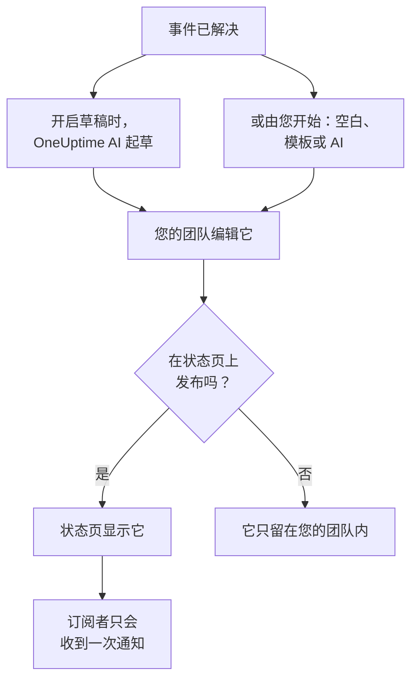

# 事后分析

事后分析是事件之后的复盘：发生了什么、为什么发生、给用户造成了什么损失，以及接下来要改变什么。在 OneUptime 中，您直接在事件上编写它。它可以从您自己的模板或 OneUptime AI 的草稿开始，也可以作为事件的收尾更新发布到您的状态页上。

:::cards
- [编写事后分析](#编写事后分析): 在事件的事后分析页面上，分五步完成。
- [从模板或 AI 草稿开始](#从模板或-ai-草稿开始): 使用您的大纲，或由 OneUptime AI 填写的大纲。
- [发布到状态页](#发布到状态页): 展示给客户，并只通知订阅者一次。
- [片段的事后分析](#片段的事后分析): 为一组事件写一份复盘。
:::

## 事后分析如何组成

事后分析由三部分组成，都在事件上：用 Markdown 编写的备注；附件，例如截图和报告；以及它是否显示在您的状态页上。它们位于事件侧边菜单 **调查** 下的 **事后分析** 页面上。

## 编写事后分析

:::steps
### 打开事后分析

打开事件，然后点击其侧边菜单中 **调查** 下的 **事后分析**。**事后分析备注** 卡片显示备注、附件，以及事后分析是否显示在状态页上。

### 点击编辑事后分析备注

**编辑事后分析备注** 对话框在第一步 **事后分析** 上打开。

### 编写备注并附加文件

用 Markdown 编写 **事后分析备注**：发生了什么、影响、如何解决以及后续行动。在 **事后分析附件** 下添加截图、报告或时间线。

### 选择是否发布

点击 **下一步**。在 **状态页** 步骤中，**在状态页上发布** 默认关闭，因此事后分析只留在您的团队内。要展示给客户，请参阅 [发布到状态页](#发布到状态页)。

### 保存事后分析

点击 **保存更改**。卡片会显示备注和附件。
:::

对备注的每次更改都会记录在事件的动态中，如果事件有 Slack 或 Microsoft Teams 频道，还会发布到该频道。只要事后分析尚未发布，状态页订阅者就不会收到任何相关消息。

编写事后分析需要 Project Owner、Project Admin、Project Member、Incident Admin 或 Incident Member 角色，或拥有 Edit Incident 权限的自定义角色。任何能读取事件的人都能读取它的事后分析。

## 从模板或 AI 草稿开始

卡片上的两个按钮可以为您填写备注：**Generate with AI**，以及在项目有事后分析模板后出现的 **应用模板**。两者都会打开与 **编辑事后分析备注** 相同的编辑器，备注已填好，事后分析的其余部分保持原样。在您点击 **保存更改** 之前不会保存任何内容，所以请先阅读并修改备注。

### 应用模板

项目有事后分析模板后，就会出现 **应用模板**。您可以在 **事件 → 设置 → 事后分析模板** 下创建模板：请参阅 [事后分析模板](/docs/incidents/settings#事后分析模板)。在 OneUptime Cloud 上，模板需要 Growth 套餐。

点击 **应用模板**，在 **应用事后分析模板** 对话框的 **选择模板** 下选择一个模板，然后点击 **应用模板**。如果项目只有一个模板，它已经被选中。

### 用 AI 生成

点击 **Generate with AI**。**Generate Postmortem with AI** 对话框在 **选择模板** 下提供大纲：**Standard Postmortem**、**Detailed Technical Postmortem** 或 **Brief Postmortem**，然后是您自己的事后分析模板。**Template Preview** 显示大纲，您可以在生成之前修改它。

点击对话框底部的 **Generate with AI**。OneUptime AI 会读取事件（它的描述、根本原因和修复、状态时间线、公开和私密备注，以及其 Slack 或 Microsoft Teams 频道中的消息），并按照您的大纲编写事后分析。随后编辑器会打开并显示结果。

生成需要在 **项目设置 → 人工智能 → AI Features** 下为项目打开 AI，并需要一个 LLM 提供商：请参阅 [LLM 提供商](/docs/ai/llm-provider)。它还需要 Project Owner 或 Project Admin 角色，或拥有 Edit Incident 权限的自定义角色：其他角色可以编写事后分析，但不能生成。

### 让 OneUptime AI 在事件解决时起草

打开 **事件解决后起草事后分析** 后，每当事件被解决，OneUptime AI 都会起草事后分析，将其保存为备注，并发布到事件的动态中供您的团队审阅。该开关位于 **事件 → 人工智能 → 设置**，新项目默认打开。

- 它从不替换已经写好的备注。
- 它从不写入已经发布的事后分析，否则草稿会未经审阅就出现在状态页上。
- 它需要为项目打开 AI，并且一旦项目达到每日 AI 限额，当天就会停止。请参阅 [自动事后分析](/docs/ai/ai-sre#自动事后分析)。

## 发布到状态页

已发布的事后分析是事件面向客户的收尾更新：状态页会显示备注，在事件时间线中突出显示，并附带可下载的附件。

:::steps
### 打开状态页步骤

点击 **编辑事后分析备注**，然后点击 **下一步** 进入 **状态页** 步骤。

### 打开在状态页上发布

打开 **在状态页上发布**。会再出现两个字段：默认打开的 **通知订阅者**，以及默认为当前时间的 **事后分析发布于**。

### 决定通知谁以及显示的时间

关闭 **通知订阅者** 即可发布而不通知订阅者。更改 **事后分析发布于** 可以在事后分析旁显示另一个时间。

### 发布

点击 **保存更改**。卡片现在会显示 **事后分析在状态页上可见？**、**通知订阅者**、**订阅者通知状态** 和 **事后分析发布于**。
:::

以下因素决定客户能否看到它、能否收到通知：

- **事件必须显示在状态页上。** 状态页只会在它显示的事件上显示事后分析：**在状态页面上可见** 已打开，且事件不是私密的。
- **备注必须有内容。** 用空备注发布的事后分析不会显示，也不会通知任何人。
- **订阅者只会收到一次通知**，即状态页第一次显示该事后分析时。再次保存，或在发布状态下编辑它，会更新页面但不通知任何人。取消发布后再次发布会再次通知他们。在事件隐藏时发布的事后分析，会在事件变为可见时发送。
- **“通知订阅者”在通知发出时才读取。** 在事后分析发布后再打开它，不会发送任何内容。

**订阅者通知状态** 显示通知是否已发出，失败时提供 **重试**。每种情况请参阅 [事后分析](/docs/status-pages/subscribers#事后分析)，另请参阅 [重试和重新发送](/docs/status-pages/subscribers#重试和重新发送)。

**事后分析发布于** 也是 **事后分析用时** 测量中事后分析被视为发布的时间：请参阅 [现成的测量](/docs/incidents/settings#现成的测量)。

## 片段的事后分析

事件片段也有一个 **事后分析** 页面，位于 **调查** 下：为片段中的所有事件写一份复盘。点击 **编辑事后分析** 来编写它。**应用模板** 和 **Generate with AI** 的作用与在事件上相同，AI 会读取片段及其成员事件。

片段的事后分析只有备注：它没有附件，也没有状态页显示它。片段解决时，OneUptime AI 不会自动起草。生成需要 Project Owner 或 Project Admin 角色，或拥有 Edit Incident Episode 权限的自定义角色。

警报和计划维护事件没有事后分析。

## 通过 API

事后分析是事件上的一组字段，与事件的其他部分一样通过 `/api/incident` 读写：

| 字段 | 含义 |
| --- | --- |
| `postmortemNote` | 备注，使用 Markdown。 |
| `showPostmortemOnStatusPage` | 事后分析是否已发布到您的状态页。初始为 `false`。 |
| `notifySubscribersOnPostmortemPublished` | 发布时是否通知订阅者。初始为 `true`。 |
| `postmortemPostedAt` | 状态页在它旁边显示的时间。 |

在已写好的 `postmortemNote` 上将 `showPostmortemOnStatusPage` 写为 `true` 会发布事后分析，与对话框的效果相同。

## 故障排除

:::details 卡片上没有应用模板
项目还没有事后分析模板，或者您的角色无法读取模板。请在 **事件 → 设置 → 事后分析模板** 下创建一个。在 OneUptime Cloud 上，模板需要 Growth 套餐。
:::

:::details Generate with AI 提示 AI 已关闭，或您没有权限
请在 **项目设置 → 人工智能 → AI Features** 下打开 AI。生成需要 Project Owner 或 Project Admin 角色，或拥有 Edit Incident 权限的自定义角色，即使对能编辑事后分析的人也是如此。
:::

:::details 事后分析没有显示在状态页上
检查三件事：**在状态页上发布** 已打开，备注不为空，并且事件显示在状态页上（**在状态页面上可见** 已打开，且不是私密的）。
:::

:::details 订阅者没有收到事后分析的通知
发布时 **通知订阅者** 是关闭的，或者事件是隐藏的：这种情况下，事件一变为可见就会发送。卡片上的 **订阅者通知状态** 会说明是哪种情况。
:::

:::details 事件解决时没有出现 AI 草稿
事件已经有备注、事后分析已经发布，或者 **事件解决后起草事后分析** 是关闭的。项目必须打开 AI，并且项目不能已达到每日 AI 限额。
:::

## 后续步骤

:::cards
- [事件概览](/docs/incidents/index): 事件的其他页面，从声明到解决。
- [事件设置与自动化](/docs/incidents/settings): 事后分析模板和事后分析用时测量。
- [订阅者与公告](/docs/status-pages/subscribers): 状态页告诉订阅者的一切。
- [AI SRE](/docs/ai/ai-sre): 事件之后 OneUptime AI 会自动做什么。
:::
