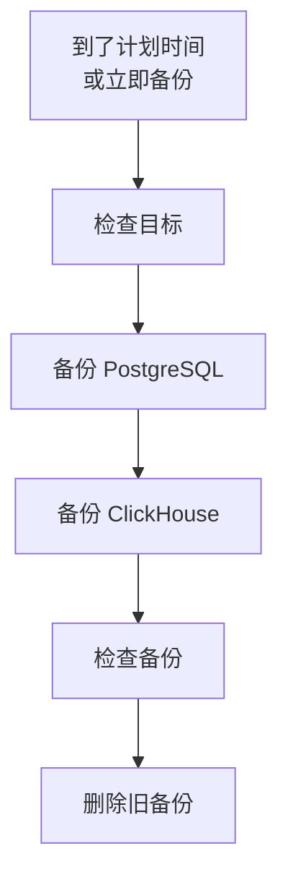

# 备份

按计划将自托管的 OneUptime 备份到你自己的存储中，并从 Admin Dashboard 恢复。备份包含 PostgreSQL（你的项目、监控器、事件、状态页和用户）和 ClickHouse（你的日志、追踪和指标）。备份按你选择的天数保留，较旧的备份会自动删除，任何备份都可以原地恢复。备份是企业版的功能。

:::cards
- [设置备份](#设置备份): 选择目标，测试它，并设定计划。
- [目标](#目标): 每个推荐目标需要提供什么。
- [恢复备份](#恢复备份): 哪些内容会被替换，以及如何保护当前数据。
- [迁移到新服务器](#迁移到新服务器): 在另一个安装中恢复一个安装的备份。
:::

## 备份的工作原理



- **一致。** PostgreSQL 在一个事务中导出，因此转储就是 OneUptime 继续运行期间某一时刻的数据库。ClickHouse 按读取每个表的数据部分时的状态备份该表。
- **直达目标。** `pg_dump` 的输出边写边流式传输到存储，ClickHouse 则自己将备份写入存储。无论数据多大，都不会写入服务器的磁盘。
- **经过检查。** 在备份算作完成之前，`pg_restore` 会从目标读回转储，并在那里找到 ClickHouse 为其备份留下的记录。转储的 SHA-256 与备份一起保存，恢复在替换任何内容之前都会先检查它。失败或被取消的备份会删除它已写入的内容，因此目标中只保存完整的备份。
- **经过加密。** 备份通过 HTTPS 传到存储，除非你输入的是 `http://` 端点。Amazon S3、Google Cloud Storage、Azure Blob Storage 和 Cloudflare R2 会加密其存储的所有内容；在其他存储上，请为存储桶开启静态加密。目标的凭据以加密形式保存，并且不会再次显示。
- **一次一个。** 整个安装同一时间只运行一个备份或恢复。其他的会排队等待。

每个备份都是目标文件夹（除非你另选，否则为 `oneuptime/backups/`）中的一个独立文件夹，以其开始时间（UTC）命名：

```text
oneuptime/backups/20261024T020000Z-3f2a9c1b/manifest.json
oneuptime/backups/20261024T020000Z-3f2a9c1b/postgres.dump
oneuptime/backups/20261024T020000Z-3f2a9c1b/clickhouse/
```

`manifest.json` 最后写入：它说明备份包含什么，以及由哪个版本的 OneUptime 创建。

## 开始之前

- **企业版**，以及包含备份功能的许可证。试用期和宽限期内备份会运行。没有许可证时不会创建新的备份，但恢复和删除备份仍然可用。请参阅[企业版](/docs/self-hosted/enterprise)。
- **主管理员。** 备份在 Admin Dashboard 中设置。
- **专用于备份的存储桶或容器**，以及可以在其中读取、写入、列出和删除的凭据。
- **ClickHouse 也能访问的目标。** ClickHouse 会自己将备份写入存储，因此它的网络必须能访问存储，就像 OneUptime 的网络一样。
- **要恢复 PostgreSQL，需要一个可以创建数据库的数据库用户。** 恢复会在运行中的数据库旁边新建一个数据库并写入。OneUptime 自带的 PostgreSQL 以超级用户身份连接，具备此权限。

## 设置备份

:::steps
### 打开备份页面

在 Admin Dashboard 中，前往 **设置 → 备份**，然后点击 **设置备份**。

### 选择备份存放的位置

选择一个推荐的目标。每个目标需要提供的内容见[目标](#目标)。

### 填写连接信息

填写目标要求的内容。文件夹、区域以及大多数人保持不变的设置位于 **更多字段** 下，**设置指南** 会打开本页上该目标的部分。

### 测试目标

点击 **测试目标**。OneUptime 会写入、读取、列出并删除一个小测试文件，检查 `pg_dump` 能否备份你的 PostgreSQL，并让 ClickHouse 写入其表定义的测试备份。不会保存任何内容，未通过的检查会说明需要更改什么。

### 选择备份运行的时间

选择 **频率** 和 **时间 (UTC)** 中的时间，每周备份还需选择 **星期几**。除非你更改，**备份保留天数** 为 30。关闭 **同时备份 ClickHouse** 即可只备份 PostgreSQL。

### 开始备份

点击 **开始备份**。第一次备份会在下一个计划时间运行，**立即备份** 则会立即开始一次备份。
:::

随后页面会显示备份的情况：上次备份何时运行、大小和耗时，以及下次备份何时运行。正在进行的备份会显示当前所处的步骤，**查看步骤** 会在运行时显示每个步骤。

## 目标

| 目标 | 存储 | 登录方式 |
| --- | --- | --- |
| [Amazon S3](#amazon-s3) | Amazon S3 | 访问密钥 |
| [Cloudflare R2](#cloudflare-r2) | S3 兼容存储 | R2 API 令牌 |
| [Backblaze B2](#backblaze-b2) | S3 兼容存储 | 应用程序密钥 |
| [Wasabi](#wasabi) | S3 兼容存储 | 访问密钥 |
| [MinIO](#minio) | S3 兼容存储 | 访问密钥 |
| [Google Cloud Storage](#google-cloud-storage) | Google Cloud Storage | HMAC 密钥 |
| [Azure Blob Storage](#azure-blob-storage) | Azure Blob Storage | SAS 令牌或访问密钥 |
| [其他 S3 兼容存储](#其他-s3-兼容存储) | S3 兼容存储 | 访问密钥 |

Amazon S3 或其他 S3 兼容存储的密钥需要对该文件夹拥有 `s3:PutObject`、`s3:GetObject`、`s3:ListBucket`、`s3:DeleteObject` 和 `s3:AbortMultipartUpload` 权限，不需要其他权限：

```json
{
  "Version": "2012-10-17",
  "Statement": [
    {
      "Effect": "Allow",
      "Action": "s3:ListBucket",
      "Resource": "arn:aws:s3:::my-backups"
    },
    {
      "Effect": "Allow",
      "Action": [
        "s3:PutObject",
        "s3:GetObject",
        "s3:DeleteObject",
        "s3:AbortMultipartUpload"
      ],
      "Resource": "arn:aws:s3:::my-backups/oneuptime/backups/*"
    }
  ]
}
```

### Amazon S3

| 字段 | 填写内容 |
| --- | --- |
| **存储桶** | 写入备份的存储桶。请仅将其用于备份。 |
| **区域** | 存储桶所在区域。初始为 `us-east-1`。 |
| **访问密钥 ID** | 具有上述权限的访问密钥。 |
| **秘密访问密钥** | 密钥的机密值。 |
| **文件夹** | 位于 **更多字段** 下。留空时，备份存放在 `oneuptime/backups/`。 |

Amazon S3 会加密它存储的每个文件，OneUptime 也会为写入的每个文件请求加密（SSE-S3）。

### Cloudflare R2

在 **端点** 中输入你帐户的 S3 API 地址 `https://<account-id>.r2.cloudflarestorage.com`，可在 R2 的存储桶设置中找到。然后输入 **存储桶**，以及可以在其中读写对象的 R2 API 令牌的 **访问密钥 ID** 和 **秘密访问密钥**。从 R2 读回备份不收费。

### Backblaze B2

在 **端点** 中输入存储桶的 S3 端点，它显示在 Backblaze 中该存储桶的 Buckets 页面上，例如 `https://s3.us-west-004.backblazeb2.com`。然后输入 **存储桶**，并将应用程序密钥的密钥 ID 和密钥分别填入 **访问密钥 ID** 和 **秘密访问密钥**。区域从端点中读取。

### Wasabi

在 **端点** 中输入存储桶所在区域的服务 URL，例如 `https://s3.us-east-1.wasabisys.com`，然后输入 **存储桶** 和访问密钥。区域从端点中读取。

### MinIO

在 **端点** 中输入你的 MinIO 服务器的 S3 API 地址，例如 `https://minio.example.com:9000`，然后输入 **存储桶** 和一个访问密钥，其策略允许在其中读取、写入、列出和删除。OneUptime 和 ClickHouse 都必须能访问该地址。

### Google Cloud Storage

输入 **存储桶**，以及对该存储桶具有 Storage Object Admin 角色的服务帐号的 **HMAC 访问密钥** 和 **HMAC 密钥**。在 Cloud Storage 设置的“互操作性”标签页中创建该密钥。OneUptime 和 ClickHouse 通过 Cloud Storage 的 S3 兼容 API 访问存储桶。

### Azure Blob Storage

输入 **存储账户** 和 **容器**，并在 **登录方式** 中选择登录方式：对该容器拥有读取、添加、创建、写入、删除和列出权限的 **SAS 令牌**，或存储帐户的 **访问密钥**。SAS 令牌可以限定在该容器内，因此是更安全的选择。**云** 和 **文件夹** 位于 **更多字段** 下。

### 其他 S3 兼容存储

对于 Ceph、DigitalOcean Spaces、Hetzner Object Storage 以及任何提供 S3 API 的存储，在 **端点** 中输入其 S3 地址，然后输入 **存储桶** 和访问密钥。位于 **更多字段** 下的 **区域** 仅在存储要求时才需要。留空时会从端点中读取，否则为 `us-east-1`。

## 计划与保留

| 设置 | 作用 |
| --- | --- |
| **频率** | **每小时**、**每 6 小时**、**每 12 小时**、**每天** 或 **每周**。大多数安装每天备份即可。 |
| **时间 (UTC)** | 备份开始的时间（UTC），旁边会显示你的本地时间。每 6 或 12 小时从此时间开始计算：设为 `02:00` 时，每 6 小时的备份在 02:00、08:00、14:00 和 20:00 运行。每小时的备份在整点运行。 |
| **星期几** | 每周备份运行的日子。 |
| **备份保留天数** | 1 到 3650 天。除非你更改，否则为 30 天。 |
| **同时备份 ClickHouse** | 除非你关闭，否则开启。PostgreSQL 始终会被备份。 |

每次备份完成后，开始于 **备份保留天数** 之前的备份会从目标和列表中删除，但最新的成功备份除外，无论它有多旧都会保留。因此，关闭备份或许可证过期都不会让你失去可恢复的备份。

状态卡片菜单中的 **关闭计划备份** 会停止计划。**立即备份** 仍然可用，也不会删除任何备份。**开启** 会重新开始计划。

## 恢复备份

:::warning 恢复会替换什么
恢复会用备份中的数据替换当前数据。除非先备份当前数据，否则自备份以来更改的所有内容都会丢失。
:::

:::steps
### 选择备份

在 **备份** 表中，点击要回到的备份上的 **恢复**。OneUptime 会先检查备份：其文件是否在目标中且未被更改、由哪个版本的 OneUptime 创建，以及此服务器能否恢复它。

### 选择要恢复的内容

勾选 **PostgreSQL：项目、监控器、事件、用户**、**ClickHouse：日志、追踪、指标** 或两者。对话框会显示备份中有多少项目、用户和监控器，以及当前有多少。

### 保护当前数据

**先备份当前数据** 已勾选：恢复会先备份它将替换的数据，以便你可以回到这些数据。只有在你有其他副本时才取消勾选，因为没有它，恢复将无法撤销。

### 确认

输入 `restore` 并点击 **恢复**。
:::

恢复会逐步运行，页面会显示每一步：

| 步骤 | 发生了什么 |
| --- | --- |
| **检查备份** | 备份的文件都在，并且此安装可以恢复它。 |
| **备份当前数据** | 备份当前数据，除非你取消了勾选。 |
| **恢复 PostgreSQL** | 将备份恢复到运行中数据库旁边的新数据库中，并进行检查。 |
| **恢复 ClickHouse** | 将运行中的遥测数据移到一旁，并在原位置恢复备份中的遥测数据。 |
| **切换到恢复后的数据** | 恢复后的数据库在片刻之间接替运行中数据库的名称。 |
| **将恢复的数据更新到最新** | 在恢复后的数据上运行此版本的数据库迁移。 |
| **清理** | 删除被移到一旁的内容。 |

在切换之前，OneUptime 会继续使用当前数据运行，在此之前它使用的任何东西都不会改变。在切换前失败或被取消的恢复会保持一切原样，在切换期间失败的恢复会把移到一旁的内容放回原处。恢复 ClickHouse 期间收到的遥测数据不会被存储。PostgreSQL 恢复后你可能会被登出：请使用备份中存在的帐户登录。

:::details 恢复提示备份是使用另一个 ENCRYPTION_SECRET 创建的
OneUptime 存储的凭据（例如目标的密钥）使用 `ENCRYPTION_SECRET` 加密。恢复之前，请设置创建该备份时使用的 `ENCRYPTION_SECRET`，否则之后将无法读取这些凭据。
:::

## 迁移到新服务器

:::steps
### 在新服务器上安装 OneUptime

安装企业版，版本应为创建这些备份的版本或更新的版本。

### 设置相同的目标

在 **设置 → 备份** 中，设置备份所在的目标。页面会找到那里已有的备份并列出，随时可以恢复。状态卡片菜单中的 **查找备份** 会重新查找。

### 恢复最新的备份

按上述步骤恢复。由较旧版本的 OneUptime 创建的备份会升级到此版本。由较新版本创建的备份，在你更新后即可恢复。
:::

## 备份失败时

状态卡片会显示 **上次备份失败** 以及错误信息，**查看步骤** 会显示它停在哪一步以及原因。每位主管理员还会收到一封电子邮件，在备份持续失败期间最多每 12 小时一封。恢复失败时总会发送电子邮件。

## 故障排除

:::details ClickHouse 无法访问目标
ClickHouse 会自己连接到存储。请让它的网络能够访问目标地址，就像 OneUptime 的网络一样，然后重新测试目标。
:::

:::details pg_dump 缺失或版本过旧
企业版镜像包含 `pg_dump` 和 `pg_restore` 16、17 和 18，可以备份 PostgreSQL 18 及之前的所有版本。在其他镜像上，请安装 PostgreSQL 客户端工具，或将 `BACKUP_POSTGRES_BIN_DIR` 设置为包含这些工具的目录。`pg_dump` 的版本必须不低于你的 PostgreSQL 服务器。
:::

:::details 恢复 PostgreSQL 需要一项更改
恢复会创建数据库，OneUptime 的数据库用户必须有此权限。以超级用户身份在 PostgreSQL 上运行以下命令（将 `oneuptime` 替换为你的 `DATABASE_USERNAME`），然后重新恢复：

```sql
ALTER USER oneuptime CREATEDB;
```
:::

:::details 备份位于之前的目标
更改目标后，在旧目标中创建的备份仍留在列表中，并标记为 **位于之前的目标**。重新设置该目标即可恢复其中一个，也可以将其从列表中删除：它的文件会留在原处。
:::

## 后续步骤

:::cards
- [企业版](/docs/self-hosted/enterprise): 许可证，以及企业版增加的功能。
- [升级](/docs/installation/upgrading): 每次升级前都先备份。
- [Docker Compose](/docs/installation/docker-compose): 在一台服务器上运行 OneUptime。
:::
