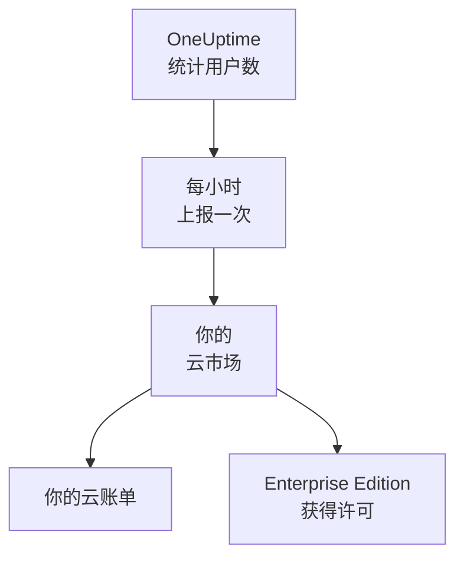

# 云市场

在 AWS Marketplace、Microsoft Marketplace 或 Google Cloud Marketplace 上购买 OneUptime Enterprise，并在你自己的 Kubernetes 集群中运行它。云市场按小时为你的安装中的每位用户计费，费用计入你的云账单；你的订阅就是 Enterprise Edition 的许可证，无需激活任何许可证密钥。

:::cards
- [安装 OneUptime](#安装-oneuptime): 在 Amazon EKS、Azure Kubernetes Service 或 Google Kubernetes Engine 上安装。
- [计费方式](#计费方式): 每位用户每小时 USD 0.10，每小时上报一次。
- [升级](#升级): 你的集群如何获得新版本。
- [故障排除](#故障排除): 版本标签发出与云市场有关的警告时。
:::

## 工作原理

OneUptime 每 15 分钟统计一次用户数，并把每个小时上报给你购买它的云市场：每个小时只上报一次，按该小时内统计到的最多用户数计算。云市场把这个小时计入你的云账单。云市场接受的每次上报也会告诉 OneUptime 你的订阅仍然有效，从而让 Enterprise Edition 持续获得许可。



| | AWS | Microsoft | Google Cloud |
| --- | --- | --- | --- |
| 商品页面 | 尚未公开：[联系我们](https://oneuptime.com/enterprise/demo) | [OneUptime Enterprise](https://marketplace.microsoft.com/en-us/product/oneupitme.oneuptime-enterprise) | 尚未公开：[联系我们](https://oneuptime.com/enterprise/demo) |
| 运行平台 | Amazon EKS | Azure Kubernetes Service (AKS) | Google Kubernetes Engine (GKE) |
| 安装方式 | Helm，从该商品的镜像仓库安装 | Azure 门户 | Google Cloud 控制台 |
| OneUptime 上报时使用 | 其 Kubernetes 服务账号的 IAM 角色 | Azure 为该安装提供的托管标识 | Google Cloud Marketplace 为该部署创建的上报 Secret |
| 新版本 | 由你用 Helm 升级 | 次要版本会自动为你安装 | 由你手动升级 |

## 开始之前

- **一个 Kubernetes 集群**，运行在该云市场所属的云上，至少有 3 个节点，每个节点 4 个 vCPU、16 GiB 内存，配有默认 StorageClass，并支持 `LoadBalancer` 类型的服务。OneUptime 在集群中运行自己的 PostgreSQL、ClickHouse 和 Valkey；请参阅[规模与容量规划](/docs/installation/sizing)为它们确定规模。
- **一个供 OneUptime 使用的域名**，例如 `oneuptime.example.com`，并且你能把它指向集群的负载均衡器。
- **出站 HTTPS**，让集群能够访问云市场，以便 OneUptime 上报用户数：AWS 上为 `metering.marketplace.<region>.amazonaws.com` 和 `sts.<region>.amazonaws.com`，Azure 上为 `marketplaceapi.microsoft.com`，Google Cloud 上为 `servicecontrol.googleapis.com` 和 `oauth2.googleapis.com`。

## 安装 OneUptime

### AWS Marketplace

在 AWS 上，OneUptime 使用 EKS 赋予其 Kubernetes 服务账号的 IAM 角色上报用户数（即“服务账号的 IAM 角色”功能）。对于来自 EKS 的用量，AWS Marketplace 只接受以这种方式签名的上报。

:::steps
1. 在 AWS Marketplace 上订阅 OneUptime Enterprise，然后选择 **Continue to Configuration**，选好版本，再选择 **Continue to Launch**。
2. 如果集群还没有 IAM OIDC 提供商，请为它创建一个，然后用下面的命令创建 `oneuptime` 服务账号，以及带有 `AWSMarketplaceMeteringFullAccess` 策略的 IAM 角色。请用这些命令代替启动页面 **General launch instructions** 第 1 步中的 `eksctl` 命令：那条命令关联的是一个你得先自己创建的角色。
3. 使用 **General launch instructions** 第 2 步中的命令，让 Helm 登录该商品的镜像仓库并安装 chart。在 `helm install` 命令中，把 `serviceAccount.name` 设为 `oneuptime`，把 `host` 设为你的域名；如果 OneUptime 前面有证书，再把 `httpProtocol` 设为 `https`。
4. [打开 OneUptime](#打开-oneuptime)。
:::

```bash
eksctl utils associate-iam-oidc-provider --cluster <cluster> --approve
eksctl create iamserviceaccount --name oneuptime --namespace oneuptime --cluster <cluster> \
  --attach-policy-arn arn:aws:iam::aws:policy/AWSMarketplaceMeteringFullAccess \
  --approve --override-existing-serviceaccounts
```

请把第 3 步的这些值保存到一个文件里，每次运行 `helm upgrade` 时都传入它：

```yaml title="values.yaml"
host: oneuptime.example.com
httpProtocol: https
serviceAccount:
  name: oneuptime
```

### Microsoft Marketplace

在 Azure 上，OneUptime 是一个 Kubernetes 应用：AKS 将它作为集群扩展安装，并为它提供用于上报用户数的托管标识。

:::steps
1. 在 Azure 门户中打开 Microsoft Marketplace 上的 OneUptime Enterprise，或者打开你的 AKS 集群并选择 **Extensions + applications** > **Add**，然后选择套餐，再选择 **Create**。
2. 选择订阅和资源组，并选择是安装到现有的 AKS 集群上，还是新建一个集群。
3. 在 **OneUptime** 步骤中，输入安装的名称、你的域名及其协议。
4. 选择 **Review + create**，然后选择 **Create**。安装需要几分钟；当 **Extensions + applications** 显示其预配状态为 **Succeeded** 时，安装即完成。
5. [打开 OneUptime](#打开-oneuptime)。
:::

自定义计量适用于 AKS 集群，而不适用于已启用 Azure Arc 的 Kubernetes，因此 Microsoft Marketplace 上的 OneUptime Enterprise 只能安装在 AKS 上。

### Google Cloud Marketplace

在 Google Cloud 上，Marketplace 会运行一个部署程序，把 OneUptime 连同它上报用户数所用的上报 Secret 一起安装到你选择的命名空间中。

:::steps
1. 在 Google Cloud 控制台中打开 Google Cloud Marketplace 上的 OneUptime Enterprise，然后选择 **Configure**。
2. 选择 GKE 集群和命名空间，然后输入安装的名称、你的域名及其协议。
3. 选择 **Deploy**。部署需要几分钟；当该应用在 **Kubernetes Engine** > **Applications** 下显示为就绪时，部署即完成。
4. [打开 OneUptime](#打开-oneuptime)。
:::

## 打开 OneUptime

OneUptime 启动时会先迁移数据库，在新安装上这需要几分钟。然后把你的域名指向它的负载均衡器：

```bash
kubectl get service --namespace <namespace>
```

名称以 `-nginx` 结尾的服务有一个 `EXTERNAL-IP`：为你的域名创建一条指向它的 DNS 记录。打开该域名并注册。新安装上的第一个账号会成为它的主管理员，可以在 `/admin` 打开管理员仪表板。

一小时之内，版本标签就会显示 Enterprise Edition，并注明通过你的云市场获得许可。主管理员可以在管理员仪表板的页眉和 Dashboard 的页脚看到版本标签。

## 计费方式

| 项目 | 说明 |
| --- | --- |
| 价格 | 每位用户每小时 USD 0.10，约合每位用户每月 USD 73。 |
| 计入的用户 | 在该安装上拥有 OneUptime 登录账号的每个人。状态页订阅者以及登录私有状态页的人不计入。 |
| 计费时间 | OneUptime 每 15 分钟统计一次用户数，每个小时只上报一次，按该小时内统计到的最多用户数计算。OneUptime 没有运行的小时不计费。 |
| 计费位置 | 通过云市场，计入你的 AWS、Azure 或 Google Cloud 账单。 |
| 不包含 | 集群本身：你的云照常对它的节点、磁盘和负载均衡器计费。 |

每个安装单独计费，因此预发布环境的安装也会计费。如需年度定价、批量折扣或非生产环境安装的价格，请向 [sales@oneuptime.com](mailto:sales@oneuptime.com) 申请私有报价，然后在云市场上接受该报价。

如果因为网络问题或云市场故障而无法发送上报，OneUptime 会在下一次运行时重新发送。每次上报都带有对应该小时的唯一标识，因此同一个小时绝不会被计费两次。

## 许可方式

你的云市场订阅就是你的许可证。云市场接受的每次上报，都会在接下来的 72 小时内为所有用户授予所有企业功能的许可。OneUptime 提供的许可证密钥同样可以用于同一个安装：安装会按两者中更好的那个运行。

| 发生的情况 | 版本标签显示的内容 |
| --- | --- |
| 云市场接受每小时的上报 | Enterprise Edition，并注明通过你的云市场获得许可。 |
| 72 小时内没有任何上报被接受 | **Enterprise Edition (Marketplace Reports Failing)**：所有企业功能在 30 天宽限期内继续工作。 |
| 云市场表示该安装没有订阅，或者宽限期结束 | **Enterprise Edition (Marketplace Subscription Ended)**：企业功能停止，与[许可证失效](/docs/self-hosted/enterprise#许可证过期或缺失时)时一样。 |

云市场拒绝的是已取消或已暂停的订阅，以及并非你所购买的那个安装。在任何情况下，监控、告警、事件、值班和状态页都会继续工作，也不会删除任何内容。重新订阅后，下一次被接受的上报会再次为 Enterprise Edition 提供许可，无需重启。

## 升级

| 云市场 | 你的集群如何获得新版本 |
| --- | --- |
| AWS Marketplace | 每个版本都是该商品的一个新版本。使用该商品镜像仓库中的 chart、新版本和你的 values 文件运行 `helm upgrade`。 |
| Microsoft Marketplace | AKS 会为你安装新的次要版本和补丁版本。新的主要版本会等到你接受后才安装。你可以在 **Extensions + applications** 中该安装的页面上关闭自动升级。 |
| Google Cloud Marketplace | Google Cloud Marketplace 会让部署保持在它安装时的版本，从不更新它。把部署迁移到新版本之前，请联系[支持团队](https://oneuptime.com/support)。 |

新版本启动时，OneUptime 会迁移数据库。升级到新的主要版本之前，请阅读[升级说明](/docs/installation/upgrading)。

请通过云市场升级。从云市场安装的实例不会与 GitHub 上的 OneUptime 版本进行比较：你的云市场提供的版本，就是应升级到的版本。

## 设置与扩缩

你的账单不会随规模变化：OneUptime 按用户计费。更多的副本或更大的节点，只会改变你的云为集群收取的费用。

| 云市场 | 设置所在的位置 |
| --- | --- |
| AWS Marketplace | 你的 values 文件。[Helm chart](https://artifacthub.io/packages/helm/oneuptime/oneuptime) 的所有设置都可以使用，内置的 operator 除外。 |
| Microsoft Marketplace | 该安装的配置设置，位于它在 **Extensions + applications** 中的页面上，也可以用 `az k8s-extension update --configuration-settings` 修改。每项设置都是一个 chart 值，例如 `autoscaling.enabled=true`。 |
| Google Cloud Marketplace | 部署表单中的字段。其他任何设置都请用 `kubectl` 在该部署自己的资源上修改。 |

- **扩缩 OneUptime**：使用 chart 的副本和自动扩缩设置（`deployment.replicaCount`、`autoscaling.enabled`，以及每个服务自己的覆盖设置），节点则交给集群的自动扩缩器。
- **不要改动商品设定的云市场设置**：`enterpriseMarketplace`，以及 AWS 上的 `serviceAccount`。没有它们，OneUptime 就无法上报，Enterprise Edition 也得不到许可。
- **不包含 KEDA、CloudNativePG 和 Altinity ClickHouse operator**，因为云市场只交付其商品中列出的镜像。如需高可用的数据存储，请用 `externalPostgres`、`externalRedis` 和 `externalClickhouse` 让 OneUptime 指向托管服务。

计费与运行多少个副本无关：同一时间只有一次运行负责上报，每个小时也只有一份上报。

## 故障排除

:::details 版本标签显示 Enterprise Edition (Marketplace Reports Failing)
OneUptime 无法向云市场上报。它记录的每一行相关日志都以 `OneUptime Enterprise marketplace billing` 开头；说明用量“cannot be reported”的那一行会指出缺少什么。常见原因：

- **AWS：** `oneuptime` 服务账号没有 IAM 角色，或者该角色没有 `AWSMarketplaceMeteringFullAccess` 策略（只有 `AWSMarketplaceMeteringRegisterUsage` 不够）。请把该策略关联到这个角色，或者用 [AWS Marketplace](#aws-marketplace) 中的 `eksctl` 命令创建角色，然后用 `kubectl rollout restart deployment --namespace oneuptime` 重启 OneUptime 的 Pod。
- **Azure：** 该安装不是 Microsoft Marketplace 应用，例如它是用 Helm 安装的，因此没有可用于上报的标识或套餐。请从 Azure 门户安装它。
- **Google Cloud：** 该部署的上报 Secret 被删除或替换了。
- **所有云市场：** 防火墙或代理阻止了[开始之前](#开始之前)中列出的出站 HTTPS。

在你修复问题期间，用量会被保留，等 OneUptime 能够再次上报后再计费。超过 30 天的用量不会计费。
:::

:::details 版本标签显示 Enterprise Edition (Marketplace Subscription Ended)
云市场拒绝了该安装：订阅已被取消或暂停，或者该安装不是在云市场上购买的那个。请在云市场上检查订阅并重新订阅；下一次被接受的上报会再次为 Enterprise Edition 提供许可。如果上报在整个宽限期内一直失败，也会显示同样的标签。
:::

:::details 安装后 Pod 一直处于 Pending 状态
OneUptime 的数据库需要持久卷。请为集群设置默认 StorageClass：在 Amazon EKS 上，安装 Amazon EBS CSI 驱动程序附加组件。
:::

## 后续步骤

:::cards
- [企业版](/docs/self-hosted/enterprise): Enterprise Edition 增加了什么，以及许可证失效时会停止什么。
- [升级](/docs/installation/upgrading): 每个版本的升级说明。
- [规模与容量规划](/docs/installation/sizing): 根据你的遥测数据确定数据存储的规模。
- [架构](/docs/self-hosted/architecture): 你的集群中运行着什么。
- [Kubernetes 代理](/docs/telemetry/kubernetes-agent#作为-amazon-eks-附加组件安装): 也可作为 Amazon EKS 附加组件在 AWS Marketplace 上免费获取，适用于向 OneUptime 发送数据的集群。
:::
