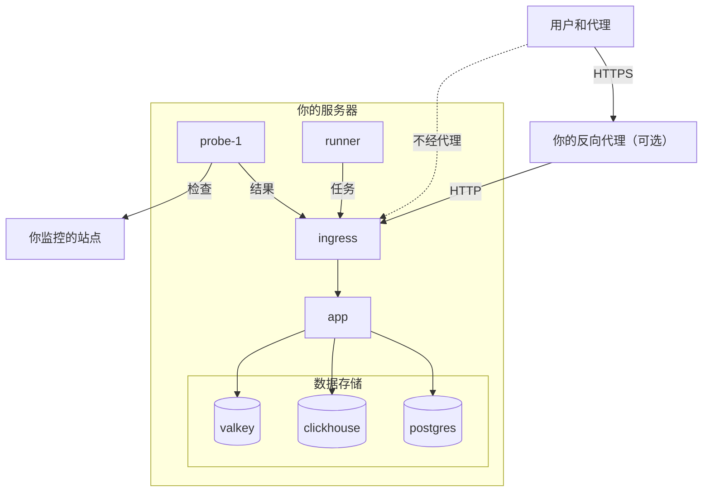

# Docker Compose

使用 Docker Compose 在一台 Linux 服务器上运行一个完整、免费的 OneUptime 实例。本页带你从一台全新的服务器走到一个运行中的实例，然后介绍 HTTPS、生产环境加固、备份、更新和卸载。

:::cards
- [安装 OneUptime](#安装-oneuptime): 从全新服务器到第一个账号，共六步。
- [设置 HTTPS](#设置-https): 让 OneUptime 获取证书，或在前面放置你自己的代理。
- [生产环境检查清单](#生产环境检查清单): 真实流量到来之前需要确定的事项。
- [更新 OneUptime](#更新-oneuptime): 升级到最新版本。
:::

## 工作原理

Docker Compose 把 OneUptime 的每个部分作为容器运行在你的服务器上。所有流量都从 `ingress` 容器进入，再由它路由到 `app`。应用把数据保存在 PostgreSQL、ClickHouse 和 Valkey 中。内置的探针执行监控器的检查，并通过 ingress 回报结果。



| 服务 | 镜像 | 作用 |
| --- | --- | --- |
| `ingress` | `oneuptime/nginx` | 接收端口 80 和 443 上的所有流量，并路由到应用。当 OneUptime 管理证书时提供 HTTPS。 |
| `app` | `oneuptime/app` | 仪表板、API、状态页面、遥测数据接收和后台任务进程。 |
| `probe-1` | `oneuptime/probe` | 执行监控器检查的全局探针。它使用主机网络。 |
| `runner` | `oneuptime/runner` | 实例的 Runner，负责执行 AI 代码修复。它使用主机网络。 |
| `postgres` | `postgres:15` | 配置和状态：监控器、事件、用户。保存在 `postgres` 卷中。 |
| `clickhouse` | `clickhouse/clickhouse-server:26.7` | 遥测数据：日志、指标、追踪和异常。保存在 `clickhouse` 卷中。 |
| `valkey` | `valkey/valkey:9.1-alpine` | 缓存和队列。它不在磁盘上保存任何数据。 |

> [!NOTE]
> `valkey` 服务运行 [Valkey](https://valkey.io)，即 Redis 7.2 的 BSD 许可分支，通过 `config.env` 中的 `VALKEY_*` 设置进行配置。任何支持 Redis 协议的服务器都可以使用——如果你愿意，可以把 `VALKEY_HOST` 指向托管的 Redis。这些设置在 13.0.0 之前名为 `REDIS_*`；旧名称仍然会被读取，容器仍然响应主机名 `redis`，而且 `npm run update` 不会改写它们，因此较旧的 `config.env` 无需修改。

对于大规模生产环境，或需要高可用性时，请改用 Kubernetes 上的 [Helm chart](https://artifacthub.io/packages/helm/oneuptime/oneuptime)：Docker Compose 在一台服务器上为每个服务只运行一个副本。

## 要求

根据要在服务器上运行的内容选择服务器规格。决定内存和磁盘用量的是遥测数据（日志、指标、追踪）；了解数据量后，请参阅 [规模与容量规划](/docs/installation/sizing)。

| | 推荐 | 家庭实验室最低配置 |
| --- | --- | --- |
| **内存** | 16 GB | 8 GB |
| **CPU** | 8 核 | 4 核 |
| **磁盘** | 400 GB | 20 GB |
| **系统** | Ubuntu 22.04，或其他基于 Debian、Ubuntu 或 RHEL 的 Linux | 相同 |
| **架构** | x86-64（`amd64`）或 ARM（`arm64`） | 相同 |

家庭实验室最低配置适合个人和实验用途——有些用户在 Raspberry Pi 上运行 OneUptime。

你还需要：

- **Docker** 以及 **Docker Compose v2** 插件（即 `docker compose` 命令）。
- **Git**，用于获取 OneUptime。
- **Node.js 和 npm**，用于运行封装 Docker Compose 的 `npm start` 和 `npm run update` 脚本。
- 服务器上**空闲的端口 80 和 443**。下表列出了 OneUptime 在主机上使用的每个端口。

| 主机端口 | 使用者 | 设置 | 用途 |
| --- | --- | --- | --- |
| 80 | `ingress` | `ONEUPTIME_HTTP_PORT` | 仪表板、API、遥测数据接收和 Let's Encrypt 验证。 |
| 443 | `ingress` | `STATUS_PAGE_HTTPS_PORT` | 当 OneUptime 管理证书时为实例提供 HTTPS，并为自定义域名上的状态页面和仪表板提供 HTTPS。 |
| 5400 | `postgres` | 在 `docker-compose.yml` 中设置 | 让 `npm run backup` 能访问 PostgreSQL。不要向互联网开放。 |
| 3874 | `probe-1` | `GLOBAL_PROBE_1_PORT` | 探针自身的服务器。服务器之外不需要访问它。 |
| 3876 | `runner` | `ONEUPTIME_RUNNER_PORT` | Runner 自身的服务器。服务器之外不需要访问它。 |

另有一个安装过程的 [视频演示](https://youtu.be/j1SWmMW2oL4)。

## 安装 OneUptime

:::steps
### 克隆 release 分支

`release` 分支包含最新版本的文件。

```bash
git clone --depth 1 --single-branch --branch release https://github.com/OneUptime/oneuptime.git
cd oneuptime
```

### 创建 config.env

OneUptime 的所有设置都在 `config.env` 中。从示例文件开始：

```bash
cp config.example.env config.env
```

### 设置主机名

打开 `config.env`，把 `HOST` 设为人们访问 OneUptime 时使用的域名或 IP 地址，不要带 `http://`。只有在自己的电脑上试用 OneUptime 时才保留 `localhost`。

```ini title="config.env"
HOST=oneuptime.example.com
```

### 生成随机密钥

示例文件中附带的占位密钥在 GitHub 上是公开的。把每一个都替换成各自的随机值：

```bash
while grep -q "please-change-this-to-random-value" config.env; do
  sed -i "0,/please-change-this-to-random-value/{s/please-change-this-to-random-value/$(openssl rand -hex 32)/}" config.env
done
grep -c "please-change-this" config.env
```

最后一条命令输出 `0`：说明没有剩下任何占位值。这个循环使用 GNU `sed`，每台 Linux 服务器都有。它会填入以下设置：

| 设置 | 保护的内容 |
| --- | --- |
| `ONEUPTIME_SECRET` | OneUptime 自身服务之间的调用。 |
| `ENCRYPTION_SECRET` | OneUptime 存储的密钥（如集成令牌和 SMTP 密码），以及它签发的登录令牌。 |
| `DATABASE_PASSWORD`、`CLICKHOUSE_PASSWORD`、`VALKEY_PASSWORD` | 三个数据存储。 |
| `REGISTER_PROBE_KEY` | 向你的实例注册探针。 |
| `GLOBAL_PROBE_1_KEY`、`GLOBAL_PROBE_2_KEY` | Docker Compose 可以运行的全局探针（默认运行 `probe-1`）。 |
| `ONEUPTIME_RUNNER_KEY` | 内置的 Runner。 |

> [!IMPORTANT]
> 请在首次启动前设置这些密钥，并在之后保持不变。PostgreSQL 只在创建数据库时采用密码，而之后更改 `ENCRYPTION_SECRET` 会让所有用旧密钥加密的值都无法读取。

### 启动 OneUptime

:::tabs
@tab npm
```bash
npm start
```
@tab Docker CLI
```bash
(export $(grep -v '^#' config.env | xargs) && docker compose up --remove-orphans -d)
```
:::

首次启动需要几分钟：Docker 要下载镜像，OneUptime 要创建数据库。`npm start` 会等待每个部分都有响应，最后输出 **OneUptime is up!**

### 创建第一个账号

打开 `http://` 加上你的 `HOST`（例如 `http://localhost`）并注册。新实例上的第一个账号会成为它的主管理员，可以在 `/admin` 打开 Admin Dashboard。

在你之后，任何能访问该页面的人都可以注册。要阻止这一点，请打开 Admin Dashboard，前往 **设置 > 认证**，然后关闭 **允许注册**。你邀请加入项目的人仍然可以创建账号。
:::

## 设置 HTTPS

在你选择以下两种添加 HTTPS 的方式之一前，OneUptime 只提供普通 HTTP：

| | 让 OneUptime 获取证书 | 使用你自己的反向代理 |
| --- | --- | --- |
| **TLS 终止于** | OneUptime 的 `ingress`，使用它自动续期的免费 Let's Encrypt 证书 | 你的代理：Caddy、Nginx 或负载均衡器 |
| **你需要** | 一个指向该服务器的公共域名，以及可从互联网访问的端口 80 和 443 | 一个代理，以及你的域名的证书 |
| **设置** | `PROVISION_SSL=true`、`HTTP_PROTOCOL=https` | `PROVISION_SSL=false`、`HTTP_PROTOCOL=https`、`TRUSTED_PROXY_HOPS=2` |
| **自定义域名上的状态页面** | 无需额外设置即可工作 | 你的代理也必须为这些域名提供服务 |

如果你把状态页面或仪表板放在自定义域名上，让 OneUptime 处理 TLS 是更简单的方案：ingress 会自己申请并提供这些域名的证书。

### 让 OneUptime 获取证书

:::steps
#### 将域名指向服务器

为你的域名创建一条 DNS `A` 记录（IPv6 用 `AAAA`），值为服务器的公网 IP 地址。

#### 开启证书申请

在 `config.env` 中设置以下值：

```ini title="config.env"
HOST=oneuptime.example.com
PROVISION_SSL=true
HTTP_PROTOCOL=https
```

`HOST` 必须是域名：OneUptime 无法为 IP 地址或 `localhost` 获取证书。

#### 使用新设置重新启动

```bash
npm start
```

#### 通过 HTTPS 打开你的实例

打开 `https://oneuptime.example.com`。OneUptime 在启动时申请证书，之后每小时检查一次，并在剩余有效期少于 30 天时续期。在第一张证书到来之前（通常在几分钟内），ingress 会提供一张临时的自签名证书，浏览器会发出警告。
:::

### 使用你自己的反向代理

以下步骤在与 OneUptime 相同的服务器上运行代理。如果你的代理运行在另一台机器上，请跳过第一步，并把代理指向这台服务器的端口 80。

:::steps
#### 将 ingress 移出端口 80 和 443

代理需要端口 80 和 443，所以要把 ingress 移到其他端口。探针和 Runner 使用主机网络，通过 `http://localhost` 访问 OneUptime，因此它们也要一起调整：

```ini title="config.env"
ONEUPTIME_HTTP_PORT=8080
STATUS_PAGE_HTTPS_PORT=8443
GLOBAL_PROBE_1_ONEUPTIME_URL=http://localhost:8080
ONEUPTIME_RUNNER_ONEUPTIME_URL=http://localhost:8080
```

#### 告诉 OneUptime 它位于代理之后

```ini title="config.env"
HOST=oneuptime.example.com
HTTP_PROTOCOL=https
PROVISION_SSL=false
TRUSTED_PROXY_HOPS=2
```

`HTTP_PROTOCOL=https` 让 OneUptime 生成的链接使用 HTTPS。`TRUSTED_PROXY_HOPS=2` 把你的代理和 OneUptime 的 ingress 都计算在内，这样 OneUptime 会在 IP 允许列表和速率限制中读取访问者的真实地址。每多一层会追加 `X-Forwarded-For` 的代理（例如 CDN 或负载均衡器），就再加一。

#### 在新端口上重新启动 OneUptime

```bash
(export $(grep -v '^#' config.env | xargs) && docker compose up --remove-orphans -d)
bash Tests/Scripts/status-check.sh localhost:8080
```

`npm start` 检查的是端口 80 上的 `http://localhost`，而那里将是你的代理，所以请自己检查新端口。脚本最后输出 **OneUptime is up!**

#### 配置代理

:::tabs
@tab Caddy
```text title="Caddyfile"
oneuptime.example.com {
	reverse_proxy localhost:8080
}
```
Caddy 会自己获取并续期证书，把 HTTP 重定向到 HTTPS，并放行 WebSocket 连接。修改文件后请重新加载 Caddy，例如使用 `sudo systemctl reload caddy`。
@tab Nginx
```nginx title="/etc/nginx/conf.d/oneuptime.conf"
map $http_upgrade $oneuptime_connection_upgrade {
    default upgrade;
    ""      close;
}

server {
    listen 80;
    server_name oneuptime.example.com;
    return 301 https://$host$request_uri;
}

server {
    listen 443 ssl;
    server_name oneuptime.example.com;

    ssl_certificate     /etc/letsencrypt/live/oneuptime.example.com/fullchain.pem;
    ssl_certificate_key /etc/letsencrypt/live/oneuptime.example.com/privkey.pem;

    # The limits OneUptime's own ingress uses.
    client_max_body_size 50M;
    proxy_read_timeout 300s;
    proxy_send_timeout 300s;

    proxy_http_version 1.1;
    proxy_set_header Host $host;
    proxy_set_header X-Forwarded-For $proxy_add_x_forwarded_for;
    proxy_set_header X-Forwarded-Proto $scheme;
    proxy_set_header Upgrade $http_upgrade;
    proxy_set_header Connection $oneuptime_connection_upgrade;

    location / {
        proxy_pass http://127.0.0.1:8080;
    }

    # MCP clients keep a stream open.
    location /mcp {
        proxy_pass http://127.0.0.1:8080;
        proxy_buffering off;
        proxy_read_timeout 86400s;
        proxy_send_timeout 86400s;
    }
}
```
证书路径是 Certbot 存放 Let's Encrypt 证书的位置；如果你的证书来自其他地方，请使用它自己的路径。使用 `sudo nginx -t && sudo systemctl reload nginx` 检查文件并重新加载 Nginx。
:::

#### 通过代理打开你的实例

打开 `https://oneuptime.example.com`。你应该会看到 OneUptime 的登录页面，使用的是你的代理的证书。
:::

> [!NOTE]
> 在你自己的代理之后，请通过 OTLP/HTTP（`/otlp`）发送遥测数据。只有当 OneUptime 自己的 ingress 终止 TLS 时（`PROVISION_SSL=true`），通过 gRPC 的 OTLP 才能到达 OneUptime。

## 生产环境检查清单

Docker Compose 在一台服务器上为每个服务只运行一个副本，适合小团队和家庭实验室。在依赖它之前，请逐项检查这份清单。

| 方面 | 要做的事 |
| --- | --- |
| **密钥** | `config.env` 中没有任何值仍是 `please-change-this-to-random-value` 占位值。请参阅 [生成随机密钥](#生成随机密钥)。 |
| **HTTPS** | 人们通过 HTTPS 访问 OneUptime，并且已设置 `HTTP_PROTOCOL=https`。请参阅 [设置 HTTPS](#设置-https)。 |
| **注册** | 团队成员都有账号后，在 Admin Dashboard 的 **设置 > 认证** 下关闭 **允许注册**。 |
| **防火墙** | 只有端口 80 和 443（以及 SSH）对互联网开放。PostgreSQL 为了备份发布在端口 5400 上：请用云服务商的防火墙关闭它，因为 `ufw` 规则不适用于 Docker 发布的端口。 |
| **备份** | 每天备份 PostgreSQL，并把副本移出服务器。请参阅 [备份与恢复](#备份与恢复)。 |
| **电子邮件** | 已在 Admin Dashboard 的 **设置 > 通知 > 电子邮件** 下设置邮件服务器，以便 OneUptime 发送邀请和通知。请参阅 [SMTP](/docs/emails/smtp)。 |
| **磁盘** | 持续关注剩余空间。ClickHouse 会随保留的遥测数据增长（请参阅 [规模与容量规划](/docs/installation/sizing)）；每个容器的日志上限为 1000 MB。 |
| **更新** | 至少每周更新一次 OneUptime。新版本发布频繁。请参阅 [更新 OneUptime](#更新-oneuptime)。 |
| **高可用性** | 如果需要，请迁移到 Kubernetes 上的 [Helm chart](https://artifacthub.io/packages/helm/oneuptime/oneuptime)。 |

## 备份与恢复

PostgreSQL 保存你配置的一切：监控器、事件、状态页面、用户。`npm run backup` 会把它转储到 `Backups` 文件夹中的一个文件里。

:::steps
### 为备份脚本提供数据库密码

在 `config.env` 中，把 `DATABASE_BACKUP_PASSWORD` 设为 `DATABASE_PASSWORD` 的值。脚本把 `config.env` 当作纯文本读取，因此它自带的 `${DATABASE_PASSWORD}` 永远不会被替换。

### 运行备份

```bash
npm run backup
```

它会询问你的 sudo 密码，并写入 `Backups/db-<day of the month>.backup`，因此每天的备份会覆盖一个月前的备份。请至少每天运行一次。

### 把备份复制到服务器之外

与数据库位于同一块磁盘上的备份，无法在这块磁盘损坏后幸存。
:::

ClickHouse 把遥测数据保存在 Docker 卷 `oneuptime_clickhouse` 中，没有任何脚本会备份它。如果需要保留这些遥测数据，请使用 [clickhouse-backup](https://github.com/Altinity/clickhouse-backup) 等 ClickHouse 工具备份该卷，或在 OneUptime 停止时复制它。

要恢复 PostgreSQL，请在 `config.env` 中设置 `DATABASE_RESTORE_*` 值：与备份时一样，把 `DATABASE_RESTORE_PASSWORD` 设为 `DATABASE_PASSWORD` 的值，并把 `DATABASE_RESTORE_FILENAME` 设为要恢复的备份，例如 `db-31.backup`。然后运行 `bash restore.sh`。它恢复到的数据库必须已经存在；在运行中的安装上，它是存在的。

> [!CAUTION]
> `restore.sh` 会先从目标数据库中删除备份里的每个对象，再重新创建它们。它在开始前会进行确认；请核对它显示的数据库名称。

## 更新 OneUptime

先备份，然后运行：

```bash
git checkout release
git pull
npm run update
```

`npm run update` 会询问你的 sudo 密码，把 `config.example.env` 中的新设置添加到你的 `config.env`（你自己的值保持不变），拉取新镜像并重启 OneUptime。与 `npm start` 一样，它最后输出 **OneUptime is up!**

升级到新的主版本（例如从 13 到 14）可能需要更多操作：开始前请阅读 [升级 OneUptime](/docs/installation/upgrading)。

`config.env` 中的 `APP_TAG=release` 总是拉取 Community Edition 的最新版本。要固定在某个版本，请把 `APP_TAG` 设为该版本号，例如 `14.0.22`。对于 Enterprise Edition，标签是 `enterprise-release` 和 `enterprise-14.0.22`。

## 卸载 OneUptime

停止 OneUptime 并删除它的容器和网络：

```bash
npm run down
```

你的数据保留在 `oneuptime_postgres` 和 `oneuptime_clickhouse` 卷中，`oneuptime` 文件夹也会保留 `config.env` 和你的备份。如果还要删除数据：

```bash
(export $(grep -v '^#' config.env | xargs) && docker compose down --volumes --remove-orphans)
```

然后删除 `oneuptime` 文件夹。

> [!CAUTION]
> `--volumes` 会永久删除所有监控器、事件、用户和全部遥测数据。如果你可能还需要其中任何内容，请先备份。

## 故障排除

:::details 运行 npm start 时 Docker 提示 "permission denied"
你的用户无法访问 Docker 守护进程。把该用户加入 `docker` 组，然后注销并重新登录：

```bash
sudo usermod -aG docker $USER
```
:::

:::details ingress 无法启动，因为端口 80 或 443 已被占用
服务器上的另一个程序（通常是 Web 服务器）占用了该端口。停止它，或者把 ingress 移到其他端口，并按 [使用你自己的反向代理](#使用你自己的反向代理) 中的说明把该程序放在 OneUptime 前面。
:::

:::details npm start 以 "Maximum retries reached" 结束
`npm start` 末尾的检查在 OneUptime 响应之前就放弃了。首次启动时要下载镜像和创建数据库，耗时可能超过检查的等待时间。查看正在运行的内容并阅读日志：

```bash
npm run ps
npm run logs
```

所有容器都运行后，用 `npm run status-check` 再次运行检查。如果你把 ingress 移出了端口 80，请改为检查它的新端口：`bash Tests/Scripts/status-check.sh localhost:8080`。
:::

:::details 部分页面能加载，但实时更新或上传失败
请通过 `HOST` 中的地址打开 OneUptime。ingress 按主机名路由请求：只有 `HOST` 和 `localhost` 能访问整个应用，其他任何名称（例如服务器的 IP 地址）都会被当作状态页面的域名。把 `HOST` 设为人们实际使用的名称，然后运行 `npm start`。
:::

:::details 设置 PROVISION_SSL 后浏览器对证书发出警告
在 Let's Encrypt 签发证书之前，ingress 会提供一张临时的自签名证书。如果警告持续超过几分钟，请检查：

- `HOST` 是域名，而不是 IP 地址或 `localhost`。
- 域名的 DNS 记录指向这台服务器。
- 端口 80 可从互联网访问，以便 Let's Encrypt 验证该域名。

当申请失败时，应用会记录一条以 `CoreSSL:EnsurePrimaryHostCertificate` 开头、后面跟着原因的错误：

```bash
(export $(grep -v '^#' config.env | xargs) && docker compose logs app) | grep -A 5 CoreSSL
```
:::

:::details 移动 ingress 端口后，内置探针显示已断开
Admin Dashboard 在 **设置 > 监控 > 全局探针** 下列出该探针。它通过 `GLOBAL_PROBE_1_ONEUPTIME_URL` 访问 OneUptime，默认值为 `http://localhost`（端口 80）。把它设为 ingress 的新端口，例如 `http://localhost:8080`，用同样的方式设置 `ONEUPTIME_RUNNER_ONEUPTIME_URL`，然后重启 OneUptime。
:::

## 后续步骤

:::cards
- [升级 OneUptime](/docs/installation/upgrading): 每个主版本需要你做的事。
- [规模与容量规划](/docs/installation/sizing): 为你的遥测数据规划内存和磁盘。
- [自托管架构](/docs/self-hosted/architecture): 各组件如何协同工作。
- [企业版](/docs/self-hosted/enterprise): Enterprise 镜像增加了什么，以及它的许可证。
:::
