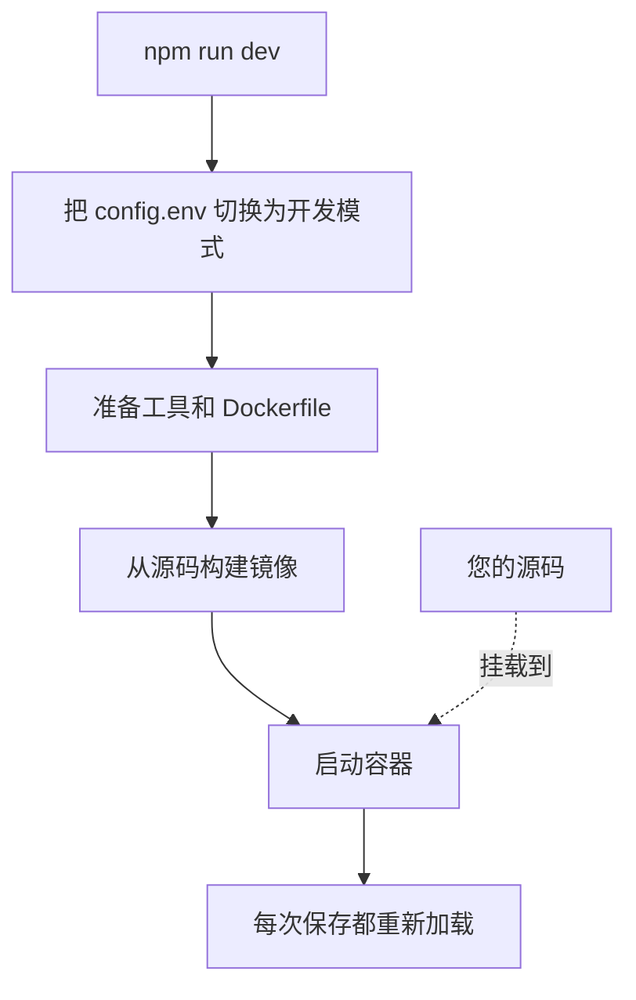

# 本地开发

在您自己的电脑上从源码运行 OneUptime，以便开发它。开发环境会用您检出的代码构建每个服务，把源码挂载进容器，并在您保存文件时重新加载。

如果要运行已发布的版本，请使用 [Docker Compose](/docs/installation/docker-compose)。

## 开发环境的工作原理

`npm run dev` 会先准备您检出的代码，然后启动 `Scripts/Dev/docker-compose.dev.yml` 中定义的服务栈：



| 阶段 | 发生了什么 |
| --- | --- |
| 切换到开发模式 | 在 `config.env` 中设置 `ENVIRONMENT=development`。 |
| 准备 | 询问您的 sudo 密码，安装缺少的工具（Git、curl、Node.js、Docker、gomplate、ts-node），在当前分支上运行 `git pull`，把 `config.example.env` 中的新设置加入 `config.env`，并把每个 `Dockerfile.tpl` 渲染成 `Dockerfile`。 |
| 构建 | 从源码为每个服务构建镜像。第一次构建需要一些时间。 |
| 运行 | 启动挂载了您源码的容器。 |
| 重新加载 | 服务器文件变化时，App 会重启其 API；您编辑仪表板时，它会重新构建仪表板。 |

如果仓库中有 `ee/` 文件夹，App 会从中加载 Enterprise Edition。在 `config.env` 中设置 `ONEUPTIME_EDITION=community` 即可改为运行 Community Edition。

## 开始之前

| 您需要 | 说明 |
| --- | --- |
| **Docker** | macOS 和 Windows 上使用 Docker Desktop，Linux 上使用带 Docker Compose v2 插件的 Docker Engine。 |
| **Node.js 26 或更高版本，以及 npm** | 仓库的 `package.json` 要求的版本，也是 CI 使用的版本。 |
| **Git** | 用于克隆仓库。 |
| **sudo 权限** | `npm run dev` 在安装任何东西之前都会询问您的密码。 |
| **端口 80 和 443 未被占用** | 服务栈在 `http://localhost`（端口 80）上提供 OneUptime，并在端口 443 上提供 HTTPS。 |

## 启动开发环境

:::steps
### 克隆仓库

```bash
git clone https://github.com/OneUptime/oneuptime.git
cd oneuptime
```

### 创建 config.env

```bash
cp config.example.env config.env
```

示例值可以直接用于开发。您可以修改它们，但不是必须的。

### 启动服务栈

```bash
npm run dev
```

它会询问您的 sudo 密码，然后构建镜像并在后台启动容器。用 `docker logs -f oneuptime-app-1` 查看 App 的启动过程。

### 打开 OneUptime

打开 `http://localhost` 并注册。第一个账户会成为主管理员，可以在 `http://localhost/admin` 打开 Admin Dashboard。
:::

## 修改代码

编辑 `packages/` 下的文件并保存：容器会接收这些更改。

在提交拉取请求之前，请在您的电脑上、容器之外检查您的更改。为此只需安装一次依赖：在仓库根目录运行 `npm install`（用于 ESLint 和迁移工具），然后运行 `npm run install-modules`，它会删除并重新安装每个包的 `node_modules`，需要一些时间。

:::steps
### 编译您修改的部分

在您修改过的每个包中运行编译器，例如 App：

```bash
cd packages/App
npm run compile
```

### 只对您的文件运行 lint

在仓库根目录传入您修改过的文件：

```bash
npx eslint --fix packages/App/path/to/File.ts
```

不要使用 `npm run lint` 和 `npm run fix-lint`：它们会对整个仓库运行 lint。

### 运行覆盖您更改的测试

在包目录中，只运行相关的测试文件，而不是整个测试套件：

```bash
cd packages/App
npx jest Tests/path/to/YourChange.test.ts
```
:::

### 数据库迁移

| 数据库 | 如何添加迁移 |
| --- | --- |
| PostgreSQL | 修改模型，然后运行 `npm run generate-postgres-migration`，不要手写迁移。在 `packages/Common/Server/Infrastructure/Postgres/SchemaMigrations/Index.ts` 中注册新文件：没有列在那里之前，它不会运行。`npm run check-postgres-schema-drift` 会列出仍然缺少的语句。 |
| ClickHouse | 参照已有的迁移，在 `packages/App/FeatureSet/Workers/DataMigrations` 中手写迁移。 |

## 参考

### 命令

在仓库根目录运行这些命令。

| 任务 | 命令 |
| --- | --- |
| 启动服务栈，或应用对 `config.env` 的更改 | `npm run dev` |
| 依赖变化后重新构建镜像 | `npm run build`，然后 `npm run dev` |
| 从头重新构建镜像 | `npm run force-build-dev`，然后 `npm run dev` |
| 列出正在运行的容器 | `docker ps` |
| 跟踪某个服务的日志 | `docker logs -f oneuptime-app-1` |
| 停止服务栈并删除其容器 | `npm run down` |

`npm run down` 会保留您的数据：PostgreSQL 和 ClickHouse 的卷不会被删除。

### 端口

开发环境会公开数据存储，方便您用自己的工具连接。密码在 `config.env` 中。

| 服务 | 地址 | 登录方式 |
| --- | --- | --- |
| OneUptime | `http://localhost` | 您创建的账户 |
| PostgreSQL | `localhost:5400` | 用户 `postgres`，数据库 `oneuptimedb`，密码 `DATABASE_PASSWORD` |
| ClickHouse | `localhost:8189`（HTTP），`localhost:9034`（原生） | 用户 `default`，数据库 `oneuptime`，密码 `CLICKHOUSE_PASSWORD` |
| Valkey | `localhost:6310` | 密码 `VALKEY_PASSWORD` |

## 故障排查

:::details npm run dev 停在 git pull
`npm run dev` 在构建之前会在当前分支上运行 `git pull`。如果分支没有上游，或者 pull 会覆盖您未提交的更改，Git 会拒绝执行。请为分支设置上游（例如用 `git push -u origin <branch>` 推送它），或者提交您的工作，然后再次运行 `npm run dev`。
:::

:::details npm run dev 在安装工具时停止
请自己安装该工具，例如 gomplate 或 ts-node，然后再次运行 `npm run dev`：它会跳过所有已安装的工具。
:::

:::details 修改依赖后某个服务失败
镜像中仍然是旧的依赖。用 `npm run build` 重新构建镜像，然后用 `npm run dev` 再次启动服务栈。如果还不行，就用 `npm run force-build-dev` 从头重新构建。
:::

:::details 端口 80 或 443 已被占用
您电脑上的另一个程序（通常是本地 Web 服务器）占用了该端口。停止它，然后再次运行 `npm run dev`。
:::

## 后续步骤

:::cards
- [自托管架构](/docs/self-hosted/architecture): 您刚刚启动的服务如何协同工作。
- [Docker Compose](/docs/installation/docker-compose): 在服务器上运行已发布的版本。
- [API 参考](/docs/api-reference/api-reference): 调用您本地实例的 API。
:::
