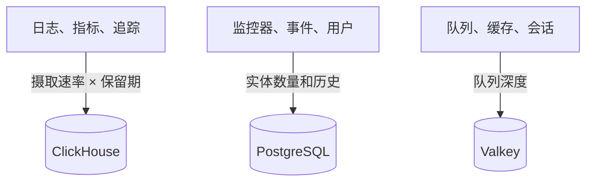

# 规模与容量规划

为使用 [Helm Chart](https://artifacthub.io/packages/helm/oneuptime/oneuptime) 在 Kubernetes 上自托管的 OneUptime 规划 CPU、内存和磁盘。分别为三个数据存储（**ClickHouse**、**PostgreSQL** 和 **Valkey**）以及应用确定规模，从下面的某个档位开始，拿到真实数据后再调整。

> [!IMPORTANT]
> Chart 的默认值不是生产规模。它默认运行的服务 **没有设置任何 CPU 或内存的请求与限制**，PostgreSQL 和 ClickHouse 只有 **25 Gi** 的小卷，这样 Chart 才能安装到任何集群上。只要不是试用，就请按照本页的数字自行设置资源和存储。

如果您改用单台服务器上的 Docker Compose 安装，确定规模会更简单：请参阅[要求](/docs/installation/docker-compose#requirements)（推荐 16 GB 内存、8 核和 400 GB 磁盘）。

:::cards
- [每个数据存储的增长因素](#what-drives-each-datastore): 三个存储随三种不同的东西增长。
- [起步档位](#starting-tiers): 小、中、大三种起点。
- [高可用](#high-availability): 每个数据存储的副本与故障转移。
- [保留期](#retention-and-how-it-affects-storage): 让磁盘成倍增长的设置。
:::

## 确定安装规模

:::steps
1. 弄清您发送多少遥测数据：每天多少 GB 的日志、指标和追踪。如果可以，在一个小型安装上测量。
2. 决定保留多少天。保留期会让 ClickHouse 的磁盘成倍增长（参见[保留期](#retention-and-how-it-affects-storage)）。
3. 用[存储公式](#storage-formula)算出 ClickHouse 的磁盘，再根据各自的章节算出 PostgreSQL 和 Valkey 的磁盘。
4. 选择最接近您数据的[起步档位](#starting-tiers)，在 Helm values 中设置它的 CPU、内存和存储。
5. 为需要的数据存储开启[高可用](#high-availability)，然后观察实际用量并调整。
:::

## 每个数据存储的增长因素

OneUptime 在生产环境中需要三个数据存储。它们各自随不同的东西增长，因此要分别确定规模。



| 数据存储 | 存储的内容 | 决定其大小的因素 |
| --- | --- | --- |
| **ClickHouse** | 所有遥测数据（日志、指标、追踪、异常、性能剖析） | 遥测的 **摄取速率 × 保留期**。这约占您存储的 95%，是最主要的成本。 |
| **PostgreSQL** | 配置和状态（监控器、事件、告警、用户、团队、项目、工作流、状态页面、仪表板） | **实体数量和历史**，而不是遥测数据量。增长缓慢。 |
| **Valkey** | 缓存、工作队列和会话 | **队列深度和活跃会话**。受内存限制，规模不大。不是权威数据源。 |

OneUptime 运行时从不需要对象存储（S3、MinIO），也不会把较旧的遥测数据移到对象存储。只有当您选择备份到对象存储时才需要它：CloudNativePG 的 Barman Cloud 插件，或 ClickHouse 的 [clickhouse-backup](https://github.com/Altinity/clickhouse-backup)。Chart 自带的 CloudNativePG 备份（`postgresOperator.cnpg.backup`）会创建卷快照，不需要对象存储。CloudNativePG 从不删除旧快照：请自行清理，否则它们会不断增加。

## ClickHouse：最主要的因素

几乎所有存储和大部分内存都用在 ClickHouse 上，因为每一行日志、每个指标点、每个追踪 span 和每个异常都存放在那里。

### 存储公式

```text
ClickHouse disk ≈ (daily raw telemetry GB ÷ compression) × retention days × replicas × 1.3 (headroom)
```

压缩率取决于信号类型：

| 信号 | 典型压缩率 | 影响因素 |
| --- | --- | --- |
| 日志 | 约 5:1 | 日志压缩效果很好。 |
| 指标 | 约 2:1 | 标签的 **基数** 高时，磁盘和内存的增长会比原始数据量更快。请保持较低的标签基数。 |
| 追踪 | 介于两者之间 | 取决于您发送的 span 属性。 |

### 计算示例

一个由 **10 个集群** 组成的集群群，每个集群约有 10 个节点和 100 个以 INFO 级别记录日志的 Pod，大致会产生 **每个集群 30 天 50–150 GB 的原始日志**（每个集群每天约 1.7–5 GB）。在整个集群群范围内，加上指标和追踪并压缩之后，大致按 **每天 5–15 GB 的压缩遥测数据** 做预算。

| 保留期 | 单副本 | 2 个副本 + 30% 余量 |
| --- | --- | --- |
| 30 天 | ~150–450 GB | **~0.4–1.2 TB** |
| 90 天 | ~0.45–1.35 TB | **~1.2–3.5 TB** |

存储 **与保留期成正比** 增长：90 天的窗口成本约为 30 天的三倍。

### 内存与磁盘类型

- **使用 NVMe 或 SSD。** 遥测以写入为主，并伴有突发的聚合读取；在机械硬盘上 ClickHouse 会力不从心。
- **给 ClickHouse 充足的内存。** 聚合查询非常耗内存。根据经验，按 *热* 数据（最近查询过的压缩数据）的 25–50% 配置内存，对于任何真正的生产集群群，实际下限为 16 GB。
- **控制指标的基数。** 它是影响 ClickHouse 内存和磁盘的最大单一因素。在采集指标的地方推行低基数的标签规范，并关注活跃序列的数量。

## PostgreSQL：配置与状态

PostgreSQL 存储的是您的配置和运行状态，而不是遥测数据，因此增长缓慢，与 ClickHouse 相比始终很小。即使是大型部署，通常也只有几十 GB。默认的 **25 Gi** 卷适合小型安装；较大的安装请规划 50–100 GB，并为事件和告警历史留出余量。

当应用、worker 和探测器的副本很多时，数据库连接可能会先于存储耗尽。每个 Pod 默认最多打开 50 个连接，而内置的 PostgreSQL 允许 500 个。Chart 正是为此提供了可选的连接池 **PgBouncer**（`pgbouncer.enabled`）：副本很多的部署请开启它。

## Valkey：缓存、队列与会话

缓存层运行 [Valkey](https://valkey.io)（Redis 7.2 的 BSD 许可分支），用作缓存、工作队列和会话存储。任何支持 Redis 协议的服务器都可以替代它，下面的规模建议同样适用。它 **受内存限制**，持久化 **默认关闭**：它不是权威数据源，可以重建。请按队列深度和并发会话数确定规模；大多数部署有 2–8 GB 内存就够了。它的驱逐策略是 `noeviction`，因此在持续负载下队列积压时要留意它的内存。

## 应用的计算资源

除了数据存储，还要为无状态工作负载确定规模。在您设置之前，每个工作负载都 **没有资源请求或限制**，且只有一个副本，只有遥测写入器有两个。

| 工作负载 | values 键 | 随什么增长 |
| --- | --- | --- |
| App：仪表板、API 和摄取 | `app` | 用户、API 调用和传入的遥测数据 |
| Worker（与应用拆分时） | `worker` | 遥测数据和后台任务处理 |
| 探测器 | `probes` | 活跃监控器的数量 |
| 入口网关 | `nginx` | 请求量 |
| 遥测写入器（开启时） | `telemetryWriter` | 不随负载增长：它把每次遥测插入批量写入 ClickHouse，因此按 ClickHouse 能承受的量确定规模 |

Chart 内置 **KEDA**，因此应用、worker、探测器和 Runner 可以按队列积压自动伸缩。请同时开启 `keda.enabled` 和每个服务自己的 `keda.enabled`（例如 `app.keda.enabled`）。在尚未安装 KEDA 的集群上，第一次安装需要额外执行一轮：请参阅 Chart 的 [KEDA 指南](https://github.com/OneUptime/oneuptime/blob/master/HelmChart/Docs/Keda.md)。KEDA 不管理的服务可以改用基于 CPU 或内存的自动伸缩器（`autoscaling`）。

## 起步档位

选择最接近您环境的档位作为起点，然后观察实际用量（`kubectl top pods`、ClickHouse 和 PostgreSQL 的磁盘增长）并调整。

- **小型 / PoC**：1–3 个集群，≤30 个节点，每天 ≤5 GB 原始遥测数据，保留 30 天。
- **中型 / 生产集群群**：约 10 个集群，约 100 个节点，每天 10–30 GB 原始遥测数据，保留 30–90 天。
- **大型 / 多集群群**：50 个以上集群，500 个以上节点，每天 100 GB 以上原始遥测数据，保留 90 天。

| | 小型 / PoC | 中型 / 生产集群群 | 大型 / 多集群群 |
| --- | --- | --- | --- |
| **ClickHouse** | 4 vCPU / 16 GB / 200 GB NVMe | 8 vCPU / 32 GB / 1–3 TB NVMe | 16+ vCPU / 64–128 GB / 5–15 TB NVMe，**分片** |
| **PostgreSQL** | 2 vCPU / 4 GB / 50 GB SSD | 4 vCPU / 8 GB / 100 GB SSD | 8 vCPU / 16–32 GB / 250 GB SSD (+ PgBouncer) |
| **Valkey** | 1 vCPU / 2 GB | 2 vCPU / 4 GB | 4 vCPU / 8–16 GB |
| **假定的保留期** | 30 天 | 30–90 天 | 90 天 |

这些档位用于确定 OneUptime 后端的规模。在每个受监控集群上安装的代理请参阅 [Kubernetes 代理](/docs/telemetry/kubernetes-agent)页面，那里还介绍了如何减少它发送的数据量。

## 高可用

Chart 内置的数据存储默认以 **单实例** 运行。要在生产环境实现高可用：

| 数据存储 | 实现高可用 |
| --- | --- |
| **PostgreSQL** | 开启内置的 [CloudNativePG](https://cloudnative-pg.io) operator（`postgresOperator.cnpg.enabled`），使用 **3 个实例**（`postgresOperator.cnpg.instances`）：一个主实例和两个热备实例，并自动故障转移。 |
| **ClickHouse** | 开启内置的 [Altinity](https://github.com/Altinity/clickhouse-operator) operator（`clickhouseOperator.altinity.enabled`），使用 **每个分片 2 个或更多副本**（`clickhouseOperator.altinity.cluster.replicasCount`）。它内置的 ClickHouse Keeper 运行 **3 个节点** 以形成仲裁。当单个节点的磁盘或内存成为瓶颈时，再添加分片（`shardsCount`）。 |
| **Valkey** | Chart 不复制它。请让 OneUptime 指向带自动故障转移的外部托管 Redis 或 Valkey（`externalValkey`）。OneUptime 只连接单个主机和端口，因此请使用服务的主端点，而不是集群模式的端点。 |

> [!WARNING]
> 为现有安装开启任一 operator 都会启动一个新的空数据库：两者都不会复制被替换的单实例数据库中的数据。请按照 Chart 指南迁移数据：[PostgreSQL](https://github.com/OneUptime/oneuptime/blob/master/HelmChart/Docs/MigratePostgresStandaloneToOperator.md) 和 [ClickHouse](https://github.com/OneUptime/oneuptime/blob/master/HelmChart/Docs/MigrateClickhouseStandaloneToOperator.md)。

## 保留期及其对存储的影响

遥测保留期是 **以天计算的 ClickHouse TTL**。每个版本都有项目的默认值，位于 **项目设置 > 遥测与 APM > 数据保留**（**默认保留期（天）**）；未设置时为 15 天。[Enterprise Edition](/docs/self-hosted/enterprise) 增加了覆盖设置：按信号（日志、追踪、指标、性能剖析）、按日志严重性和追踪状态，以及按服务或资源。

日志和指标在保留期结束后的第一个午夜（ClickHouse 服务器时间）按天删除，这样 ClickHouse 不必在数据过期期间每隔几小时重写每一天的数据。在午夜之前，磁盘上最多还会多保留一天的数据：请按 **保留天数 + 1** 为日志和指标确定规模。

由于保留期会让 ClickHouse 的存储成倍增长，请在确定磁盘规模之前先决定保留期。OneUptime **不会** 归档旧的遥测数据，也不会把它们移到对象存储。如果出于合规需要保留多年，请延长保留窗口并相应地确定 ClickHouse 存储规模，或导出到您选择的外部归档。

## 先测量再决定

遥测数据量会因应用日志的详细程度、命名空间数量、抓取间隔以及是否在某处开启了 DEBUG 日志而相差极大。请把上面的档位当作起点：**从您的环境中至少采集四周的数据**，测量每种信号每天的实际 GB 数，再根据真实数据确定保留期和存储规模。

## 后续步骤

:::cards
- [Docker Compose](/docs/installation/docker-compose): 单服务器安装的要求。
- [自托管架构](/docs/self-hosted/architecture): 各组件如何协同工作。
- [Kubernetes 代理](/docs/telemetry/kubernetes-agent): 发送集群遥测数据的采集器。
- [Enterprise Edition](/docs/self-hosted/enterprise): 保留期覆盖设置和其他 Enterprise 功能。
:::
