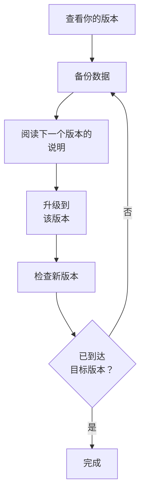

# 升级

将自托管的 OneUptime 安装（使用 Docker Compose，或使用 Kubernetes 和 Helm）升级到更新的版本。请按照下面的步骤操作，并阅读从你正在运行的版本到目标版本之间每个主要版本的说明。

:::cards
- [如何升级](#如何升级): 适用于 Docker Compose 和 Kubernetes 的步骤。
- [各版本的说明](#查找你的版本的说明): 每个主要版本需要你做什么，一目了然。
- [Community Edition 与 Enterprise Edition 镜像](#community-edition-与-enterprise-edition-镜像): 从 14 起应运行哪个镜像。
- [从 OneUptime 13 → 14 升级](#从-oneuptime-13-14-升级): 最新的主要版本。
:::

## 如何升级

遵守三条规则，升级就是安全的：

- **一次只升级一个主要版本**（例如 6 → 7 → 8）。不要跳过任何主要版本。
- **次要版本和补丁版本可以随意跳过**（例如 8.1 → 8.4），只要遵循它们的发行说明即可。
- **每次升级前都要备份**，并确认你能够恢复它。



:::steps
### 查看当前版本

以主管理员身份打开管理员仪表板页眉中的版本标签：**This installation** 显示你正在运行的版本。实例也会在 `/version` 上报告它：

```bash
curl http://localhost/version
```

将 `http://localhost` 替换为你的实例地址。响应是 JSON，例如 `{"version":"14.0.22","commit":"..."}`。

### 备份数据

备份 PostgreSQL；如果你需要 ClickHouse 中的遥测数据，也备份 ClickHouse。使用 Docker Compose 时，请参阅 [备份与恢复](/docs/installation/docker-compose#备份与恢复)。在 Kubernetes 上，请使用你的卷快照或 chart 的 CloudNativePG 备份。

### 阅读下一个主要版本的说明

说明在 [下表](#查找你的版本的说明) 中。升级前请先完成说明中要求的事项：有些步骤（例如重命名 Helm 值）必须先做。

### 运行升级

:::tabs
@tab Docker Compose
```bash
git checkout release
git pull
npm run update
```
`npm run update` 会把新设置添加到你的 `config.env` 中而不更改你已有的设置，拉取新镜像并重启 OneUptime。
@tab Kubernetes
```bash
helm repo update
helm upgrade my-oneuptime oneuptime/oneuptime -f values.yaml
```
请使用你自己的发布名称和 values 文件。chart 会在新 Pod 处理流量之前，在一个单独的 Job 中运行数据库迁移。
:::

### 检查新版本

使用 Docker Compose 时，`npm run update` 以 **OneUptime is up!** 结束。在 Kubernetes 上，请等待每个 Pod 都处于 `Running` 并就绪：

```bash
kubectl get pods -n <namespace>
```

然后像第一步那样再次检查你的版本。如果还没有到达目标版本，请回到 [备份数据](#备份数据)，继续下一个主要版本。
:::

### 查找你的版本的说明

| 升级 | 你需要做什么 |
| --- | --- |
| [13 → 14](#从-oneuptime-13-14-升级) | 选择一个版本。设置了 `IS_ENTERPRISE_EDITION=true` 的 Docker Compose 安装改用 `APP_TAG=enterprise-release`。在 Enterprise Edition 上激活许可证。重新保存 IPv6 的 Ping、Port 和 SSL 监视器。 |
| [12 → 13](#从-oneuptime-12-13-升级) | 通常不需要做什么：Redis 换成 Valkey，旧的设置名称仍然有效。手动运行 Docker Compose？请添加 `--remove-orphans`。使用自己的缓存？请阅读 [如果你运行自己的缓存](#如果你运行自己的缓存)。 |
| [11 → 12](#从-oneuptime-11-12-升级) | 将 Runbook Agent 重新部署为 Runner。使用 Docker Compose 时设置 `ONEUPTIME_RUNNER_KEY`。使用 Helm 时将 `aiAgent:` 重命名为 `runner:`。重新授予 API 密钥曾直接拥有的 Runner 权限。 |
| [10 → 11](#从-oneuptime-10-11-升级) | SCIM 和团队合规设置需要 Enterprise Edition。要保留遥测历史，请在升级前重命名旧的 ClickHouse 表。 |
| [9 → 10](#从-oneuptime-9-10-升级) | 无。 |
| [8 → 9](#从-oneuptime-8-9-升级) | 使用 Helm 时，从你的 values 中移除 `oneuptimeIngress` 覆盖。 |
| [7 → 8](#从-oneuptime-7-8-升级) | 使用 Helm 时，改用 Postgres、Redis 和 ClickHouse 的新 values 结构。请先备份。 |

## Community Edition 与 Enterprise Edition 镜像

OneUptime 现在以两个镜像交付应用程序。**Community Edition** 是基于 Apache 2.0 许可证的开源版本，包含 SAML 和 OIDC 单点登录、全局 SSO 以及“Require SSO for login”。**Enterprise Edition** 增加了仓库 `ee/` 目录中的企业模块：SCIM、团队合规、审计日志，以及管理员仪表板的企业版 Health 仪表板。在此更改之前，两个版本运行相同的代码，由 `IS_ENTERPRISE_EDITION` 决定启用哪些功能。现在由镜像决定，Community 镜像中不包含 `ee/` 目录。

完整的功能对比、许可证详情以及切换版本时会发生什么，请参阅 [企业版](/docs/self-hosted/enterprise) 页面。

### 升级前要做什么

- **不使用 SCIM 的 Community Edition:** 无需操作。照常升级。
- **使用 `image.type: enterprise-edition` 的 Helm:** 无需操作。chart 已经拉取 `enterprise-` 镜像，这些镜像现在包含企业模块。
- **使用 `IS_ENTERPRISE_EDITION=true` 的 Docker Compose:** 升级时在 `config.env` 中设置 `APP_TAG=enterprise-release`（或 `enterprise-<version>`），切换到 Enterprise 镜像。`APP_TAG=release` 是 Community 镜像，而 `IS_ENTERPRISE_EDITION=true` 不再开启任何功能。只要 `IS_ENTERPRISE_EDITION=true`，`npm run update` 就会替你完成这项更改（`release` 变为 `enterprise-release`，固定的 `13.0.7` 变为 `enterprise-13.0.7`），并输出它所做的更改。现在，当在 Community 镜像上设置了 `IS_ENTERPRISE_EDITION=true` 时，应用程序会 **拒绝启动**，而不是悄悄停止 SCIM 预配和审计日志记录。错误信息会说明要设置什么：要保留 Enterprise Edition，设置 `APP_TAG=enterprise-<version>`；要运行 Community Edition，设置 `IS_ENTERPRISE_EDITION=false`。
- **已配置 SCIM 的 Community 镜像:** 此次升级后 SCIM 预配会停止，包括取消预配。要继续使用，请切换到 Enterprise 镜像。否则，请在升级前阅读 [从 Enterprise 切换到 Community](/docs/self-hosted/enterprise#switching-from-enterprise-to-community)。它说明了哪些功能会停止以及应先移除哪些人。要运行 Community Edition，还要设置 `IS_ENTERPRISE_EDITION=false`。单点登录不受影响：Community 镜像同样提供它。

你的配置永远不会被删除，无论朝哪个方向切换版本都不需要迁移。

### 升级后的许可证

Enterprise Edition 现在会检查自己的许可证：

- **有许可证密钥的安装** 会继续运行。它在启动时以及每天一次向 OneUptime 检查许可证。如果许可证过期，在 30 天的宽限期内一切照常运行，之后会发生与无许可证安装相同的情况。
- **没有许可证的安装**（例如只通过 `IS_ENTERPRISE_EDITION=true` 运行 Enterprise Edition 的安装）从首次启动此版本起获得 14 天的试用期。**如果你使用 SCIM 或审计日志记录，请在试用期结束前激活许可证。** 试用期结束后，SCIM 预配会停止，审计日志记录也会停止记录。企业配置也会变为只读，企业版 Health 仪表板会被锁定。单点登录不受影响。只要你激活许可证，一切都会立即恢复，无需重启。试用期用于评估：在生产环境中使用 Enterprise Edition 需要 OneUptime Enterprise 订阅。请参阅 [许可证过期或缺失时](/docs/self-hosted/enterprise#when-a-license-expires-or-is-missing)。
- **与网络隔离的安装** 可以使用签名的许可证令牌而不是密钥来激活。请参阅 [离线激活](/docs/self-hosted/enterprise#offline-activation-air-gapped-installs)。

### OneUptime Cloud 客户

对你来说没有任何变化。OneUptime Cloud 运行 Enterprise Edition，你能使用哪些功能仍由你的套餐决定：SSO、OIDC、SCIM 和团队合规从 Scale 套餐起提供，审计日志在 Enterprise 套餐中提供。Scale 套餐的项目现在可以看到以前显示升级提示的 SSO、OIDC、SCIM 和团队合规设置。

### API 和端点的变更

- `GET /api/global-config/license` 只向主管理员返回许可证密钥、许可证令牌、实例列表、实例 ID 和版本详情。其他调用方只获得版本和许可证状态。
- 自托管安装不再提供 `/api/enterprise-license/` 下的许可证服务器端点。只有 oneuptime.com 使用它们。
- SCIM 端点在 Enterprise Edition 上保持完全相同的路径，因此身份提供商的配置无需更改。在 Community Edition 上它们返回 `404`。在 Enterprise Edition 上，许可证过期期间（试用期或宽限期之后）它们会拒绝请求，一旦激活许可证就会再次响应。
- SSO 和 OIDC 端点（SAML 登录和 ACS URL、OIDC 重定向 URI，以及全局 SSO 端点）保持完全相同的路径，并且无论许可证处于什么状态，两个版本都会提供它们。

## 从 OneUptime 13 → 14 升级

OneUptime 14 将应用程序分为两个版本，你拉取的镜像决定你运行哪一个。**Community Edition**（Apache-2.0，标签 `release` 和 `<version>`）包含 SAML SSO、OpenID Connect、全局 SSO 和“Require SSO for login”。它不包含仓库的 `ee/` 目录，因此 SCIM 预配、团队合规设置、审计日志、管理员仪表板的 **Health** 仪表板以及管理员仪表板的 **Query Console** 根本不在该镜像中。**Enterprise Edition**（标签 `enterprise-release` 和 `enterprise-<version>`）包含它们，并在运行时检查 Enterprise 许可证，这是 OneUptime 13 从未做过的。单点登录不依赖该许可证。

上面的 [Community Edition 与 Enterprise Edition 镜像](#community-edition-与-enterprise-edition-镜像) 是此变更的参考：每个版本包含什么、每种部署方式要设置什么，以及许可证起什么作用。本节是升级本身。请从 13 升级——如果你仍在 12，请先完成 12 → 13。

无论哪个版本，都不会删除任何内容。单点登录在两个版本中的工作方式相同：你的 SSO 和 OIDC 配置以及“Require SSO for login”设置都会原样保留。你的 SCIM 配置和迄今为止记录的审计日志都保留在数据库中。Community Edition 只是不提供它们，而无论朝哪个方向切换版本都不需要迁移。

### 你需要做什么

1. **决定此安装运行哪个版本。** 如果你使用 SCIM 预配、团队合规设置或审计日志，或者需要管理员仪表板的 **Health** 仪表板，那就是 Enterprise Edition。否则无需决定：Community Edition 就是你现在使用的版本，它包含 SAML SSO 和 OpenID Connect。
2. **使用 Helm 时，在 values 文件中设置版本:** `image.type: enterprise-edition`（默认值为 `community-edition`）。不要改动 `image.tag`——chart 会自行添加 `enterprise-` 前缀，因此 `image.tag: release` 会拉取 `oneuptime/app:enterprise-release`。这个值不是新的。如果你已经在使用 `enterprise-edition`，则无需更改：你已经拉取的标签现在包含 `ee/`。
3. **使用 Docker Compose 时，在 `config.env` 中设置 `APP_TAG=enterprise-release`**（或用 `enterprise-<version>` 固定版本）。`APP_TAG=release` 是 Community 镜像。这是唯一会让 13 上的安装停下来的一项：在 13 上，使用 Compose 的 Enterprise 安装是 `APP_TAG=release` 加上 `IS_ENTERPRISE_EDITION=true`，而现在这种组合会 **拒绝启动**，而不是以 SCIM 预配和审计日志记录被悄悄停止的 Community Edition 身份启动。只要 `IS_ENTERPRISE_EDITION=true`，`npm run update` 就会替你重写 `APP_TAG`（`release` 变为 `enterprise-release`，固定的 `13.0.8` 变为 `enterprise-13.0.8`），并输出它所做的更改。如果你改为手动拉取镜像，请先自己设置 `APP_TAG`。
4. **在 Enterprise Edition 上激活许可证。** 没有许可证的安装从其首次启动 Enterprise Edition 起获得 14 天的试用期——对升级来说，这一天是你升级的那天，而不是你第一次安装 OneUptime 的那天。主管理员可以通过管理员仪表板页眉中的版本标签激活它；与网络隔离的安装则使用签名令牌激活。请参阅 [许可](/docs/self-hosted/enterprise#licensing)。
5. **如果此安装将运行 Community Edition，而你的身份提供商通过 SCIM 取消预配用户，请在升级前检查谁拥有访问权限。** SCIM 取消预配会停止，因此你在身份提供商中移除的人会保留他们的 OneUptime 帐户；除非“Require SSO for login”适用于他们，否则任何仍能访问这些帐户邮箱的人都可以通过“忘记密码”设置密码并登录。请先移除这些用户：[从 Enterprise 切换到 Community](/docs/self-hosted/enterprise#switching-from-enterprise-to-community)。
6. **如果你使用 Ping、Port 或 SSL 监视器监视 IPv6 地址，请在升级后重新保存这些监视器。** 在 14 之前保存的目标可能被截断存储——请参阅 [IPv6 的 Ping、Port 和 SSL 监视器](#ipv6-的-pingport-和-ssl-监视器)。

### 版本：哪些变了，哪些没变

| | 直到 13 | 从 14 起 |
| --- | --- | --- |
| 企业代码 | 在每个镜像中；由 `IS_ENTERPRISE_EDITION=true` 开启 | 在 `ee/` 中，且只在 `enterprise-` 镜像中 |
| Helm 中的选择器 | `image.type` | `image.type`——未变，但镜像现在不同了 |
| Compose 中的选择器 | `IS_ENTERPRISE_EDITION=true` | `APP_TAG=enterprise-release` |
| Enterprise 许可证 | 运行时从不检查 | 启动时和每天一次检查 |
| SSO 和 OIDC 端点 | 两个版本中路径相同 | 两个版本中路径相同，与许可证状态无关 |
| SCIM 端点 | 两个版本中路径相同 | Enterprise 上路径相同；Community 上为 `404` |
| 你的企业配置 | 存储并应用 | 两种情况下都存储，在 Enterprise 上应用 |

会运行一个迁移：在只有一行的 `GlobalConfig` 表上添加一个可为空的列 `enterpriseEditionFirstSeenAt`，因此是即时完成的。没有 ClickHouse 迁移，不会删除任何内容，无论朝哪个方向切换版本都不需要迁移。

### Enterprise Edition 上的许可证时间线

- **没有许可证的安装** 运行 14 天的试用期，从首次启动 Enterprise Edition 起计算。试用期内所有企业功能都能使用，版本标签会在试用期结束前发出提醒。试用期用于评估：在生产环境中使用 Enterprise Edition 需要依据 OneUptime Enterprise License 的订阅。
- **到期的许可证** 自到期日起有 30 天的宽限期，期间所有企业功能都能使用，版本标签会发出提醒。
- **试用期结束后，或宽限期结束后**，直到激活许可证为止：来自你的身份提供商的 SCIM 请求会被拒绝，审计日志记录会停止记录。企业配置变为只读——你仍然可以查看和删除它，并重置 SCIM 持有者令牌，这正是处理事件时需要的——管理员仪表板的 Health 仪表板和 Query Console 会被锁定。
- **不会删除任何内容，核心监控也从不受影响。** 监视器、警报、事件、值班、状态页和遥测都不受许可证限制，登录也一样：通过 SSO 和 OIDC 登录、“Require SSO for login”，以及包括主管理员在内的所有用户的密码登录，在任何许可证状态下都一样工作。激活许可证会使用你已有的配置恢复 SCIM 预配和审计日志记录，无需重启。
- **你已有的许可证密钥会被接受**，作为“unverified”许可证：它的到期日和席位上限来自许可证服务器已经告知此安装的信息，并在该到期日之后同样获得 30 天的宽限期。今后签发的许可证都经过签名，由应用程序自行验证。此次升级不需要新的密钥。
- **此安装从未记录过到期日的密钥** 在试用期内会继续工作，而不会停止。许可证服务器分别写入密钥和到期日，因此一个安装可能拥有从未被告知到期日的密钥。这样的安装与没有许可证的安装完全一样对待：在从首次启动 Enterprise Edition 起计算的 14 天试用期内，所有企业功能都能使用；试用期结束后，停止的功能与上面相同。许可证处于此状态时不强制执行席位上限，因为该安装持有的许可证记录本来就不完整。主管理员通过版本标签重新激活许可证，或每日许可证同步从 oneuptime.com 取回到期日，都会在无需重启的情况下将其恢复。

完整的状态表见 [许可证过期或缺失时](/docs/self-hosted/enterprise#when-a-license-expires-or-is-missing)。

### Docker Compose：选择镜像标签

```bash
git checkout release # Please make sure you're on release branch.
git pull
npm run update
```

- **只要 `IS_ENTERPRISE_EDITION=true`，`npm run update` 就会移动 `APP_TAG`**，将其改为同一版本的 Enterprise 镜像，并输出它所做的更改。它会保留你的注释和引号，不会改动已经是 `enterprise-` 标签的 `APP_TAG`，第二次运行时不做任何更改。
- **手动拉取镜像会跳过这一步**，此时应用程序会在启动时退出，并给出准确说明要设置什么的错误：要保留 Enterprise Edition，设置 `APP_TAG=enterprise-<version>`；要运行 Community Edition，设置 `IS_ENTERPRISE_EDITION=false`。
- **要有意切换到 Community Edition**，请设置 `APP_TAG=release` 和 `IS_ENTERPRISE_EDITION=false`。如果你的身份提供商通过 SCIM 取消预配用户，请先阅读上面的第 5 点。
- 对于此版本，`config.env` 中无需更改其他任何内容。

### Helm：选择镜像类型

```bash
helm repo update
helm upgrade my-oneuptime oneuptime/oneuptime -f values.yaml
```

- **已经使用 `image.type: enterprise-edition` 的安装无需更改任何值。** chart 早已为标签添加前缀；新的变化是 `enterprise-` 镜像包含 `ee/`。从此版本起，按照上面的时间线对它应用许可证。
- **`image.tag: release` 是默认值**，因此停留在浮动标签上的 chart 会在下一次升级时转到 14，无需更改任何值。如果该安装在 `community-edition` 上配置了 SCIM，请在同一次升级中设置 `image.type: enterprise-edition`。
- **chart 仍然会输出 `IS_ENTERPRISE_EDITION`**，它由 `image.type` 推导而来，因此两者永远不会不一致。它不控制任何东西。在 Community 镜像上通过 `extraEnv` 将其强制设为 `true`，只会让应用程序拒绝启动。永远不要通过 chart 设置 `ONEUPTIME_EDITION`。
- **chart 的探针重新遵循 `probes.<key>.allowPrivateNetworkMonitors`**（[#3879](https://github.com/OneUptime/oneuptime/issues/3879)）。除非你设置它，否则什么都不会改变——默认值仍为 `false`——并且它适用于实例上所有项目的监视器，因为 chart 的探针是全局探针。无论你设置什么，回环地址、链路本地地址和 `169.254.169.254` 都保持被阻止。

### 14 中的其他变更

这些变更会改变升级后 OneUptime 的行为，大多数不需要你做任何事。如果你使用由单项权限组成的自定义角色或 API 密钥、事件、警报或维护的自定义状态、Terraform 或 API、SSO，或者 Slack 和 Microsoft Teams 应用，请阅读它们。

:::details 阅读 14 中的其他变更
- **OTLP 接收只在队列接受批次之后才确认该批次。** 13 先响应 `200`，之后才入队，因此被队列拒绝的批次会悄悄丢失。14 改为响应 `503` 并附带 `Telemetry queue unavailable. Please retry.`，gRPC 端点返回 `UNAVAILABLE`；两者都可以重试，导出器也会重试。这适用于日志、指标、追踪和性能剖析数据。你无需做任何事，但以前数据会消失的地方，现在能看到导出器的重试和队列的背压——如果你在规划接收容量，这一点值得了解。
- **管理员仪表板的 Health 仪表板和 Query Console 需要 Enterprise Edition**，PostgreSQL 和 Valkey 的健康警报也一样。在 13 中，仅凭 `IS_ENTERPRISE_EDITION=true` 就能使用它们，因此对于曾使用它们的 Community 安装来说，这是可见的功能损失。ClickHouse 容量监控及其清理、迁移状态、全局探针和支持包在两个版本中都有。
- **通过探针代理访问 IP 地址的 HTTPS 监视器重新可以工作了。** 探针过去把 IP 作为 TLS 服务器名称发送，而这不是有效的服务器名称，Node 会直接拒绝，因此在设置了 `PROBE_ALLOW_PRIVATE_NETWORK_MONITORS` 的全局探针上，监视 `https://<private IP>` 的监视器会在握手时失败。现在探针对 IP 目标省略服务器名称，并根据 IP 本身验证证书。主机名目标不变。
- **`oneuptime` CLI 会报告其真实版本**，`--version` 返回真实版本而不是占位符。
- **新的警报或片段从其创建时指定的状态开始。** API、Terraform（`current_alert_state_id`、`current_incident_state_id`）和工作流可以像仪表板的 **初始状态** 字段那样，指定警报、警报片段或事件片段开始时的状态。以前该状态会被项目的创建状态替换；设置了它的 Terraform 配置会得到与计划不同的值。未指定状态的创建仍从创建状态开始，其他项目的状态会被拒绝。请参阅 [新记录开始时的状态](/docs/api-reference/api-reference)。
- **创建时就已确认或已解决的记录不会呼叫任何人。** 通过 **初始状态**、模板的起始状态、API、Terraform 或工作流以较后状态创建的事件、警报或片段，不再运行其值班策略；它的动态会改为说明这一点。以已解决状态创建的记录也不再被分组到片段中、被补救、被 OneUptime AI 调查，或获得 Slack 或 Microsoft Teams 频道；以已解决状态创建的事件不会改动其监视器的状态和监控，也不会启动 SLA。以已确认状态创建的记录会以已响应的状态启动其 SLA。在创建状态下创建的记录（例如监视器打开的所有记录）不变。请参阅 [声明时已确认或已解决](/docs/incidents/declaring-incidents#声明时即已确认或已解决)。
- **位于已解决状态之后的状态在任何地方都算作已解决。** 处于你放在已解决状态之后的状态（例如 **已解决** 下方的 **Closed** 状态）中的事件、警报或片段，过去在某些地方算作已解决，在另一些地方算作未解决。现在它们都遵循同一条规则：项目的已解决状态及其之后的每个状态都是已解决。处于这种状态的记录会从 **活动事件** 和 **活动警报** 列表及其侧边菜单计数、仪表板的事件和警报列表、活动片段以及移动应用的未解决记录列表中移除；Slack 和 Microsoft Teams 摘要会将它们算作已解决，状态页时间线会将这样的行显示为已解决。其事件或警报处于这种状态的监视器或 SLO 消耗速率规则，下次触发时会打开一个新的，而过去它会认为旧的仍未解决。将事件直接移到这种状态会像 **已解决** 一样解决它，而将其移过 **已解决** 不再重新打开片段，也不再为该事件启动新的 SLA。自定义状态都位于已解决状态之上的项目不会看到任何变化。请参阅 [活动事件列表](/docs/incidents/states-and-severities#活动事件列表)。
- **位于已确认状态之后的状态在任何地方都算作已确认。** 处于你放在已确认和已解决状态之间的状态（例如 **已确认** 下方的 **Investigating** 状态）中的事件、警报或片段，已经会停止值班呼叫，但移动应用和 Microsoft Teams 仍为其提供 **Acknowledge**，而在该状态下确认警报或片段（从 Teams、Slack 或值班页面）会把它移回 **已确认**。现在它们都遵循同一条规则：项目的已确认状态、其之后的每个状态以及已解决状态都算作已确认。这类记录在任何地方都不再提供 **Acknowledge**，确认它会被拒绝（"... is already acknowledged."）而不是将其移回；为它确认自己呼叫的响应者只是完成该呼叫。将记录直接移到这种状态现在会把事件的 SLA 标记为已响应——过去它会保持未响应直到事件解决，可能违反响应目标——并在概览的确认用时、**Time to Acknowledge** 指标、测量以及 Slack 和 Microsoft Teams 摘要的 MTTA 中算作对它的确认。未经确认就被解决的记录现在在解决时算作已确认，正如概览早已显示的那样。**已确认** 列表筛选器也会显示处于这些状态的记录，**Time in State** 指标的 `isAcknowledgedState` 属性对它们为 `true`。自定义状态都位于已确认状态之上的项目不会看到任何变化。请参阅 [确认会做什么](/docs/incidents/states-and-severities#确认会做什么)。
- **片段按照事件和警报所遵循的规则在状态间移动。** 事件片段或警报片段过去可以从仪表板的状态时间线、Slack、Microsoft Teams、API 或 Terraform 被移回其状态列表的上方——例如把已解决的片段移回 **已确认**——并且这一移动会传递到它的事件或警报。现在，移到按顺序位于片段当前状态之前的状态会被拒绝，错误与事件得到的相同（"Episode cannot transition to Acknowledged state from Resolved state because Acknowledged is before Resolved in the order of incident states."），并且什么都不会改变。分组规则的 **重新打开最近解决的片段** 选项仍会重新打开片段，作为 OneUptime 自己的移动。要更正误设的状态，请像对事件那样从片段的状态时间线中删除该行；片段会回到其最后剩余行的状态，删除使其解决的那一行会清除其解决时间。片段只会把它的每个事件或警报移到它们自己的状态会去的地方：已经处于该状态或更后状态的，保持不动。
- **写入记录的当前状态也遵循同一规则。** 通过 API 或 Terraform（`currentIncidentStateId`、`currentAlertStateId`、`currentScheduledMaintenanceStateId`）更新事件、警报、片段或计划维护事件的当前状态时，如果这会把记录移回其列表的上方，就会在保存任何内容之前以同样的错误被拒绝。过去写入会先到达记录，然后状态时间线才拒绝它，使记录停留在其时间线从未有过的状态。现在写入事件片段的状态会将其记录到片段的状态时间线并移动其事件，就像写入警报片段的状态早已做到的那样。设置较早状态的 Terraform 计划会在 apply 时失败；请按顺序设置状态，或用状态时间线的一行来更改状态。
- **Slack 和 Microsoft Teams 中的 Change State 只提供记录接下来可以进入的状态。** 处于它能到达的最后一个状态的记录会收到回复"There is no later state to move this incident to."，而不是一个每个选项都会被拒绝的表单。仪表板页眉中的 **Change state to** 菜单遵循同一规则。
- **被移回列表上方的计划维护事件的错误现在与其他错误的写法一致:** "Scheduled Maintenance cannot transition to Scheduled state from Ongoing state because Scheduled is before Ongoing in the order of scheduled maintenance states."（过去写的是 `ScheduledMaintenance` 和 `scheduledMaintenance states`）。比对旧文本的脚本需要改用新文本。请参阅 [顺序是真正的约束](/docs/incidents/states-and-severities#顺序是真正的约束而不是显示偏好)。
- **解决事件只会交还它所持有的监视器。** OneUptime 现在会记录事件是否持有其监视器的状态。已经解决过一次又被重新打开的事件，再次解决时不再把其监视器恢复为正常运行，因此监视器在此期间获得的状态——来自其探针、维护或手动设置——会保留；在事件打开期间更改其监视器或它为监视器设置的状态，会让它再次持有这些监视器。升级前的事件会像以往一样，在下次解决时交还其监视器。请参阅 [解决会做什么](/docs/incidents/states-and-severities#解决会做什么)。
- **事件或警报所属的片段只能通过片段的成员来设置。** `incidentEpisodeId` 和 `alertEpisodeId`（以及关系 `incidentEpisode` 和 `alertEpisode`）是只读的。API、Terraform（`incident_episode_id`、`alert_episode_id`）、MCP 工具和工作流过去可以在不把记录加入片段的情况下写入它们：片段概览会因此列出其 **成员** 页面中没有的事件或警报，而设置了片段创建的记录从不会被分组。现在发送其中之一的创建或更新会被拒绝，并附带一条指向片段成员的消息：使用 `POST /api/incident-episode-member`（或 `/api/alert-episode-member`）添加记录，删除该成员即可将其移出，片段引用会随之变化。读取不变。设置了 `incident_episode_id` 或 `alert_episode_id` 的 Terraform 配置，在你升级提供程序后就必须将其移除，因为提供程序现在只读取它们；成员关系由资源 `oneuptime_incident_episode_member` 和 `oneuptime_alert_episode_member` 管理。请参阅 [事件或警报所在的片段](/docs/api-reference/api-reference)。
- **新的来电升级规则响铃 20 秒，而不是 30 秒。** 许多电话会在 30 秒内把未接来电转到语音信箱，而语音信箱一旦接听，通话就在那里结束，不会转给下一条规则。仪表板的 **响铃时长（秒）** 字段、API（`escalateAfterSeconds`）和 Terraform 提供程序（`escalate_after_seconds`）现在以 20 开始新规则。已有的规则保留其响铃时长：升级只更改该列的默认值。省略 `escalate_after_seconds` 的 Terraform 配置在你升级提供程序后，会为它管理的规则计划 `30 -> 20`；要保持 30，请设置 `escalate_after_seconds = 30`。请参阅 [来电策略](/docs/on-call/incoming-call-policy)。
- **Slack 和 Microsoft Teams 摘要在时钟调整时保持其一天中的时间。** 摘要现在有一个时区，其计划按该时钟读取。到目前为止它是按 UTC 读取的，因此在柏林设定为 09:00 的摘要，在恢复冬令时后会在当地 08:00 送达。升级会为每个现有摘要设置其创建者个人资料中的时区，也就是仪表板为它显示的时钟；如果它没有带时区的创建者（由 API 密钥创建），则设置为 UTC，也就是它迄今为止的读取方式。升级期间下一次发送不会偏移；从下一次发送起，偏移了一小时的摘要会回到其第一次摘要的时间，而在 29 日到 31 日发送的月度摘要不再滑到 28 日。API 和 Terraform（`timezone`）接受 IANA 时区名称；创建时未指定时区的摘要会采用其创建者个人资料中的时区，由 API 密钥创建时则采用 UTC，不是时区的名称会被拒绝。请参阅 [摘要](/docs/workspace-connections/slack)。
- **事件或警报动态中的“已更新”条目只记录发生了变化的内容。** 只更改标题后保存 **事件详情** 卡片，或者 API 客户端、工作流或脚本把事件或警报原样写回，过去都会添加一个条目，重复它所带的标题、描述、根本原因、补救说明和标签——同时还会发布到该事件或警报的 Slack 和 Microsoft Teams 频道——而每次带有标签或 **发送提醒** 开关的写入，即使什么都没变，也会重新开始提醒间隔，因此经常被编辑的事件会不断推迟其提醒。现在每个发生变化的值写一行，没有改变任何内容的保存则什么都不写；只有在严重程度或标签变化，或切换 **发送提醒** 时，才会重新应用提醒规则并重新开始间隔。读起来相同的文本视为相同（不计换行和首尾空白），标签视为顺序无关的同一集合。警报现在也会记录在其页面上更改的根本原因——过去除非标题一起更改，否则会丢失——以及被清空的描述、根本原因或补救说明。移除所有标签会记录为"All labels removed."。请参阅 [动态记录什么](/docs/incidents/notes-owners-and-feed#信息流记录什么)。
- **计划维护事件或监视器动态中的“已更新”条目同样只记录发生了变化的内容。** 未做任何更改就保存事件的 **Maintenance Details** 或 **受影响的资源** 卡片或监视器的详情，或者 API 客户端、工作流、Terraform 或脚本把事件或监视器原样写回，过去都会添加一个条目，重复它所带的标题（监视器的名称）、时间窗口、描述、提醒、状态页、受影响的资源和标签——同时还会发布到其 Slack 和 Microsoft Teams 频道——而每次带有事件标签或其 **发送提醒** 开关的写入都会重新开始其提醒间隔。现在每个发生变化的值写一行，没有改变任何内容的保存则什么都不写；只有在事件的标签变化或切换 **发送提醒** 时，才会重新应用其提醒规则。时间只要表示同一时刻就视为相同，无论如何书写；提醒、状态页、受影响的资源和标签视为顺序无关的同一集合。清空事件的描述、提醒、状态页或标签，或者监视器的描述或标签，现在都会被记录，监视器的名称、描述和标签名称会按输入原样显示，而不是被当作 Markdown 读取。从 **已计划** 直接移到放在 **进行中** 和 **已结束** 之间的自定义状态的事件，现在会像 **进行中** 那样开始：其监视器会转到它的 **将监视器状态更改为**，而到目前为止它们会保持原样。请参阅 [计划维护事件](/docs/status-pages/subscribers#计划维护事件)。
- **处于“进行中”之前的自定义状态的维护事件会按时开始，并作为即将进行的事件列出。** 从 **已计划** 移到放在 **进行中** 之上的自定义状态（例如"Confirmed"步骤）的计划维护事件，过去在其 **开始** 时间到达时从未启动：在有人手动移动它之前，它的监视器不会进入维护状态，它的所有者和订阅者也不会收到通知。它还会从其状态页及其 RSS 和 Atom 订阅源的即将进行的事件中、从 Microsoft Teams 应用的计划维护中消失，事件前发给其订阅者的提醒也会被丢弃。现在它会像留在 **已计划** 中的事件一样按时开始，在此之前作为即将进行的事件被列出并发送提醒。处于这种状态且开始时间已过的事件会在升级后一分钟内启动——如果其 **结束** 时间也已过，则在一分钟后结束——并像每次开始和结束一样通知其所有者和订阅者；因此在升级前，请推进或删除每个被落下的此类事件。放在 **已计划** 之前的自定义状态——草稿或审批步骤——仍由人来处理，和以前一样。随之而来的还有四项较小的变更。事件的每次状态变化都会立即计算它所覆盖的网络站点的状态，即使事件因其当前状态的条目被从 **状态时间线** 中删除而回退也是如此，而到目前为止回退要等待五分钟一次的扫描。事件在 **已完成** 以及放在其后的每个自定义状态（"Archived"）中都视为已完成：更改提醒规则后不再为它重新安排其所有者的提醒，Microsoft Teams 在查找要变成备注的回应时把它视为已关闭，它的动态和状态页时间线把它标记为已结束。事件的 **测量** 卡片会像其页眉一样，把处于 **已结束** 之后的自定义状态的事件视为已结束，而“进入已结束状态”和“进入已完成状态”指的是转入事件已结束或已完成的状态，因此直接从 **进行中** 完成的事件会在那里记录其结束。另外，带有四个内置标志中多个标志的状态，现在在事件页眉和服务器上的解读是一致的。没有自定义状态的项目只会看到网络站点和测量方面的变化。请参阅 [计划维护事件](/docs/status-pages/subscribers#计划维护事件)。
- **处于“进行中”之后的自定义状态的维护事件在任何地方都算作进行中。** 从 **进行中** 移到放在 **已结束** 之上的自定义状态（例如"Verifying"步骤）的计划维护事件，过去会让其监视器保持维护状态，但其他任何地方都不认为它在进行中：其状态页的概览完全省略它，它覆盖的网络站点和遥测序列不再被静默，其监视器上的 SLO 消耗速率警报会触发，**计划维护** 和 **首页** 下的 **进行中** 列表、它们的菜单徽章以及 **进行中的维护** 磁贴都省略它，Microsoft Teams 应用不列出它，并且在其 **结束** 时间到达时没有任何东西会结束它：在有人移动它之前，它会带着处于维护状态的监视器停留在该状态。现在它们都遵循同一条规则：事件在进行中状态以及放在 **进行中** 和 **已结束** 之间的每个自定义状态中都处于进行中。这样的事件会像进行中的事件一样在其 **结束** 时间结束，如果 **事件结束时** 已开启，还会通知其订阅者，因此在结束时间之后仍停留在"Verifying"的事件会在升级后一分钟内结束。放在 **已结束** 之后的自定义状态（"Reviewing"）是已结束的：现在从 **进行中** 或"Verifying"把事件移到那里，会像 **已结束** 一样结束它，而到目前为止它的监视器会永远停留在维护状态；事件页眉也不再为它提供 **标记为“已结束”** 。放在 **进行中** 之前的状态仍会等待开始。手动把事件移到会启动或结束它的自定义状态，会像 **标记为“进行中”** 或 **标记为“已结束”** 那样触发 **通知状态页订阅者** 。状态页的计划事件页面及其 RSS 和 Atom 订阅源也会列出在该页面的历史窗口之前就已开始的进行中事件。自定义状态都位于 **进行中** 之前的项目不会看到任何变化。随之而来的还有三项较小的修复：当事件的提醒规则等待开始时，移动事件的 **开始** 时间会连同其第一个提醒一起移动；移除除监视器之外的最后一个受影响的资源时，会在其动态中记录为"No other affected resources."；未带时区写入的 **开始** 或 **结束** 时间会按 UTC 比较，与其存储方式一致，因此不以 UTC 运行的服务器不再记录并未发生的移动。请参阅 [计划维护事件](/docs/status-pages/subscribers#计划维护事件)。
- **原样再次保存机密不会改变任何内容。** 监视器机密、工作流变量、运行手册机密或凭据、LLM 提供商的 API 密钥、OIDC 客户端密钥，以及 OneUptime 加密存储的其他值，每次保存都会重新加密，因此原样回传其中之一的保存看起来像是一次更改：它会运行记录的 **On Update** 工作流，把记录发送到打开的仪表板，并在审计日志中添加一个条目。原样写回的值现在视为未更改；新值仍会做这三件事，并且仍以加密方式存储。
- **在 OneUptime Cloud 上，API 密钥在低于其套餐时停止工作，SCIM 只会移除人员。** 项目的 API 密钥需要 **Growth**，其 SCIM 连接（项目及其状态页的连接）需要 **Scale**。到目前为止，试用期结束或项目转到较低套餐后它们仍会继续工作。现在，使用项目的某个 API 密钥发出的每个请求——REST API、Terraform、CLI、使用 API 密钥连接的 MCP 客户端——都会以 `402` 和一条说明所需套餐的消息被拒绝，而每个会添加或更改人员或组的 SCIM 请求都会以 SCIM 错误格式的 `402` 被拒绝。SCIM 在每个套餐上仍会停用、删除和移除人员，因此离开的人仍会失去访问权限。不会删除任何内容：一旦项目回到该套餐，它们会在一分钟内按原样完全恢复工作。套餐变更使它们停止时，项目的所有者会收到一封电子邮件，而已经低于这些套餐的项目的所有者会在此次升级后收到一封电子邮件，说明哪些功能停止了以及如何重新启用。**项目设置** > **账单** 会说明较低套餐会停止或限制多少个。登录的人员、通过登录连接的 MCP 客户端、遥测接收密钥、探针密钥和代理密钥不受影响，自托管安装（没有套餐）不会看到任何变化。请参阅 [低于其套餐的 API 密钥和 SCIM](/docs/api-reference/api-reference)。
- **以文本形式写入的开关就是被存储的开关，不改变任何内容的保存不会触发任何东西。** API、Terraform 和工作流可以用文本或数字发送开/关字段：`"true"`、`"yes"`、`"on"`、`"1"` 或 `1` 表示开，`"false"`、`"no"`、`"off"`、`"0"` 或 `0` 表示关。数据库一直把它们存储为开或关，但 OneUptime 自身读取的是文本：以 `"isVisibleOnStatusPage": "true"` 发送的计划维护事件会出现在其状态页上，但其图片仍为私有，因此在那里无法加载；以 `"isArchived": "false"` 发送的监视器保持未归档，却被标记了是谁在何时归档了它。现在，在 OneUptime 读取它们的每个地方，这些值都是数据库所存储的开或关。数据库无法存储的值，例如 `"maybe"`、`""` 或 `2`，会以 `400` 和一条指明字段的消息（`isEnabled must be true or false.`）被拒绝，而不是服务器错误；这也包括 SLO 消耗速率规则的警报和事件选项的 `""`，过去它会被当作默认值读取。用记录已有的值写回记录——以关闭发送的关闭开关、以 0 发送的 0 计数、顺序不同的相同标签——不再运行其 **On Update** 工作流，不再发送实时更新，也不再在审计日志中添加条目；真实更改的条目只列出更改了的字段。工作流的 **Listen on** 现在只感知更新所更改的字段，并感知这些字段的每次更改：监听某个开关的工作流在该开关被关闭时也会运行，而过去它会错过这一点。请参阅 [开关](/docs/api-reference/api-reference)。
- **Runner 已从项目设置移到运行手册。** Runner 现在位于 **运行手册 → Runbook 代理**（`…/runbooks/runners`），Runner 凭据位于 **运行手册 → Runbook 代理 → 凭据**（`…/runbooks/runner-credentials`），就在它们为之运行步骤的运行手册旁边。旧的 URL `…/settings/runners` 和 `…/settings/runner-credentials` 会重定向，因此书签仍然有效。其他一切不变：Runner 保留其 ID、密钥、能力和权限，并且仍然运行 AI 代码修复和 AI 补救命令。早于此版本的 Runner 镜像仍会在其日志消息中写"Project Settings > Runners"；请将其理解为运行手册 → Runbook 代理。
- **实时更新随打开它们的登录一起结束，并要求与每个请求相同的条件。** 打开的页面的实时更新——页眉中的计数、实时日志、AI 聊天——现在会在其登录结束时停止：登出、更改密码、被阻止，或 15 分钟的访问令牌过期时。在令牌过期前一分钟，页面会续订其登录并自行重新连接，因此其实时更新会继续；无法续订的登录会把用户带到登录页面，和以前一样。要求 SSO 的项目或实例只向通过 SSO 登录的页面提供实时更新，并让没有 SSO 登录的页面去用 SSO 登录，正如其请求早已做到的那样——包括启用该要求时已经打开的页面。某人的权限更改、被阻止或失去主管理员角色，会立即到达其打开的页面，而且是在每个应用服务器上，而不只是做出更改的那个服务器：每个应用服务器都会额外保持一个到 Valkey 的连接，订阅频道 `oneuptime:realtime:access-changes`。当该频道无法访问时，服务器会在 30 秒内追上权限变化，在一分钟内追上阻止，在访问令牌的 15 分钟内追上会话或新要求的 SSO 登录。请参阅 [用户、团队和权限](/docs/permissions/index)。
- **关闭或删除项目的 SSO 提供商，会结束它所授予的登录。** 在要求 SSO 的地方，通过被关闭或删除的 SAML 或 OIDC 提供商登录的人员，必须在下一个请求时重新用 SSO 登录，他们打开的页面不再接收实时更新，他们用该登录连接的 MCP 客户端需要重新连接。重新开启该提供商不会恢复这些登录，而在升级时已经关闭的提供商视为在升级时关闭。新的证书或客户端密钥会让所有人保持登录。只要项目要求 SSO，在关闭"Require SSO for Login"之前，其最后一个提供商以及它所要求的提供商都无法关闭或删除；当整个服务器都要求 SSO 时，在另一个提供商开启之前，项目的最后一个提供商无法关闭或删除。请参阅 [SSO](/docs/identity/sso#关闭或删除提供商)。
- **全局 SSO 提供商和状态页 SSO 提供商以同样的方式结束其登录，而开启"Require SSO for Login"需要一个提供商。** 关闭或删除全局 SAML 或 OIDC 提供商，会像项目的提供商那样结束它所授予的登录，重新开启也不会恢复这些登录；在升级时已经关闭的全局提供商视为在升级时关闭。对全局提供商或其关联项目的更改，如果会让要求 SSO 的项目（自己要求，或因为整个服务器要求）没有可用于登录的提供商，就会被拒绝，并指出这些项目。为项目或整个服务器开启"Require SSO for Login"，只要没有任何提供商能让人员在那里登录，就会被拒绝；消息会说明需要先配置什么。关闭或删除状态页的 SSO 或 OIDC 提供商，会让它登录的私有用户登出，要求 SSO 的状态页也不再保持以密码开始的会话。只通过 SSO 登录过的私有用户在升级后需要再登录一次。请参阅 [全局 SSO](/docs/identity/global-sso#关闭或删除提供商) 和 [状态页](/docs/status-pages/index#sso-和-oidc)。
- **创建项目也遵循 SSO 规则，允许人员登录的更改会立即到达每个应用服务器。** 只要整个服务器要求通过 SSO 登录，创建项目就需要一个已启用、能让人员登录每个项目的全局 SSO 提供商，因为新项目还没有自己的提供商；没有它，创建项目会被拒绝，消息会请服务器管理员启用一个。主管理员仍然可以创建项目。在已开启"Require SSO for Login"的情况下创建的项目也有同样的要求。启用提供商或全局提供商的关联、取消全局提供商对其关联项目的限制，以及为项目或整个服务器关闭"Require SSO for Login"，现在都会立即到达每个应用服务器，就像结束登录的更改早已做到的那样，而不是等到另一个服务器的缓存响应在一分钟后过期。只有当同一设置的两项更改在完全相同的时刻保存时，应用服务器仍可能需要最多一分钟才能追上。请参阅 [SSO](/docs/identity/sso#为项目要求使用-sso) 和 [全局 SSO](/docs/identity/global-sso#强制使用-sso)。
- **再次以开启状态保存"Require SSO for Login"会像开启它时一样受到检查。** 发送开启状态的"Require SSO for Login"（无论针对项目还是整个服务器）或指定项目所需提供商的保存，现在即使该设置已经是这个值也会受到检查，API、Terraform 以及每次保存都会发送全部设置的其他工具就是这样。只要没有任何提供商能让人员在那里登录，或者项目所需的提供商已关闭，这样的保存无论还更改了什么，都会以开启它时给出的消息被拒绝：请先启用一个提供商，或关闭该设置。关闭它以及清空所需的提供商永远不会被拒绝。请参阅 [SSO](/docs/identity/sso#为项目要求使用-sso)。
- **你无权读取的记录不再能被更改或删除，而按 ID 进行但未命中任何记录的更改会明确告知。** 来自仪表板、API、Terraform、MCP 工具或工作流的更改或删除，现在只会命中调用方可以读取的记录；通过另一条记录读取的记录，只能通过调用方可以读取的记录来命中。OneUptime 提供的角色照常工作：每个可以更改或删除某类记录的角色都可以读取它，警报角色仍能看到其警报关联到哪些事件，遥测角色仍能读取指标管道的规则和源映射，每个人仍能读取发给自己的通知的日志。变化的是由单项权限组成的自定义角色和 API 密钥：
  - 更改或删除某类记录的权限需要一个读取它的权限：没有读取事件权限的 `EditProjectIncident` 不会更改任何事件。读取被限制到某些标签或某些所有者的角色，无论其更改或删除权限有多宽，都只会更改和删除这些记录，对读取的阻止也会一并取消更改和删除。
  - 通过另一条记录读取的记录——事件或警报的备注、状态页的公告和域名、值班策略的升级规则等——需要读取那条记录的权限：没有读取事件权限的 `ReadIncidentInternalNote` 现在不会命中任何备注，而过去它会命中每个事件的备注。对读取事件的带标签阻止，会排除带有这些标签的事件的备注。
  - 按 ID 更改或删除记录（`PUT` 或 `DELETE /api/<resource>/<id>`，以及路由 `update-item` 和 `delete-item`）在记录不存在或调用方无法读取时返回 `404`，在调用方可以读取但不能更改时返回 `422`。过去删除会返回 `200` 却什么都不删，更新在两种情况下都返回 `422`。Terraform 在 destroy 期间把 `404` 视为已删除。

  请为自定义角色或 API 密钥在每个更改或删除权限旁边授予读取权限，并在备注或公告的权限旁边授予父记录的读取权限。拥有 Project Admin 的 API 密钥现在也能读取它原本就能更改的项目 SSO 和 OIDC 提供商。请参阅 [更改或删除你无权读取的记录](/docs/api-reference/api-reference) 和 [用户、团队和权限](/docs/permissions/index)。
- **通过另一条记录读取的记录，只能在其创建者可以读取的记录下创建。** 事件、警报、片段或计划维护事件的备注、状态时间线和动态，状态页的公告、域名、组和所有者，值班策略的升级规则，以及其他通过另一条记录读取的记录，无论从仪表板、API、Terraform 还是 MCP 工具创建，都只能在调用方可以读取的记录下创建，判断规则与其读取遵循的规则相同：调用方的读取权限所及的标签或所有者，减去对其读取的带标签阻止所排除的部分。调用方无法读取的记录会像不存在一样被拒绝，返回指明字段和 ID 的 `400`，并且不会写入任何内容。私有的事件、警报或片段只接受其所有者（直接或通过团队）以及项目所有者和管理员的这类记录。公告只会在调用方可以读取的状态页上创建，而且每一个都必须如此；读取状态页的权限只覆盖部分状态页的调用方，至少要指定一个。OneUptime 提供的角色照常工作，在整个项目中读取其所创建记录的上级记录的自定义角色或 API 密钥也是如此。变化的是由单项权限组成的那些：没有读取事件权限的 `CreateIncidentInternalNote` 现在不会创建任何备注，而过去它可以向任何事件添加备注；`ReadProjectIncident` 被限制到某些标签或 **拥有的** 范围时，它只会向这些事件添加备注。监视器的状态时间线遵循同一规则：某人声明或更改的事件，会更改该人可以读取的监视器的状态，其余的保持不变。请为自定义角色或 API 密钥在这些创建权限旁边授予其所创建记录的上级记录的读取权限。请参阅 [请求所指定的记录](/docs/api-reference/api-reference) 和 [用户、团队和权限](/docs/permissions/index)。
- **把记录移到另一条记录之下或向列表中添加记录时，只能使用修改者能读取的记录；限定到标签或"拥有"范围的创建权限也约束它所创建的记录。** 移动通过另一条记录读取的记录的更改——把公告放到更多状态页上、把规则移到另一个服务——遵循创建所遵循的规则：它添加为上级的每条记录都必须是调用方可以读取的，否则更改会以指明字段和 ID 的 `400` 被拒绝，并且不会写入任何内容。创建或更改所列出的记录——事件的监视器、警报的服务、计划维护事件的状态页——在调用方拥有读取该类记录的权限时遵循该权限，并且无论如何都遵循对其读取的带标签阻止。更改保留在原处的内容（无论是上级还是列表中的内容）不会再次检查。限定到标签的创建权限只会创建带有其某个标签的记录——对于没有自己标签的记录，则是在带有这种标签的记录之下的记录——除非另一个创建该类记录的权限覆盖整个项目；对创建权限的带标签阻止会拒绝带有其某个标签的记录；两者都会以指明标签的 `422` 被拒绝。**拥有的** 范围的创建权限只会为某个人创建监视器、状态页或其他有自己所有者的记录，此人成为其所有者；备注也只会创建在该人或其某个团队拥有的事件上。权限覆盖整个项目的角色和 API 密钥照常工作；对于限定到标签的角色，请在它创建的每条记录上带上其中一个标签。创建监视器、事件、警报、计划维护事件、状态页或模板时选择的所有者，以及创建值班策略时选择的第一条升级规则，即使创建者的读取不覆盖新记录，也会为其创建者添加。其添加权限无法覆盖的选择——例如限定到新记录不带有的标签——会使创建被拒绝，并且不会保存任何内容。请参阅 [请求所指定的记录](/docs/api-reference/api-reference) 和 [用户、团队和权限](/docs/permissions/index)。
- **写入所指定的单条记录，以及对记录标签的更改，也遵循调用方的权限。** 创建或更改在其自身字段中指定的单条记录——警报的监视器、状态页资源所显示的监视器、成本预算的服务、运行手册执行所关联的事件——无论用哪一个名称指定，都遵循写入所列出的记录所遵循的规则：超出调用方读取该类记录权限的记录，或带有对其读取的阻止所排除的标签的记录，会以指明字段和 ID 的 `400` 被拒绝，并且不会写入任何内容。更改只有在指定另一条记录时才检查这一点。OneUptime 的全局探针和 AI 代理仍对每个项目开放。服务替调用方填入的记录——事件模板添加到从该模板声明的事件中的监视器、状态页和值班策略——也会以同样方式检查，而且在保存任何内容之前、在事件获得编号之前进行。对记录所带标签的更改会被限制在调用方更改该记录的权限范围内：如果该权限限定到标签，记录会保留其中一个标签，而对更改它的带标签阻止会拒绝给它添加阻止中的某个标签；两种情况都会以指明标签的 `422` 被拒绝。创建权限只覆盖自己所拥有内容的创建者，会在保存之后、记录发生任何其他事情之前立即成为所有者；如果这一步失败，记录会再次被移除，创建会以 `500` 被拒绝。监视器、事件、警报、计划维护事件及其模板的所有者，现在像状态页和服务的所有者一样，通过它们所拥有的记录来读取。权限覆盖整个项目的角色和 API 密钥照常工作；对于限定到标签的自定义角色或 API 密钥，请授予它读取其所指定记录的权限。请参阅 [请求所指定的记录](/docs/api-reference/api-reference) 和 [用户、团队和权限](/docs/permissions/index)。
- **订阅、规则的 Run Now、LLM 提供商列表以及 AI 命令计划的批准所能触及的范围，都保持在允许的范围之内。**
  - 状态页订阅只指定其自身状态页的资源。在状态页上进行的注册或更改只指定该页面所显示的资源，因此不会指定其监视器已归档的资源；而由团队、API 密钥或工作流进行的创建或更改只指定订阅者所在页面的资源；任何其他资源都会像不存在的资源一样，以指明字段和 ID 的 `400` 被拒绝。更改只询问它所添加的资源，因此订阅会保留它已经指定的内容。在此之前保存的、指定了其他页面资源的订阅保持原样：它只通过自己页面的资源获知事件，和以往一样。
  - 网络的站点分配、设备标签和自动导入规则的 **Run Now** 需要覆盖整个项目的权限，就像其他所有规则的 **Run Now** 一样：编辑该规则，以及 `EditNetworkDevice`——对于自动导入规则则是 `CreateNetworkDevice`，规则带有监视器模板时还需要 `CreateProjectMonitor`。限定到标签或所拥有资源的权限会以 `422` 被拒绝；对于每个规则的 **Run Now**，团队对运行所更改资源的带标签阻止也同样如此：运行也会更改带有这些标签的资源。请为运行规则的角色或 API 密钥授予这些权限，范围为项目中的所有资源。
  - LLM 提供商只能由可以读取项目设置的项目成员读取（`ProjectOwner`、`ProjectAdmin`、`ProjectMember`、`Viewer`、`SettingsAdmin`、`SettingsMember`、`SettingsViewer` 和 `ReadProjectLlm`）；未登录的请求会得到 `401`。**项目设置 → 人工智能 → LLM 提供商** 中的全局 LLM 提供商列表会向任何已登录的人显示其名称、描述和价格。
  - 批准带有 SSH 命令的 AI 命令计划需要读取运行手册凭据的权限（`ReadRunbookCredential`，或 `ProjectOwner` 或 `ProjectAdmin`），就像在运行手册步骤中指定凭据一样；没有该权限，批准会以 `422` 被拒绝，并且不会运行任何东西。保存让 OneUptime AI 无需询问就运行其命令的自动补救规则——OneUptime AI 编写命令、**无需询问直接修复** 以及命令允许列表——在保存会开启这一点（包括开启这样的规则）或添加允许列表模式或 Runner 时，需要同样的权限。已经以这种方式运行的规则会继续运行，收窄它们或关闭这一点不需要更多权限。为持有 SSH 凭据的 Runner 开启 **执行 AI 补救命令** 需要同样的权限；已经在运行它们的 Runner 会继续运行。将 `ReadRunbookCredential` 添加到其团队后，`ProjectMember` 和运行手册角色就可以批准这样的计划。
  请参阅 [让订阅者选择资源和事件类型](/docs/status-pages/subscribers#让订阅者自己选资源和事件类型)、[对现有资源运行规则](/docs/configuration/run-rules-now#开始之前) 和 [用户、团队和权限](/docs/permissions/index)。
- **资源的所有者，以及保存凭据的设置，只有能读取它们的人才能指定。** 每种资源（值班策略和排班、监视器组、仪表板、来电策略、工作流、运行手册、探针、主机和集群、SLO 等）的所有者，现在都像监视器、状态页和服务的所有者一样，通过它们所拥有的资源来列出、读取、添加和移除：限定到标签的角色或 API 密钥能触及带有其标签的资源的所有者，对读取资源的带标签阻止会排除其所有者，而只针对所有者的权限则触及不到任何所有者。来电策略的所有者现在遵循策略自身的角色（`SettingsAdmin`、`SettingsMember`、`SettingsViewer`），而不是值班角色。指定 SMTP 服务器、通话和短信提供商、运行手册凭据、SNMP 凭据、视频通话连接或 API 密钥的创建或更改——状态页的 SMTP 服务器或通话和短信提供商、来电策略的提供商、Kubernetes 集群提供给 OneUptime AI 的凭据、网络设备或站点的 SNMP 凭据、视频通话的连接、API 密钥权限的密钥、运行手册 SSH 和 Kubernetes 步骤的凭据——需要读取该类设置的权限，否则会以指明字段和 ID 的 `400` 被拒绝；保留记录已指定设置的更改不会被检查。可以编辑状态页但不能读取项目的 SMTP 服务器或通话和短信提供商的角色（例如 `StatusPageAdmin`）不再能为状态页选择它们；运行手册作者需要 `ReadRunbookCredential` 才能在步骤中指定凭据。搜索要购买的号码，以及列出通话和短信提供商拥有的号码，需要对所指定的提供商具有同样的读取权限。项目是在哪里购买的——其经销商、经销商套餐和许可证——只由 OneUptime 设置：发送 `resellerId`、`resellerPlanId`、`resellerLicenseId` 或其关系的项目创建，会以指明字段的 `400` 被拒绝，就像对它们的更改早已如此。请参阅 [请求所指定的记录](/docs/api-reference/api-reference) 和 [用户、团队和权限](/docs/permissions/index)。
- **每项授权和范围都会收窄其所触及的内容，而按 ID 读取你无权读取的记录会返回 `404`。** 同一规则现在也适用于此前尚未覆盖的地方：
  - 按 ID 读取一条记录（`POST /api/<resource>/<id>/get-item`）时，如果记录不存在、位于另一个项目中，或是调用方无权读取的记录，则返回 `404`——每种情况都给出相同的回答，就像按 ID 更改或删除早已如此。过去它会返回 `200` 和空的正文。仪表板会和以前一样把这样的记录显示为未找到。MCP 工具会以指向列表工具的未找到错误进行响应，CLI 以代码 `3` 退出。Terraform 提供程序在刷新时会把它无法再读取的资源从其状态中移除，下一个计划会再次创建它：请为 Terraform 使用的 API 密钥授予读取其所管理的每个资源所需的权限和标签（请参阅 [故障排除](/docs/terraform/troubleshooting#a-resource-leaves-the-state-and-the-next-apply-creates-it-again)）。
  - 限定到标签的 **All Operational Resources** 权限（`ReadAllOperationalResources`、`EditAllOperationalResources`、`DeleteAllOperationalResources`）过去无论标签如何，都会触及项目的每个监视器、事件、状态页和其他运营资源。现在它触及带有其某个标签的资源，就像每种资源自身限定到相同标签的权限一样，而对它的带标签阻止会把带有这些标签的资源从它所授予的范围中去掉。需要所有资源的团队或 API 密钥，应以 **全部** 范围持有该权限。
  - 当角色只能以 **拥有的** 范围读取事件时，通过事件读取的记录——其备注、状态时间线、动态等——无论读取、更改还是删除，都是由其人员或其团队所拥有的事件的记录，而不论这些记录本身的权限范围如何。警报、片段、计划维护、监视器、值班策略、状态页以及其他所有被用来读取其他记录的记录也是如此：片段的备注或状态页的公告，过去会触及每个片段或状态页的备注或公告。
  - 删除遥测数据——日志、追踪、指标、异常、性能剖析和会话回放——限于调用方既能读取又能删除其遥测数据的资源，再减去带标签阻止所排除的资源，并且一次只在一个项目中进行：跨调用方所有项目的请求会被拒绝。按 ID 删除一行但未命中任何内容时返回 `404`；调用方能读取该行但不能删除时返回 `422`。
  - 状态页的 SAML 和 OIDC 登录提供商由 `ProjectOwner`、`ProjectAdmin`、`ProjectMember`、`Viewer` 以及 **Read Status Page SSO** 和 **Read Status Page OIDC** 权限读取，不再由每个能读取该状态页的成员读取。状态页自己的登录页面不受影响。

  请参阅 [按 ID 读取一条记录](/docs/api-reference/api-reference) 和 [用户、团队和权限](/docs/permissions/index)。
- **Runbook Member 运行运行手册，但不构建运行手册。** `RunbookMember` 过去可以创建和删除运行手册、Runner 及其所有者，尽管不能编辑它们。现在它会打开运行手册及其执行并运行它们——启动执行、完成或跳过其步骤、取消执行——但不创建、更改或删除其中任何一项：请把 `RunbookAdmin` 授予构建运行手册的人。角色也只运行其标签和所拥有范围所覆盖的运行手册，并以该角色自身的授权读取：过去，限定到某些标签的 `RunbookMember` 可以从运行手册页面、其 API 或通过批准补救建议，运行项目中的每个运行手册。对于无法运行运行手册的人，**Run Now** 会被锁定，并在其工具提示中说明原因。`WorkflowMember` 不再添加或移除工作流的所有者。请参阅 [权限](/docs/runbooks/configuration#权限)。
- **账单角色名副其实。** `BillingViewer` 读取项目的账单页面和记录——套餐和订阅、发票、用量、余额、AI 积分、付款方式以及账单联系信息——并且不更改任何内容。`BillingMember` 还会下载发票并更改账单联系信息，`BillingAdmin` 做 `BillingMember` 所做的事，并开关短信、电话、WhatsApp 和 Telegram。过去，只有 `BillingViewer` 或 `BillingMember` 的团队或 API 密钥什么都读不到，账单页面对所有者之外的所有人都会失败。**Manage Billing** 现在也能读取和支付发票。更改套餐、付款方式或余额以及支付发票，仍然需要 `ProjectOwner` 或 **Manage Billing**：这些按钮对其他所有人都是锁定的，并说明谁可以操作。
- **发给所有者的电子邮件遵循团队阻止。** 项目所有者收到的电子邮件——套餐变更、套餐导致的停用、AI 限额和积分、余额不足——会发送给持有 `ProjectOwner` 的成员，不再发送给被团队阻止该角色的人。待处理的邀请不算成员身份。
- **每个角色的描述都说明该角色做什么。** 角色选择器中的描述已与每个角色的权限逐一核对。承诺超出角色实际能力的描述——`SettingsAdmin` 的 API 密钥、团队、标签、SSO 和域名，`TelemetryAdmin` 的管道和接收密钥，`MonitorAdmin` 的探针和机密，`StatusPageAdmin` 的 SSO——现在说明它做什么；说得太少的描述，例如 `ProjectMember` 的“can view most resources”，现在说明它会更改什么。没有其他角色失去它原本能做的任何事：只有上面的 `RunbookMember` 和 `WorkflowMember` 有所减少。**Create Team** 不再提供给 `ProjectMember`、`SettingsAdmin` 和 `SettingsMember`：团队名称需要 `ProjectAdmin` 或 **Create Team**，因此它们本来就无法创建团队。
- **未能完成的 Slack、Microsoft Teams 或 GitHub 连接会在其发起的页面上说明原因。** 在完成阶段失败的连接——被 Slack 拒绝的令牌交换、失败的读取或写入——可能让浏览器一直等待而没有任何回应；被拒绝的 Slack 或 GitHub 连接会停在一个简陋的错误页面上，而 Microsoft Teams 和 GitHub 的连接可能会显示 Microsoft 或 GitHub 的原始回复。现在浏览器总会回到连接发起的页面——项目设置或你自己的用户设置中的 Slack 或 Microsoft Teams、代码仓库中的 GitHub——该页面会用你的语言说明未连接以及原因，并在旁边提供连接按钮。提供商的回复只会记录在服务器日志中。无法再使用的链接会转到 `/dashboard/connect-return`，它会在你打开的项目中打开提供商的页面。无需配置：Slack 应用、Microsoft 应用注册和 GitHub App 的重定向 URL 保持不变。请参阅 [Slack](/docs/self-hosted/slack-integration#故障排除)、[Microsoft Teams](/docs/self-hosted/microsoft-teams-integration#连接未完成) 和 [GitHub](/docs/self-hosted/github-integration#故障排除)。
- **服务器管理员在项目内不受任何套餐约束。** 在启用账单的地方，服务器管理员通过 API 自身的路由在项目中发出的请求——测试通知、发起 GitHub 连接——过去会受到项目套餐的约束，而创建记录却从不受约束。现在到处适用同一条规则：在项目中操作的服务器管理员不受任何套餐约束，其他所有人都受项目套餐约束。关闭账单的安装（自托管的默认设置）不会看到任何变化。
- **更改状态只需要状态时间线的权限，不需要其他任何权限。** 事件、警报、片段或计划维护事件通过其状态时间线上的新一行更改状态，监视器也以同样方式更改状态，然后记录会采用新状态。这第二次写入过去是以你自己的权限进行的，因此拥有 **Create Incident State Timeline** 但没有 **Edit Incident** 的自定义角色（或对 **Edit Incident** 有阻止的团队）会出现更改被记录在时间线上、却在事件上被拒绝的情况，事件保持旧状态。现在只要时间线行被允许，OneUptime 就会自行写入记录的状态，因此这些角色可以更改状态。如果你曾用对编辑的阻止来防止某个团队更改状态，请改为阻止状态时间线的创建权限。随更改一起发布的备注仍然需要备注自身的权限。开始后失败的状态更改也不再拖住同一记录的下一次更改：下一次更改会立即进行，而过去它会等待大约十秒，然后在没有防止两次更改交错的锁的情况下继续。请参阅 [更改状态](/docs/permissions/index#更改状态)。
- **在声明事件时确认警报，所需权限与在其他任何地方确认警报相同。** 在勾选了确认警报的复选框的情况下从警报声明事件——API 中的 `acknowledgeAlertsToLink`——过去对它所确认的每个警报都需要 **Edit Alert** 以及 **Create Alert State Timeline**，比在各自页面上逐一确认同样的警报要求更多。现在只需要 **Create Alert State Timeline**，并像在警报页面上一样受你的标签、所有者以及每个警报的隐私限制，因此拥有该权限但没有 **Edit Alert** 的自定义角色（或对 **Edit Alert** 有阻止的团队）会在声明时确认警报。对 **Create Alert State Timeline** 的阻止仍会阻止团队这样做，内置角色不会看到任何变化。仪表板的复选框要求同样的权限，而 Terraform 不会从警报声明事件，因此那里没有变化。请参阅 [在声明时确认警报](/docs/incidents/linked-alerts#声明时确认告警)。
- **来电策略的电话号码遵循策略的角色。** 查找号码——`POST /api/notification/phone-number/search` 和 `/list-owned`——需要读取来电策略的权限以及读取通话和短信配置的权限，因此 **Viewer** 和 **Settings** 角色现在可以查找号码，而只有 **Read Incoming Call Policy** 的自定义角色——过去它会被放行，然后被告知找不到配置——现在会被拒绝，并返回"Looking up phone numbers needs permission to read incoming call policies and call and SMS settings." 购买、关联和释放号码——`/purchase`、`/assign-existing` 和 `/release`——需要编辑来电策略的权限，**Settings Admin** 和 **Settings Member** 现在在这里也拥有该权限，就像在策略本身上一样。团队对任一权限的不带标签的阻止会取消该权限，而过去它会被忽略。对于 API 会拒绝的任何人，仪表板的 **Add Phone Number** 和 **释放** 按钮会保留在屏幕上，但处于锁定状态。购买号码仍然从你自己的 Twilio 帐户扣费，不需要任何账单权限。Terraform 不管理电话号码，因此那里没有变化。请参阅 [谁可以添加和释放电话号码](/docs/on-call/incoming-call-policy#谁可以添加和释放电话号码)。
- **Slack 和 Microsoft Teams 表单以使用它们的 OneUptime 成员的身份操作。** Slack 的 `/incident` 和 `/maintenance`、Microsoft Teams 的 `create incident` 和 `create maintenance` 卡片，以及 **Execute On-Call Policy** 选择器，过去会列出项目的每个严重程度、监视器、监视器状态、值班策略和标签，而 Slack 的 `/incident` 对工作区中的任何人开放，不论是否已连接。现在，聊天帐户未连接到 OneUptime 的人会被要求连接；无权声明事件、创建活动或执行策略的人，会在任何表单打开之前被告知；每个列表只包含该成员可以读取的内容；提交以成员自己的权限进行：该成员无权读取的记录或其他项目的记录，会像项目中不存在的记录一样被拒绝，并且不会创建任何内容。Teams 的监视器和值班策略视图同样以该成员的身份读取，从卡片上升级策略需要执行策略的权限。没有任何项目设置能恢复在没有连接帐户的情况下从 Slack 声明。REST API 和 Terraform 不变。请参阅 [Slack](/docs/workspace-connections/slack) 和 [Microsoft Teams](/docs/workspace-connections/microsoft-teams)。
- **Slack 和 Microsoft Teams 按钮以按下它们的 OneUptime 成员的身份操作。** 事件、警报、片段和计划维护事件上的 **Acknowledge**、**Resolve**、**Change State**、**Mark as Ongoing**、**Mark as Complete**、**Add Note** 和 **Execute On-Call Policy**，以及通过回应从消息保存的备注，现在会以成员自己的权限做出仪表板对同一操作所做的更改，并将其记在该成员名下。无权在 OneUptime 中做出该更改的成员、超出其标签范围或属于其他项目的记录，以及项目套餐不包含的更改都会被拒绝，并且不会更改任何内容。Microsoft Teams 的 **Acknowledge** 和 **Resolve** 过去需要编辑事件或警报的权限；与仪表板的状态面板一样，它们现在需要更改其状态的权限（**Create Incident State Timeline**、**Create Alert State Timeline**），因此请检查只持有两者之一的自定义角色。**Change State** 只列出该成员可以读取的状态。Teams 的 **Escalate** 会为其卡片所涉及的事件、警报或片段执行策略，不涉及其中任何一项的卡片则会收到回复。执行已归档的值班策略——无论是从记录的 **执行值班策略** 还是通过 API——不会呼叫任何人，其执行日志会说明原因，就像使用这样的策略声明事件时早已如此。请参阅 [Slack](/docs/workspace-connections/slack) 和 [Microsoft Teams](/docs/workspace-connections/microsoft-teams)。
- **Ask AI 的操作以提问者的身份进行。** 从 Ask AI 确认或解决事件或警报、通过值班策略呼叫、运行运行手册、更改事件的严重程度、启动 AI 调查以及向仓库写入代码，现在会以提问者自己的权限、标签和所有者做出仪表板对同一操作所做的更改，并将其记在该人名下。确认和解决过去需要编辑事件或警报的权限；与仪表板的状态面板一样，它们现在需要更改其状态的权限（**Create Incident State Timeline**、**Create Alert State Timeline**）。呼叫过去需要编辑事件的权限，现在需要执行值班策略的权限（**Create On-Call Duty Policy Execution Log**）；运行运行手册过去需要编辑运行手册的权限，现在需要启动运行手册执行的权限（**Create Runbook Execution**），因此请检查持有旧权限但没有新权限的自定义角色。被拒绝的操作不会更改任何内容，Ask AI 会说明原因。AI 在 Slack 和 Microsoft Teams 中的回答以及自主 AI 调查都不会执行这些操作。请参阅 [Ask AI](/docs/ai/ask-ai#actions-are-made-as-you)。
- **SSH 凭据只能通过可以读取运行手册凭据的人，到达运行 OneUptime AI 命令的 Runner。** 使用开启了 **执行 AI 补救命令** 的 Runner 创建 SSH 运行手册凭据，或把这样的 Runner 添加到凭据中，现在需要读取运行手册凭据的权限（`ReadRunbookCredential`，或 `ProjectOwner` 或 `ProjectAdmin`），就像为持有 SSH 凭据的 Runner 开启该开关早已需要的那样；没有该权限，保存会以指明该 Runner 的 `422` 被拒绝。凭据保留升级前分配给它们的 Runner；移除 Runner、使用已有 Runner 保存凭据以及 Kubernetes 凭据不需要更多权限。没有该权限的人创建这样的凭据和开启该开关，在一个项目中会逐一保存：等待另一项保存太久或无法访问 Valkey 的此类保存，会以要求稍后重试的 `400` 被拒绝。不更改开关就保存 Runner——例如编辑其描述——无论由谁保存，都不会等待，也不需要 Valkey。工作流的步骤以 Project Admin 身份操作，但永远不会借用运行手册凭据或任何其他保存凭据的设置的读取权限：会让 OneUptime AI 的命令使用运行手册凭据的步骤，或指定 SMTP 服务器、通话和短信提供商、SNMP 凭据、视频通话连接、API 密钥或运行手册凭据的步骤会被拒绝，其运行日志会说明必须由能读取它们的人来进行更改。从 14.0.26 到 14.0.31 的升级：这些版本过去询问的是最后保存工作流步骤的人，记录在工作流上只读的 `lastSavedByUserId` 列中。该列会在启动时删除，API 和 Terraform 不再返回它，并且无论是谁保存了工作流，步骤都会被拒绝。请参阅 [运行 OneUptime AI 命令的 Runner](/docs/runbooks/credentials#运行-oneuptime-ai-命令的-runner) 和 [工作流步骤可以做什么](/docs/workflows/configuration#工作流步骤可以做什么)。
- **LLM 提供商的附加参数像其 API 密钥一样被读取，其基础 URL 只能由能读取它们的人更改。** 提供商的 **附加参数** 会随每个请求发送给提供商，并可能携带令牌或标头，因此现在像 **API 密钥** 一样，只有项目所有者和管理员（`ProjectOwner`、`ProjectAdmin`）才能读取。其他成员以及持有其角色的 API 密钥在请求 `additionalParams` 时会得到 `422`；它们可以改为读取新的只读字段 `hasAdditionalParams`，该字段说明是否保存了参数，并在每次读取时根据参数计算得出。可以编辑提供商的成员仍然可以替换其 API 密钥和参数。API 密钥和参数会发送到提供商的 **基础 URL**，因此现在更改 `baseUrl` 也需要 `ProjectOwner` 或 `ProjectAdmin`；其他任何人都会得到说明谁可以更改它的 `422`。Terraform 提供程序和 MCP 服务器会省略 API 密钥无权读取的内容，因此管理 `additional_params` 或 `base_url` 的 Terraform API 密钥需要 `ProjectOwner` 或 `ProjectAdmin`。每个读取提供商的人都会读取其 **基础 URL**，因此请不要在其中放入密钥和令牌。请参阅 [谁可以查看提供商](/docs/ai/llm-provider#设置-llm-提供商)。
- **探针和 AI 代理只能由其项目的成员读取。** 读取项目的探针或 AI 代理需要可以读取它们的角色，例如 **Viewer**、**Settings Viewer**、**Read Probe** 或 **Read AI Agent**（对于探针，监视器角色也可以），没有已登录用户或 API 密钥的请求会得到 `401` 的响应。可以读取、创建或编辑监视器、监视器的探针、网络设备、其发现扫描或网络站点的人，可以读取探针选择器所显示的项目探针信息——名称、描述、图标、状态以及新监视器是否以它开始——但不能读取探针的密钥、版本、标签或数据包捕获报告。探针的密钥只留给项目所有者和管理员。全局探针和全局 AI 代理的列表只响应已登录的用户。
- **更新或删除要指明其项目。** 已登录用户对项目记录的更新或删除，如果没有指明任何项目（没有 `tenantid` 标头），或者跨其所有项目进行请求（`is-multi-tenant-query` 标头），会以要求传入项目 ID 的 `400` 被拒绝。过去这样的请求会以 `500` 失败。API 密钥在其自己的项目中操作，而 Dashboard 和移动应用总会随更改发送项目，因此两者都不受影响。请参阅 [更改一次只在一个项目中进行](/docs/api-reference/api-reference)。
- **应用停止等待的数据库语句会被取消。** 当语句运行超过 `DATABASE_QUERY_TIMEOUT_MS`（默认 35 秒）时，应用现在会在数据库上取消它，并关闭它运行所在的连接，而不仅仅是放弃它。在 PgBouncer 后面，这样的语句过去会继续运行，而它所属的创建可能在第一个请求被告知失败之后，由使用该连接的下一个请求提交。语句运行这么久的请求现在会再最多等待 5 秒，让数据库确认取消，然后像以前一样失败。chart 的 PgBouncer 现在会拒绝在其队列中等待空闲服务器连接 30 秒的语句（`pgbouncer.queryWaitTimeoutSeconds`；PgBouncer 自己的默认值是 120 秒），因此它不会在应用放弃之后才开始。如果你运行自己的 PgBouncer 或托管的连接池端点，请把它的 `query_wait_timeout` 设置得低于 `DATABASE_QUERY_TIMEOUT_MS`，并在应用的数据库角色上保留 `statement_timeout`：它仍会结束取消请求无法到达数据库的语句。对 SSO 登录设置的更改，或对 OneUptime AI 可使用的 Runner 和凭据的更改，如果其写入被取消，现在会立即归还其锁，而不是让其他此类更改最多等待一分钟。
- 有关移动或收紧的端点，包括 `GET /api/global-config/license` 以及自托管安装不再提供的许可证服务器端点，请参阅上面的 [API 和端点的变更](#api-和端点的变更)。
:::

### 工作流步骤以 Project Admin 身份运行

工作流的 Find、Create、Update 和 Delete 步骤，以及它的 On Create、On Update 和 On Delete 触发器，过去以 OneUptime 本身的身份运行：不对它们进行任何权限、列或套餐检查。现在它们以工作流所在项目的 **Project Admin** 身份、按项目的套餐运行。请参阅 [工作流步骤可以做什么](/docs/workflows/configuration#工作流步骤可以做什么)。

现有工作流会发生的变化：

- 向团队或 API 密钥授予 Project Admin 不具备的权限的步骤——**Project Owner**、账单或删除项目，或 Project Admin 权限之外的任何权限——会被拒绝；把某人添加到权限多于 Project Admin 的团队（例如所有者团队）的步骤也会被拒绝。
- 编辑或删除动态条目、写入通知日志、设置 OneUptime 自行维护的值（已验证的 CNAME、团队的保护开关、主要事件角色、通知和提醒字段、当前谁在值班、SLO 的结果、私有用户的密码重置令牌……）或把记录移到另一个上级之下的步骤会被拒绝。完整列表见该页面。
- 通过发送 `createdIncidentTemplateId` 从模板声明事件的 **Create One Incident** 步骤会被拒绝。请改为在该步骤的 **Incident Template** 设置中选择模板，并从其 **JSON Object** 中去掉 `createdIncidentTemplateId`。这样该步骤就会像仪表板那样从模板声明事件——步骤设置的所有内容优先，包括状态——添加模板的所有者，并记录该模板。仍在发送该列的步骤，其运行日志会指向该设置。请参阅 [从模板声明事件](/docs/workflows/components#根据模板宣布事件)。
- 选择探针或 AI 代理由谁创建的步骤会被拒绝。
- 指定 SMTP 服务器、通话和短信提供商、SNMP 凭据、视频通话连接、API 密钥或运行手册凭据的步骤会被拒绝——例如设置状态页 SMTP 服务器的步骤，或向 API 密钥授予权限的步骤。步骤永远不会借用保存凭据的设置的读取权限：必须由能读取它们的人进行该更改。保留记录已指定的设置或将其清空的步骤不会被拒绝。
- 在 OneUptime Cloud 上，创建或更改项目套餐不包含的内容的步骤会被拒绝，并说明所需的套餐，就像仪表板一样。
- Update 步骤不再写入项目：记录会留在它所在的项目中，和以前一样。

被拒绝的步骤会走其 **Error** 输出，不做出被拒绝的更改，其运行日志会指明该步骤和原因（Create Many 步骤会在被拒绝的记录处停止，保留它之前创建的记录）。升级后，请查看工作流的 **运行记录**，找出被拒绝的步骤。

不变的方面：API、Terraform 和 MCP 服务器早已对其调用方执行这些检查，现在仍然如此，因此它们没有任何变化。与其他系统通信的工作流步骤（API、电子邮件、聊天、Custom Code、AI）不受影响。谁可以编辑或运行工作流也没有变化。

审计日志现在会记录工作流步骤所做的更改，并以工作流当时的名称指明该工作流。过去它们是系统事件，只有在开启 **存储系统事件** 时才会记录。审计日志的两个新列 `workflowId` 和 `workflowName` 会在启动时添加；升级前写入的条目读起来与以前相同。

Slack 和 Microsoft Teams 操作同样受项目套餐约束：在不包含值班功能的套餐上从聊天中通过值班策略呼叫，会被拒绝并说明所需的套餐，就像在仪表板中一样。

### IPv6 的 Ping、Port 和 SSL 监视器

粘贴时带有前后空白的 Ping 或 Port 目标——从 looking glass 或路由器配置中复制地址时就会这样——过去会被截断存储：`2001:518:2800:9::2 ` 会变成主机 `2001` 和端口 `518`。两部分都是合法的，因此不会有任何失败，也不显示错误；监视器只是在监视一个没有人输入过的主机。IPv4 地址从未受到影响，因为其中没有可以拆分的冒号。14 修复了解析问题，同时修复了 macOS 和 FreeBSD 探针上的 IPv6 Ping 监视器立即且永久失败（并被报告为真实故障）的问题，以及 IPv6 SSL 监视器以 `ENOTFOUND` 失败的问题。

已存储的目标没有迁移，因此 **请在升级后重新打开每个 IPv6 的 Ping、Port 和 SSL 监视器并再次保存**，并检查它显示的目标。预计在 macOS 或 FreeBSD 探针上一直失败的监视器会开始报告真实情况，这可能会解决事件，也可能引发新的事件。

### Kubernetes 代理 chart：Kubernetes AI 代理

`kubernetes-agent` chart 现在默认运行 **Kubernetes AI 代理**：一个小型的只读 Pod（`component=ai-agent`，镜像 `oneuptime/kubernetes-ai-agent`），让 OneUptime AI 在调查该集群上的事件或警报时可以运行 `kubectl`。它取代了 `aiAccess.enabled=true` 安装的集群内 Runner。它与 OneUptime 12 中停用的 AI Agent 无关（[如果你运行过独立的 AI Agent](#如果你运行过独立的-ai-agent)）。

- **请先升级 OneUptime 服务器，再升级 chart。** AI 代理需要较旧服务器所没有的 API。面对这样的服务器，它会记录"This OneUptime server does not have the Kubernetes AI agent API"并每 5 分钟重试一次——而 chart 升级已经移除了旧的集群内 Runner。在你能够升级服务器之前，请安装与之匹配的 chart 版本（`--version <your OneUptime version>`）。
- **如果你的升级会等待，请镜像该镜像，或选择不启用代理。** chart 升级会添加一个拉取 `docker.io/oneuptime/kubernetes-ai-agent` 的 Pod。如果你的节点通过镜像仓库或镜像允许列表拉取镜像，并且你使用 `--wait` 或 `--atomic`、Terraform 或 Flux 进行升级，请镜像该镜像并设置 `aiAgent.image.repository`（私有镜像仓库还需设置 `aiAgent.imagePullSecrets`），或者传入 `--set aiAgent.enabled=false`。否则 Pod 永远不会就绪，升级会超时，而 `--atomic` 会回滚整个发布。
- **`aiAccess` 设置会延续。** 写入权限、命名空间列表、节点操作开关和 `aiAccess.extraEnv` 会一直生效，直到你设置相应的 `aiAgent.*` 值，而该值始终优先。`aiAccess.enabled=false` 不会关闭 AI 代理——`--set aiAgent.enabled=false` 才会——`aiAccess.image` 和 `aiAccess.resources` 不会延续。
- **集群的 AI 设置会保留**，服务器升级会做两处更改：有人解除绑定或删除了其 Runner（集群内 Runner 或其他任何 Runner）的集群，会以关闭 kubectl 访问的状态开始；而项目从未开启 **Enable AI Command Execution** 的集群上的 **自动** 或 **跳过批准**，会变为 **请求批准**。
- **要降级 chart，请使用 `helm rollback`**，而不是 `helm upgrade --version <older version>`：较旧 chart 的 schema 会拒绝存储在发布中的 `aiAgent` 值。在升级后一周内，回滚会恢复集群内 Runner，一旦 AI 代理停止，它会自行重新连接。在那之后，OneUptime 可能已经移除了旧的 Runner，回滚后的 Runner 不会被使用，直到你通过 API 或 Terraform 再次将其绑定到集群（集群的 **AI Access Runner**；Project Owner、Project Admin 或 **Edit Auto Remediation Rule** 可以执行此操作），或者再次升级 chart。

```bash
helm repo update
helm upgrade kubernetes-agent oneuptime/kubernetes-agent \
  --namespace oneuptime-agent --reset-then-reuse-values \
  --set aiAgent.enabled=true
```

如果你的发布名称和命名空间不同，请使用你自己的。Kubernetes 代理页面上的 [升级代理](/docs/telemetry/kubernetes-agent) 有详细说明，[AI SRE – 集群访问](/docs/ai/ai-sre#cluster-access-let-oneuptime-ai-run-kubectl) 解释了代理可以做什么，以及如何让它修复它发现的问题。

### AI 可以做什么由 AI 代理设置

Kubernetes 集群或基础设施资源上的调查和修复，现在是 AI 代理自身的设置——chart 的 `aiAgent.investigation` 和 `aiAgent.fixes`，或资源 AI 代理运行处的 `ONEUPTIME_AI_INVESTIGATION` 和 `ONEUPTIME_AI_FIXES`。代理报告它们，OneUptime 应用它们，AI 代理页面以只读方式显示它们：**更改** 会显示每个选项的命令，而不是保存任何内容。

- **你选择的设置会保留。** 有人在其 AI 代理页面上选择过 AI 设置的集群或资源，会一直保留这些设置，直到其代理的配置指定它们。早于此版本的代理或 chart 不报告任何内容，页面会像以前一样设置它们。
- **指定了这些设置的配置优先。** 此时 OneUptime 会拒绝在其他任何地方——AI 代理页面、API、Terraform——进行的更改，直到配置不再指定它们。命令允许列表留在页面上。
- **尚未选择任何内容：使用代理的默认值。** 调查开启，修复在代理具有写入权限时为 **请求批准**，否则为 **关闭**。
- 通过你绑定的 Runner 运行 AI 命令的集群，会在页面上保留其设置。

[AI SRE – 集群访问](/docs/ai/ai-sre#cluster-access-let-oneuptime-ai-run-kubectl) 和 [基础设施 AI 代理](/docs/ai/infrastructure-ai-agents#what-ai-may-do-set-by-the-agent) 中有这些命令。

### 启用 AI 是唯一的 AI 开关

**项目设置 → AI Features** 过去有三个开关。**Enable Auto-Remediation** 和 **Enable AI Command Execution (for Runners)** 已经移除：只要 **启用 AI** 处于开启状态，自动补救和 Runner 上的 AI 命令就会运行。关闭 **启用 AI** 会让它们与其他所有 AI 功能一起停止，包括不使用 AI 而启动运行手册的自动补救规则。因此，已经关闭 **启用 AI** 的项目在升级后会停止运行这些规则；要保留它们，请开启 **启用 AI**。

这两个开关过去会拦住一些修复。为了在它们消失后不会有任何东西在没有人参与的情况下开始更改你的系统，服务器升级会把这些修复改为先询问：

- 在曾关闭 **Enable Auto-Remediation** 的项目中，**Full Auto** 规则会变为 **Suggest**，设置为 **自动** 或 **跳过批准** 的集群和资源会变为 **请求批准**。
- 在从未开启 **Enable AI Command Execution** 的项目中，让 AI 编写命令的 **Full Auto** 规则会变为 **Suggest**。AI 通过你绑定到它的 Runner（使用 Kubernetes 凭据）访问的 Kubernetes 集群，会从 **自动** 或 **跳过批准** 变为 **请求批准**。通过 Kubernetes AI 代理访问的集群会保留其模式，资源也一样：它们从来不需要那个开关。

不会关闭任何东西。被其中一个开关压住的规则、集群和资源会开始提出修复，每个修复仍然等待人来处理。要让项目不进行自动补救，请关闭 **启用 AI**，或关闭 **自动修复新事件** 和 **自动修复新警报**（事件或警报 → 人工智能 → 设置；请参阅 [修复新事件和警报有自己的开关](#修复新事件和警报有自己的开关)）。设置了 `enableAutoRemediation` 或 `enableAiCommandExecution`（Terraform 中为 `enable_auto_remediation` 或 `enable_ai_command_execution`）的 API 客户端和 Terraform 配置应停止设置它们。

### 新项目开始时所有 AI 功能都已开启

升级后创建的项目开始时所有 AI 功能都已开启，而不仅仅是事件和警报的自动调查：事后分析草稿（事件 → 人工智能 → 设置），以及带有修复拉取请求和预期拒绝异常自动归档的 AI Insights（人工智能 → 洞察 → 设置）。OneUptime AI 为事件和警报打开的拉取请求属于修复的一部分，而修复开始时是关闭的；请参阅 [拉取请求开关属于修复的一部分](#拉取请求开关属于修复的一部分)。

已存在的项目保留其现有设置；升级不会开启任何东西。开启也不意味着正在运行：每个功能仍然需要 LLM 提供商（在 OneUptime Cloud 上还需要 AI 积分），而打开拉取请求的功能还需要已连接的仓库和具备代码修复能力的 Runner。可以在各自的设置页面上关闭其中任何一个，或用 **启用 AI** 关闭全部。

通过 API 创建并将其中某个字段设为 `false` 的项目，会保持该功能关闭。Terraform 提供程序对这些属性的默认值仍为 `false`，因此用 Terraform 创建的项目开始时这些功能是关闭的，除非其配置将它们设为 `true`。

### AI 默认没有限制

AI 自行完成的工作的每项限制现在都是可选的，没有人设置的限制不会生效。现有项目如果把其中某项设置留空，过去会得到一个默认值，现在则没有限制：

| 设置 | 以前 | 现在 |
| --- | --- | --- |
| **Minimum Severity To Investigate**（警报） | 项目最高的两个严重程度级别 | 所有严重程度 |
| **Re-investigation Cooldown (Minutes)**（事件和警报） | 30 分钟 | 没有冷却时间：每个事件和警报都会被调查 |
| **Max Concurrent Incident Investigations**、**Max Concurrent Alert Investigations** | 3，你设置的值被限制在 1–25 | 没有限制：每次调查都会立即开始 |
| **Daily Incident AI Fix Task Limit**、**Daily Alert AI Fix Task Limit** | 每个 UTC 日 25 个 | 没有限制 |
| 事件和警报之外的 AI 工作：洞察分类，以及针对异常、洞察和性能的修复任务 | 同时 3 次运行，每个 UTC 日 25 个修复任务 | 没有限制 |
| **Max Open Fix Pull Requests**（仓库的 **设置** 页面） | 5 | 没有上限 |

项目已经设置的值会原样保留，不会迁移任何内容。它们照常工作，只是并发上限不再被限制在 25：它可以是 1 及以上的任何数字。调查只会在有上限的通道中排队等待空闲位置，排队的调查仍会在 30 分钟后过期。0 仍会在原来暂停的地方暂停：每日修复任务限制为 0 会暂停该通道的修复任务，**Max Open Fix Pull Requests** 为 0 会阻止该仓库上的 AI 修复拉取请求。冷却时间仍被限制为最多 1440 分钟（一天）。

要保留旧的限制，请自行设置：在 **事件 → 人工智能 → 设置** 和 **警报 → 人工智能 → 设置** 上设置 **Minimum Severity To Investigate**、冷却时间、并发上限和每日修复任务限制，并在每个仓库的 **设置** 页面上设置 **Max Open Fix Pull Requests**。事件和警报之外的 AI 工作没有对应的设置，因此会在没有这些限制的情况下运行。**Daily Incident AI Token Limit** 和 **Daily Alert AI Token Limit**（0 仍会暂停该通道）以及调查时间限制没有变化：它们默认本来就未设置，也就是没有限制。

事件和警报的侧边菜单中的 AI 页面也有变化。每个菜单的 **人工智能** 部分紧跟在 **片段** 之后，在你打开之前处于折叠状态，其中包含 OneUptime AI 针对该类信号所做的一切：新增的 **洞察** 和 **日志**，然后是 **设置**（原先名为 **调查** 的页面）以及 **自动补救规则**（原先名为 **补救** 的页面）。它们的地址从 `…/settings/ai` 和 `…/settings/auto-remediation-rules` 移到了 `…/ai/settings` 和 `…/ai/auto-remediation-rules`。旧地址会打开新页面，因此书签仍然有效。

### AI Logs 为每日 AI 限制添加索引

项目的每日 AI 限制（**项目设置 → AI Features → 更多设置**）以及事件和警报的每日令牌限制，会在每次 AI 调用前汇总当天的 AI Logs。到目前为止，这会读取项目曾经写入的每条 AI Log，而自托管安装会保留全部记录。升级会在 AI Logs（`LlmLog`）上按项目和每次调用的时间添加索引，因此每次检查只读取当天的记录。AI Logs 页面也会更快地列出项目的日志。

无需做任何事：索引会在升级期间在线构建（`CREATE INDEX CONCURRENTLY`），构建期间 AI 调用照常工作。对于较大的 AI Logs 表，这需要几分钟。构建最多在单个长时间运行的事务（例如备份）之后等待两分钟，并最多运行十五分钟。如果无法完成，升级仍会完成，限制会在没有索引的情况下继续工作，日志会说明这一点以及如何构建索引。可以随时在 OneUptime 数据库上、在事务之外运行以下命令：

```sql
CREATE INDEX CONCURRENTLY IF NOT EXISTS "IDX_LLM_LOG_PROJECT_CREATED_AT"
  ON "LlmLog" ("projectId", "createdAt");
```

如果日志说留下了未完成的（INVALID）副本，请先使用 `DROP INDEX CONCURRENTLY IF EXISTS "IDX_LLM_LOG_PROJECT_CREATED_AT";` 删除它。当备份在升级期间运行时就会出现这种情况：备份会一直占用该表直到完成。你在升级前以这种方式构建的索引会原样保留。

在使用 `migrate.hook: true` 的 Helm 上，`helm upgrade` 会等待迁移，默认等待 5 分钟。如果你的 AI Logs 表非常大，请使用 `--timeout 20m` 运行此次升级。

### 修复新事件和警报有自己的开关

**事件 → 人工智能 → 设置** 和 **警报 → 人工智能 → 设置** 各有一个新开关：**自动修复新事件** 和 **自动修复新警报**。开关关闭时，不会修复该类的任何新内容：不会修复 Kubernetes 集群或主机，也不会运行自动补救规则。它开始时处于关闭状态，新项目也是如此，因为它会让 OneUptime AI 更改你的基础设施。**启用 AI** 仍会一次关闭所有 AI。

升级会让每个项目继续修复它以前修复的内容：

- 在曾为事件（或警报）启用自动补救规则，或为其任何 Kubernetes 集群或主机开启了修复的项目中，该开关为开启状态。在其他所有地方，它为关闭状态。
- 在设置了规则的情况下，现在只有与其中某条规则匹配的事件才会被修复。到目前为止，无论规则怎么说，OneUptime AI 都会修复它所关联的集群和主机上的每个事件，因此启用了规则且为某个集群或主机开启了修复的项目会多出一条规则：**Fix every incident with OneUptime AI**（或 **Fix every alert with OneUptime AI**），它匹配每一个事件并让 OneUptime AI 修复。删除它即可只修复你的其他规则匹配的内容。
- 自动补救规则现在会问三个问题：哪些事件（其条件）、**修复方式**（**OneUptime AI** 或 **运行手册**）以及 **批准**（**修复前先询问** 或 **无需询问直接修复**）。没有 AI 设置的现有规则是 **运行手册** 规则，会像以前一样运行其运行手册；让 AI 编写命令或选择运行手册的规则会继续这样做。它们的其他设置（命令允许列表、命令 Runner、验证窗口和自动解决）会保留，并通过 API 或 Terraform 设置：仪表板不再显示它们。
- 这些规则从单独的页面移到了 AI 设置页面上的 **更多设置** 中，旁边是新的 **调查规则**，它会收窄哪些事件（或警报）被调查；没有调查规则时，全部都会被调查。`…/ai/auto-remediation-rules` 和 `…/settings/auto-remediation-rules` 会打开 AI 设置页面。

API 客户端和 Terraform 配置可以用项目的 `enableAutomaticIncidentRemediation` 和 `enableAutomaticAlertRemediation`（Terraform 中为 `enable_automatic_incident_remediation` 和 `enable_automatic_alert_remediation`）开启修复，并在规则的 `remediationAction` 中说明它用什么修复（`OneUptimeAI` 或 `Runbooks`）。在不指定它的情况下创建、带有运行手册且没有 AI 设置的规则，是 **运行手册** 规则，与以前的运行方式相同。

### 拉取请求开关属于修复的一部分

**当调查发现代码更改时打开修复拉取请求** 和 **打开补充缺失遥测的拉取请求**（事件或警报 → 人工智能 → 设置）现在位于 **自动修复新事件**（或 **自动修复新警报**）之下。只有在修复开启时它们才会显示；开启修复会同时开启两者，关闭修复会同时关闭两者。修复开启期间，两者都可以单独关闭。

升级后会发生的变化：

- 只有在其自身开关之外修复也处于开启状态时，拉取请求才会自动打开。曾开启拉取请求开关但关闭修复的项目，会停止自动打开这些拉取请求。开启修复即可恢复。要阻止 OneUptime AI 更改你的集群或主机，请在它们的 **AI 代理** 页面上保持 **修复** 关闭（默认设置），并且不要添加自动补救规则。
- 升级不会更改任何已存储的设置。在关闭的修复之下处于开启状态的拉取请求开关会保持开启并等待；修复开启后设置页面就会显示它，而开启修复无论如何都会开启它。
- 新项目开始时拉取请求开关处于关闭状态，与修复一样。调查、事后分析草稿和 AI Insights 开始时仍处于开启状态。
- 调查上的 **Open Fix PR from this analysis** 不变：它不需要这两个开关中的任何一个。

API 客户端和 Terraform 配置保留其字段（`enableAutomaticIncidentCodeFixes`、`enableIncidentInstrumentationFixTasks`、`enableAutomaticAlertCodeFixes`、`enableAlertInstrumentationFixTasks`，或 Terraform 中的 `enable_automatic_incident_code_fixes` 等）。服务器会存储它们写入的内容，不会随 `enableAutomaticIncidentRemediation`（或警报字段）开启或关闭拉取请求字段：要连同拉取请求一起开启修复，请在一个请求中设置全部三个字段。

### 验证版本和许可证

- **管理员仪表板页眉中的版本标签** 会显示正在运行的版本，在 Enterprise Edition 上还会同时显示许可证状态。
- **Compose:** `docker compose images` 会列出你正在运行的标签——在 Enterprise Edition 上，每个 OneUptime 镜像都带有 `enterprise-` 前缀。
- **Helm:** `kubectl get pods -n <namespace> -o jsonpath='{..image}'` 会打印 Pod 运行的镜像；同样的前缀规则适用。
- SCIM 端点可以区分这两种情况：`404` 表示该镜像中没有 `ee/`（Community Edition），而 `402` 或 `403` 表示 Enterprise Edition 正在使用需要处理的许可证运行。

### 回滚到 13

- 两个版本和两个发行版读取相同的数据，唯一的 schema 更改是 13 会忽略的一个可为空的列，因此回滚镜像不需要任何数据库操作。
- **Docker Compose:** 把 `APP_TAG` 改回你运行过的 13 标签（`13.0.8` 或 `enterprise-13.0.8`），然后运行 `npm run update`。在 13 上，开启企业功能的是 `IS_ENTERPRISE_EDITION=true`，因此如果你曾设置过它，请把它加回去。
- **Helm:** `helm rollback my-oneuptime`，或把 `image.tag` 固定为 `13.0.8`。
- 运行 14 不会改动你的企业配置，因此回滚后会看到它原来的样子。

> [!TIP]
> 在 Enterprise Edition 上，请在升级当天激活许可证，而不是等到试用期结束。正是激活让 SCIM 预配和审计日志记录保持运行，而试用期从这次升级开始计算，而不是从你最初的安装日期开始。

## 从 OneUptime 12 → 13 升级

OneUptime 13 用 [Valkey](https://valkey.io) 取代 Redis，作为内置的缓存和队列引擎。Redis 7.4 放弃了 BSD 许可证，而 Redis 的大多数原始贡献者转向了 Valkey；Valkey 是 Redis 7.2 的分支，使用相同的协议。套接字之上的一切都没有变化——如果你愿意，仍然可以让 OneUptime 使用真正的 Redis，或使用托管的 Redis 兼容服务。

你所配置的一切现在都以它命名：设置是 `VALKEY_*`，Helm 值是 `valkey:` / `externalValkey:`，Kubernetes 对象是 `<release>-valkey*`。**所有旧名称仍然有效**，因此未改动的 `config.env` 或 `values.yaml` 会照常升级并继续运行。没有必须编辑的配置，也没有需要迁移的数据——缓存不是事实来源，Postgres 和 ClickHouse 不受影响。

你需要做什么取决于你的部署方式：

- **Docker Compose:** 照常升级，但有一个重要的标志——请参阅 [Docker Compose 升级](#docker-compose-升级)。
- **Helm:** 无需更改值，但缓存 Pod 会被重新创建，并以空的状态回来——请参阅 [Helm 升级](#helm-升级)。
- **你让 OneUptime 使用你自己运行的缓存**（托管 Redis、ElastiCache、Memorystore、你自己的 Valkey）：请阅读 [如果你运行自己的缓存](#如果你运行自己的缓存)。这是唯一一种可能悄悄无法连接到你的服务器的配置。
- **你有基于 Kubernetes 对象名称的仪表板、警报、网络策略或脚本:** 这些名称会改变——请参阅 [Helm 升级](#helm-升级)。

### 哪些变了，哪些没变

| | 直到 12 | 从 13 起 |
| --- | --- | --- |
| 引擎 | `redis:7.0.12` | `valkey/valkey:9.1-alpine` |
| 设置 | `REDIS_*` | `VALKEY_*`——仍会读取 `REDIS_*` |
| Compose 服务 | `redis` | `valkey`——仍响应主机名 `redis` |
| Helm 值 | `redis:`、`externalRedis:` | `valkey:`、`externalValkey:`——旧键仍然生效 |
| Kubernetes 对象 | `<release>-redis`、`<release>-redis-master` | `<release>-valkey`、`<release>-valkey-master` |
| 生成的 Secret | `<release>-redis` 中的 `redis-password` | `<release>-valkey` 中的 `valkey-password` |
| 外部缓存 Secret | `<release>-external-redis` | `<release>-external-valkey` |

重命名的十个设置是 `VALKEY_HOST`、`VALKEY_PORT`、`VALKEY_DB`、`VALKEY_USERNAME`、`VALKEY_PASSWORD`、`VALKEY_IP_FAMILY`、`VALKEY_TLS_CA`、`VALKEY_TLS_CERT`、`VALKEY_TLS_KEY` 和 `VALKEY_TLS_SENTINEL_MODE`。当某个设置以两种写法同时存在时，应用优先使用 `VALKEY_*` 的写法。Helm chart 则反过来解决冲突：旧的 `redis:` 键优先于新的默认值，因此你从未改动过的 values 文件会与以前完全一样地工作。

**缓存会重启一次**，两种部署方式都是如此，因为容器会被替换。它不在磁盘上保存任何内容（`appendonly no`、`save ""`），因此会以冷状态回来：缓存的值会消失，正在等待、被延迟或处于退避中的 BullMQ 作业会丢失。可重复作业和 cron 作业会在重新连接时自行重新注册。如果传输中的遥测数据或工作流重试对你很重要，请在空闲时段升级。

### Docker Compose 升级

只需进行标准更新：

```bash
git checkout release # Please make sure you're on release branch.
git pull
npm run update
```

- **如果你手动运行 compose，请使用 `--remove-orphans`。** `npm run update` 和 `npm run start` 已经会传入它，移除旧 `redis` 容器的正是它。如果让那个容器继续运行，就会有两个容器响应主机名 `redis`——连接会随机落到过时的那个上。
- **你的 `config.env` 不会被重写。** `npm run update` 通常会追加它在 `config.example.env` 中找到而你的文件中缺少的每个设置，但它会把这十个设置识别为重命名，并把你的值——包括你的 `REDIS_PASSWORD`——原样保留在原处。它会输出它保留了哪些设置。
- 把你自己的键重命名为 `VALKEY_*` 是可选的，以后再做也是安全的。每个设置只设置一种写法。
- **如果你在 `docker-compose.override.yml` 中设置了缓存变量，请将它们重命名为 `VALKEY_*`。** 基础文件现在会根据你的 `REDIS_HOST` 设置 `VALKEY_HOST`，而应用会先读取 `VALKEY_HOST`，因此只设置 `REDIS_HOST` 的覆盖不再优先。

### Helm 升级

```bash
helm repo update
helm upgrade my-oneuptime oneuptime/oneuptime -f values.yaml
```

- **无需更改任何值。** `redis:` 和 `externalRedis:` 仍然有效——你在其中设置的内容会叠加在新的 `valkey:` / `externalValkey:` 默认值之上——并且 `helm upgrade` 会输出一条 `DEPRECATED VALUES` 通知，列出它找到的旧键。方便时再重命名它们。
- **不会轮换任何内容。** chart 会从你现有的 Secret `<release>-redis` 中读取密码，并将其带入 `<release>-valkey`，而不是生成新密码。
- **两个旧 Secret 都会保留。** `<release>-redis` 以及（如果你使用自己的缓存）`<release>-external-redis` 带有注解 `helm.sh/resource-policy: keep`，因此它们会留下来，保存着现在已不再使用的副本。在升级稳定后再删除它们——但请先阅读 [回滚](#回滚到-12)。
- **对象名称会改变。** 请更新所有基于 `<release>-redis` 或 `<release>-redis-master` 的内容：Grafana 仪表板、警报规则、NetworkPolicy、ServiceMonitor、备份作业。
- Service 也会以其旧名称 `<release>-redis-master` 发布，这样尚未滚动更新的 Pod 会自行重新连接，而不会在整个发布过程中都无法解析。所有工作负载都滚动更新后，设置 `valkey.legacyServiceAlias: false` 即可去掉它。
- **如果你曾设置 `persistence.enabled: true`**，新的 StatefulSet 会申请一个新的卷 `data-<release>-valkey-0`。旧的 `data-<release>-redis-0` 从未保存过任何内容，因此请删除它，以免继续为它付费。

### 如果你运行自己的缓存

让 OneUptime 使用并非由它运行的缓存仍然完全受支持，另一端的服务器可以是 Valkey、Redis 或托管的 Redis 兼容服务。改变的是配置它的块的名称。

- 在你的 values 文件中把 `externalRedis:` 重命名为 `externalValkey:`。这是可选的——旧键仍然生效——但这是 chart 现在所记载的方式。
- chart 会以新名称 `<release>-external-valkey` 重新生成 Secret。旧的 `<release>-external-redis` 会保留，但不再更新，因此如果你自己的任何清单按名称引用它，请将其指向新名称。
- **`extraEnv` 覆盖不再能到达缓存——而且这种失败是悄无声息的。** 如果你用 `extraEnv: [{name: REDIS_HOST, ...}]` 而不是 `externalValkey:` 块来指向托管缓存，你的条目仍会占据 `REDIS_HOST` 的位置，但应用现在会先读取 `VALKEY_HOST`——而 chart 会把它设置为自己的集群内缓存。你的覆盖存在于 Pod 规范中，却被忽略了。请把这些条目重命名为 `VALKEY_*`，或者把设置移到受支持的方式 `externalValkey:` 中。`helm upgrade` 会对整个 chart 范围的 `extraEnv` 条目发出警告；它看不到按服务设置的 `<service>.extraEnv` 列表，因此请自行检查这些列表。Compose 中的对应情况是只设置 `REDIS_HOST` 的覆盖文件。

### 验证升级

- **管理员仪表板 → OneUptime 健康状况 → Valkey** 应显示“Connected”，并附带内存数值。这与健康警告电子邮件所使用的可达性检查相同。
- **Compose:** `docker compose ps` 会列出 `valkey` 服务，并且没有 `redis` 容器。
- **Helm:** `kubectl get pods,svc -n <namespace>` 会显示处于 Running 状态的 `<release>-valkey-0` 和 Service `<release>-valkey-master`。运行 `helm get notes my-oneuptime` 可以重新查看升级输出的弃用通知。
- 如需更深入地检查，`HelmChart/Public/diagnose.sh` 会报告缓存内存、驱逐和连接情况，并且能识别旧的和新的对象名称。

### 回滚到 12

- **Helm:** `helm rollback` 可以正常工作，因为 12 的 chart 会发现它创建的 Secret `<release>-redis` 仍在原处，并重用其密码。这就是保留旧 Secret 的原因——在确定会留在 13 之前，不要删除它们。
- **Docker Compose:** 在确定之前，请在 `config.env` 中保留 `REDIS_*` 写法。OneUptime 12 只读取 `REDIS_*`，因此用已重命名键的 `config.env` 回滚，会让缓存没有配置任何密码，它会在 compose 网络上完全开放地启动，而应用无法通过身份验证。同时保留两种写法并使用相同的值也可以。
- 回滚会再次重启缓存，带来同样的冷启动开销。

### 有意保留为 Redis 的名称

这些不是疏忽，也都不需要采取行动：

- **API 保持其形态。** 实例健康数据中的 `components.redis` 和 `summary.redis`、路由 `/api/admin/health/redis`，以及管理员 Query Console 中的引擎值 `redis` 都是协议键，而不是显示文本。你针对它们编写的任何脚本都会继续工作。
- **Redis 协议词汇:** `redis-cli`、`INFO` 中的 `redis_version` 字段，以及健康通知用于比较的已存储内存基线键。重命名该键会丢弃每个实例的历史记录。
- **默认主机名仍然是 `redis`**，供手写清单和简单的 `docker run` 配置使用。只有在 `VALKEY_HOST` 和 `REDIS_HOST` 都未设置时才会使用它，而在我们自己的 Compose 和 Helm 中不会出现这种情况。
- 内部类名和 Postgres 列名，读者看不到它们，重命名它们需要一次迁移。

## 从 OneUptime 11 → 12 升级

OneUptime 12 把两个组件合并为一个。**Runbook Agent**（你安装在自己的主机上、用于执行运行手册步骤的容器）和 **AI Agent**（负责 AI 代码修复的服务）现在是同一个组件：**OneUptime Runner**，以 Docker 镜像 `oneuptime/runner` 交付。旧镜像 `oneuptime/runbook-agent` 和 `oneuptime/ai-agent` 不再构建或发布——现有标签仍可拉取，但永远不会再收到更新。

Runner 是一个已安装的容器，可以拥有多项 **能力**，在仪表板中按 Runner 开关：**执行运行手册**（默认开启）、**执行 AI 代码修复**（默认关闭）和 **执行 AI 补救命令**（默认关闭）。能力的更改会在 Runner 的下一次心跳时生效——无需重启。该组件的日常工作方式请参阅 [Runner](/docs/runbooks/agents)。

你需要做什么取决于你的部署方式：

- **所有人:** 阅读 [自动发生的事情](#自动发生的事情) 和 [已移动的仪表板页面](#已移动的仪表板页面)。
- **你在主机上安装了 Runbook Agent:** 将它们重新部署到新镜像上——请参阅 [重新部署你的 Runbook Agent](#重新部署你的-runbook-agent)。
- **Docker Compose:** 环境变量重命名，外加 **一个与安全相关的步骤**——请参阅 [Docker Compose 部署](#docker-compose-部署)。
- **Helm:** values 文件中的一处重命名，跳过会导致验证失败——请参阅 [Helm 部署](#helm-部署)。
- **被直接授予代理权限的 API 密钥:** 重新授予它们——请参阅 [权限：团队会迁移，API 密钥不会](#权限团队会迁移api-密钥不会)。

### 自动发生的事情

无需手动操作数据库。首次启动时，v12 会运行一个迁移，它会：

- 重命名 Postgres 表和列（`RunbookAgent` → `Runner`、`RunbookAgentJob` → `RunnerJob`，以及相应的所有者、标签和关联表）。Runner 的 ID、密钥和作业历史不受影响——这是重命名，而不是重新注册。
- 把每项授予 **团队** 的权限从旧权限名称 `…RunbookAgent…` 迁移到新名称 `…Runner…`，因此团队角色无需重新分配就能继续工作。（直接授予 API 密钥的权限是例外——见下文。）

API 也保持兼容：

- 对 `/api/runbook-agent`、`/api/runbook-agent-job`、`/api/runbook-agent-owner-team` 和 `/api/runbook-agent-owner-user` 的请求会在服务器端改写为对应的 `/runner…`，因此现有脚本会继续工作。
- 面向代理的接收路径 `/runbook-agent-ingest` 仍与新的 `/runner-ingest` 一起提供，因此 **你尚未重新部署的 Runbook Agent 容器会继续向 v12 服务器发送心跳并执行 Bash 和 JavaScript 步骤**。每个容器都会在服务器上记录一条弃用警告，指明应重新部署的代理。

### 重新部署你的 Runbook Agent

你现有的代理会继续原样运行 Bash 和 JavaScript 步骤，因此这不会阻碍升级——但请尽快完成：

- **SSH 和 Kubernetes 步骤（v12 新增）在旧代理上会失败。** 服务器不会阻止旧代理认领它们：仍在 `runbook-agent` 镜像上的代理会认领 SSH 或 Kubernetes 作业，并以 `Unsupported step type` 使其失败——通常是在事件进行中、运行手册运行时。请在编写针对该代理的 SSH 或 Kubernetes 步骤 **之前** 重新部署它。
- 旧镜像不会再收到任何形式的更新。

重新部署意味着使用新镜像和新变量名重新运行安装命令。代理的 ID 和密钥 **保持不变**（同一数据库行）——更换名称，保留值：

```bash
docker rm -f oneuptime-runbook-agent

docker run --name oneuptime-runner --restart unless-stopped \
  -e ONEUPTIME_RUNNER_ID=<agent-id> \
  -e ONEUPTIME_RUNNER_KEY=<agent-key> \
  -e ONEUPTIME_URL=https://oneuptime.yourdomain.com \
  -d oneuptime/runner:release
```

（或者在 **运行手册 → Runbook 代理** 中打开该 Runner，使用 **显示设置说明** 获取预先填好的命令。）

如果你用环境变量调整过代理，请重命名它们——新镜像会 **悄悄忽略** 旧名称：

| 旧（Runbook Agent） | 新（Runner） |
| --- | --- |
| `RUNBOOK_AGENT_ID` | `ONEUPTIME_RUNNER_ID` |
| `RUNBOOK_AGENT_KEY` | `ONEUPTIME_RUNNER_KEY` |
| `RUNBOOK_AGENT_POLL_INTERVAL_MS` | `ONEUPTIME_RUNNER_POLL_INTERVAL_MS` |
| `RUNBOOK_AGENT_HEARTBEAT_INTERVAL_MS` | `ONEUPTIME_RUNNER_HEARTBEAT_INTERVAL_MS` |
| `RUNBOOK_AGENT_JOB_HEARTBEAT_INTERVAL_MS` | `ONEUPTIME_RUNNER_JOB_HEARTBEAT_INTERVAL_MS` |
| `RUNBOOK_AGENT_CONCURRENCY` | `ONEUPTIME_RUNNER_CONCURRENCY` |

### 如果你运行过独立的 AI Agent

**设置 → 人工智能 → AI 代理** 页面已经移除，`oneuptime/ai-agent` 镜像也不再构建。如果你自己安装过 AI Agent 容器，请用 Runner 替换它：

:::steps
1. 在 **运行手册 → Runbook 代理** 下创建一个 Runner，并使用 **显示设置说明** 提供的命令安装它。
2. 在该 Runner 上开启 **执行 AI 代码修复**。更改会在下一次心跳时生效。
:::

旧的 AI Agent 凭据仍然可以通过旧版回退机制启动新的 `oneuptime/runner` 镜像（仅限代码修复，并会记录一条提示你创建真正 Runner 的警告）——请把它当作迁移期间的过渡，而不是最终形态。

### Docker Compose 部署

compose 服务 `ai-agent` 现在是 `runner`。如果你使用标准的 `npm run update` 流程升级，新变量会自动追加到你的 `config.env` 中，堆栈也会启动——但请阅读下面关于密钥的警告。如果你手动管理 `config.env` 或覆盖文件，重命名如下：

| 旧 | 新 |
| --- | --- |
| `AI_AGENT_KEY` | `ONEUPTIME_RUNNER_KEY` |
| `AI_AGENT_ONEUPTIME_URL` | `ONEUPTIME_RUNNER_ONEUPTIME_URL` |
| `AI_AGENT_PORT` | `ONEUPTIME_RUNNER_PORT` |
| `DISABLE_TELEMETRY_FOR_AI_AGENT` | `DISABLE_TELEMETRY_FOR_RUNNER` |
| `ENABLE_PROFILING_FOR_AI_AGENT` | `ENABLE_PROFILING_FOR_RUNNER` |

旧的 `AI_AGENT_*` 行可以留在 `config.env` 中；已经没有任何东西读取它们。

**重要——请把 `ONEUPTIME_RUNNER_KEY` 设置为随机值。** 模板合并会用字面占位符 `please-change-this-to-random-value` 追加它；你旧的 `AI_AGENT_KEY` 值 **不会** 被带过来。该密钥会注册整个实例的 Runner，并对 AI 代码修复协议进行身份验证——包括签发仓库访问令牌——因此保留这个众所周知的占位符就是一个安全漏洞。在启动 v12 之前，请把它设置为一个较长的随机值（重用你旧的 `AI_AGENT_KEY` 值也可以）。

**移除孤立的 `ai-agent` 容器。** `npm start` 会以 `--remove-orphans` 运行 compose 并清理它。如果你手动运行 `docker compose up -d`，请加上 `--remove-orphans`（或用 `docker rm -f` 删除旧容器）——否则旧的 AI Agent 会继续运行，并与新的 Runner 一起继续认领代码修复工作。

### Helm 部署

- 把 values 覆盖中的 `aiAgent:` 块重命名为 `runner:`。所有子键（`enabled`、`replicaCount`、`resources`、`keda` 等）都保持不变。这是一个硬性中断：chart 的 schema 会拒绝未知键，因此只要还留有 `aiAgent:` 块，`helm upgrade` 就会 **验证失败**。
- 工作负载名称从 `<release>-ai-agent` 变为 `<release>-runner`——请更新所有基于旧名称的内容（仪表板、警报、网络策略）。
- 发布 Secret 的键从 `ai-agent-key` 变为 `runner-key`。升级时会生成新密钥，集群内 Runner 会自动重新注册，因此除非有外部内容引用了旧的 Secret 值，否则无需做任何事。
- 有意保持不变的是：KEDA 扩缩指标仍名为 `oneuptime_ai_agent_queue_size`——不要在自定义扩缩器中重命名它。

### 权限：团队会迁移，API 密钥不会

有十二项权限被重命名（`CreateRunbookAgent` → `CreateRunner`、`EditRunbookAgent` → `EditRunner`、`DeleteRunbookAgent` → `DeleteRunner`、`ReadRunbookAgent` → `ReadRunner`，以及 `…RunbookAgentOwnerTeam` → `…RunnerOwnerTeam` 和 `…RunbookAgentOwnerUser` → `…RunnerOwnerUser` 的同样四个动词）。通过 **团队** 持有的授权会自动迁移。**直接附加在 API 密钥上** 的授权不会——持有这十二项权限之一的密钥在升级后会失去该访问权限。请在仪表板中为这些密钥重新授予新的 `…Runner…` 权限。权限系列 `RunbookSecret`、`RunbookCredential` 和 `RunbookExecution` 保留了原名。

此外，v12 修补了一个漏洞：启动运行手册执行现在需要一个持有 `ProjectOwner`、`ProjectAdmin`、`ProjectMember`、`CreateRunbookExecution`、`RunbookAdmin` 或 `RunbookMember` 的已认证调用方——推进或取消执行还接受 `EditRunbookExecution`。未经身份验证的触发不再有效，只读角色（例如 `RunbookViewer`）也不再能启动运行——触发运行手册的 API 自动化需要 `CreateRunbookExecution`。

### 已移动的仪表板页面

旧 URL 没有重定向——请更新书签和内部 wiki 链接：

| 页面 | 旧位置 | 新位置 |
| --- | --- | --- |
| Runner（原“Agents”） | 运行手册 → 设置 → Agents（`…/runbooks/settings/agents`） | 设置 → Runner（`…/settings/runners`） |
| Runner 凭据 | 运行手册 → 设置 → 凭据（`…/runbooks/settings/credentials`） | 设置 → Runner 凭据（`…/settings/runner-credentials`） |
| AI 代理 | 设置 → 人工智能 → AI 代理（`…/settings/ai-agents`） | 已移除——由具备 **执行 AI 代码修复** 能力的 Runner 取代 |

运行手册机密仍在原处，位于运行手册 → 设置 → 机密下。

这些就是 12 和 13 中页面所在的位置。在 14 中，两个 Runner 页面再次移动，移到了 **运行手册 → Runbook 代理**（`…/runbooks/runners`）和 **运行手册 → Runbook 代理 → 凭据**（`…/runbooks/runner-credentials`）；表中 12 和 13 的 URL 会重定向到那里。请参阅 [14 中的其他变更](#14-中的其他变更)。

### 12 中的新功能，不会意外开启

v12 增加了由 AI 编写的补救命令：AI 可以提出命令计划，并将其交给 Runner 执行。与之相关的一切默认都是关闭的，并会保持关闭，直到你两次选择加入——项目级的 **AI command execution** 设置和每个 Runner 的 **执行 AI 补救命令** 能力必须都已开启，并且只有你为此配置的运行手册和规则才会参与。升级不会改变这里的任何内容。

> [!TIP]
> 与每次主要版本升级一样，升级前请备份 Postgres（回滚到 v11 意味着恢复该备份），先在预发布环境中测试，并逐步升级——11 → 12，不要从更早的主要版本跳过来。

## 从 OneUptime 10 → 11 升级

OneUptime 11 有两项变更需要你在升级前注意：

1. **SCIM 预配和团队合规设置已移至 Enterprise Edition**——如果你在自托管的 Community 版本上使用它们，请先阅读这部分。
2. **ClickHouse 遥测存储已重建**——如果你想把历史遥测数据带到新版本，这与你有关。

本页对这两项都作了说明——变化了什么、谁需要采取行动，以及（对于遥测重建）迁移历史数据所需的每一条查询。

### SCIM 和团队合规设置现在需要 Enterprise Edition

在 v11 中，以下访问管理功能移到了 **OneUptime Enterprise Edition**，不再属于免费的开源（Community）版本：

- **SCIM 用户预配**——项目和状态页
- **团队合规设置**

SAML SSO、OpenID Connect（OIDC）和全局（整个实例范围的）SSO，无论用于项目登录还是状态页登录，都属于 Community Edition——请参阅 [Community Edition 与 Enterprise Edition 镜像](#community-edition-与-enterprise-edition-镜像)。

**升级后你会看到什么:** 如果你在 Community Edition 版本上配置了 SCIM 或团队合规设置，设置页面会显示升级提示，而不是配置表单，并且配置不能再更改。你现有的配置 **保留在数据库中**——不会删除任何内容——一旦实例运行 Enterprise Edition，它就会重新生效。

**可用性:**

- **自托管:** 需要 **Enterprise Edition** 版本。
- **OneUptime Cloud:** 需要 **Scale** 套餐（或更高）。

**如果你依赖 SCIM 并且自托管**，请发送电子邮件至 [support@oneuptime.com](mailto:support@oneuptime.com) 获取 Enterprise Edition 许可证，并说明你从 v10 升级到了 v11，我们会帮助你恢复使用。如果你的团队正在升级途中，而这阻碍了预配，请在升级生产环境之前联系我们，以便我们与你一起规划。

### v11 中的变化（遥测存储）

遥测数据（日志、追踪、指标、异常、性能剖析、监视器日志、审计日志）移到新的 ClickHouse 表中，这些表采用基于时间的分区、按列的压缩编解码器以及新的实体模型列：

| 旧表 | 新表 |
| --- | --- |
| `LogItemV2` | `LogItemV3` |
| `MetricItemV2` | `MetricItemV3` |
| `SpanItemV2` | `SpanItemV3` |
| `ExceptionItemV2` | `ExceptionItemV3` |
| `ProfileItemV2` | `ProfileItemV3` |
| `ProfileSampleItemV2` | `ProfileSampleItemV3` |
| `MonitorLogV2` | `MonitorLogV3` |
| `AuditLogV1` | `AuditLogV2` |

每个遥测表上都有两列被重命名：`serviceId` → `primaryEntityId` 和 `serviceType` → `primaryEntityType`。这是硬性重命名—— **如果你直接使用 `serviceId`/`serviceType` 过滤器查询 OneUptime 分析 API，请将它们更新为新名称。** OneUptime 内部的仪表板、监视器和警报会自动迁移。

这次切换 **只向前进行**：新表开始时为空，升级后接收的所有遥测数据会立即进入新表，历史数据会随着时间推移自然填满。旧表会在升级期间 **自动删除** 以回收磁盘空间——如果你想保留把历史数据带过来的选项，请在升级 **之前** 重命名它们（[升级前，重命名旧表](#升级前重命名旧表)）。

> [!IMPORTANT]
> **已经在使用 11.0.0 或 11.0.1？** 这些版本保留了旧表（它们通过 TTL 逐渐清空，复制可以“在升级后的任何时间”运行）。之后的任何更新都会 **在启动时删除它们**。如果你仍然想复制历史数据而还没有做，请在应用更新之前重命名旧表（[升级前，重命名旧表](#升级前重命名旧表)）。

### 谁需要采取行动

- **全新安装:** 无需任何操作。
- **不需要在 UI 中看到升级前遥测数据的升级:** 无需任何操作。遥测页面只会显示从升级时刻起的数据；旧表会在升级期间被删除。
- **希望看到升级前遥测数据的升级:** 在升级 **之前** 重命名旧表（[升级前，重命名旧表](#升级前重命名旧表)），然后在升级后的任何时间运行手动复制。

一如既往：逐步升级主要版本（10 → 11，不要跳过），并在升级前备份 Postgres 和 ClickHouse。

### 可选：把遥测历史带过来

第一步在 **升级之前** 运行；之后的每一步都在 **升级完全启动之后** 运行（新表及其物化视图必须已经存在）。请直接在 ClickHouse 主机上连接——原生协议没有 HTTP 超时，因此运行数小时的语句也没有问题：

```bash
clickhouse-client --database oneuptime
```

开始之前需要了解：

- 复制可以在 OneUptime 运行时安全地进行。新的遥测数据独立写入新表；复制的历史数据在其后补齐。
- 在大规模（数百 GB）下，预计需要数小时。
- 下面的每条语句都带有 `insert_deduplication_token`，并且新表带有去重窗口——因此 **重新运行中途失败的语句是安全的** （已插入的块会被跳过，包括指标汇总中的块），前提是你较快地重新运行。在繁重的实时接收下，窗口（每个表最近 10,000 个插入块）最终会逐出旧令牌。
- 复制指标还会自动重建预聚合的仪表板汇总（每个复制的行都会重新送入汇总物化视图）——这使得指标复制比其他复制更慢；请最后运行它。

:::details 逐步完成复制
:::steps
#### 升级前，重命名旧表

升级会在启动时删除旧表，因此请先把你要从中复制的表移出它的范围。停止 OneUptime（将部署缩容），使任何东西都无法写入或重新创建它们，然后重命名——`RENAME TABLE` 是即时的元数据操作，而 `IF EXISTS` 让这批语句跳过你的安装从未有过的表（早于 10.0.x 中期的部署可能完全没有 `AuditLogV1` 或某些 `…V2` 表——那就没有该类型的历史数据可复制）：

```sql
RENAME TABLE IF EXISTS LogItemV2 TO LogItemV2_backup;
RENAME TABLE IF EXISTS MetricItemV2 TO MetricItemV2_backup;
RENAME TABLE IF EXISTS SpanItemV2 TO SpanItemV2_backup;
RENAME TABLE IF EXISTS ExceptionItemV2 TO ExceptionItemV2_backup;
RENAME TABLE IF EXISTS ProfileItemV2 TO ProfileItemV2_backup;
RENAME TABLE IF EXISTS ProfileSampleItemV2 TO ProfileSampleItemV2_backup;
RENAME TABLE IF EXISTS MonitorLogV2 TO MonitorLogV2_backup;
RENAME TABLE IF EXISTS AuditLogV1 TO AuditLogV1_backup;
RENAME TABLE IF EXISTS MetricItemAggMV1mByHost TO MetricItemAggMV1mByHost_backup;
```

然后升级，并等 OneUptime 完全启动后再继续。

> [!WARNING]
> 如果你在重命名后回滚到 v10（v10 会在启动时重新创建空的旧名称表），请在重启 v10 之前把 `_backup` 表重命名回原来的名称——否则回滚期间接收的遥测数据会进入重新创建的表，并在之后的升级中被删除。

#### 列出源分区

每个旧表最多有 16 个分区。对每个源表执行：

```sql
SELECT DISTINCT _partition_id FROM LogItemV2_backup ORDER BY _partition_id;
```

#### 生成复制语句

不同安装之间的列集合可能略有不同（较旧的部署可能缺少最近添加的列），因此请根据你实际运行的 schema 生成语句，而不是复制粘贴一条固定的语句。把 `WITH` 子句中的 `src` 和 `dst` 设置为上表中的某一对表（源表带有第一步添加的 `_backup` 后缀），然后运行：

```sql
WITH 'LogItemV2_backup' AS src, 'LogItemV3' AS dst
SELECT concat(
  'INSERT INTO ', dst, ' (`', arrayStringConcat(groupArray(name), '`, `'), '`)',
  ' SELECT ', arrayStringConcat(groupArray(selectExpr), ', '),
  ' FROM ', src,
  ' WHERE _partition_id = ''{PARTITION}''',
  ' ORDER BY ', (SELECT sorting_key FROM system.tables WHERE database = currentDatabase() AND name = dst), ', _id',
  ' SETTINGS max_execution_time = 0, max_partitions_per_insert_block = 0, insert_deduplication_token = ''v3copy:', dst, ':{PARTITION}'', deduplicate_blocks_in_dependent_materialized_views = 1'
) AS copy_sql
FROM (
  SELECT name,
    multiIf(name = 'primaryEntityId', 'serviceId', name = 'primaryEntityType', 'serviceType', name) AS srcName,
    if(srcName = name, concat('`', name, '`'), concat('`', srcName, '` AS `', name, '`')) AS selectExpr,
    position
  FROM system.columns
  WHERE database = currentDatabase() AND table = dst
    AND srcName IN (SELECT name FROM system.columns WHERE database = currentDatabase() AND table = src)
  ORDER BY position
);
```

生成的语句只复制两个表共有的列（新列取其默认值），在复制时直接重命名 `serviceId`/`serviceType`，以确定的顺序排列行，使重试产生相同的、可去重的块，并解除这种规模的语句所需的执行时间和分区数量限制。

#### 运行它，一次一个分区

取生成的语句，把 `{PARTITION}`（它出现两次——在 `WHERE` 中和令牌中）替换为你列出的每个分区 ID。一次运行一条语句，然后对每一对表重复列出、生成和运行。

> [!NOTE]
> 如果某个源表在你的安装中不存在，第一步会跳过它，而列出其分区会以 `UNKNOWN_TABLE` 失败——直接跳过这一对即可；没有该类型的历史数据可复制。

如果某条语句中途失败，请尽快重新运行 **同一条** 语句——已经提交的块会被去重。如果很久之后才重新运行，请先比较行数（[验证复制](#验证复制)）。

#### 可选：复制按主机的指标汇总

复制的原始指标行会自动重建服务级汇总，但不会重建 **按主机** 的汇总（旧行没有主机实体键）。你在第一步中重命名的旧汇总表是这部分历史数据的唯一来源；通过根据主机名计算新键把它带过来：

```sql
INSERT INTO MetricItemAggMV1mByHostV2 (projectId, name, hostEntityKey, bucketTime, valueSumState, valueCountState, valueMinState, valueMaxState, retentionDate)
SELECT
  projectId,
  name,
  substring(lower(hex(SHA256(concat(projectId, '|host|host.name=', lower(trimBoth(hostIdentifier)))))), 1, 16) AS hostEntityKey,
  bucketTime,
  valueSumState,
  valueCountState,
  valueMinState,
  valueMaxState,
  retentionDate
FROM MetricItemAggMV1mByHost_backup
ORDER BY projectId, name, hostIdentifier, bucketTime, _id
SETTINGS max_execution_time = 0, insert_deduplication_token = 'v3copy:MetricItemAggMV1mByHostV2:all';
```

`ORDER BY` 很重要：它使重新运行产生相同的插入块，以便去重令牌能够识别它们。没有它，重试可能会被悄悄跳过或被重复计数。（边缘情况：包含 `\`、`|` 或 `=` 的主机名——它们不是合法的 RFC-1123 主机名字符——计算出的键会与应用程序不同；除非你知道有这样的主机，否则请忽略。）

#### 验证复制

按每一对表比较总数（新表还包含升级后的行，因此它应该大于或等于旧表）：

```sql
SELECT
  (SELECT count() FROM LogItemV2_backup) AS old_rows,
  (SELECT count() FROM LogItemV3) AS new_rows;
```

#### 删除备份

重命名的表保留其保留期 TTL，因此它们会自行清空并缩小——但一旦你对复制感到满意，就删除它们以立即回收磁盘空间：

```sql
DROP TABLE IF EXISTS LogItemV2_backup SETTINGS max_table_size_to_drop = 0;
DROP TABLE IF EXISTS MetricItemV2_backup SETTINGS max_table_size_to_drop = 0;
DROP TABLE IF EXISTS SpanItemV2_backup SETTINGS max_table_size_to_drop = 0;
DROP TABLE IF EXISTS ExceptionItemV2_backup SETTINGS max_table_size_to_drop = 0;
DROP TABLE IF EXISTS ProfileItemV2_backup SETTINGS max_table_size_to_drop = 0;
DROP TABLE IF EXISTS ProfileSampleItemV2_backup SETTINGS max_table_size_to_drop = 0;
DROP TABLE IF EXISTS MonitorLogV2_backup SETTINGS max_table_size_to_drop = 0;
DROP TABLE IF EXISTS AuditLogV1_backup SETTINGS max_table_size_to_drop = 0;
DROP TABLE IF EXISTS MetricItemAggMV1mByHost_backup SETTINGS max_table_size_to_drop = 0;
```

（`max_table_size_to_drop = 0` 为这一条语句解除服务器 50 GB 的删除保护。）
:::
:::

> [!TIP]
> 与每次主要版本升级一样，请先在预发布环境中测试，并在生产环境中依赖复制之前，确认遥测数据正在流入新表。

## 从 OneUptime 9 → 10 升级

没有需要手动操作的变更：请按照 [如何升级](#如何升级) 操作。

## 从 OneUptime 8 → 9 升级

Helm chart 不再创建 Kubernetes Ingress 资源。OneUptime 自带一个入口网关容器，它已经负责终止 TLS、管理状态页域名并为平台路由流量，因此不再需要集群入口控制器。

- 升级前，请从你的自定义 `values.yaml` 文件中移除所有 `oneuptimeIngress` 覆盖。这些键现在会被忽略，如果保留它们会导致验证错误。
- 确保 `nginx.service.type` 反映了你希望如何公开内置的入口网关（例如 `LoadBalancer`、`NodePort`，或配合外部负载均衡器的 `ClusterIP`）。
- 验证状态页或主主机的所有 DNS 记录仍然指向位于 OneUptime 入口网关前面的 Service 或负载均衡器。
- 升级后，确认 TLS 证书继续通过内置网关续期，并且状态页域名能够正确解析。

## 从 OneUptime 7 → 8 升级

如果你在 Kubernetes 上运行，有一些重要的破坏性变更：

- 由于 [Bitnami 许可证变更](https://github.com/bitnami/charts/issues/35164)，我们不再为 Postgres、Redis 和 ClickHouse 使用 Bitnami chart
- 这些变更不向后兼容。你必须遵循 Helm chart `values.yaml` 中的新结构。
- 升级前请备份你的数据（Postgres、ClickHouse 以及所有持久卷）。

> [!TIP]
> 请先在预发布环境中测试升级。在升级生产环境之前，确认你的工作负载运行正常且数据完好。

## 后续步骤

:::cards
- [Docker Compose](/docs/installation/docker-compose): 安装、备份和更新单服务器实例。
- [企业版](/docs/self-hosted/enterprise): 版本、许可证以及在它们之间切换。
- [规模与容量规划](/docs/installation/sizing): 在安装规模增长之前规划资源。
- [架构](/docs/self-hosted/architecture): 各个组件如何组合在一起。
:::
